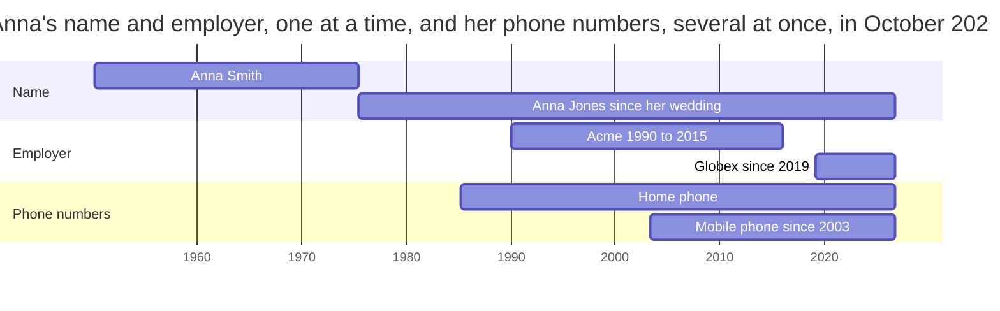
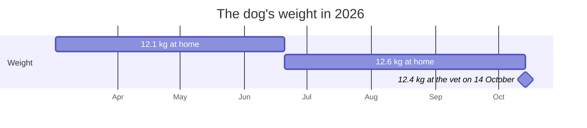
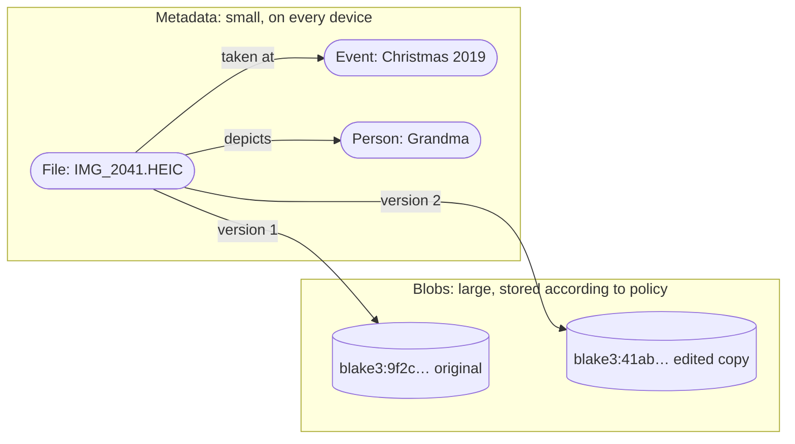
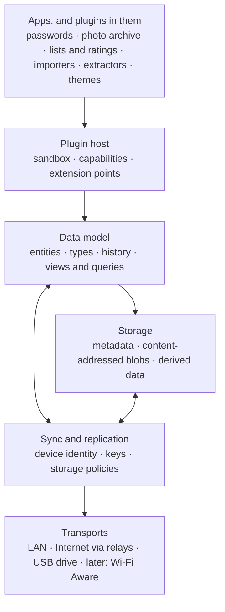

# NibKeep design guidelines

> [!NOTE]
> **Status: draft.** Last updated 2026-11-25.
> This document covers what NibKeep is for, its design principles and its core concepts, for contributors and curious users. The [technical design](Technical-design.md) explains how each concept is built and why; the [development plan](Plan.md) gives the order of the work.

## Contents

1. [Summary](#1-summary)
2. [Motivation](#2-motivation)
3. [Goals and non-goals](#3-goals-and-non-goals)
4. [Design principles](#4-design-principles)
5. [Scenarios](#5-scenarios)
6. [Core concepts](#6-core-concepts)
7. [Architecture outline](#7-architecture-outline)
8. [Glossary](#8-glossary)

## 1. Summary

NibKeep is a **local-first, peer-to-peer system for personal and family data**. It keeps a typed, versioned graph of the things in your life (people, places, events, photos, recordings, books, lists, passwords) with their files, and replicates it across your devices and those of the people you share with. It needs no company's server and is built to keep data readable for decades.

In short:

- **Everything in one place, shared only as far as you choose.** Media, documents, notes and passwords from every device and service, each in a *space*: your own, or one shared with a partner, a household or the whole family.
- **No single hierarchy.** Organization is metadata; folders are views you define and switch between.
- **Typed entities and relationships**, with fuzzy dates and sources.
- **Full history.** Every change is kept and attributed; any past state can be restored.
- **Redundancy you can see.** NibKeep knows where every file is and warns when copies are too few.
- **Phone first, offline first.** Capture takes seconds, and everything works offline.
- **Extensible.** Apps for passwords, photos, lists and ratings share one data model; sandboxed plugins add more.

Related systems include Perkeep, git-annex, Syncthing, Immich, Ente and Anytype, and for passwords KeePassXC, pass and Bitwarden.

## 2. Motivation

### 2.1 Family memories are scattered and fragile

Family stories are worth recording while the storytellers are still with us, and old prints deserve digitizing for the grandchildren. These things now sit on phones, laptops, SD cards, USB drives, discs, old hard drives and cloud services. Finding "that Christmas" means remembering where it is, and services change their terms or shut down.

### 2.2 No single hierarchy fits

Every folder tree forces one way of organizing, and there is always another, equally valid one:

| Data | One hierarchy | An equally valid alternative |
| --- | --- | --- |
| Bookmarks | Activity, then topic: `Read/Rust`, `Watch/GameDev` | Topic, then activity: `Rust/Read`, `GameDev/Watch` |
| Projects | Ownership, then project: `Mine/Foo`, `OpenSource/Baz` | Domain, then project: `GameDev/Foo`, `Security/Baz` |
| Camera roll | Date: `2026/10`, `2025/3` | Kind of event: `Trips/Paris`, `Birthdays/Lena` |

Each hierarchy is one *ordering of facets* (activity, topic, ownership, domain, date, kind of event). People prefer different orderings, and one person wants different ones for different tasks. Hand-made trees also drift into mixed orderings. A flat folder is no answer either: names collide, and it is hard to navigate.

### 2.3 Facts have structure

Markdown suits prose, not entities and relationships; hence the infobox on most Wikipedia articles. *"In episode #123 of podcast Foo, guest John Doe mentioned project Bar, which I want to follow"* is a small graph of an episode, a podcast, a person and a project.

Facts also carry time, at any precision from an epoch to a second, as ranges ("from 2001 to 2023") or uncertain ("summer 1975, probably"). Even a shopping list gains from metadata: if it records who made it and when, and keeps checked-off items in its history, it can answer "which chocolate did I buy last weekend?".

### 2.4 Capture happens on the phone

The phone is always at hand, so personal data must be manageable there first:

- Lists: checkboxes, swipe to delete, and drag to reorder, because order is priority.
- A friend's tip for a movie, a book or a game goes into *To watch*, *To read* or *To play* in seconds.
- Afterwards, NibKeep asks for a rating, such as a tier from S to D: *The Matrix* into S, *False Gods*, book 2 of *The Horus Heresy*, into D.

### 2.5 Not everything is for everyone

Personal notes, to-do lists and screenshots belong to one person; family photos belong to everyone. In between lie many circles: a partner, the household, the immediate family, the extended family. Sharing must support them all yet keep the common case simple, because most people only need *mine* and *family*.

### 2.6 Passwords

Passwords are a family's most sensitive data, and some are shared: streaming services, utilities, the Wi-Fi. Password managers also lock people in: one that runs only on Windows is no help on a Linux laptop or a phone.

## 3. Goals and non-goals

### Goals

| ID | Goal |
| --- | --- |
| G1 | **Personal and family archive.** Gather media, documents and their metadata from every device and service, for everyone to browse and search what is shared with them, for decades. |
| G2 | **Many ways to organize.** Navigate the same data in many ways at once, without moving or copying it. |
| G3 | **Structured knowledge.** Typed entities, relationships, fuzzy dates and sources. |
| G4 | **Fast everyday capture.** Lists, ratings, notes and recordings on a phone in seconds. |
| G5 | **No single point of failure.** Enough copies on the family's own devices that losing one loses nothing already synced. |
| G6 | **Full history.** Every previous state can be viewed and restored. |
| G7 | **Extensibility.** Sandboxed plugins, first-party or community, add types, importers, views, automations and themes. |
| G8 | **Passwords and other secrets.** Stronger protection than other data, full history, and sharing with chosen people. |
| G9 | **Sharing circles.** Each item is private or shared with a partner, a household, the immediate or whole family, or a friend. Groups overlap freely, yet most people need only *mine* and *family*. |

### Non-goals

These and their numbers are working targets, to be revisited with real use.

- **Public publishing or social networking.** Data is shared with chosen people; publishing is an export.
- **Internet scale.** NibKeep is for a household or an extended family: up to 20 people, 50 devices, 10 TB and 10 million entities per space.
- **A general-purpose file system.** NibKeep is not mounted as a POSIX drive, and apps do not work on files inside it. It can keep the history of a chosen folder, as version control does, with the files left in place ([trees](Technical-design.md#15-trees)). A read-only export view may come later.
- **Real-time co-editing of long documents**, as in Google Docs, at least initially.
- **Full nodes on microcontrollers.** ESP32-class devices (about 520 KB of RAM) are thin clients.
- **Media editing.** NibKeep stores and organizes; other apps edit photos and videos.
- **Browser integration, at first.** Passwords and one-time codes are copied to the clipboard; browser extensions, autofill and passkeys come later.

## 4. Design principles

When two principles conflict, **the one listed first wins**: durability first, privacy second, portability third. Encrypting everything (privacy) can lose data when keys are lost (durability), so every space needs a recovery path ([6.10](#610-users-people-and-devices)).

### P1. Never lose data

A lost family archive is the one failure that cannot be fixed later.

- Changes are appended, never overwritten. Deletes can be undone; only an explicit *purge* removes data for good.
- Originals are kept bit for bit. Edits add versions, and thumbnails or transcodes never replace originals.
- NibKeep knows where every file is and checks a *storage policy*, such as "at least three copies, one outside the home". It shows what lacks copies and will not remove a copy the policy needs.
- Stored data is regularly re-verified against its hashes and repaired from another copy if it decays.
- Sync is not backup: a mass deletion, ransomware or a buggy plugin must not wipe history everywhere at once. NibKeep is built to be part of a 3-2-1 backup, with append-only history, at least one copy that does not apply deletions automatically, and regular verification. It is not called a backup until that is proven in practice.
- Losing keys means losing data, so key backup and recovery are part of durability ([6.10](#610-users-people-and-devices)).
- New captures, such as a photo only on one phone, are most at risk, so they sync as soon as the platform allows.

### P2. Private by default, least privilege everywhere

- Data is encrypted end to end with separate keys per space, even on a home network, which also hosts untrusted devices such as smart TVs and robot vacuums.
- Users, devices and plugins get explicit, minimal, revocable permissions.
- Every change is attributed to a user and a device.
- Secrets, such as passwords, are encrypted a second time and revealed only after the user confirms ([6.9](#69-secrets)).

### P3. Your data outlives NibKeep

Products come and go; NibKeep must not become the lock-in it replaces.

- The on-disk format and sync protocol are documented and versioned, with specifications in this repository. Data is deterministic CBOR, with a documented JSON form for every structure.
- Everything can be exported at any time to ordinary files and open sidecar formats (such as JSON and XMP), with SHA-256 sums that standard tools can check.
- Established standards come first: EXIF and XMP for media, ISO 8601 and EDTF for dates, vocabularies such as schema.org for common types.

### P4. Local-first: the network is optional

- Each device holds a local replica of what it needs and works fully offline, syncing whenever it reaches another.
- No server is mandatory. Relays, discovery and off-site storage are optional, replaceable and self-hostable.
- No account with any company is required.

NibKeep aims for all seven ideals of [local-first software](https://www.inkandswitch.com/essay/local-first/).

### P5. Phone first: capture now, structure later

People do not fill in forms at a family dinner, so capture comes first and structure later.

- Capture takes seconds and never requires choosing a type, a folder or a field.
- Metadata is collected automatically where possible: time, place, device, author, source and EXIF data.
- Anyone with access can add or correct types, fields and links later.
- Navigation (views) and search are both first-class.
- The phone is the main device: every core flow must work on a small touch screen, offline, with limited storage and battery.

### P6. Organization is metadata, not location

- Where data is stored means nothing. Names are labels, not identities, so they cannot collide.
- Folders, albums and categories are *views* computed from metadata; users define many and switch freely.
- An entity can be in any number of views and collections.
- In a *tree*, a folder whose history NibKeep keeps, a file's path is a field like its name: build tools need it, and it can change without changing the file ([trees](Technical-design.md#15-trees)).

### P7. One data model, many apps

- The photo archive, lists, notes, ratings and passwords are separate apps, from any vendor, on one typed graph in one library; plugins are smaller add-ons ([6.11](#611-apps-on-one-library)).
- Plugins cooperate through shared data and documented extension points, never through each other's internals or by patching the host.
- Types are namespaced and versioned. Changes are additive by default, so old and new app versions can share data.

### P8. No privileged plugins

- First-party plugins use the same public API and sandbox as community plugins. If they need something, the API gains it for everyone.
- The project curates a default set of plugins; what almost everyone needs graduates into it.
- Themes are data, not code, so they need no permissions.

### P9. Small core, proven building blocks

- The core (data model, storage, sync, security, plugin host) stays small enough for one person to understand and audit.
- Not building on someone else's *product* does not mean avoiding *libraries*. NibKeep reuses established protocols and libraries for hashing, encryption, transport, CRDTs and storage, and builds its own only where its goals differ.
- Every milestone must be useful on its own ([Plan](Plan.md#1-approach)).

## 5. Scenarios

These scenarios drive and test the design. Each should eventually work end to end.

| # | Scenario | What it requires |
| --- | --- | --- |
| S1 | **Grandma's story.** A recording made at a family dinner gets time and place, is on two more devices by morning, and later gains a transcript linked to the people and places in it. | Phone capture, automatic metadata, replication, relationships, derived data |
| S2 | **The shoebox of prints.** Old prints are scanned front and back, with fuzzy dates ("summer 1975?"). Over months, relatives name the people and sometimes disagree ("Grandma says 1952, the letter says 1953"). | Fuzzy dates, multiple editors, attribution, competing claims with sources |
| S3 | **Consolidation.** Photos come in from two old phones, a Google Takeout archive, a DVD and an old hard drive. Identical files are stored once, resized copies join their originals, and original names, dates and sources stay. | Importers, deduplication, provenance, sidecar metadata |
| S4 | **"That Christmas".** A phone finds the photos and videos of Christmas 2019 at the grandparents' and plays a video whose original is on the home NAS. | Search by time, place, people and text; thumbnails everywhere and originals on demand; transfer over LAN and Internet |
| S5 | **A recommendation.** Two taps put a friend's movie tip on *To watch*, "recommended by" included. Two offline phones reorder the list, and the orders merge sensibly. After watching, NibKeep asks for a rating. | Lists with manual order, offline merging, automations |
| S6 | **A podcast note.** "Episode #123 of Foo, guest John Doe, mentioned project Bar" is saved as text in seconds and turned into linked entities later. | Capture first, structure later |
| S7 | **A lost phone.** Revoked from another device, it can no longer sync or decrypt new data. Its unsynced changes wait for review, and nothing is lost, as everything on it had copies elsewhere. | Device identity and revocation, key rotation, storage policies |
| S8 | **Installing a plugin.** A community "board game collection" plugin asks to "read and write board games; no network". Once approved, it appears with the same permissions on the owner's other devices that accept plugins; asking for more later needs new approval. | Sandbox, capabilities, plugin sync, re-approval |
| S9 | **Shopping history.** "Which chocolate did I buy last weekend?" NibKeep shows last Saturday's list, including items since checked off or deleted. | Full history, "as of" queries |
| S10 | **Circles.** Screenshots sync only between one person's phone and laptop. A couple shares household papers and logins, the grandparents see the children's photos, and the whole family sees the old prints. Everyone browses one library, and a private note on a family photo stays private. | Spaces with overlapping members, a merged library, links across spaces, a default space for each capture source |
| S11 | **Is there an account?** On an unlocked laptop, a search finds a streaming service's login at once. Copying the password needs a fingerprint or the passphrase, the clipboard clears after 30 seconds, and the old password stays in the history. A stolen NAS holds only ciphertext, with no passphrase to guess. | Secret fields, two layers of keys, history, random keys for synced data |
| S12 | **Who was that again?** While reading, a few taps note a character with book and chapter; later the character is linked to the actor in the TV series and to a game character based on them. The books are credited to James S. A. Corey; a search for Daniel Abraham finds them too. | Fast capture, portrayals that join three entities, *based on* links, pen names |
| S13 | **Back to 2000.** At 2000 on the time slider, filmographies end in 2000, bands have that year's members, and a 1950 photo shows Grandma under her maiden name. | Valid time on every fact, "as of" queries across the whole graph, names that change over time |
| S14 | **Films and memories.** A 40 GB film ripped from a Blu-ray disc stays where it is, as one copy. A 6 GB 4K video of a child's first steps gets two copies, one on the NAS. A changed password reaches three devices, one outside the home. | Storage policies, rules based on where data came from, copies on separate devices |
| S15 | **Growing up.** Granddad records his grandson's height in feet and inches, the parents add theirs, and the paediatrician's come from a health record, their source. A growth chart shows them all, in centimetres for the parents, and the time slider shows his height in a birthday photo from two years ago. | Values that change, quantities with units, sources, time travel |
| S16 | **The dog's weight.** Two family members weigh the dog on the same day, each on an offline phone. After sync its history has both readings with their sources, and the later one shows. A typo of 121 kg for 12.1 kg is corrected alone. | Values that change, concurrent additions, sources, corrections |
| S17 | **In several languages.** Russian notes on a company and its English Wikipedia article, imported by an AI agent, describe one entity with one founding date. A reader who ranks English, Russian, then Swedish sees each field in the first available, labeled with its language. A friend's name is kept as four forms of one name, in Ukrainian, Russian and two Latin transliterations, and a search for any finds the friend. Nothing is translated unless someone asks. | Language tags on values, forms of one value, ranked languages and scripts, translation only on request |

## 6. Core concepts

These sections describe the whole design, built or not. *(planned)* marks unbuilt parts, which the [technical design](Technical-design.md#19-decided-not-built-yet) lists; [Known limits](Known-limits.md) says what is imperfect in what is built.

### 6.1 Entities, types and fields

An **entity** is anything with identity: a person, a photo, a book, a list or an event. It has:

- a permanent random **ID** (a UUIDv4) that never changes;
- one or more **types**, such as `Person`, `Book` or `Photo`, which combine like traits, much like Tana's supertags. `Place` from the core and `Restaurant` from a food app can both apply, so nobody has to decide whether a restaurant is a place or an organization;
- **fields**: named, typed values, each a **literal** (text, number, date and so on) or a **reference** to another entity.

A **type** is a named, versioned schema of optional fields, so it can grow without touching existing entities. Types are data, defined by the core or a plugin, with namespaced names (such as `std.person`), and they sync like everything else. Apps keep fields they do not know, so an older app never destroys a newer one's data.

**Languages.** Each piece of text carries a language tag; numbers, dates and links have none and join it all into one graph. Users rank the languages and scripts they read, as in a browser, and see each field in the best one available, labeled where it matters. Spellings in several languages or scripts are *forms* of one value, not rival values. Nothing is translated unless a person asks, since machine translation is unreliable for names and short labels: in one study, language models got personal names in historical texts right about 60% of the time, and differently from run to run. A kept translation is a form marked as made by machine ([languages](Technical-design.md#55-languages-scripts-and-forms)).

Capture comes first ([P5](#p5-phone-first-capture-now-structure-later)), so identity is often settled later: types can change, and entities can be merged or split without breaking links.

### 6.2 Relationships

A simple relationship is a reference field: `Book.author → Daniel Abraham`. Author is a *role*, not a kind of entity, so there is no `Author` type. The field points to an **agent**: a person, a group such as a band, or an identity such as a pen name. (An *AI agent*, software working for a user, is something else and always named with both words.)

A relationship with its own data, or with more than two participants, becomes an entity itself, with *role* fields for the participants (an associative entity, or reified relationship). Ilya Sutskever's PhD, for example:


The same rule covers everyday cases:

- **Birth.** `child → Person`, `place → City`, `date: 1985-01-01`. The city is an entity; the date is a literal.
- **List membership.** A movie's position in *To watch*, and who added it when, belong to the membership, since one movie can be in several lists.
- **Rating.** Each family member rates separately, so a rating joins a person and a movie, with tier and date.
- **Pen names.** *The Expanse* novels are credited to James S. A. Corey, the joint pen name of Daniel Abraham and Ty Franck; Abraham has also written as M. L. N. Hanover. A pen name is an agent linked to the people who use it, as in library catalogs and Wikidata; a book under the author's own name points straight at the person.
- **Characters and portrayals.** A character is an entity that appears in works. A *portrayal* joins character, performer and production, with the kind of role (live action, voice, motion capture) and the credited name. A game character based on a book character is a separate entity with a *based on* link, because adaptations change characters.

The *Expanse* example as a graph:


Any value can also carry standard **qualifiers**: when it was true, its source, how the source wrote it (*credited as*), and confidence. They record a married name or "Grandma says 1952" without turning fields into entities. Underneath, every value is an entity–field–value statement, as in Wikidata.

### 6.3 Time

NibKeep distinguishes two kinds of time:

- **When something was true** (*valid time*), at any precision and possibly uncertain, in [EDTF (ISO 8601-2)](https://www.loc.gov/standards/datetime/): `1985-01-01`, `2007`, `1975~` (about 1975), `196X` (sometime in the 1960s), `2001/2023` (a range). Named periods, such as the Jurassic, are entities with a time range.
- **When it was recorded** (*system time*): every change records when, by whom and on which device. This powers history and "as of" queries (S9).

Camera clocks are often wrong, and many omit the time zone, so NibKeep keeps the file's time, the inferred time and any person's correction as separate values.

**Time travel.** Any view can be shown as of a chosen moment in valid time, for example with a slider: at 2000, people have the names they used then, filmographies stop at 2000, and bands have that year's members. The history view moves system time instead, showing the archive as recorded on a given day.

- Undated facts appear at every moment, marked "date unknown" where it matters, except in fields that hold one value at a time.
- A fuzzy fact shows as uncertain while its possible range overlaps the moment.
- Apps for fiction can add the reader's position as a third axis, so character notes stop where the reader is.

**Values that change.** An employer, a child's height or a dog's weight holds until it changes. A field with one value at a time keeps every value with its date, each shown until the next starts. A value with a known end, such as a job from 1990 to 2015, ends on its own and can leave a gap. In fields with several values at once, such as phone numbers, a new value ends none of the others: Anna keeps her home phone after getting a mobile phone, and the newer one shows first.





There are three kinds of edit:

- **Something changed in the world:** Anna changed jobs or name, or the dog was weighed. The new value is added with its date; in a one-value field, the previous value stops where the new one starts.
- **A value was wrong:** Anna's new employer was typed as "Globx". The correction replaces the bar and keeps its date.
- **A value in the past was wrong:** the March reading was 12.1 kg, not 121 kg. Only that reading changes.

A value dated with a period (a job from 1990 to 2015, a band's members from 1975 to 1981) is a state, shown while the period lasts. A value with a single date (a film's release, a marriage) is an event, shown from that day on. The [data model specification](spec/model.md#6-current-values) has the rules.

**Names change.** A person, a city or a company has one name at a time, and the slider shows each where it held: Christiania until 1925, Oslo after. A name can have forms in several languages and scripts, such as München and Munich, and parts, such as given and family names, for sorting. A pen name is an agent ([6.2](#62-relationships)), a nickname is a separate field, and credits keep the printed name in a *credited as* qualifier.

### 6.4 Files and blobs

A **blob** is an immutable sequence of bytes identified by its cryptographic hash. A **file** is an entity whose versions point to blobs.



- Blobs are identified by their BLAKE3 hash, stored with the algorithm's name (`blake3:…`) so the algorithm can change ([hashes](Technical-design.md#2-encoding-identifiers-and-hashes)).
- Identical content is stored once per replica, however often and into however many spaces it is imported.
- Originals never change; an edit adds a version, and derived data (thumbnails, previews, transcodes, transcripts) links to its original.
- Every import records its provenance: source device or service, original path, name and timestamps, and import time.

The file's storage policy sets how many copies must exist and whether a device keeps its copy in NibKeep's store or where the file already is ([6.8](#68-device-roles-and-storage-policies)).

NibKeep writes into a person's own folders only when asked, as for a checkout or a tree, and can export everything to an ordinary folder tree. Other apps reach the files as they reach a cloud drive's: a NibKeep app offers them through the platform's file provider, in every file picker and "Save to" menu ([6.11](#611-apps-on-one-library)).

### 6.5 History and deletion

Each space keeps an append-only log of changes, so any past state can be rebuilt, compared and restored.

- **Delete** hides an entity and can be undone.
- **Purge** removes content for good, such as a photo a relative wants removed, an address someone wants erased, or an old password. Copies live on many devices, so purging uses *crypto-shredding*: every change, secret value and blob has its own key, and destroying the key makes every copy unreadable ([purging](Technical-design.md#64-purging)).
  - Any value can be purged: the keys of the changes that hold it are destroyed, and the rest of the entity they held is stated again. A secret value is purged through its own key alone.
  - A space purges only its own keys. The app names the other spaces it holds that keep the content; admins of spaces it cannot see purge their own copies.
  - Unedited plain copies that NibKeep wrote are deleted; originals it knows of are listed and left in place.
- **Archive nodes and backups wait** 30 days, unless their owner says otherwise, before destroying purged content, so no mistake or infected device can wipe data everywhere at once. Meanwhile the content is hidden, and the copy's owner can stop the purge or end the wait sooner. A purge says first which copies wait, and until when ([copies that wait](Technical-design.md#911-copies-that-wait)).
- All metadata history and all originals are kept forever. Blob history is costly, so intermediate file versions are to be thinned out *(planned)* by storage policy, for example hourly, then daily, then weekly, as Time Machine does. Trees are exempt, and any version can be pinned.

### 6.6 Views and collections

A **view** *(planned)* is a saved query plus a presentation: a list, table, gallery, board, calendar, map or folder tree. A folder tree groups by facets in a chosen order:

```text
"Bookmarks by activity"   group by activity, then topic  →  Read/Rust, Watch/GameDev, …
"Bookmarks by topic"      group by topic, then activity  →  Rust/Read, GameDev/Watch, …
```

Views are entities: they sync, can be shared and can be pinned like folders.

A **collection** is a hand-curated set or ordered list, such as *To watch*, for when membership or order cannot be computed. Order is kept on each membership, so reordering on two offline devices merges sensibly: items neither jump nor appear twice ([ordered lists](Technical-design.md#66-ordered-lists-and-long-text)).

### 6.7 Spaces, members and devices

A **space** is the unit of sharing, sync and encryption: entities shared with the same people under the same keys. Every entity, relationship and blob is in exactly one space.

- **Simple by default.** Everyone starts with a personal space; the first share with someone creates a shared space, such as *Family*. Other spaces appear only when needed.
- **Any circles you need.** Spaces can have any members and can overlap: *Personal*, *Me and my partner*, *Household*, *Immediate family*, *Whole family*, or one album shared with a friend. They form no hierarchy.
- **One library.** Each user sees their spaces merged into one library, each item marked with its space, and each capture source has a default space, such as "camera photos go to *Personal*".
- **Links cross spaces.** A relationship can point into another space, but you see the link only if you can see the space it is stored in, and its target only if you can see the target's space. So your private note on a family photo can stay in your personal space.
- **Sharing means moving.** There are no per-item lists of people, which are hard to show and easy to get wrong. To share more widely, move an item to a wider space; to give it away, move it to a space the new owner administers. A move takes the history along and purges what it leaves, unless the person keeps that copy, marked as moved. The app first names who gains and who loses sight of the item. Copies others already made cannot be recalled ([spaces and moves](Technical-design.md#131-spaces-and-moves)).
- A **member** is a user with a role in a space: admin, editor or viewer. Groups such as *Household* can be editors or viewers, never admins, so a child added to *Household* joins every space that includes it. When a member leaves, the keys are rotated: they keep their copies but cannot read anything added later, and their additions stay, attributed to them.
- **Owners.** An entity's owners are its space's admins; apps show who added each value as "added by". Members can edit each other's entities.
- A **replica** is one copy of a library, or of some of its spaces, kept by one app or shared by the apps of one container ([6.11](#611-apps-on-one-library)). It has its own key, belongs to one user and can be revoked alone ([6.10](#610-users-people-and-devices)). It can also hold a space's data encrypted without reading it, as a relative's NAS does for an off-site copy.
- A **device**, a phone or a computer, holds a replica per app or container that keeps a copy, and per user of a shared computer. Revoking a device revokes all its replicas.
- **Spaces on each device.** A device holds only the spaces chosen for it, so a phone need not carry a project's files and secrets: computers take new spaces, phones ask. A device can drop a space whose copies are elsewhere and get it back later, with approval from a device that holds it ([devices that choose their spaces](Technical-design.md#1310-devices-that-choose-their-spaces)).

The roles:

| Role | Can |
| --- | --- |
| Admin | Everything an editor can, plus add and remove members, change roles, and purge anything, content included |
| Editor | Add, edit and delete (reversibly) anything in the space; purge the changes they made, but no file's content |
| Viewer | Read |

There is no contributor or guest role; work with outsiders, such as colleagues, gets its own space. How admins come about:

- **The first admin** of a space or group is its creator. A personal space has its user as sole member and admin.
- **Admins appoint admins.** Shared spaces and groups should have at least two, so one lost phone or absence does not strand them; while there is only one, inviting someone suggests making them the second.
- **No change leaves a space or group without an admin**, not even two admins removing each other offline. Only losing every admin, through lost devices or a death, can.
- **Claiming the role.** When every admin is gone, any member who can edit can claim the role in person; AI agents never claim roles or change members. Everyone sees the claim ("Olga claims admin, from 14 November, unless an admin objects"). It takes effect 30 days after another member's device first shows it, unless an admin rejects it; for 30 more days the new admin can only undo, so a returning admin can reverse it. There are no votes, which offline devices, absent members and stolen phones would undermine. A member left alone copies what they can read into a new space.
- **Leaving needs no admin.** A member alone in a space can leave, which closes it.

[Sharing](Technical-design.md#13-sharing) has the rules every device applies alike.

### 6.8 Device roles and storage policies

Not every device can or should hold everything. Once a space has an archive node, archive nodes and everyday devices keep what their roles want and drop the rest once other disks prove their copies ([the planner](Technical-design.md#99-the-planner)). Thin clients are *(planned)*.

| Role | Examples | Keeps | Typical use |
| --- | --- | --- | --- |
| **Archive node** | NAS, desktop, home server; an encrypted cloud bucket or a relative's NAS as the off-site copy | All metadata, and the blobs its policy assigns (usually all of them) | Durability; heavy processing such as thumbnails, transcoding, transcription and face recognition; serving originals |
| **Everyday device** | Phone, laptop, tablet | All metadata of its spaces, thumbnails, and recent or pinned originals; everything else on demand | Capture, browsing, search |
| **Thin client** | TV, picture frame, an ESP32 button or display | A cache at most | Shows or sends data through a nearby node, such as a button that adds "milk" to the shopping list |

A **storage policy** says how many copies of some data must exist, where, and how devices hold them, since a password, a family photo and a ripped DVD need different care. Policies are entities: they sync, keep history and can be edited. The defaults, which people can change and extend:

| Policy | Copies | Where | How devices hold it | Typical data |
| --- | --- | --- | --- | --- |
| **Critical** | 3 | At least one outside the home | In NibKeep's store | Passwords and other secrets, important documents, the metadata of every space |
| **Standard** (default) | 2 | At least one on an archive node | In NibKeep's store | Photos, recordings, scans |
| **Replaceable** | 1 | Anywhere | Where the file already is | Films, ripped DVDs, downloads |

The 3-2-1 rule is a common baseline for important data: three copies, on two kinds of media, one off-site.

- **Copies count disks, not replicas or files.** Only copies on different disks count, so two apps on one phone hold one copy, and a server with two drives can hold two ([where the copies are](Technical-design.md#96-where-the-copies-are)). A USB drive plugged in now and then is a [backup](Technical-design.md#910-backups): encrypted, without keys, and counted as of its last check.
- **Three ways to hold a copy.** *In NibKeep's store*, a copy is sealed with the blob's own key and never changes. *Where it is*, NibKeep records only the location and hash of a person's original; other apps may change it, so it counts only while the hash matches. A *checkout* is a plain copy written on request (for another app, for sharing, for a media server) and counts like a file where it is. NibKeep seals what it writes, so plain copies exist only where people want them, and viewing decrypts in memory.
- **Choosing a policy.** An explicit choice on an item wins (on a collection, later). Otherwise ordered rules decide, such as "from a camera → Standard", "from a downloads folder → Replaceable", and "secrets → Critical" once secrets have copies on other devices. For now rules are entities with fixed conditions; views will bring queries ([storage policies](Technical-design.md#93-storage-policies)).
- **Size is a hint, not the rule.** A downloaded film and a 4K video of a child's first steps are both large, but only the film is replaceable, so default rules look at origin. A file of unknown origin larger than 1 GiB (configurable) prompts "Can you get this again?", and the answer covers its source folder.
- **Keeping the promise.** Each device records which blobs it holds and when it last verified them. NibKeep shows unmet policies ("312 photos have only one copy") and copies data where roles want it. Before removing a copy, it checks that enough others exist right now, not just in its records, as git-annex does.
- **Metadata** is on every device of its space anyway, so a policy only adds where copies must be, such as outside the home.
- **Old versions.** Originals are kept forever; the policy sets how intermediate versions are thinned ([6.5](#65-history-and-deletion)).

### 6.9 Secrets

Passwords and other secrets are ordinary entities with **secret fields**. A `Login` has ordinary fields (title, website, username) and secret fields (password, one-time-code seed, recovery codes).

- **Two layers.** Ordinary fields are encrypted with keys that the space's key opens, held by a member's unlocked devices. Secret fields are also encrypted with the space's *secrets key*, which a device unlocks only after a fingerprint, face, security key or passphrase, and locks again after a timeout. So finding an account is an ordinary search, but revealing or copying a password needs confirmation; a space can require it for ordinary fields too *(planned)*.
- **Chosen devices only** receive secrets keys, so an archive node can store secrets for durability without reading them.
- **Nothing to guess in synced data.** Space keys are random 256-bit keys, so copies on other devices, relays and backups cannot be attacked by guessing a passphrase. A passphrase protects only keys on a person's own devices, through Argon2id, a memory-hard key derivation function. The printed recovery code is a long random key: unguessable, but usable by anyone who finds it.
- **History and purge.** Old passwords stay in the history, and each secret value has its own key, so one value, such as a password pasted into the wrong field, can be purged alone.
- **Sharing.** A shared account's login lives in the space of its users, such as *Me and my partner*.

Why it is built this way:

- **One record per change, not one vault file.** Each change to a login is its own encrypted record, named by its hash: sync moves only what changed, each entry has its own history, and no service name is in plaintext.
- **Random keys beat salts.** A salt only rules out precomputed tables, and a memory-hard key derivation makes each guess expensive; a random key, like 1Password's Secret Key, makes guessing pointless. RFC 9106 suggests 2 GiB of memory for Argon2id, or 64 MiB where memory is scarce, and an iOS AutoFill extension gets about 120 MB, so phones unlock through the keystore and biometrics instead.
- **Post-quantum** where keys travel, as in OpenSSH and age; symmetric 256-bit keys are not threatened.
- **Hygiene.** Secrets are wiped from memory after use. Copies are marked sensitive, so clipboard histories skip them, and cleared after a timeout. Turning core dumps off is *(planned)*.
- **Import and export** *(planned)* with other password managers, through CSV and KeePass's KDBX ([P3](#p3-your-data-outlives-nibkeep)).
- **Review.** Only reviewed algorithms and libraries, a written threat model, and an outside review before NibKeep holds anyone else's passwords.

### 6.10 Users, people and devices

With no central server, there is no account to log in to: identity rests on keys, and the devices themselves do every check.

A **user** uses NibKeep: they have devices, belong to spaces and sign their changes. A **person** is someone described in the data, such as Grandma in a 1950 photo; most are not users. A user can be linked to the person they are, separately in each space. Claiming to be someone in the data needs an admin, and nobody is linked against their will. One human can have several users, such as one for work, but each user is one human, so a shared tablet belongs to one user.

- **A user** has a permanent random ID (a UUID) and a name. Each replica has its own key pair, made on its device and opened by the platform's keystore or a passphrase (later by secure hardware such as Secure Enclave or TPM). The user's list of replicas is signed by the replicas already on it, as on Keybase.
- **Signing in is local.** The device's lock (face, fingerprint, PIN) or a passphrase unlocks the keys on that device ([6.9](#69-secrets)).
- **Every change is signed** by its replica, so by a known app on a known device: "created by" and "changed by" are proven, not just recorded. History shows who added each value: the person linked in that space, or else the user's name ([6.7](#67-spaces-members-and-devices)).
- **Adding a device.** An existing device shows a short code, or a QR code *(planned)*, which the new device types or scans. The code allows three tries, expires within minutes and is checked with a password-authenticated key exchange (PAKE), so it cannot be guessed offline, as in Magic Wormhole. Another app on the same device that cannot share a replica joins through links instead, and both apps show a short code to compare *(planned)* ([6.11](#611-apps-on-one-library)).
- **Inviting a user.** An admin of a space or group passes the same kind of one-time code through another channel, such as in person or by phone. The admin can name the person in the space to link the new user to; the new user confirms or joins unlinked. The code works once, and the admin confirms who joined. In spaces with secrets, both can also compare a safety code, as Signal users do *(planned)*.
- **Recovery.** Shared spaces need none: other admins keep access, and members can claim the role when all admins are gone ([6.7](#67-spaces-members-and-devices)). A printed recovery code *(planned)*, like Keybase's paper keys, is one more device on paper for a user who lost every device, the passphrase or the use of biometrics. It holds keys, not data, and restores the user's personal spaces and roles from a backup or from a library that no longer unlocks. It is no way in for others after the user is gone: personal spaces stay closed unless the user arranged otherwise. Anyone who finds it can use it, so it is kept as safely as a passport.
- **AI agents** act like an extra replica of their user: they have their own key, so their changes stand apart, see only the spaces the user chose, and can be revoked like a lost phone.
- **A lost or stolen device** is revoked from any of the owner's other devices. If none is left, a space's admin removes the owner, which ends all their devices there, and invites them again on a new device. Other devices stop syncing with it, its changes that the revoking device lacked are set aside for review, and every space it could read gets new keys ([revocation](Technical-design.md#11-revocation-and-new-keys)).
- **What a lost device already holds** is protected only by its own lock and disk encryption. It is not told to erase itself: a forged revocation would then destroy data, and a stolen device need not obey. So revealing passwords, purging and managing members need a fresh confirmation, and deletions can be undone.

### 6.11 Apps on one library

NibKeep is a platform for apps by any vendor, like a cloud drive but with no server and with typed data. A to-do app from a store creates someone's library; a note-taking app by another vendor, once allowed, works on the same data. Either can be installed or removed first, and both can run at once.

- **Apps are separate** and each usable alone; plugins are smaller add-ons inside an app ([7.1](#71-plugins)).
- **Replicas, devices and disks are three things.** A *replica* is one copy of a library, with its own key; a *device* holds replicas; a *disk* holds their bytes, and storage policies count copies by disk.
- **Spaces stay about people,** not apps: apps on the same data hold the same spaces.
- **Apps that reach one container share one replica,** such as one developer's apps on iOS, or apps sharing a folder on a computer. Other apps keep their own replica, with the spaces the user grants, and sync with the rest as with another device.
- **The platforms differ.** On iOS and Android an app's files are private and go with it. One developer's apps can share a container on iOS, macOS and Windows, not on Android. Android lets one app serve others; iOS connects apps only through system channels, such as file providers and links that open another app.

The [technical design](Technical-design.md#710-separate-apps-on-one-library) covers replicas, engine versions and removed apps.

## 7. Architecture outline

This sketch makes the concepts concrete; it is not a commitment.



- **Two kinds of data, two strategies.** Metadata (entities, fields and their history) is small, about 6 KB per entity on disk with history and indexes, so every device replicates all metadata of its owner's spaces. Blobs are large, so each device keeps what its role and policy require and fetches the rest by hash on demand, verifying it on arrival.
- **Derived data is disposable.** Search indexes, thumbnails and embeddings can be rebuilt from originals; they may be cached or shared, but are never the only copy of anything. A person's correction, such as a fixed transcript or a confirmed face, becomes regular data.
- **Peers are known.** Devices sync only with devices that share a space, so NibKeep needs no public discovery network such as a DHT. Devices meet on the LAN, through optional self-hostable rendezvous and relay servers, or via a USB drive carrying an encrypted bundle to a relative without Internet.
- **Sync is set reconciliation.** Changes and blobs are immutable and named by hash, so two devices find which hashes the other lacks and send only those.
- **Conflicts are expected.** Two offline edits to one field are kept as concurrent values and shown to a person, as genealogy software keeps disagreements with sources (S2), unless the type says the last writer wins, as for "last opened". Concurrent edits to a binary file make two versions. Nothing is overwritten silently.

### 7.1 Plugins

- **What plugins provide.** Types; importers and exporters (Google Takeout, a phone's camera roll, DVDs, and reference data such as films, books and casts from Wikidata); metadata extractors (EXIF, transcription, face recognition); views; actions and automations, such as "ask for a rating when a movie is marked as watched"; and themes, which are data only.
- **Runtime.** A portable sandbox for every platform, including those that forbid generating machine code at runtime, such as iOS. WebAssembly components are the main candidate.
- **Capabilities.** A plugin's manifest declares which types and spaces it may read or write, which network hosts it may reach, whether it runs in the background, and which parts of the UI it uses. The user sees this before enabling it. An update asking for more needs new approval, and every permission can be revoked.
- **Distribution.** Plugins may be open or closed source, free or paid. Packages are identified by hash and signed by their authors. Enabling a plugin enables *the same version with the same permissions* in the same app on the member's other devices that can run it and have opted in, never in other apps.
- **Composition.** Plugins talk only through shared types in the graph and host-defined extension points, never through each other's internals.

### 7.2 Platforms

| Platform | Typical role | Constraints that shape the design |
| --- | --- | --- |
| Linux, macOS, Windows | Archive node or everyday device | Can watch folders and run in the background |
| Android | Everyday device | Background work is limited; broad file access needs Google Play approval; photos come from the system media store |
| iOS and iPadOS | Everyday device | Strict background limits; no access to arbitrary folders (photos come through PhotoKit); no runtime code generation outside web views; App Store rules for plugins |
| TV | Thin client | Streams from an archive node |
| ESP32-class microcontrollers | Thin client | About 520 KB of RAM; talks to a nearby node through a small API |

### 7.3 Security model

What needs protecting: family media, personal knowledge, secrets, and the history of all of them.

| Threat | Mitigation |
| --- | --- |
| Lost or stolen device | Revocation and new keys ([6.10](#610-users-people-and-devices)); unsynced changes wait for review; the device's own lock and disk encryption; fresh confirmation for revealing passwords, purging and managing members |
| A leaked invitation code | Three tries, expiry within minutes; the admin confirms who joined; safety codes in spaces with secrets |
| Malicious plugin, or a malicious *update* of a good one | Sandbox, declared capabilities, re-approval when they grow, versions pinned by hash and signed |
| Untrusted storage or relay (cloud bucket, rented server, relative's NAS) | End-to-end encryption with random space keys, so no passphrase to guess. Sizes and timing still leak, and so do plaintext hashes unless keyed hashes are used there |
| Someone at an unlocked device | Fresh confirmation for secret fields, which lock again after a timeout; copied passwords leave the clipboard |
| Accidental mass deletion, ransomware, buggy sync | Append-only history, reversible deletes, a copy that does not apply deletions automatically, confirmation for mass changes |
| Bit rot, failing disks | Regular verification against hashes; repair from other copies |
| A family member overstepping | Per-space roles; every change attributed and revertible |
| A member leaving a space (a separation, a falling-out) | Key rotation; what they already synced stays with them |
| Key loss (forgotten passphrase, lost devices, death of the owner) | A printed recovery code ([6.10](#610-users-people-and-devices)); after a death, shared spaces go on through other admins or a claim to the role ([6.7](#67-spaces-members-and-devices)), and personal spaces stay closed |
| Untrusted devices on the home network (smart TVs, robot vacuums) | Encryption between your own devices too; discovery announces no names; such a device joins a space only if someone adds it |
| Recorded traffic decrypted later by a quantum computer | Hybrid X25519 + ML-KEM-768 wherever keys travel; 256-bit symmetric keys |
| A compromised NibKeep release | Signed releases; reproducible builds later |

## 8. Glossary

| Term | Meaning |
| --- | --- |
| Entity | Anything with identity: a person, photo, book, list or event |
| Type | A named, versioned schema of optional fields; an entity can have several |
| Field | A named value on an entity: a literal or a reference |
| Secret field | A field encrypted a second time and revealed only after the user confirms |
| Qualifier | Extra information on a field value: valid time, source, credited name, confidence, language |
| Language tag | A BCP 47 tag, such as `uk` or `uk-Latn`, giving a value's language and script |
| Form | One of several versions of a value in different languages or scripts, such as a name and its transliteration |
| Valid time | When a fact was true in the world |
| Quantity | A decimal number with its unit, such as 72.3 kg |
| System time | When a fact was recorded in NibKeep |
| Relationship entity | An entity for a relationship with its own data or more than two participants |
| Role | A participant's part in a relationship, such as author or voice actor |
| Agent | A person, group or identity (such as a pen name) that can create, act or be credited; not an AI agent |
| AI agent | Software that reads and changes data for a user, acting like one of the user's replicas |
| Person | Someone described in the data, such as Grandma in a photo; a user can be linked to the person they are |
| User | Someone who uses NibKeep: with devices, in spaces, signing changes |
| Blob | Immutable bytes identified by their BLAKE3 hash |
| File | An entity whose versions point to blobs |
| Tree | A folder whose files NibKeep tracks by path, with every version, as version control does |
| Derived data | Data recomputable from originals: thumbnails, indexes, embeddings |
| View | A saved query plus a presentation (list, table, gallery, folder tree…) |
| Collection | A hand-curated set or ordered list |
| Space | The unit of sharing, sync and encryption: a personal or shared set of entities with the same members and keys |
| Member | A user with a role in a space, directly or through a group |
| Group | A named set of users and groups, such as *Household*, that can be a member of spaces and groups |
| Invitation | A one-time code that lets a new device or user join |
| Replica | One copy of a library or some of its spaces, kept by one app or shared by the apps of one container, with its own key |
| Device | A phone or a computer, holding one or more replicas |
| Disk | Where a copy's bytes are; storage policies count copies by disk |
| Archive node, everyday device, thin client | Device roles, by how much data they keep |
| Backup | A folder on a drive or share that a person's computers keep up to date with their spaces' data, encrypted and without keys |
| Storage policy | Rules for how many copies of which data must exist, where, and how devices hold them |
| Plugin | A sandboxed package that adds types, importers, extractors, views, automations or themes |
| Capability | A specific, revocable permission granted to a plugin, device or member |
| Purge | Irreversible removal of content by destroying its encryption key |
