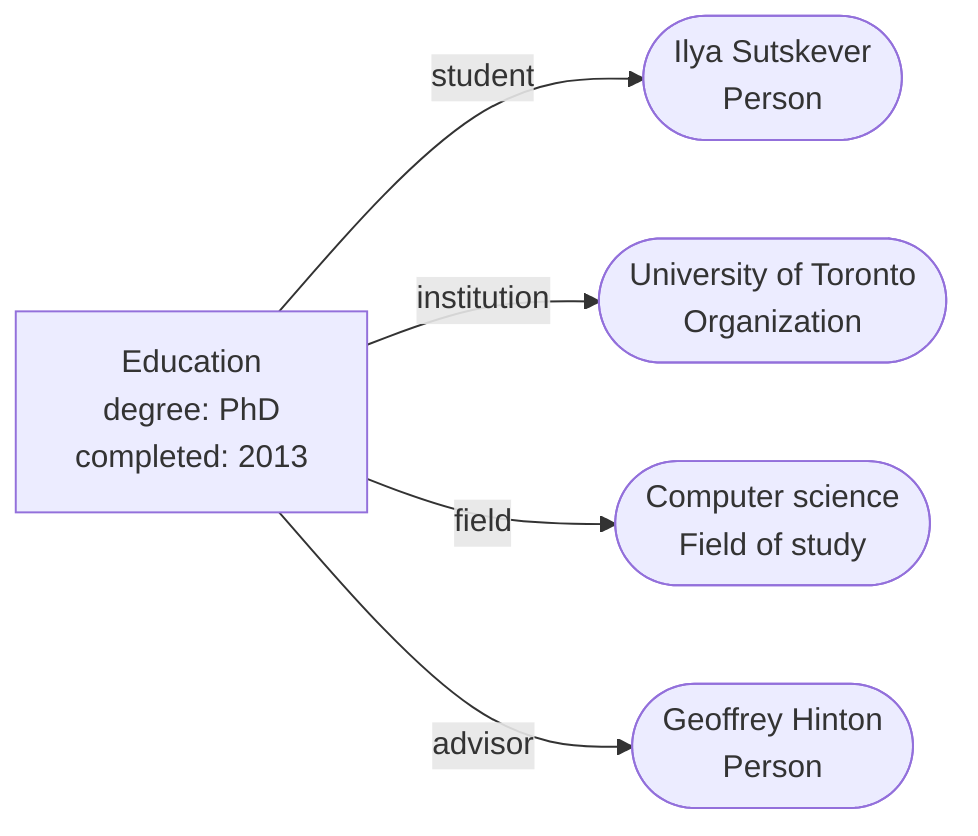
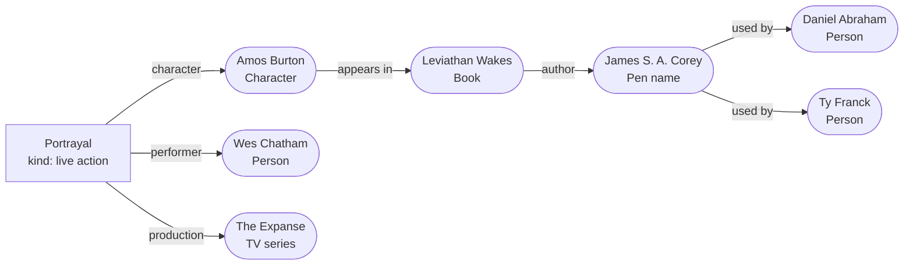
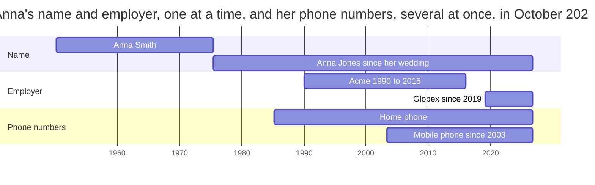
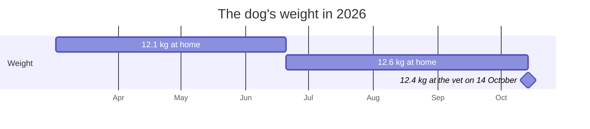
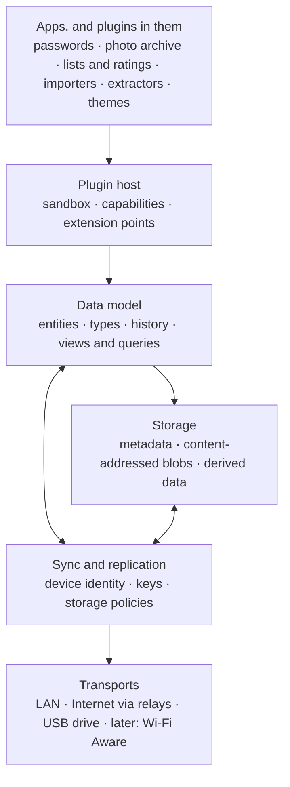

# NibKeep design guidelines

> [!NOTE]
> **Status: draft for discussion.** Last updated 2026-11-21.
> This document describes what NibKeep is for, the principles behind its design, its core concepts, and the questions still open. It is written for contributors and curious users. How each concept is built, and why, is in the [technical design](Technical-design.md); the systems NibKeep learns from are in [Prior art](Prior-Art.md), and the order in which NibKeep gets built is in the [development plan](Plan.md).

## Contents

1. [Summary](#1-summary)
2. [Motivation](#2-motivation)
3. [Goals and non-goals](#3-goals-and-non-goals)
4. [Design principles](#4-design-principles)
5. [Scenarios](#5-scenarios)
6. [Core concepts](#6-core-concepts)
7. [Architecture outline](#7-architecture-outline)
8. [Open questions](#8-open-questions)
9. [License and governance](#9-license-and-governance)
10. [Glossary](#10-glossary)

## 1. Summary

NibKeep is a **local-first, peer-to-peer system for personal and family data**. It keeps a typed, versioned graph of the things in your life (people, places, events, photos, recordings, books, lists, passwords) together with the files they refer to, and replicates it across your own devices and those of the people you share it with. It needs no company's server, and it is designed so that the data stays readable for decades.

In short:

- **Everything in one place, shared only as far as you choose.** Photos, videos, audio, documents, notes and passwords from every device and service. Each item lives in a *space*: your own, or one shared with the people you pick, such as your partner, your household or the whole family.
- **No single hierarchy.** Organization is metadata; folders are views that you define and switch between.
- **Typed entities and relationships**, with fuzzy dates and sources.
- **Full history.** Every change is kept and attributed; any past state can be viewed or restored.
- **Redundancy you can see.** NibKeep knows where every file is stored and warns when there are too few copies.
- **Phone first, offline first.** Capturing something takes seconds, and everything works without a network.
- **Extensible.** Apps for passwords, photos, lists and ratings share one data model, and sandboxed plugins can add more.

The closest existing systems are Perkeep, git-annex, Syncthing, Immich, Ente and Anytype, and for passwords KeePassXC, pass and Bitwarden. None of them covers all the goals below. [Prior art](Prior-Art.md) describes what NibKeep borrows from each and which known problems it must avoid.

## 2. Motivation

### 2.1 Family memories are scattered and fragile

Family stories get told at family gatherings. While the storytellers are still with us, those stories are worth recording, as audio or video, whichever is less intrusive at the moment. Old analog photos deserve to be digitized so that grandchildren can see and learn about their ancestors.

Today these artifacts are spread across iPhones, Android phones, Windows laptops, MacBooks, camera SD cards, USB flash drives, CDs, DVDs, old hard drives, Google Drive, OneDrive and more. Finding the photos from "that Christmas" or "that trip when something funny happened" means first remembering which device or service holds them. Services also change their terms or shut down (see [Vendor risk](Prior-Art.md#vendor-risk)).

### 2.2 No single hierarchy fits

Every folder tree forces one way of organizing, and there is always another, equally valid one:

| Data | One hierarchy | An equally valid alternative |
| --- | --- | --- |
| Bookmarks | Activity, then topic: `Read/Rust`, `Watch/GameDev` | Topic, then activity: `Rust/Read`, `GameDev/Watch` |
| Projects | Ownership, then project: `Mine/Foo`, `OpenSource/Baz` | Domain, then project: `GameDev/Foo`, `Security/Baz` |
| Camera roll | Date: `2026/10`, `2025/3` | Kind of event: `Trips/Paris`, `Birthdays/Lena` |

Each hierarchy is just one *ordering of facets* (activity, topic, ownership, domain, date, kind of event). Different people prefer different orderings, and the same person wants different ones depending on the task and the mood. Hand-made trees also drift: it is easy to end up with `GameDev` split by engine right next to `C++` split by activity.

A flat folder is no answer either: names collide, it is hard to navigate, and some file systems handle huge directories poorly.

### 2.3 Facts have structure

Markdown is great for prose but poor at representing entities and the relationships between them, which is why most Wikipedia articles carry an infobox. A note like *"in episode #123 of podcast Foo, guest John Doe mentioned project Bar, which I want to follow"* is a small graph: an episode, a podcast, a person, a project and the links between them.

Facts also carry time, at very different precisions: an epoch for dinosaurs, a year for a graduation, a full date for a birthday, seconds for a timeline of events. Some facts span ranges ("from 2001 to 2023"), and some dates are uncertain ("summer 1975, probably").

Even trivial data benefits from metadata. A shopping list that records who created it and when, and keeps checked-off items in its history, can later answer "which chocolate did I buy last weekend?".

### 2.4 Capture happens on the phone

The phone is always at hand, so personal data has to be manageable there first:

- A to-do or shopping list: checkboxes, and swipe to delete.
- A friend recommends a movie, a book or a game: it goes into *To watch*, *To read* or *To play* in seconds. Lists are reordered by dragging, because order is priority.
- After finishing it, NibKeep asks for a rating, for example a tier from S to D: *The Matrix* goes into tier S; *False Gods*, book 2 of *The Horus Heresy*, into tier D.

### 2.5 Not everything is for everyone

Family members share some things and not others. Personal notes and to-do lists belong to one person, and so do screenshots that only need to move between that person's phone and laptop. Family photos belong to everyone. In between lie many circles: things shared with a partner, with the household, with the immediate family or with the whole extended family. Sharing has to support all of them without making the common case complicated, because most people only ever need *mine* and *family*.

### 2.6 Passwords

Passwords are the most sensitive data a family has, and some of them are shared: streaming services, utilities, the Wi-Fi. Password managers also lock people in: one that runs only on Windows is no help on a Linux laptop or a phone.

## 3. Goals and non-goals

### Goals

| ID | Goal |
| --- | --- |
| G1 | **Personal and family archive.** Gather photos, videos, audio, documents and their metadata from every device and service, so that everyone can browse and search what is shared with them, now and decades from now. |
| G2 | **Many ways to organize.** Organize and navigate the same data in many ways at once, without moving or copying it. |
| G3 | **Structured knowledge.** Record typed entities, the relationships between them, fuzzy dates, and where each piece of information came from. |
| G4 | **Fast everyday capture.** Capture lists, ratings, notes and voice or video recordings in seconds on a phone. |
| G5 | **No single point of failure.** Data lives on the family's own devices with enough copies that losing any one device loses nothing that had already been synced. |
| G6 | **Full history.** Every previous state can be viewed and restored. |
| G7 | **Extensibility.** Sandboxed plugins, first-party and community alike, add types, importers, views, automations and themes. |
| G8 | **Passwords and other secrets.** Store passwords and other sensitive data with stronger protection than everything else, keep their history, and share some of them with chosen people. |
| G9 | **Sharing circles.** Keep each item private or share it with a chosen group: a partner, a household, the immediate family, the whole family or a friend. Groups can overlap in any way, yet most people only ever need two: *mine* and *family*. |

### Non-goals

These, and the numbers in them, are working targets, to be revisited once NibKeep is in real use.

- **Public publishing or social networking.** Data is shared within a family or with chosen people, not with the world. Publishing something is an export.
- **Internet scale.** NibKeep is built for a household or an extended family. Working targets: up to 20 people, 50 devices, 10 TB and 10 million entities per space.
- **A general-purpose file system.** NibKeep is not mounted as a POSIX drive, and apps do not work on files inside it. It can keep the history of a folder that a person chooses, as version control does, while the files stay in that folder ([trees](Technical-design.md#15-trees)). A read-only export view may come later.
- **Real-time co-editing of long documents** in the style of Google Docs, at least initially.
- **Full nodes on microcontrollers.** ESP32-class devices (about 520 KB of RAM) take part as thin clients.
- **Media editing.** NibKeep stores and organizes; photos and videos are edited in other apps.
- **Browser integration, at first.** Passwords and one-time codes are copied to the clipboard. Browser extensions, autofill and passkeys come later.

## 4. Design principles

When two principles conflict, **the one listed first wins**: durability first, privacy second, portability third. Encrypting everything (privacy) can lose data when keys are lost (durability), so under this order every space needs a recovery path ([6.10](#610-users-people-and-devices)).

### P1. Never lose data

A lost family archive is the one failure that cannot be fixed later.

- Changes are appended; nothing is overwritten in place. Deleting is a recorded change that can be undone. Only an explicit *purge* removes data for good.
- Original files are kept bit for bit. Edits create new versions, and thumbnails or transcodes never replace originals.
- NibKeep knows where every file is stored and checks a *storage policy*, for example "at least three copies, one of them outside the home". It shows what is under-replicated and refuses to remove a copy that the policy still needs.
- Stored data is regularly re-verified against its hashes and repaired from another copy when it has decayed.
- Synchronization is not backup. An accidental mass deletion, ransomware or a buggy plugin must not be able to wipe history on every device at once. NibKeep is built to be part of a 3-2-1 backup, with append-only history, at least one copy that does not apply deletions automatically, and regular verification, but it is not advertised as a backup until that has been proven in practice.
- Losing keys means losing data, so key backup and recovery are part of durability ([6.10](#610-users-people-and-devices)).
- The newest data is the most at risk: a photo that so far exists only on one phone. New captures are synced as soon as the platform allows.

### P2. Private by default, least privilege everywhere

- Data is encrypted end to end, with separate keys for each space, even between your own devices on your own network, because a home network also hosts devices that cannot be trusted, such as smart TVs and robot vacuums.
- Users, devices and plugins get explicit, minimal and revocable permissions.
- Every change is attributed to a user and a device.
- Secrets, such as passwords, are encrypted a second time and revealed only after the user confirms ([6.9](#69-secrets)).

### P3. Your data outlives NibKeep

NibKeep exists because products come and go. It must not become the lock-in it replaces.

- The on-disk format and the sync protocol are documented and versioned, and their specifications live in this repository. Data is encoded as deterministic CBOR, and every structure also has a documented JSON form for other apps and languages.
- Everything can be exported at any time to ordinary files plus open sidecar formats (such as JSON and XMP) that remain useful without NibKeep, together with SHA-256 sums so that anyone can check the files with standard tools.
- Established standards are preferred: EXIF and XMP for media, ISO 8601 and EDTF for dates, widely used vocabularies such as schema.org for common types.

### P4. Local-first: the network is optional

- Each device holds a local replica of what it needs and is fully usable offline. Devices sync whenever they can reach each other.
- No server is mandatory. Helper services such as relays, discovery and off-site storage are optional, replaceable and self-hostable.
- No account with any company is required.

NibKeep aims for all seven ideals of [local-first software](https://www.inkandswitch.com/essay/local-first/).

### P5. Phone first: capture now, structure later

People do not fill in forms at a family dinner. Elaborate up-front filing does not pay off either: in studies, people who carefully filed their email did not find it more successfully than people who searched, yet people still prefer to *navigate* to their files rather than search for them ([research](Prior-Art.md#research-on-personal-information-management)).

- Capture takes seconds and never requires choosing a type, a folder or a field.
- Metadata is collected automatically where possible: time, place, device, author, source and EXIF data.
- Types, fields and links can be added, corrected and refined at any time afterwards, by anyone with access.
- Navigation (views) and search are both first-class.
- The phone is the primary device for capture and browsing. Every core flow must work on a small touch screen, offline, with limited storage and battery.

### P6. Organization is metadata, not location

- Where data is stored carries no meaning. Names are labels, not identities, so name collisions cannot happen.
- Folders, albums and categories are *views* computed from metadata. Users can define many and switch between them freely.
- An entity can appear in any number of views and collections at once.
- In a *tree*, a folder whose history NibKeep keeps as version control does, a file's path is a field, as its name is: metadata that build tools need, which changes without changing the file ([trees](Technical-design.md#15-trees)).

### P7. One data model, many apps

- The photo archive, lists, notes, ratings and passwords are all apps over the same typed graph: separate apps, from any vendor, that work on one library, and plugins for smaller add-ons ([6.11](#611-apps-on-one-library)).
- Plugins cooperate through shared data and documented extension points, never by reaching into each other's internals or patching the host.
- Types are namespaced and versioned. Changes are additive by default, so old and new versions of an app can work on the same data.

### P8. No privileged plugins

- First-party plugins use the same public API and the same sandbox as community plugins. If a first-party plugin needs something, the API gains it for everyone.
- The project curates a default set of plugins. Functionality that almost everyone needs graduates into that set instead of remaining an add-on that each user has to discover. In Obsidian, for example, advanced templating comes from the community Templater plugin.
- Themes are data, not code, so they need no permissions.

### P9. Small core, proven building blocks

- The core (data model, storage, sync, security and plugin host) stays small enough for one person to understand and audit.
- Not building on someone else's *product* does not mean not using anyone's *library*. NibKeep reuses established protocols and libraries for hashing, encryption, transport, CRDTs and storage, and builds something new only where its goals differ.
- Every milestone must be useful on its own ([Plan](Plan.md#1-approach)).

## 5. Scenarios

These scenarios drive and test the design. Each should eventually be demonstrable end to end.

| # | Scenario | What it requires |
| --- | --- | --- |
| S1 | **Grandma's story.** At a family dinner, someone taps *record*. The recording is saved immediately with time and place, and by the next morning it is on two other devices. Later someone adds a transcript and links the people and places mentioned. | Phone capture, automatic metadata, replication, relationships, derived data |
| S2 | **The shoebox of prints.** Old prints are scanned, front and back. Dates are fuzzy ("summer 1975?"). Over months, family members identify the people in them and sometimes disagree ("Grandma says 1952, the letter says 1953"). | Fuzzy dates, multiple editors, attribution, competing claims with sources |
| S3 | **Consolidation.** Photos from two old phones, a Google Takeout archive, a DVD and an old hard drive are imported. Identical files are stored once, resized copies are grouped with their originals, and the original names, dates and sources are kept. | Importers, deduplication, provenance, sidecar metadata |
| S4 | **"That Christmas".** On a phone, find the photos and videos from Christmas 2019 at the grandparents' place, then play a video whose original lives on the home NAS. | Search by time, place, people and text; thumbnails everywhere and originals on demand; transfer over LAN and Internet |
| S5 | **A recommendation.** A friend recommends a movie, and two taps add it to *To watch* with "recommended by" filled in. Priorities are reordered by dragging on two phones while both are offline, and the results merge sensibly. After watching, NibKeep asks for a rating. | Lists with manual order, offline merging, automations |
| S6 | **A podcast note.** "Episode #123 of Foo, guest John Doe, mentioned project Bar." It is captured as text in seconds and turned into linked entities later. | Capture first, structure later |
| S7 | **A lost phone.** From another device, the owner revokes the phone. It can no longer sync or decrypt new data, changes it made that never reached another device wait for review, and nothing is lost, because everything it held had copies elsewhere. | Device identity and revocation, key rotation, storage policies |
| S8 | **Installing a plugin.** A community "board game collection" plugin shows what it can access: "read and write board games; no network". Once approved, it appears with the same permissions on the owner's other devices that accept plugins. An update that asks for more needs approval again. | Sandbox, capabilities, plugin sync, re-approval |
| S9 | **Shopping history.** "Which chocolate did I buy last weekend?" NibKeep shows the shopping list as it was last Saturday, including items that have since been checked off or deleted. | Full history, "as of" queries |
| S10 | **Circles.** One person's screenshots sync only between their own phone and laptop. A couple shares household documents and the logins for shared accounts, the household shares the children's photos with the grandparents, and the whole extended family shares the scanned prints. Everyone browses one library made of the spaces they belong to, and a private note on a family photo stays private. | Spaces with overlapping members, a merged library, links across spaces, a default space for each capture source |
| S11 | **Is there an account?** On an unlocked laptop, a search for a streaming service shows its login at once. Copying the password asks for a fingerprint or the passphrase, and the clipboard clears itself after 30 seconds. The previous password is still in the history. A stolen NAS holds the passwords only as ciphertext, with no passphrase to guess. | Secret fields, two layers of keys, history, random keys for synced data |
| S12 | **Who was that again?** While reading, a few taps record a character's name with the book and chapter. Before the next book, the list of characters refreshes the reader's memory. Later the character is linked to the actor who plays them in the TV series and to a game character based on them. The books are credited to James S. A. Corey, and a search for Daniel Abraham finds them too. | Fast capture, portrayals that join three entities, *based on* links, pen names |
| S13 | **Back to 2000.** Dragging the time slider to 2000 shows everything as it was then: actors' filmographies end in 2000, bands have the members they had, and a photo from 1950 shows Grandma under her maiden name. | Valid time on every fact, "as of" queries across the whole graph, names that change over time |
| S14 | **Films and memories.** A 40 GB film ripped from a Blu-ray disc is registered where it is and kept as a single copy. A 6 GB 4K video of a child's first steps gets two copies, one of them on the NAS, even though it is large. A changed password reaches three devices, one of them outside the home. | Storage policies, rules based on where data came from, copies on separate devices |
| S15 | **Growing up.** Granddad measures his grandson against the door frame every few months and enters the height in feet and inches. The parents add their own measurements, and the paediatrician's are copied from a health record, with the record as their source. A growth chart shows them all, in centimetres for the parents. Dragging the time slider to a birthday photo from two years ago shows how tall he was then. | Values that change, quantities with units, sources, time travel |
| S16 | **The dog's weight.** The family's dog is weighed at home and at the vet. One day two family members weigh it, each on a phone that is offline: after sync both readings are in its weight history, each with its source, and the later one is shown. A reading entered as 121 kg instead of 12.1 kg is corrected on its own, and the rest of the series is untouched. | Values that change, concurrent additions, sources, corrections |
| S17 | **In several languages.** Notes about a company are written in Russian; later an AI agent imports its Wikipedia article in English. Both describe the same entity, with one founding date. A person who reads English first, then Russian, then Swedish sees each field in English where there is English, otherwise in Russian, otherwise in Swedish, and always sees which language it is. A friend's name is kept in Ukrainian, in its passport transliteration, in Russian and in the transliteration the friend uses on web sites, as four forms of one name: a search for any of them finds the friend. Nothing is translated unless someone asks. | Language tags on values, forms of one value, ranked languages and scripts, translation only on request |

## 6. Core concepts

These sections describe the design as a whole, built or not. Where a concept is only partly built, *(planned)* marks the parts that are not; the [technical design](Technical-design.md#19-decided-not-built-yet) lists them all, and [Known limits](Known-limits.md) says what is imperfect in what is built.

### 6.1 Entities, types and fields

An **entity** is anything with identity: a person, a photo, a book, a list or an event. Each entity has:

- a permanent random **ID** (a UUIDv4) that never changes, whatever happens to its content or its name;
- one or more **types**, such as `Person`, `Book` or `Photo`, which combine like traits, much like Tana's supertags: `Place` comes from the core, `Restaurant` from a food app, and both apply to one entity. With a single type, the hierarchy problem would come back inside the type system: is a restaurant a place or an organization?
- **fields**: named, typed values. A value is either a **literal** (text, number, date and so on) or a **reference** to another entity.

A **type** is a named, versioned schema listing the fields that an entity of that type may have. All fields are optional, so a type can gain new fields without touching existing entities. Types are data themselves: the core or a plugin defines them, they have namespaced names (for example `std.person`) so that two plugins cannot collide, and they sync like everything else. Fields that an app does not know about are preserved, so an older app never destroys data written by a newer one.

**Languages.** Facts about one entity often come in several languages: notes about a company in Russian, its Wikipedia article in English. Each piece of text carries its own language tag, while numbers, dates and links have no language and join it all into one graph. A user ranks the languages and scripts they read, as web browsers rank theirs, and sees each field in the best one available, told which language it is when that matters. Spellings of one value in several languages or scripts are *forms* of one value, not competing values. Nothing is translated unless a person asks: machine translation is unreliable for names and short labels (in one study, language models translated personal names in historical texts correctly about 60% of the time, and differently from run to run), so a translation that a person keeps is stored as a form marked as made by machine ([languages](Technical-design.md#55-languages-scripts-and-forms)).

Because capture comes first ([P5](#p5-phone-first-capture-now-structure-later)), identity is often settled later. An entity's types can change, two entities that turn out to be the same can be merged, and one can be split in two, without breaking the links that point to them.

### 6.2 Relationships

A simple relationship is a reference field: `Book.author → Daniel Abraham`. Being an author is a *role* in that relationship, not a kind of entity, so there is no `Author` type that inherits from `Person`. The field points to an **agent**: a person, a group such as a band, or an identity such as a pen name. (Not to be confused with an *AI agent*, software that works for a user, which these documents always call by both words.)

When a relationship carries data of its own or connects more than two entities, it becomes an entity itself, with *role* fields that point to the participants. Data modelers call this an associative entity or a reified relationship.

For example, Ilya Sutskever's PhD connects four entities and carries its own data:



The same rule covers everyday cases:

- **Birth.** `child → Person`, `place → City`, `date: 1985-01-01`. The city is an entity; the date is a literal.
- **List membership.** A movie's position in *To watch*, who added it and when belong to the membership, not to the movie, because the same movie can be in several lists.
- **Rating.** In a family, each person rates separately, so a rating connects a person and a movie and carries the tier and the date.
- **Pen names.** *The Expanse* novels are credited to James S. A. Corey, the joint pen name of Daniel Abraham and Ty Franck, and Abraham has also written as M. L. N. Hanover. A pen name is an agent of its own, linked to the people who use it, which is also how library catalogs and Wikidata record it. The simple case stays simple: a book by someone who writes under their own name points straight at the person, and a pen name can be added whenever it turns up.
- **Characters and portrayals.** A character is an entity that appears in one or more works. That an actor played a character is not a fact about either of them alone: a *portrayal* connects the character, the performer and the production, and records the kind of role (live action, voice, motion capture) and the name in the credits. A game character based on a book character is a separate entity with a *based on* link, because adaptations change characters.

The *Expanse* example as a graph:



Any field value can also carry a few standard **qualifiers**: when it was true, where the information came from, how the source wrote it (*credited as*), and how confident it is. That is how a name change after marriage, or "Grandma says 1952", gets recorded without turning every field into an entity. Under the hood every value is stored alike, as an entity–field–value statement, as Wikidata models its statements, so "literal or reference" is just the kind of the value.

### 6.3 Time

NibKeep distinguishes two kinds of time:

- **When something was true** (*valid time*). Facts and events carry dates at any precision and with uncertainty, following [EDTF (ISO 8601-2)](https://www.loc.gov/standards/datetime/): `1985-01-01`, `2007`, `1975~` (about 1975), `196X` (sometime in the 1960s), `2001/2023` (a range). Named periods, such as the Jurassic, are entities with a time range.
- **When it was recorded** (*system time*). Every change records when it was made, by whom and on which device. This powers history and "as of" queries (S9).

Photo timestamps need care: many cameras record local time without a time zone, and camera clocks are often wrong. NibKeep keeps what the file says, what was inferred, and any correction made by a person as separate values.

**Time travel.** Any view can be shown as of a chosen moment, for example with a slider at the bottom of the window. Dragging it from now back to 2000 moves the valid time: people appear under the names they used then, an actor's filmography stops at 2000, and a band has the members it had that year. The history view moves the system time, and shows the archive as it was recorded on a given day. Undated facts appear at every point in time, marked "date unknown" where it matters, except where a field holds one value at a time (below); a fuzzy fact appears as uncertain while its possible range overlaps the chosen moment; and apps for fiction can offer the reader's position as a third axis, so that notes on characters stop where the reader is.

**Values that change.** An employer, a child's height and a dog's weight hold until they change, and NibKeep records them all in the same way. A field that holds one value at a time keeps every value with the date it happened, and each value shows until the next one starts. A value with a known end, such as a job from 1990 to 2015, can also end on its own, which leaves a gap, as when someone has no employer for a while. Fields that hold several values at once, such as a person's phone numbers, work differently: a new value does not end the others, so after she gets a mobile phone Anna still has her home phone, and the newer one shows first:





So there are three kinds of edit:

- **Something changed in the world:** Anna changed jobs or her name, or the dog was weighed. The new value is added with the date it happened, and nothing is removed; in a field that holds one value at a time, the previous one stops where the new one starts.
- **A value was wrong:** Anna's new employer was typed as "Globx". Correcting it replaces the bar instead of starting a new one, and keeps its date.
- **A value in the past was wrong:** the reading in March was 12.1 kg, not 121 kg. Only that reading is corrected.

A value dated with a period, such as a job from 1990 to 2015 or a band's members in 1975 to 1981, is a state, shown while the period lasts. A value dated with a single date is an event, such as a film's release or a marriage, shown from that day on.

The rules are in the [data model specification](spec/model.md#6-current-values).

**Names change.** A person, a city or a company has one name at a time, which can change, at a wedding or a rebranding, and the time slider shows each where it held: Christiania until 1925 and Oslo after, Facebook until 2021 and Meta after. A name can be written in several languages and scripts at once: München in German, Munich in English, Monaco di Baviera in Italian, or a person's name in Ukrainian, in Russian, and transliterated into the Latin script for a passport or a web site. Those are forms of one name, not several names. A person's name can also have parts, such as given and family names, so that a list can sort people by family name. A pen name is an agent of its own ([6.2](#62-relationships)), and a nickname a field of its own. Credits keep the name as it was printed, in a *credited as* qualifier, so an old book or film is recorded exactly as it was published.

### 6.4 Files and blobs

A **blob** is an immutable sequence of bytes identified by its cryptographic hash. A **file** is an entity whose versions point to blobs.


- Every blob is identified by its BLAKE3 hash. The hash is stored with the name of its algorithm (`blake3:…`), so the algorithm can be changed later ([hashes](Technical-design.md#2-encoding-identifiers-and-hashes)).
- Identical content is stored once in each replica, however many times and into however many spaces it is imported.
- Originals are never modified. An edit adds a version. Derived data (thumbnails, previews, transcodes, transcripts) links to the original it was made from.
- Every import records its provenance: the source device or service, the original path and name, the original timestamps, and when it was imported.

How many copies of a file must exist, and whether a device keeps its copy in NibKeep's store or where the file already is, depends on the file's storage policy ([6.8](#68-device-roles-and-storage-policies)).

NibKeep never writes into a person's own folders unless asked, as for a checkout or a tree, and can export its data into an ordinary folder tree at any time. Other apps reach the library's files the way they reach a cloud drive's: a NibKeep app offers them through the platform's file provider, so they appear in every app's file picker and "Save to" menu ([6.11](#611-apps-on-one-library)).

### 6.5 History and deletion

Each space keeps an append-only log of changes. Any past state can be reconstructed, compared and restored.

- **Delete** hides an entity and can be undone.
- **Purge** removes content for good, for example a photo a relative asked to have removed, an address someone wants erased, or an old password. Copies and history live on many devices, so purging works by *crypto-shredding*: every change, every secret value and every blob is sealed with its own key, and destroying that key makes every sealed copy unreadable. Any value can be purged: the purge destroys the key of every change that holds it, and states again what else those changes held, which is only the rest of that entity, as every change is about one entity; a secret value is purged through its own key alone ([purging](Technical-design.md#64-purging)). A space purges only its own keys, so the same content stays readable through another space that holds it: before purging, an app names the other spaces it holds that keep the content, but it cannot see spaces it does not hold, whose admins purge their own copies. Plain copies that NibKeep wrote on request are deleted where unedited. The originals NibKeep knows of are listed, and left where they are.
- **Archive nodes and backups wait** before they destroy what a purge destroys, 30 days unless their owner says otherwise, so that no mistake or infected device wipes data everywhere at once. Meanwhile the purged content is out of sight everywhere, and the copy's owner can stop the purge, which brings it back as it was, or end the wait sooner, as for a photo that a relative asked to have removed. A purge says first which copies wait, and until when ([copies that wait](Technical-design.md#911-copies-that-wait)).
- All metadata history and all original files are kept forever. Metadata history is cheap, blob history is not, so intermediate versions of a file are to be thinned out *(planned)* according to its storage policy (for example hourly, then daily, then weekly, as Time Machine does), except in trees, and any version can be pinned to keep it.

### 6.6 Views and collections

A **view** *(planned)* is a saved query plus a presentation: a list, table, gallery, board, calendar, map or folder tree. A folder tree is simply a grouping by facets in a chosen order:

```text
"Bookmarks by activity"   group by activity, then topic  →  Read/Rust, Watch/GameDev, …
"Bookmarks by topic"      group by topic, then activity  →  Rust/Read, GameDev/Watch, …
```

Views are entities, so they sync, can be shared and can be pinned like folders.

A **collection** is a hand-curated set or ordered list, such as *To watch*. It is for cases where membership or order cannot be computed from metadata. The order is kept on each membership, not on the item, so reordering on two offline devices merges sensibly: items neither jump around nor appear twice ([ordered lists](Technical-design.md#66-ordered-lists-and-long-text)).

### 6.7 Spaces, members and devices

A **space** is the unit of sharing, sync and encryption: a set of entities shared with the same people and protected by the same keys. Every entity, relationship and blob belongs to exactly one space.

- **Simple by default.** Everyone starts with a personal space. Sharing with someone for the first time creates a shared space, such as *Family*. Other spaces appear only when someone needs them.
- **Any circles you need.** A space can have any members, and spaces can overlap: *Personal*, *Me and my partner*, *Household*, *Immediate family*, *Whole family*, or a single album shared with a friend. Spaces do not form a hierarchy, so a family can also have a space for each side of the family.
- **One library.** Each user sees the spaces they belong to merged into one library. Every item shows which space it is in, and each capture source has a default space, for example "photos from my camera go to *Personal*" or "scans go to *Whole family*".
- **Links cross spaces.** A relationship can point to an entity in another space. You see a link only if you can see the space it is stored in, and its target only if you can see the target's space. A rating, tag or private note about a family photo can therefore live in your personal space, where nobody else sees it.
- **Sharing means moving.** There are no per-item lists of people, which are hard to show clearly and easy to get wrong. To share an item more widely, move it to a wider space. To give it to someone, move it to their space. A move brings the item's history and purges what it leaves behind, unless the person chooses otherwise, and the app first names who will see it for the first time and who will no longer see it ([spaces and moves](Technical-design.md#131-spaces-and-moves)). If the person keeps what stays behind, the old space keeps the item as it was, marked as moved, and an edit made there later stays there. Copies that others already made cannot be recalled.
- A **member** is a user with a role in a space: admin, editor or viewer. Groups such as *Household* can be members too, as editors or viewers, never as admins, so a child who gets a first phone and is added to *Household* joins every space that includes it. When a member leaves, the space's keys are rotated, so they cannot read anything added afterwards; they keep the copies they had, and what they added stays in the space, attributed to them.
- **Owners.** An entity's owners are the admins of its space; apps show who added each value as "added by". To give something to someone, a person moves it to a space that the new owner administers. Members can edit each other's entities.
- A **replica** is one copy of a library, or of some of its spaces: kept by one NibKeep app, or shared by the apps that can reach the same container ([6.11](#611-apps-on-one-library)). It has its own key, belongs to one user, syncs that user's spaces as far as its role and the user allow, and can be revoked on its own ([6.10](#610-users-people-and-devices)). A replica can also hold a space's encrypted data without being able to read it, such as on a relative's NAS that keeps an off-site copy.
- A **device** is a phone or a computer, which holds one or more replicas: one for each app or container that keeps a copy, and one for each user of a shared computer. A lost device is revoked with all its replicas.
- **Spaces on each device.** A device holds the spaces chosen for it, so a phone need not carry a project's files and secrets: computers take a new space, phones ask. A device can drop a space once its copies are elsewhere, and ask for it again later, which the person approves on a device that holds it ([devices that choose their spaces](Technical-design.md#1310-devices-that-choose-their-spaces)).

For comparison, Apple's iCloud Shared Photo Library lets each person join only one shared library, of up to six people, and Anytype's spaces do not support relations between objects in different spaces ([Sharing models](Prior-Art.md#sharing-models)).

The roles:

| Role | Can |
| --- | --- |
| Admin | Everything an editor can, plus add and remove members, change roles, and purge anything, content included |
| Editor | Add, edit and delete (reversibly) anything in the space; purge the changes they made, but no file's content |
| Viewer | Read |

There is no contributor or guest role: work with someone outside the family, such as a colleague, gets a space of its own. How admins come about:

- **The first admin** of a space or group is the user who makes it. A personal space has its user as its only member and admin.
- **Admins appoint admins,** by changing a member's role. Every shared space and group should have at least two admins, so one lost phone or one person's absence does not leave nobody to manage it: while it has one, inviting someone suggests making them a second.
- **No change leaves a space or group without an admin,** neither a change of roles nor an admin leaving, even when two admins remove each other offline. Only losing every admin, through lost devices or a death, can.
- **Claiming the role.** When the admins are gone, any member who can edit can claim it, in person; AI agents never claim roles or change members. Every member sees the claim, such as "Olga claims admin, from 14 November, unless an admin objects". It takes effect 30 days after another member's device first shows that it saw it, unless an admin rejects it, and for 30 more days the new admin can do nothing beyond undoing, so an admin who was only away can undo it on return. Nothing is decided by votes: who may vote is hard to settle while membership changes on offline devices, members who are gone would block any majority, and a stolen phone would be a voter. A member left alone with every admin gone copies what they can read into a new space instead.
- **Leaving needs no admin.** A member alone in a space can leave it, which closes the space.

The rules that every device applies alike are in [Sharing](Technical-design.md#13-sharing).

### 6.8 Device roles and storage policies

Not every device can or should hold everything. Archive nodes and everyday devices keep what their roles want, once a device of a space is an archive node, and remove what they no longer keep once other disks prove their copies ([the planner](Technical-design.md#99-the-planner)); thin clients are *(planned)*:

| Role | Examples | Keeps | Typical use |
| --- | --- | --- | --- |
| **Archive node** | NAS, desktop, home server; an encrypted cloud bucket or a relative's NAS as the off-site copy | All metadata, and the blobs its policy assigns (usually all of them) | Durability; heavy processing such as thumbnails, transcoding, transcription and face recognition; serving originals |
| **Everyday device** | Phone, laptop, tablet | All metadata of its spaces, thumbnails, and recent or pinned originals; everything else on demand | Capture, browsing, search |
| **Thin client** | TV, picture frame, an ESP32 button or display | A cache at most | Shows or sends data through a nearby node, such as a button that adds "milk" to the shopping list |

A **storage policy** says how many copies of a piece of data must exist, where they must be, and how each device holds its copy. A password, a family photo and a film ripped from a DVD deserve different treatment, so there is no single answer. Policies are entities: they sync, keep their history and can be edited. The default set, which people can change and extend:

| Policy | Copies | Where | How devices hold it | Typical data |
| --- | --- | --- | --- | --- |
| **Critical** | 3 | At least one outside the home | In NibKeep's store | Passwords and other secrets, important documents, the metadata of every space |
| **Standard** (default) | 2 | At least one on an archive node | In NibKeep's store | Photos, recordings, scans |
| **Replaceable** | 1 | Anywhere | Where the file already is | Films, ripped DVDs, downloads |

A common baseline for important data is the 3-2-1 rule: three copies, on two kinds of media, one of them off-site.

- **Copies count disks, not replicas or files.** A second copy on the same disk does not survive the failure of that disk, so only copies on different disks count: two apps on one phone, or two users of one family computer, hold one copy between them, and a server with two separate drives can hold two. Each replica records the disk it is on ([where the copies are](Technical-design.md#96-where-the-copies-are)). A USB drive that is plugged in now and then counts too, as of its last check: a [backup](Technical-design.md#910-backups) that a person's computers update whenever they find it, holding everything encrypted and no keys.
- **Three ways to hold a copy.** *In NibKeep's store*, the copy is sealed with the blob's own key and never changes. *Where it is*, NibKeep only records the location and hash of a person's original. Nothing is duplicated, but other apps can change or delete the file, so such a copy counts only while its hash still matches. A *checkout* is a plain copy that NibKeep writes on request, for another app, for sharing or for a media server's folder, and it counts like a file held where it is. NibKeep seals what it writes, so plain copies exist only where people keep them or ask for them, and viewing decrypts in memory.
- **Choosing a policy.** An explicit choice on an item, and later on a collection, wins. Otherwise ordered rules decide, such as "from a camera → Standard" and "from a downloads folder → Replaceable", and "secrets → Critical" once secrets have copies on other devices. For now rules are entities with a fixed set of conditions; views will bring queries. People can edit both the policies and the rules ([storage policies](Technical-design.md#93-storage-policies)).
- **Size is a hint, not the rule.** A downloaded film is large and replaceable; a 4K video of a child's first steps is just as large but irreplaceable. So the default rules look at where a file came from, and a file of unknown origin larger than 1 GiB (configurable) prompts one question, "Can you get this again?", whose answer applies to its whole source folder.
- **Keeping the promise.** Each device records which blobs it holds and when it last verified them. NibKeep shows where a policy is not met ("312 photos have only one copy"), copies data to devices whose role wants it, and before removing a copy checks that enough other copies exist right now, not just according to its records, as git-annex does.
- **Metadata** is on every device that holds the space anyway, so for metadata a policy only adds where copies must be, such as outside the home.
- **Old versions.** Originals are kept forever. The policy says how intermediate versions are thinned out ([6.5](#65-history-and-deletion)).

### 6.9 Secrets

Passwords and other secrets are ordinary entities with **secret fields**. A `Login`, for example, has ordinary fields (title, website, username) and secret fields (password, one-time-code seed, recovery codes).

- **Two layers.** Ordinary fields are encrypted with keys that the space's key opens, which a member's devices hold while they are unlocked. Secret fields are also encrypted with the space's *secrets key*, which a device unlocks only after the person confirms with a fingerprint, face, security key or passphrase, and locks again after a timeout. "Do I have an account at this service?" is therefore an ordinary search, while revealing or copying a password asks for confirmation. A space can require confirmation for its ordinary fields too *(planned)*.
- **Chosen devices only.** Only the devices a person picks receive the secrets keys of the spaces they hold. An archive node can store secrets for durability without being able to read them.
- **Nothing to guess in synced data.** Space keys are random 256-bit keys, so copies on other devices, relays and backups cannot be attacked by guessing a passphrase. A passphrase protects only the keys on a person's own devices, through a memory-hard key derivation function (Argon2id). The printed recovery code is itself a long random key, so it cannot be guessed, but anyone who finds it can use it.
- **History and purge.** Every change is kept, so an old password stays in the history. Each secret value also has its own key, so a single value can be purged without touching the change around it, for example a password pasted into the wrong field.
- **Sharing.** The login for a shared account lives in the space of the people who use it, such as *Me and my partner*.

Why it is built this way ([Password managers](Prior-Art.md#password-managers) has the sources):

- **One record per change, not one vault file.** KeePass-style apps encrypt the whole database as one file; `pass` stores one file per entry, whose names reveal which services you use. In NibKeep, each change to a login is a separate encrypted record in its space's log, named by its hash: sync moves only what changed, every entry keeps its own history, and no service is named in plaintext.
- **Random keys beat salts.** A salt only rules out precomputed tables; a memory-hard key derivation makes each guess expensive; a random key makes guessing pointless, as 1Password's Secret Key does. LastPass's stolen vaults, protected by master passwords alone, have since been cracked in part. RFC 9106 suggests 2 GiB of memory for Argon2id, or 64 MiB where memory is scarce, so phones rather unlock through the keystore and biometrics: an iOS AutoFill extension gets about 120 MB.
- **Looking up without unlocking** is tied to an unlocked device, not to plaintext on disk: LastPass kept website addresses unencrypted, and its breach exposed them.
- **Post-quantum** where keys travel, as OpenSSH and age do; symmetric 256-bit keys are not threatened.
- **Hygiene.** Secrets are wiped from memory after use, the clipboard is cleared after a timeout and copies are marked sensitive, so clipboard histories skip them; turning core dumps off is *(planned)*.
- **Import and export** *(planned)* from other password managers, through CSV and KeePass's KDBX, at any time ([P3](#p3-your-data-outlives-nibkeep)).
- **Review.** Only reviewed algorithms and libraries. The threat model is written down, and an outside review comes before the app holds anyone else's passwords.

### 6.10 Users, people and devices

Without a central server, there is no account to log in to. Identity rests on keys, and every check happens on the devices themselves.

A **user** is someone who uses NibKeep: they have devices, belong to spaces, and their devices sign their changes. A **person** is someone described in the data, as Grandma in a photo from 1950 is. A user can be linked to the person they are, and most people in the data are no users at all. The link lives in each space, so a user can be Olga in the family tree of the family space and linked to nobody in a project's space. Nobody can claim to be someone in the data without an admin, and nobody is linked against their will. One human can have several users, such as one for work; a user belongs to one human, so a shared tablet belongs to one user, and a household shares through its spaces.

- **A user** has a permanent random ID (a UUID) and a name. Each of their replicas has its own key pair, created on its device and kept in a key file that the platform's keystore or a passphrase opens, and later inside secure hardware where there is one (Secure Enclave, TPM). The user's list of replicas, each with the device it is on, is signed by the replicas already on it, as on Keybase.
- **Signing in is local.** The app opens with the device's own lock (face, fingerprint, PIN) or a passphrase, which unlocks the keys stored on that device ([6.9](#69-secrets)).
- **Every change is signed** by the replica that made it, and so by a known app on a known device, so "created by" and "changed by" are proven rather than merely recorded. An entity's owners are the admins of its space ([6.7](#67-spaces-members-and-devices)). For each value, history shows the person linked in the space to the user who added it, or else the user's own name.
- **Adding a device.** An existing device shows a short code, or a QR code *(planned)*, and the new device types or scans it. An app on the same device that cannot share a replica joins without scanning *(planned)*: it opens an app that has the library by a link, with its request and its public key, the user approves there, and the answer comes back by a link, sealed to that key. Both apps show a short code for the user to compare, so that another app cannot pose as the one asking ([6.11](#611-apps-on-one-library)). The code takes three tries, expires within minutes, and is checked with a password-authenticated key exchange (PAKE), so even a short code cannot be guessed offline. Magic Wormhole works this way.
- **Inviting a user.** An admin of a space or group creates the same kind of one-time code and passes it on through another channel: in person, by phone or in a chat. The admin can name the person in the space whom the new user will be linked to, and the new user confirms it when accepting, or joins unlinked. A secret shared that way is enough, but only once. After the exchange, the two devices know each other's keys, the code is worthless, and the admin confirms who joined. In spaces with secrets, the two people can also compare a short safety code, as Signal users do *(planned)*.
- **Recovery.** Shared spaces need no special recovery, because their other admins keep access, and a member can claim the admin role when every admin is gone ([6.7](#67-spaces-members-and-devices)). A printed recovery code *(planned)* works like one more device that lives on paper, as Keybase's paper keys did, and restores everything its user had, personal spaces and roles in shared ones: for the user who lost every device, forgot the passphrase or lost the use of biometrics. The code holds keys and no data, so it restores from a backup, or from a library on the device that no longer unlocks. It is not a way for others to get in after the user is gone, and NibKeep does not present it as one: what a family shares is in its shared spaces, and personal spaces stay closed unless the user arranged otherwise. Anyone who finds the code can use it, so it is kept as safely as a passport.
- **AI agents** act like an extra replica of their user: with a key of their own, so that their changes are told apart, with access only to the spaces the user chose, and revocable like a lost phone.
- **A lost or stolen device** is revoked from any other device of its owner. If the owner has none left, a space's admin, including one whose claim to the role took effect, removes the owner from the space, which ends all their devices there, and invites them anew from their new device. A revocation is recorded in the owner's device list and in every space the device was in, so other devices stop syncing with it. Its changes that the revoking device had not received are set aside for review instead of being applied. The keys of every space it could read are rotated, so it cannot read anything added later ([revocation](Technical-design.md#11-revocation-and-new-keys)).
- **What a lost device already holds** stays protected only by its own lock and disk encryption. A revoked device is not told to erase itself: a forged revocation would then destroy data, and a stolen device need not obey. That is why revealing passwords, purging and managing members all need a fresh confirmation, and why deletions can be undone.

### 6.11 Apps on one library

NibKeep is a platform for apps by any vendor, much as a cloud drive is, but with no server and a graph of typed data rather than files alone. Someone installs a to-do app from a store, and it creates their library. Later they install a note-taking app by another vendor, and after they allow it, it works on what the first app made. Either app can be installed or removed first, and both can be used at the same time.

- **Apps are separate,** each usable on its own; plugins are for smaller add-ons inside an app ([7.1](#71-plugins)).
- **Replicas, devices and disks are three things.** A *replica* is one copy of a library, with a key of its own; a *device* holds replicas; a *disk* is where their bytes are, and storage policies count copies by disk.
- **Spaces stay about people.** A space is the unit of sharing with people, not a container for an app: apps that work on the same data hold the same spaces.
- **Apps that can reach one container share one replica,** such as one developer's apps on iOS, or apps on a computer that share a folder. An app that cannot keeps a replica of its own, with the spaces the user grants it, and syncs with the others, on the same device as with another.
- **The platforms differ.** On iOS and Android an app's files are private and go with it. Apps by one developer can share a container on iOS, macOS and Windows, not on Android. Android lets one app serve others; iOS has no channel between apps but those the system defines, such as file providers and links that open another app.

How replicas, versions of engines and removed apps are handled is in the [technical design](Technical-design.md#710-separate-apps-on-one-library).

## 7. Architecture outline

This is a sketch that makes the concepts concrete, not a commitment.



- **Two kinds of data, two strategies.** Metadata (entities, fields and their history) is small, about 6 KB per entity on disk with its history and indexes, so every device replicates all metadata of its owner's spaces. Blobs are large, so each device keeps what its role and policy require and fetches the rest on demand by hash, verifying the content as it arrives.
- **Derived data is disposable.** Search indexes, thumbnails and embeddings can be rebuilt from the originals. They may be cached or shared between devices but are never the only copy of anything. When a person corrects derived data, for example by fixing a transcript or confirming a face, the correction becomes regular data.
- **Peers are known.** Devices only sync with devices that share a space, so NibKeep needs no global, public discovery network such as a DHT. Devices find each other on the LAN, through optional self-hostable rendezvous and relay servers on the Internet, or via a USB drive that carries an encrypted bundle to a relative who has no Internet connection.
- **Sync is set reconciliation.** Changes and blobs are immutable and identified by hash, so two devices work out which hashes the other is missing and exchange only those.
- **Conflicts are expected.** Two offline edits to the same field are kept as concurrent values and shown to a person, as genealogy software keeps disagreements with their sources (S2), unless the type says the last writer wins, as for "last opened". Concurrent edits to a binary file produce two versions. Nothing is overwritten silently.

### 7.1 Plugins

- **What plugins provide.** Types; importers and exporters (Google Takeout, a phone's camera roll, DVDs, and reference data such as films, books and their casts from Wikidata); metadata extractors (EXIF, transcription, face recognition); views; actions and automations, such as "ask for a rating when a movie is marked as watched"; and themes, which are data only.
- **Runtime.** A portable sandbox that runs on every platform, including those that forbid generating machine code at runtime, such as iOS. WebAssembly components are the main candidate ([8](#plugin-runtime-and-plugin-ui)).
- **Capabilities.** A plugin's manifest declares what it needs: which types and spaces it may read or write, which network hosts it may reach, whether it runs in the background, and which parts of the UI it uses. The user sees this before enabling the plugin. An update that asks for more needs approval again, and every permission can be revoked.
- **Distribution.** Plugins may be open or closed source, free or paid. Plugin packages are identified by hash and signed by their authors. Enabling a plugin in an app on one device enables *the same version with the same permissions* in the same app on the member's other devices that can run it and have opted in to receiving plugins, never in other apps ([8](#how-are-plugins-approved-and-synced)).
- **Composition.** Plugins talk to each other through shared types in the graph and through extension points that the host defines. They cannot see each other's internals.

### 7.2 Platforms

| Platform | Typical role | Constraints that shape the design |
| --- | --- | --- |
| Linux, macOS, Windows | Archive node or everyday device | Can watch folders and run in the background |
| Android | Everyday device | Background work is limited; broad file access needs Google Play approval; photos come from the system media store |
| iOS and iPadOS | Everyday device | Strict background limits; no access to arbitrary folders (photos come through PhotoKit); no runtime code generation outside web views; App Store rules for plugins |
| TV | Thin client | Streams from an archive node |
| ESP32-class microcontrollers | Thin client | About 520 KB of RAM; talks to a nearby node through a small API |

Details and sources are in [Mobile platform constraints](Prior-Art.md#mobile-platform-constraints).

### 7.3 Security model

What needs protecting: family media, personal knowledge, secrets, and the history of all of them.

| Threat | Mitigation |
| --- | --- |
| Lost or stolen device | Revocation from any other device of the owner, or the owner's removal from a shared space by an admin; its unsynced changes wait for review; key rotation for the affected spaces; the device's own lock and disk encryption; a fresh confirmation for revealing passwords, purging and managing members |
| A leaked invitation code | Codes take three tries and expire within minutes; the admin confirms who joined; spaces with secrets can compare safety codes |
| Malicious plugin, or a malicious *update* of a good one | Sandbox; declared capabilities; re-approval when capabilities grow; versions pinned by hash and signed |
| Untrusted storage or relay (cloud bucket, rented server, relative's NAS) | End-to-end encryption, so storage sees only ciphertext. Space keys are random, so there is no passphrase to guess. Sizes and timing still leak, and so do plaintext hashes unless keyed hashes are used there |
| Someone at an unlocked device | Secret fields need a fresh confirmation and lock again after a timeout; copied passwords are cleared from the clipboard |
| Accidental mass deletion, ransomware, buggy sync | Append-only history; reversible deletes; at least one copy that does not apply deletions automatically; confirmation for mass changes |
| Bit rot, failing disks | Regular verification against hashes; repair from other copies |
| A family member overstepping | Per-space roles; every change attributed and revertible |
| A member leaving a space (a separation, a falling-out) | Remove the member and rotate the space's keys. What they had already synced stays with them |
| Key loss (forgotten passphrase, lost devices, death of the owner) | A printed recovery code lets a user recover everything they had ([6.10](#610-users-people-and-devices)); on a death, shared spaces go on through their other admins, or a member's claim to the admin role ([6.7](#67-spaces-members-and-devices)), and personal spaces stay closed |
| Untrusted devices on the home network (smart TVs, robot vacuums) | End-to-end encryption between your own devices too; discovery on the network announces no names; such a device joins a space only if someone adds it |
| Recorded traffic decrypted later by a quantum computer | Hybrid X25519 + ML-KEM-768 wherever keys travel between devices or people; 256-bit symmetric keys |
| A compromised NibKeep release | Signed releases; reproducible builds later |

## 8. Open questions

Plugin questions are decided during development, when plugins come. Each comes with a recommendation, a starting point for discussion. Technical questions still open are in the [technical design](Technical-design.md#20-open-questions).

### Plugin runtime and plugin UI

- **Runtime:** WebAssembly components are portable and capability-oriented, and they can run in an interpreter where JIT compilation is not allowed (for example Wasmtime's Pulley). The alternative is JavaScript in a sandboxed engine.
- **UI:** declarative views that the host renders natively (list, table, gallery, board, calendar, map, form), or custom UI in a sandboxed web view.

*Recommendation:* WebAssembly for logic; declarative UI by default, with sandboxed web views only where they are needed and supported. Apple allows downloaded plugins on iOS as long as they are interpreted code and stay within the app's advertised purpose, so the App Store listing should present plugins as part of what NibKeep is. Obsidian's JavaScript plugins are the precedent. Downloaded plugins can run in an embedded interpreter, or in a web view, which gets Safari's JIT compiler; plugins bundled with the app can be compiled ahead of time. Plugins never call native APIs such as the camera or location themselves (guideline 4.7.2): the core does that and passes data on with the user's consent. See [Mobile platform constraints](Prior-Art.md#mobile-platform-constraints).

### How are plugins approved and synced?

The original notes proposed asking for consent once, then installing plugins in one click and enabling them automatically on all synced devices. But the usual way plugin ecosystems get compromised is a malicious *update* to a trusted plugin (Fractureiser for Minecraft mods, the Cyberhaven Chrome extension, GlassWorm in VS Code extension marketplaces). One blanket approval that spreads to every device, including the one holding the password space, amplifies such an attack. Apple's guideline 4.7.3 also requires explicit consent before data or privacy permissions are shared with plugin software. For comparison, Obsidian syncs community plugins only to devices where the user has opted in, and in the PhantomPulse campaign (April 2026) attackers had to talk victims into opting in before a plugin in a shared vault could run their malware ([Obsidian](Prior-Art.md#obsidian)).

*Recommendation:* approve per plugin and per capability; re-approve when an update asks for more; pin versions by hash; spread enablement only to the same app on the same member's devices, only to devices that have opted in once to receiving plugins, and only within the spaces it was granted for; and never grant access to secret fields by default.

## 9. License and governance

All code is under the MIT license or the Apache License 2.0, at the choice of whoever uses it (`MIT OR Apache-2.0`), and the specifications and documentation are under CC BY 4.0. Closed forks are acceptable, and apps built on NibKeep may be closed source and sold, by the project's author or by anyone else. A permissive license also avoids any conflict with the App Store and Google Play.

Why both licenses, rather than MIT alone, which allows the same closed forks and closed apps:

- **Patents.** The Apache License grants a license to the contributors' patents in their code, and ends it for anyone who sues over patents in that code. The MIT license says nothing about patents. That matters for cryptographic code that companies may build on.
- **The Rust ecosystem** licenses this way, the Rust standard library and iroh among others, so code can move between NibKeep and those projects without a license question.
- **No one is worse off.** Whoever prefers MIT, for example to combine the code with GPLv2 code, with which the Apache License is incompatible, takes MIT and its single notice.
- **The time to choose.** Changing a project's license needs every copyright holder's consent. While the author is the only one, the choice is the author's alone.

What follows from the decision:

- **Contributions** come under both licenses, with a Developer Certificate of Origin (DCO) sign-off. No contributor license agreement (CLA) is needed, because either license already lets anyone, the author included, build closed apps on contributed code.
- **Dependencies** must keep closed apps and app stores possible. Permissive licenses (MIT, Apache-2.0, BSD, ISC, Zlib) and MPL-2.0 are fine; GPL and AGPL are not. The LGPL is impractical, because Rust links statically and the LGPL requires that users can relink the program with a modified version of the library. CI enforces the rule with a tool such as `cargo-deny`.
- **Notices.** Whoever uses the code follows the license they choose. Either requires keeping its license text and the copyright notice, which `COPYRIGHT` states for both; the Apache License also requires marking changed files as changed. So every app built on NibKeep lists the licenses of the code it includes, for example on an acknowledgements screen generated by a tool such as `cargo-about`.
- **Selling inside the mobile apps.** Plugins sold inside the iOS or Android app fall under the stores' payment rules. Apple requires in-app purchase to unlock features ([guideline 3.1.1](https://developer.apple.com/app-store/review/guidelines/), which 4.7.1 applies to plugins), except for links to outside purchases on its US storefront. [Google Play](https://support.google.com/googleplay/android-developer/answer/9858738) requires its billing system except where its alternative billing programs apply. Separate apps sold through the stores avoid these questions.
- **Trademark.** Register the name and the logo before the first public release. A trademark policy welcomes forks under another name and lets apps say that they work with NibKeep, while only official apps use the name and the logo as their own.
- **Governance.** Start with one maintainer and written rules: contribution guidelines, a code of conduct, a security policy with private vulnerability reporting, and the open questions in this document and the [technical design](Technical-design.md) as the decision process. Add a second maintainer with release rights early, and consider a foundation or a fiscal host once there are several maintainers or money to manage.

The options that were considered ([Licensing](Prior-Art.md#licensing) lists what comparable projects use):

| Option | Examples | What it means for NibKeep |
| --- | --- | --- |
| **Permissive:** MIT, Apache-2.0 | iroh, Automerge, Loro, Perkeep | Anyone can reuse the code, including in closed products. No problems with app stores or with plugins under any license |
| **File-level copyleft:** MPL-2.0 | Syncthing, Firefox, VLC for iOS | Changes to NibKeep's own files must be published, but NibKeep can be combined with code under other licenses. App stores are no problem |
| **Strong copyleft:** GPL | KeePassXC, Bitwarden's clients, Zed | Distributed forks must stay open. Apple's App Store terms are considered incompatible with the GPL, so iOS releases need every contributor's consent or an extra permission, and plugins need an explicit exception |
| **Network copyleft:** AGPL-3.0 | Immich, Ente, Logseq, Signal | Like the GPL, and it also covers software offered as a service, such as a hosted relay. Many companies forbid AGPL code |
| **Source-available:** BSL, FSL and similar | Anytype | Not open source, so it conflicts with the goal of an open source project |

## 10. Glossary

| Term | Meaning |
| --- | --- |
| Entity | Anything with identity: a person, photo, book, list or event |
| Type | A named, versioned schema of optional fields; an entity can have several |
| Field | A named value on an entity: a literal or a reference |
| Secret field | A field that is encrypted a second time and revealed only after the user confirms |
| Qualifier | Extra information about a field value: valid time, source, how it was credited, confidence, language |
| Language tag | A BCP 47 tag, such as `uk` or `uk-Latn`, that says in which language and script a value is written |
| Form | One of several versions of the same value in different languages or scripts, such as a name and its transliteration |
| Valid time | When a fact was true in the world |
| Quantity | A decimal number with its unit, such as 72.3 kg |
| System time | When a fact was recorded in NibKeep |
| Relationship entity | An entity representing a relationship that carries its own data or joins more than two entities |
| Role | The part a participant plays in a relationship, such as author or voice actor |
| Agent | A person, group or identity (such as a pen name) that can create, act or be credited; not to be confused with an AI agent |
| AI agent | Software that reads and changes data for a user, acting like one of the user's replicas |
| Person | Someone described in the data, such as Grandma in a photo; a user can be linked to the person they are |
| User | Someone who uses NibKeep: with devices, in spaces, signing changes; can be linked to a person in the data |
| Blob | Immutable bytes identified by their BLAKE3 hash |
| File | An entity whose versions point to blobs |
| Tree | A folder whose files NibKeep tracks by their paths in it, with every version, as version control does |
| Derived data | Data that can be recomputed from originals: thumbnails, indexes, embeddings |
| View | A saved query plus a presentation (list, table, gallery, folder tree…) |
| Collection | A hand-curated set or ordered list |
| Space | The unit of sharing, sync and encryption: a personal or shared set of entities with the same members and keys |
| Member | A user with a role in a space, directly or through a group |
| Group | A named set of users and of other groups, such as *Household*, that can be a member of spaces and of groups |
| Invitation | A one-time code that lets a new device or user join |
| Replica | One copy of a library, or of some of its spaces, kept by one NibKeep app or shared by the apps of one container, with its own key |
| Device | A phone or a computer, holding one or more replicas |
| Disk | Where a copy's bytes are; storage policies count copies by disk |
| Archive node, everyday device, thin client | Device roles, by how much data they keep |
| Backup | A folder on a drive or share that a person's computers keep up to date with their spaces' data, encrypted, without keys |
| Storage policy | Rules for how many copies of which data must exist, where, and how each device holds them |
| Plugin | A sandboxed package that adds types, importers, extractors, views, automations or themes |
| Capability | A specific, revocable permission granted to a plugin, device or member |
| Purge | Irreversible removal of content, done by destroying its encryption key |
