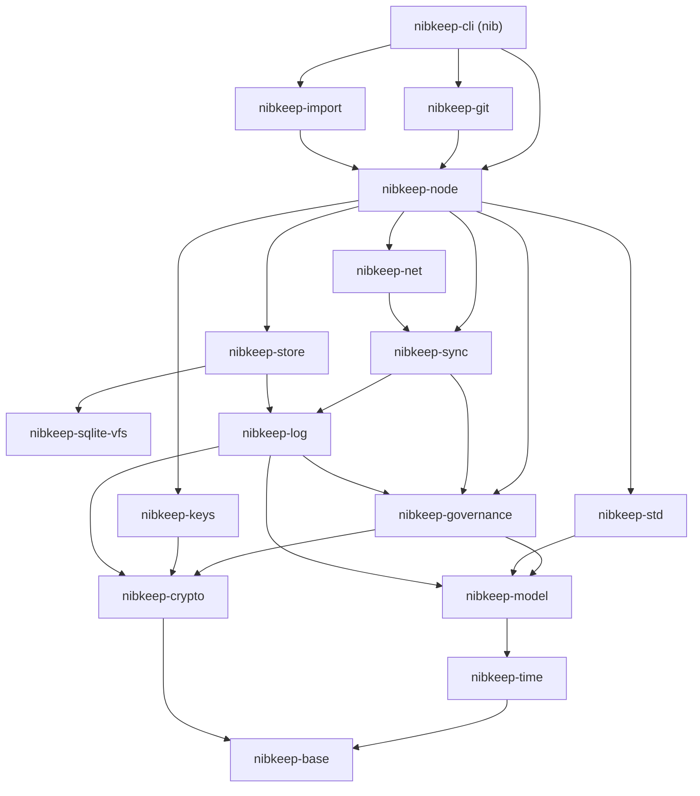

# NibKeep development plan

> [!NOTE]
> **Status: draft.** Last updated 2026-11-22.
> This plan describes how NibKeep gets built: which Rust crates implement the layers from the [design guidelines](Design.md), in what order, and how each step is tested. The design guidelines say *what* to build and why, and the [technical design](Technical-design.md) how it is built.

## Contents

1. [Approach](#1-approach)
2. [From layers to crates](#2-from-layers-to-crates)
3. [Engineering conventions](#3-engineering-conventions)
4. [Testing strategy](#4-testing-strategy)
5. [Phases](#5-phases)
6. [Risks](#6-risks)

## 1. Approach

- **Libraries first.** The layers of the [architecture](Design.md#7-architecture-outline) become Rust libraries. The generic command-line tool `nib` builds on them, and apps build on the same libraries. Nothing in an app reaches around the engine's public API ([P8](Design.md#p8-no-privileged-plugins)).
- **Passwords first.** Password records, kept through `nib` and the open crate `nibkeep-passwords`, are the first use of the engine. They need few features, yet they exercise most of the core: entities and types, history, encryption, sync between devices and sharing with a partner. They have the highest stakes, so whatever keeps a person's passwords now stays the source of truth until NibKeep has earned trust, and an export is always at hand.
- **Tests first.** Each library starts from unit tests written from the rules in the design guidelines, before the code that satisfies them.
- **Step by step.** Each phase ends with something usable, or with scenarios from the design guidelines that run as tests. A phase does not start before the previous one is done.
- **Real data at version 1.** Nothing went into daily use while the formats were drafts, which could change in place: data put in then would have had to be made again. The formats are now at [version 1](#version-1-of-the-formats), so real data can go in, one stage at a time ([Known limits before daily use](#known-limits-before-daily-use)). Until its stage comes, every collection stays where it is, with the programs that keep it now.
- **Crates when needed.** The crate map below is the target. A crate is created when a phase needs it, not up front.
- **Decisions in writing.** Technical decisions and their reasons live in the [technical design](Technical-design.md), changed in place when a decision changes; product decisions in the design guidelines.
- **Documents as a book.** The documents read on GitHub as they are, and as a book built with [mdBook](https://rust-lang.github.io/mdBook/). Continuous integration builds the book and checks every link between the documents, in both forms.

## 2. From layers to crates

### 2.1 Crate map

| Crate | Layer | Responsibility | I/O | Created in |
| --- | --- | --- | --- | --- |
| `nibkeep-base` | Foundations | IDs, algorithm-tagged BLAKE3 hashes, canonical encoding, shared error types | No | Phase 1 |
| `nibkeep-time` | Foundations | EDTF dates and ranges, the rules of time travel, hybrid logical clocks for system time | No | Phase 1 |
| `nibkeep-crypto` | Security | Versioned envelopes, keys that can be destroyed, signatures, Argon2id, keys sealed with HPKE and X-Wing, sealed blobs | No | Phase 1 |
| `nibkeep-model` | Data model | Entities, types as data, fields and qualifiers, relationship entities, secret fields, concurrent values, merging and splitting entities | No | Phase 1 |
| `nibkeep-log` | Data model | Each space's log of signed, hash-linked changes; applying what `nibkeep-governance` decides counts; history and "as of" queries; ordered lists, and long text later | No | Phase 1 |
| `nibkeep-testkit` | Tests | Repeatable randomness and a clock set by hand, test folders, child processes for crash tests, LazyFS mounts, and test pictures | – | Phase 1 |
| `nibkeep-store` | Storage | The log file, the state file and search, the blob store, records of which device holds what | Yes | Phase 2 |
| `nibkeep-keys` | Security | The key file, opened by a passphrase or the platform keystore; unlocking and fresh confirmation | Yes | Phase 2 |
| `nibkeep-sqlite-vfs` | Storage | The layer between SQLite and the VFS that encrypts the state file, with `unsafe` code ([technical design](Technical-design.md#75-the-state-file)) | Yes | Phase 3 |
| `nibkeep-std` | Vocabulary | The standard vocabulary: types for everyday subjects, such as people, organizations, books and their editions, audiobooks, films, series, games, pen names, characters, portrayals, logins and folders, which the project curates and spaces install ([Data model](spec/model.md#1-names)) | No | Phase 3 |
| `nibkeep-governance` | Security | Users, replicas, spaces, members and roles, groups, claims, invitations, revocation, key distribution and rotation: the governing statements written, the rules of which changes count, and each space's roster | No | Phase 3, as `nibkeep-identity`; the log's rules from phase 1 joined it in phase 6 |
| `nibkeep-node` | Engine | Everything an app needs behind one API: open a library, query, change, import, sync, manage devices and spaces, trees | Yes | Phase 3 |
| `nibkeep-cli` | App | The generic command-line tool, in `apps/nib`; its binaries are `nib` and `nibkeep-sync` | Yes | Phase 3 |
| `nibkeep-generate` | Tests | The library generator of the compatibility fixtures and the benchmarks, and `nibkeep-bench` | Yes | Phase 3 |
| `nibkeep-sync` | Sync | Set reconciliation and blob transfer, as a state machine without I/O; from phase 7, the proofs that a replica holds a copy, while the planner and the removal of copies are in `nibkeep-node` | No | Phase 4 |
| `nibkeep-net` | Transports | Connections through iroh, discovery on the home network that announces no names; relays and bundles on a USB drive later | Yes | Phase 4 |
| `nibkeep-bonjour` | Transports | Apple's DNS-SD, by which replicas find each other on macOS and iOS, with `unsafe` code for its C interface | Yes | Phase 5 |
| `nibkeep-passwords` | Domain | The domain of password records: the password generator, one-time codes, clipboard handling; importers and exporters later | Partly | Phase 5 |
| `nibkeep-end-to-end` | Tests | The end-to-end tests of `nib`, which reach it only as a program ([technical design](Technical-design.md#18-end-to-end-tests)) | – | Phase 6 |
| `nibkeep-drives` | Storage | The physical drives under a volume and their partition tables, which name a disk, as Windows reads them, with `unsafe` code for its calls ([technical design](Technical-design.md#96-where-the-copies-are)) | Yes | Phase 7 |
| `nibkeep-thumbnails` | Storage | Thumbnails of pictures, with decoders in memory-safe Rust, which a program hands the engine ([technical design](Technical-design.md#98-thumbnails)) | No | Phase 7 |
| `nibkeep-git` | Engine | The person's own Git, run for the repositories in trees, isolated from the variables that point it elsewhere, which `nib` uses and the engine knows nothing of ([technical design](Technical-design.md#15-trees)) | Yes | After phase 7 |
| `nibkeep-import` | Engine | Importers on the engine's public API, such as of Google Takeout's archives, read in place ([technical design](Technical-design.md#912-importers-and-where-files-came-from)) | Yes | Phase 7 |
| `nibkeep` | Engine | NibKeep under one name, for a program that depends on one crate: the API of `nibkeep-node` at its root, and the crates whose types that API speaks in as modules, `base`, `model`, `time`, `vocabulary` for `nibkeep-std`, and `crypto` | Yes | Version 1 |
| `nibkeep-plugins` | Plugin host | Plugin runtime and capabilities ([open questions](Design.md#8-open-questions)) | Yes | Phase 9 |

Crates without I/O are plain, synchronous Rust. They are the easiest to test and to compile for phones. Only the storage, keystore, network and engine crates touch disks, keystores, networks or the clock.

### 2.2 Dependencies

Arrows point from a crate to the crates it uses. `nibkeep-testkit` is used by the tests of all of them and is left out. So are the crates that use no other crate of the workspace: `nibkeep-bonjour`, which `nibkeep-net` uses, `nibkeep-drives`, which `nibkeep-node` uses, and `nibkeep-thumbnails` and `nibkeep-passwords`, which `nib` uses. An app built on the engine also uses the crates below it for the types its API speaks in, such as IDs, values and dates: the crate `nibkeep`, also left out, gives the engine and those crates one name.



### 2.3 Workspace layout

```text
nibkeep/
├── Cargo.toml          workspace: shared package settings, dependencies and lints
├── crates/             the libraries
├── apps/
│   └── nib/            package nibkeep-cli: binaries nib and nibkeep-sync
├── fixtures/           compatibility fixtures, never deleted
├── fuzz/               fuzz targets
├── book.toml           the documents as a book, built with mdBook
├── scripts/            benchmarks, device runs, checks of the documents
└── docs/
    ├── SUMMARY.md      the book's table of contents
    ├── Design.md, Technical-design.md, Plan.md, Known-limits.md, Prior-Art.md, Agents.md
    └── spec/           the formats that NibKeep stores and sends
```

## 3. Engineering conventions

- **Workspace.** Edition 2024. Shared `[workspace.package]` settings (the license, MIT OR Apache-2.0, and the minimum Rust version), shared `[workspace.dependencies]` and shared `[workspace.lints]`.
- **Safety.** `unsafe` code is forbidden everywhere but in the crates the [technical design](Technical-design.md#1-code-layout) names; `nibkeep-generate` only denies it, for the one call with which `nibkeep-bench` asks Windows for its peak memory. Clippy warnings, pedantic ones included, fail the build.
- **Formatting** with tabs (`hard_tabs = true` in `rustfmt.toml`).
- **Determinism.** Code without I/O takes clocks and random number generators as parameters, so that every test is reproducible.
- **Async** only inside `nibkeep-net`, which iroh needs. The engine and everything below it are synchronous.
- **Errors** with `thiserror`, in the libraries and in `nib` alike. No logging library is in use yet; `tracing` is the choice once one is needed. No secret goes into a log, an error or a panic message.
- **Secrets** live in types that wipe themselves from memory (`zeroize`).
- **Formats.** Every format that is stored or sent is versioned and described in `docs/spec/` before anything relies on it ([P3](Design.md#p3-your-data-outlives-nibkeep)).
- **Versions.** Formats and programs are numbered apart. Each format has a version of its own, a whole number that its specification states, and while the specification is a draft, that number promises nothing. Every change to a format after version 1 makes a new version, whose specification says whether engines that know only the version before still read and write what it stores, as with a new kind of value or a new table, or must leave it alone ([engines of different versions](Technical-design.md#710-separate-apps-on-one-library)). That is what a minor or a major version would say, so formats need no semantic versioning. The crates and `nib` do follow [semantic versioning](https://semver.org/), as Cargo expects, and stay at 0.x while the engine's API still changes freely, also after the formats reach version 1. Each release names the format versions it reads and writes. A 0.x release still keeps data for good: that promise is the formats', not the program's number.
- **Dependencies.** As few as possible ([P9](Design.md#p9-small-core-proven-building-blocks)). `cargo-deny` checks their licenses against the rule in [License and governance](Design.md#9-license-and-governance) and against the RustSec advisory database. `cargo-about` generates the license notices that apps must show.
- **Phones from the start.** Continuous integration also builds the crates for iOS and Android, so that nothing phones cannot run slips in.
- **Project files.** `LICENSE-MIT`, `LICENSE-APACHE` and `COPYRIGHT`, `CONTRIBUTING.md` with the DCO sign-off, `CODE_OF_CONDUCT.md` and `SECURITY.md` with private vulnerability reporting.

## 4. Testing strategy

"Never lose data" ([P1](Design.md#p1-never-lose-data)) makes two promises, each tested in its own way:

- Nothing that was committed is lost, whatever crashes, fails or arrives.
- Data that one version of NibKeep wrote stays readable by every later version.

| Kind of test | Where | Examples |
| --- | --- | --- |
| **Unit tests, written first** | Every crate | "Concurrent writes to one field keep both values" |
| **Property tests** with `proptest` | Model, log, sync, time, encodings, indexes | Replicas that receive the same changes in any order end up equal; every value survives encoding and decoding; the search index finds what a scan of every statement finds |
| **Test vectors** | Crypto, encodings, formats | Published vectors for XChaCha20-Poly1305, ChaCha20-Poly1305, XAES-256-GCM, Argon2id, Ed25519 and HPKE with X-Wing ([list](spec/crypto.md#9-test-vectors)); NibKeep's own vectors once a format is specified |
| **Compatibility fixtures** | Every format that is stored or sent | A generator, the crate `nibkeep-generate`, builds from a fixed seed a library that uses every feature the engine has, growing with it: types, secrets, purges, blobs, merges, lists and history. Its files are committed in `fixtures/` for every version of every format and never deleted. Every later version must read them to the same state, and once there are exports and history, the same export and the same hashes |
| **Crash and power-loss tests** | Storage, trees | A child process killed while it writes changes or imports blobs, or while it commits a tree's secret files and updates its copy with another device's. Power cuts with [LazyFS](https://github.com/dsrhaslab/lazyfs), a file system that drops on command the data written to files but not synced: a library must then open, hold everything committed, and be sound, and a tree's copy hold whole versions, none taken for a change. LazyFS creates, renames and deletes files at once, so the real power cuts on the Raspberry Pi test the syncing of directories. Later, writes torn in half and a full disk |
| **Fuzzing** with `cargo-fuzz` | Everything that reads untrusted input | Stored records first: canonical CBOR, changes and payloads, wrapped keys, the key file, values, statements and types, envelopes, sealed blobs, and the text of dates, names and identifiers. Whatever reads must write out again as it read, and nothing sealed opens with the wrong key. Also the messages of pairing, syncing and invitations, and backups' packs. Later, the importers for CSV, KDBX and Google Takeout. Every input that once failed stays in the seeds, which every push replays |
| **Deterministic simulation** | Engine, then sync | Random sequences of commands, replayable from a seed, checked after every step against a model of what the library should show; restarts, after which the library shows the same and its search index, built anew, finds the same. Each run counts the situations worth testing, such as competing values and refused edits, and fails if a situation never comes up. Replicas that sync in pairs over connections that break off converge (`nibkeep-sync`). Later: several devices in the engine's simulation, crashes and reordering; history stays intact, devices converge, and exports round-trip. And a replica that turned against its user, in a simulation of its own: a device of the person's or an AI agent's replica, which writes whatever its own key can sign and sends it as it syncs, while the honest devices keep the guarantees below. It finds the holes that hand-written tests of an infected device find only once someone thinks of them. It writes in the personal space, and is to write in spaces with members too ([Known limits](Known-limits.md#what-no-test-covers)) |
| **Scenario tests** | Engine | Each scenario in the [design guidelines](Design.md#5-scenarios) becomes a test named after it, such as `s09_shopping_history`, as soon as its pieces exist |
| **Command-line tests** | `nib` | The output of every command, run in the test process with fixed randomness and time |
| **End-to-end tests** | `nib` | The program itself, as a person or a script runs it, on devices that are folders of one computer, each with an environment of its own: alone, syncing with each other over the home network, and killed while they write. Each ends with `nib verify` on every device. In `nibkeep-end-to-end`, which reaches `nib` only as a program ([technical design](Technical-design.md#18-end-to-end-tests)) |
| **Verification** | Engine and `nib` | `nib verify` checks every change, key and blob, and compares an export with the library, both in tests and on real libraries |
| **Mutation testing** with `cargo-mutants` | Core crates, from time to time | Bugs planted on purpose, which some test must catch |
| **Benchmarks** | Engine, storage and search, through the Rust API, `nib` and `nib mcp`, and a first sync | How long it takes to import 10,000, 100,000 and a million entities, to open a library and build its index, to search, to show an entity as of a day, and to verify; peak memory and disk space per entity ([below](#benchmarks)) |
| **Real devices** | An Android phone, an iPhone, Linux, Windows and macOS computers, a Raspberry Pi | The test suite and crash tests on real hardware and storage, with `scripts/test-on-device.py`: on Android, on the iPhone from the Mac with Xcode's `devicectl` (the crash tests aside, since an iOS app may not start a process), and on the Raspberry Pi over SSH; `nib` in daily use once the formats reach version 1, also on Android in Termux; power cuts on the Raspberry Pi with `scripts/power-cut.py`, under a library or a tree with secret files, by hand or by a power switch: the script picks a random moment while the Pi writes, and an ESP32-C6 cuts the Pi's 5 V supply through a MOSFET on its command, since no phone's battery comes out. Emulators and simulators in CI between runs on real devices |

Quick tests run on every push. The end-to-end tests run by hand when a change touches `nib`, syncing or storage, as they need a home network's multicast. The long tests run by hand too: the simulations for much longer, with many seeds, new ones every run, in an optimized build that keeps the checks of a debug build, every fuzz target for five minutes, and 200 power cuts. The property tests join them as they come.

**Test data.** The compatibility fixtures live in this repository and change in the same commit as the code that reads them, so that no change can break old files unnoticed. Corpora that are large or not ours to publish, such as photos with unusual metadata, Takeout archives and exports of other programs that keep passwords, are to live elsewhere, pinned by their hashes, for the nightly job to fetch; none is used yet. A person's real data never goes into any repository: it is checked in place, with read-only imports, `nib verify` and exports, while the originals stay where they are ([P1](Design.md#p1-never-lose-data)).

The scenario tests double as a progress report: the scenarios that pass show what NibKeep can do.

**Guarantees that tests keep,** beyond the scenarios, written first in each phase and kept since:

- Replicas converge whatever the order of changes, payloads and keys; concurrent writes keep both values; concurrent moves in an ordered list neither lose nor duplicate items; a change with a bad signature is rejected.
- After a restart or a crash, exactly what was committed is there; a damaged blob is detected; the state file always equals the state built again from the log.
- A purged value never comes back when its payload or key is sent again, a purge never changes which value is current, and after a purge neither file holds what was purged.
- Secret fields never enter the search index or the state file unsealed; a sentinel password never shows up in logs, panic messages or crash reports; copying marks the clipboard sensitive and clears it.
- A pairing or invitation code takes three tries and expires, a wrong one shows on both sides, and a new device tries each device that announces its code's first two digits; changes from a revoked device that the revoker had not received are set aside.
- An AI agent's replica gets no secrets key, nothing secret is in any tool's result, and every replica refuses its purges and its changes that govern a space.
- A tree's path that leaves its folder, names `.nib` or a `.git`, or goes through a link is never written or cloned into; an edited copy never loses its edits; `.nibignore` leaves out what `git check-ignore` would for the same rules; no credential in a remote's address is recorded.
- Nobody acts on a role they did not know they had; only admins accept set-aside changes, and acceptance never lifts a role's limits; no change leaves a space without a direct admin.

### Benchmarks

The design targets up to 10 million entities per space ([section 3](Design.md#3-goals-and-non-goals)), and the first benchmarks showed that building the state and the search index in memory each time a space opens cannot reach it, so both moved to disk ([the state file](Technical-design.md#75-the-state-file)). Benchmarks measure how close NibKeep is to the target, and what each change of architecture costs. They are not tests: they record numbers, and flag a slowdown.

- **Data.** Every machine imports the same real data, from Wikidata and MusicBrainz, whose core data is in the public domain, with a simulated household for what no source holds, such as a dog weighed for ten years (S13, S15 and S16): about 138,000 entities. A script fetches it once, and it is kept as a numbered revision in the results repository: fetched again on each machine, it would differ, as Wikidata changes every day. A new revision starts a new series of results, so one is added rarely: when a feature changes what a typical library holds, such as files, not for each new type or field, which tests check. One commit measured on both revisions, a bridge, shows what the new data alone changed. The importer's recipe is a number, raised when what it makes of the data changes. A new recipe starts a new series too, and a test fails when the import of a sample changes without one. Two kinds of data are measured by hand. The generator of the compatibility fixtures, `nibkeep-generate`, makes libraries of any size from a seed, with the whole mix the engine supports, secrets and files among them. And the real data, imported with every form of every name, shows what the data costs, where one name for each entity shows the cost of the code. `CONTRIBUTING.md` describes both, under Real data.
- **Measures.** The usual runs keep the few numbers that decide whether NibKeep is usable, so that machines and commits can be compared at a glance: the time to open a library, with its index; the 95th percentile of searches for a first page of 50, what a person waits for while typing; entities imported per second; changes received per second in a new replica's first sync; peak memory, which matters on phones; disk space per entity, which matters for the target; and `nib find` and `nib edit`, each without unlocking. All but the last come from a program of its own, `nibkeep-bench`, which prints its results as JSON, and measures more for looking into a number by hand: searches that list everything they find, showing an entity, also as of a day, and verifying a library. Small, hot pieces of code, such as encoding and hashing, are to be measured with [criterion](https://crates.io/crates/criterion) once one needs it.
- **Through each interface.** The same data is measured at three layers, each compared with the engine. Through the engine's Rust API come most measures: what NibKeep itself costs. Through `nib` come `find` and `edit` on computers: each runs as a process of its own, which starts, unlocks the keys, opens the spaces it needs and builds their indexes, does the work and prints, as a script would run it. `nib` reports how long each of these phases took, so that unlocking, which a passphrase makes cost a fixed fraction of a second by design, can be told apart; every machine unlocks with a passphrase, so that all of them unlock the same way. Through `nib mcp`, by hand, come a few tool calls from a scripted client, with no language model: the server opens the library once, so they measure the cost of each call and of a burst of calls, such as an AI agent importing a hundred films. A new replica's first sync is measured through the Rust API.
- **Sizes for each machine.** The real data on every machine; by hand, generated libraries of a million entities on computers with at least 8 GB of memory, and of 10 million now and then where memory allows. The Raspberry Pi 3B is left out: with 1 GB of memory and a slow processor, it took 36 seconds to open 50,000 entities of real data, too slow for a device of the system until opening no longer grows with the library. It stays in the power-cut tests.
- **Budgets.** Opening a space should take less than 2 seconds with 100,000 entities on the Android phone, and with a million on the desktop; the state on disk is meant to keep it well within. A `nib` command, unlocking aside, should take less than half a second with 100,000 entities on the desktop; when it takes longer, a process that keeps a library open between commands is due ([open questions](Technical-design.md#20-open-questions)). The real data is larger than 100,000 entities, so the usual runs check both budgets of 100,000 directly.
- **Machines.** Numbers compare only on the same machine, each run repeated and its median taken. Each machine is described in the results repository: its system, model, processor, memory and disk, as the system tells them, by which a run finds the machine without being told, and what a person adds by hand, such as the memory's speed. Each result adds the machine's own measures: how long one core takes for a fixed piece of work, how long writing a page and syncing it take, and how fast the disk takes a large file. Machines can then be told apart by what holds each one back, a slow core or a slow disk, as more of them are measured. A machine whose system, processor, memory or disk changes is another machine, which gets a label of its own. The benchmarks run on our own machines, the computers that keep a series and an Android phone, by hand or on a timer, never in continuous integration, whose virtual machines have little in common with real ones.
- **Results** go to a private repository of their own, apart from the code, one line per run, with a branch for each of the code's branches that was measured, which starts from main's results. A run more than about 20% worse than the last three on the same machine and series, of one data revision and one recipe, is flagged. `CONTRIBUTING.md` says how to record and compare them, under Benchmarks.

The first benchmarks came in phase 3, right after valid time and the new kinds of value, and grow with the features that follow. Their numbers as the formats left draft are the baseline for every later change, and the changes on the way there show what each feature cost.

## 5. Phases

### Done so far

Each phase below is built, and its scenarios run as tests: S2, S3, S5, S9, S12 and S14 as tests named after them, S7, S11 and S17 as the tests of revocation, logins and languages, and S6, S13, S15 and S16 only through the tests of their pieces, with no test of the scenario yet. What each brought is in the [technical design](Technical-design.md), and what is still imperfect in [Known limits](Known-limits.md). Nothing is in daily use yet: the formats have only now reached [version 1](#version-1-of-the-formats), and each stage of daily use starts once [the limits listed for it](#known-limits-before-daily-use) are closed. So the parts of a phase's "Done when" that need daily use, or a person's own data, still wait.

| Phase | What it brought |
| --- | --- |
| 0. Groundwork | The workspace, its conventions, continuous integration on Linux, Windows and macOS |
| 1. Core libraries | Encoding, time, cryptography, the data model and the log, as tested Rust without I/O; S2, S5 and S9 |
| 2. Persistence on one device | The log file, sealed blobs, the key file and the platform keystores; crash tests |
| 3. The engine and `nib` | The engine and `nib`: types, entities, search, history and time travel, values that change, languages, users, relationships and the standard vocabulary, files and checkouts, storage policies, purging any value, export and import; the state file on disk, encrypted by NibKeep's VFS, shared by several programs, and batches; the fixtures, simulation, fuzzing, power-loss tests and `nib verify`; S6, S9, S12, S13, S15, S16 and S17 |
| 4. Your own devices | Pairing and sync over the home network, revocation and new keys (S7), AI agents' replicas and `nib mcp` |
| 5. Passwords | Password records, the password generator and one-time codes, secret files, copies of a replica, drives without a journal; the sync role and syncing from login; S11 |
| Trees | Folders with history on several computers, with their Git repositories |
| Secrets in trees | A project's `.env` and keys kept in its tree as secret files, sealed, and read and written only where the space's secrets are |
| 6, steps 1 to 5 | Spaces of one's own and moves; members, roles and invitations; leaving, removing and new keys; one entity per change; one sealed copy per replica; groups in spaces and inside groups, through every level, with direct members and keeping out; claims to the admin role |
| 7, steps 1 to 7 | Where the copies are, counted by disk; regular checks and repair; thumbnails; the planner, which keeps on each device what its role wants, fetches a file on opening it, and removes copies once other disks prove theirs; backups on drives and shares, without keys; archive nodes and backups that wait before purging, during which a purge can be stopped; importers for folders and Google Takeout, with where each file came from |

**Still to do from them:**

- **Passwords:** importers and exporters for CSV and KeePass's KDBX, perhaps as plugins; and an outside security review before anyone else's passwords are stored. Password records go into daily use once [the limits listed for them](#known-limits-before-daily-use) are closed, beside whatever keeps the person's passwords now, which stays the source of truth until NibKeep has earned trust.
- **Sync without the Internet** between two phones, or a phone and a computer, over Bluetooth Low Energy, if iroh's transport for it works.

### Phase 6. Sharing with the family

**Goal:** spaces shared with other people, including shared logins with a partner ([Sharing](Technical-design.md#13-sharing)).

Steps 1 to 5 are built.

Tests to write first: nested groups give access through every level; a group is a member of a space only once admins of both agree, and never an admin; an AI agent counts only in the spaces where it is listed itself, never through a group; a removal from a group takes effect in a space at its first anchors; a shared group with one admin suggests a second; a claim takes effect 30 days after another member's device first shows that it saw it, unless an admin rejects it, and a claim dated into the past takes effect no earlier; every member sees it, it adds an admin and removes nobody, and for 30 more days the new admin can neither purge, nor make anyone an admin, nor remove the admins they joined; an admin who returns can undo a claim; a rejection that arrives late counts if it arrives within 30 days after the claim took effect, and not after; concurrent claims each take effect; viewers and AI agents cannot claim.

**Done when** S10 (circles) works, and a household's family space and a space shared with a partner are in daily use. Relatives in other homes share once phase 8 brings relays, as replicas meet only on the home network until then.

### Phase 7. Files and photos across devices

**Goal:** every file has the copies its storage policy asks for, on separate disks, while each device keeps only what its role wants; photos and videos come in from old phones, drives and Google Takeout, each stored once, with where it came from ([device roles and storage policies](Design.md#68-device-roles-and-storage-policies), [storage policies](Technical-design.md#93-storage-policies)).

Steps 1 to 7 are built, on computers and through `nib`: until a device of a space is marked as an archive node, every replica still keeps every file of that space, only computers make and update backups, archive nodes and backups wait 30 days before purging unless marked otherwise, and importers read folders and Google Takeout's archives, linking resized copies and edits. S3 and S14 run as tests (`crates/nibkeep-import/tests/scenarios.rs`, `crates/nibkeep-node/tests/scenarios.rs`), S14's device outside the home one kept away from home.

Crates: `nibkeep-store` (which disk holds what), `nibkeep-sync` (what each replica holds, told to the others; the proofs that a replica holds a copy), `nibkeep-node` (the planner, fetching a file when it is opened, removal that checks first) and `nib`; the importers in a crate of their own on the engine's public API, which a plugin can take over in phase 9.

Steps, each designed in the technical design before it is built:

1. **Where the copies are.** Each replica records the disk it is on, by an ID that every replica on that disk shares within a space and that tells nothing across spaces. A person marks devices as archive nodes and as kept away from home. Replicas tell each other, through sync, which sealed blobs they hold, which of their originals still match, and when they last checked each: each replica signs its own account, the others pass it on, and only the latest counts, outside the log's history. `nib policy check` then counts copies by disk across devices ("312 photos have only one copy"), and counts the space's changes too: how many disks hold them, and how many of those are away. Nothing is copied or removed yet.
2. **Checking and repair.** The program that holds the sync role checks a share of the replica's copies every day, so that each is checked within weeks, and finds originals that changed. A damaged sealed blob is fetched again from a replica that holds it intact, and checked before it replaces the damaged one. A damaged original is reported, never written over.
3. **Thumbnails,** the first derived data: one for each photo and video, made by the device that adds the file or by another that can read it, sealed as a blob of its own, linked to the content it was made from, and kept by every replica. Never of a secret file. Decided first: which formats the engine reads itself, and which it leaves to the platform, such as HEIC and video.
4. **The planner.** Archive nodes keep what their spaces' policies assign them; everyday devices keep thumbnails, the files pinned to them and recent originals, within a size the person sets. Every replica still receives every change and key, but sync sends a replica only the blobs it wants, and opening a file the device does not hold fetches it from another device on the home network. A copy is removed only once the replicas that are to keep the others prove, right then, that they hold them, and hold them for a while after, so two devices that remove at once never leave too few. With it: of two sealed copies of one content, one is kept; what a move leaves behind is purged once its content has its policy's copies; and a file whose policy changes from the store to in place leaves the store.
5. **Backups:** a folder on a USB drive, on a drive kept away from home, or on a network share, holding the sealed changes and blobs of chosen spaces, and no keys. A backup is no replica, so it has no database that a pulled stick could damage: each file is written whole and checked. It counts as a copy as of its last check; plugged in, it is brought up to date and checked, on computers for now. A replica takes in from a backup what it lacks. On FAT and exFAT, this is the way to carry a library's files.
6. **A copy that waits before purging,** so that no mistake or infected device wipes data everywhere at once: an archive node or a backup set to wait keeps what a purge destroys for a set time, 30 days by default, during which its owner can stop the purge. A purge says first which copies wait, and for how long. Such a copy never removes a file on another device's word. Decided first: how waiting fits a purge that a relative asks for.
7. **Importers and where files came from:** folders from old phones, discs and drives through `nib file add`, which already stores identical content once; Google Takeout archives, whose JSON files beside the photos give the times, places, descriptions and albums that the photos lost; every import recording its source (the device or service, the original path and name, the original times, and when it was imported); and resized or re-encoded copies linked to their originals, never merged without the person.

Tests to write first: S3 (consolidation) and S14 (films and memories); the planner never removes a copy that a policy still needs, not when two devices remove at once, not when the device that is to keep the other copy lies about holding it, and not when a crash or a power cut stops the removal halfway; copies count disks: two replicas on one disk, such as two apps on one phone or two users of one computer, hold one copy, and a computer with two drives can hold two; an original kept in place counts only while it is unchanged; a replica's disk, role and account of its copies are its own, which no other replica can write or forge; every replica receives every change and key, whatever blobs it keeps; a damaged blob is found by the regular check and replaced only by a copy whose hash matches; a file opened on a device that does not hold it arrives checked against its hash; of two sealed copies of one content, every replica keeps the same one; what a move leaves behind is purged only once the new entity's content has its policy's copies; a purge reaches backups and checkouts, a copy that waits keeps purged content for its time and no longer, and its owner can stop the purge meanwhile; no thumbnail of a secret file, and purging content purges its thumbnails; a backup holds nothing readable without the space's keys, and a stick pulled out while a backup is written loses at most the file being written, which the next check finds; a Takeout file is matched with its JSON file, also under the names that Takeout shortens; the same photo from Takeout and from a phone is stored once, with both sources; a resized copy is linked to its original and never merged with it.

**Done when** S3 and S14 run as tests, and the household's photos and videos from old phones, a Takeout archive and an old drive are in one library, each with the copies its policy asks for on separate disks, one of them an archive node, while a phone keeps thumbnails and opens originals from the archive node over the home network. Until phase 8 brings relays, S14's copy outside the home is a backup, or a device kept away from home.

Thin clients, and old versions thinned out by policy, wait for a phase that needs them.

### Recovery codes

**Goal:** a user who lost every device, or the means to unlock them, comes back with a printed code and a backup, with their spaces, their roles in shared ones, and their passwords ([recovery codes](Technical-design.md#111-recovery-codes)). It came before the formats left draft, as it adds records to every space, a rule to the log and a file to backups.

Crates: `nibkeep-crypto` (the code and its keys), `nibkeep-governance` and `nibkeep-log` (codes' records, and the rule for a device that a code lists), `nibkeep-node` (making, checking, revoking and recovering; the recovery file in replicas' folders and backups), `nibkeep-sync` (a new device introducing itself) and `nib`.

Step 1 is built, through `nib recovery`: the code and its keys, a code named in the personal space and the user's other spaces, also those reached through a group alone, with those spaces and their keys sealed to it, the secrets where the person chooses, the recovery file in folders and backups with the personal space in every backup, a new code replacing those before it once every backup carries it, and revoking, also of the codes that a revoked device made ([Known limits](Known-limits.md#recovery-codes)). Step 2 is built too: `nib recovery restore` brings back from a backup, or from a library on the computer that no longer unlocks, in its place or elsewhere, the personal space, the person's other spaces and groups, and the secrets that the code holds, with the log's rule for a device listed by a code, in the personal space and in spaces with members, a device in hand beating it, a listing by a code taken from a sync or a backup, a space reached through a group alone listing the device by its own anchor, and the lost devices revoked, but those the person keeps, named with `--keep` or chosen when asked; and the new device introduces itself, with its listings by the code, in the syncs it starts, to the person's other devices and to other members'.

Steps:

1. **Making, checking and revoking a code,** through `nib recovery`: the code and the keys derived from it; its record in the personal space, and in every space and group of its user; space keys, entries and, where the person chooses, secrets keys sealed to it, also those made later; the recovery file in each replica's folder and each backup; revoking, with new keys.
2. **Recovering,** through `nib recovery restore`, from a backup or from a library on the computer that no longer unlocks: the log's rule for a device that lists itself by a code, in the personal space, in spaces with members and in groups; taking the spaces, keys and secrets; revoking the lost devices; a device in hand beating one listed through a code; and the new device introducing itself to other members' devices in a sync.

Tests to write first: a code's keys derive alike everywhere, by test vectors, and a mistyped code is told by its check characters; a code that was not typed back names nothing; keys are sealed only to the encryption keys that the code signed, whatever a replica states on its record; the code reaches every space and group its user's devices are listed in, also one joined after it was made; a code stated by an AI agent's replica, or by another member's, an admin's too, counts for nothing; a code copied onto another member's record leaves the first member's code standing; a new space key, after a revocation or a departure, opens with the code, and a new secrets key too where the code holds the secrets; a code made with the secrets locked opens none; a revoked code opens nothing sealed after its revocation, in any space, and lists nobody; a new code replaces the one before; the recovery file opens only with its code, and a backup with one still holds nothing readable without the code; a backup not updated since a code was made is named as not carrying it, and the code before stays until every backup carries the new one; recovering from a backup brings back the personal space, the user's other spaces, shared spaces with the member's roles, and the secrets, and revokes the lost devices; a member through a group alone recovers their place in the group's spaces; recovering from a library that no longer unlocks does the same; a wrong code writes nothing; a recovery stopped by a crash or a power cut leaves no new device or a whole one, and goes on when run again; a listing with a code's signature for another space, record or key does not count, nor one by a code that no replica of that member stated; a listing made at the same time as its code's revocation is set aside; of a device and a device listed through a code that revoke each other, the first stays, also where a device listed by a code paired the second; another member's device takes the new device's listing from a sync and then syncs with it, and takes nothing from a key whose code it does not hold; a backup that someone tampered with loses data and forges no device.

**Done when** a library is restored on a wiped computer from its code and a backup drive, with its shared spaces, roles and passwords, the lost devices revoked, and a family member's device syncing with the new one; and the user's own library has a code that `nib recovery check` confirms.

Later, with relays or a need: recovering with no backup, through another member's device; recovering on a phone, from a backup that the engine reads through the system's folder picker.

### Secrets in trees

**Goal:** a project's `.env`, keys and other secrets are kept in its tree with their history, and are read and written only where the space's secrets are ([secrets in trees](Technical-design.md#151-secrets-in-trees)).

Crates: `nibkeep-std` (secret files in trees), `nibkeep-node` (which files are secret, committing, writing, the index, history and purges) and `nib`.

The step is built, through `nib`. What it cannot do yet is in [Known limits](Known-limits.md#trees).

Steps:

1. **Secret files in trees,** through `nib`: the vocabulary and the index's sealed hashes in the specifications first, and the compatibility fixtures made again; the built-in names and `.nibsecret` files, with `nib status --secrets`; commits that seal secret versions, with `--secret`, `--ordinary` and `--leave-secrets`, and that make a committed file secret, purging its old versions; writing, merging and status with the secrets unlocked or not; moves of secret files, and lines taken out of a `.nibsecret`, by other devices, named before they are written; purges; history, with `--secrets`.

Tests to write first: a new file that a built-in name or a `.nibsecret` matches, or whose path held a secret file, goes in as secret, and is never sealed as ordinary, also after its type is taken away, or after it moves; a change from another device that takes a line out of a `.nibsecret` is written only once the person agrees; a secret file taken into a tree other than by that tree's commit is never written; a file committed as ordinary stays ordinary until made secret, which purges the contents of its old versions that no other file holds; a secret file and an ordinary file at one path are never merged into one copy; a replica without the secrets, an AI agent's included, finds no part of a secret file's content or content hash in the log, the state, `nib mcp`'s tools, `diff` or `blame`; a commit with the secrets locked refuses, and with `--leave-secrets` commits the rest; a device without the secrets writes and commits the rest of the tree, never deletes a secret file it never wrote, and writes the rest of a commit whose secret part it cannot open; a secret file is written only with the secrets unlocked, readable only by its owner on Unix, and never through a link or outside the tree; a secret file that another device moved is written at its new place only once the person agrees; a purge of a secret version deletes its unedited copies on every device, also with the secrets locked, and keeps edited ones; the end-to-end tests: a tree with a `.env` and an SSH key on two computers that hold the secrets and one that does not.

**Done when** the trees in daily use keep their `.env` files and keys as secret files, written on the computers that hold the secrets, and the rest of each tree is written on a computer that does not.

### AI agents on the person's replica

**Goal:** a person connects an AI agent on their own computer, of any AI client, with one command, `nib mcp enable`, with no pairing code, second folder, passphrase or device record ([AI agents](Technical-design.md#14-ai-agents)). It came before version 1 of the formats, in case the record of an agent's key needed anything that a replica's record lacks.

Crates: `nibkeep-node` (an AI agent's key kept in the user's replica, with no folder of its own; writing as it under the replica's lock; the consent in the replica's local settings) and `nib` (`nib mcp enable` and `disable`, the table of AI clients, `nib mcp` on the user's replica).

Both steps are built, for the personal space, with Claude Code and Codex in the table of clients; `--in SPACE` is not ([Known limits](Known-limits.md#ai-agents)).

Steps:

1. **Agents' keys in the user's replica:** made on a client's first connection, named after its `clientInfo` or `--agent`, listed as an AI agent's replica on this computer's device record, with no folder; changes written as the key under the replica's lock; revoking one alone.
2. **`nib mcp enable` and `disable`:** the consent, with `--in SPACE`; `nib mcp serve` on the user's replica, refusing without the consent, reading only the agent's spaces and opening the library for each tool call; registering with the AI clients found, with `--client` and `--print`, and taking the server out again.

Tests to write first: an agent's change made on the user's replica counts, or is set aside, exactly as a paired agent's, by the tests of what counts, and the infected-replica simulation writes as such a key too; history names it "Ada, through NAME"; `nib mcp` on a user's replica without the consent refuses, and never signs with the replica's own key; it reads nothing of a space where the agent's key is not listed, and no secret; two servers of one client writing at once leave a log that every replica takes; `disable` revokes the keys and takes out exactly the entries it added to clients' configurations, leaving the others; `nib` uses the library while a server runs; a client that no entry of the table knows works from the printed line.

**Done when** two AI clients, Claude Code and another, connect to a library with `nib mcp enable` alone, and their changes show in history under their names, on the person's one device.

### Devices that choose their spaces

**Goal:** each device of a person holds only the spaces chosen for it, so that a phone keeps none of the spaces that only computers need, nor their keys and secrets ([technical design](Technical-design.md#1310-devices-that-choose-their-spaces)). It came before version 1 of the formats, as it adds a rule to the log and changes who is given keys.

Crates: `nibkeep-governance` and `nibkeep-log` (a device's choice, the state it ends a device in, and listing a device again), `nibkeep-node` (consent, taking, asking and approving, dropping, the names of spaces, and what reads who holds a space), `nibkeep-sync` (a device ended by its choice) and `nib`.

Every step is built: a device's choice, stated by `Library::state_space_choice`, carried into a space by its user's devices, ending it there, and undone by `Library::list_again` with its newer choice to hold; and consent and taking: entries given as the person makes or joins a space (`Library::create_space_on`), pairs a device as a computer or a phone (`pair_device`), or approves a request (`Library::allow_space`), the mark for new spaces (`Library::set_takes_new_spaces`), taking and asking (`Library::take_space`), the names of spaces in the personal space (`Library::known_spaces`), and `nib space list`, `take` and `allow`, `nib device pair --phone` and `nib device mark --new-spaces`; and dropping (`Library::drop_space` and `Library::drop_progress`): refused below the policies, on no other device of the person's, or with a tree's folder or an edited checkout here; the device's copies of the space's blobs removed in the holder's passes as their copies elsewhere are proven; the choice stated once the waits are over; the space deleted once a device of the person's that holds it holds the drop, at once for a space the person left; and `nib space drop`; and what reads who holds a space (`Library::out_of_reach`, `Recovered::out_of_reach`, `BackupUpdate::elsewhere`): a revocation and a recovery naming the spaces they cannot reach and the devices that hold them, in `nib device revoke` and `nib recovery restore`; a backup's update naming the spaces it did not write, in `nib backup update`; origins and checkouts moving only to a space their device holds; pins only to a device that holds the file's space; and a device made from a copy taking the spaces the copy holds, and asking first where it did. Its "done when" is for the user to try.

Steps:

1. **Choices in the log:** the signed choice, stated in the personal space and carried into a space; a standing choice not to hold a space ending the device there, with new keys from the others and none from it; listing it again only with a newer choice to hold; syncing with a device so ended; the infected replica of the simulation writing choices.
2. **Consent and taking:** entries given only with consent; the mark for new spaces, set when pairing by whether the device is a computer or a phone; choosing devices when making or joining a space; a group's spaces taken as spaces made elsewhere; asking for a space and approving on a device that holds it; the names of spaces in the personal space; `nib space list` showing every space of the person's, held or not, and by which devices; `nib space take`, `nib space allow` and `nib device mark --new-spaces`; lists and searches naming what they did not look in.
3. **Dropping:** waiting for the device's changes, the copies of the space's changes and the proven copies of its blobs; refusing below the policies, with what is missing; the choice, its sync, and deleting the space's files and the blobs that no other space keeps; a space that the person left; `nib space drop`.
4. **What reads who holds a space:** a revocation naming the spaces it cannot reach, and the devices that hold them; moves of origins and checkouts; pins; backups; recovery; a device made from a copy.

Tests to write first: a choice signed by another key, for another space or record, or with another number, counts for nothing, carried by any replica; of a device's choices, the one with the highest number stands, whatever order they come in; a standing choice to drop ends the device: no key is sealed to it after, a sync sends it only what ended it, its account stops counting, and what it writes after is set aside; the others make a new key, and a new secrets key where it held them, and a key that the dropping device makes after its drop is never safe; a listing of a dropped device without a newer choice to hold lists nothing, also by its own member's other device, and one with such a choice brings it back with every key made meanwhile; a choice counts for nothing from another member's replica, an admin's too, and a choice of the personal space itself for nothing at all; a device that declines a space is never given an entry by its user's devices, takes none it is given, and is never listed there; a device paired as a phone holds the personal space alone, and one paired as a computer every space; a space made on one device reaches the devices that take new spaces and no other; a request is shown only on a device that holds the space, and approving it gives the space; a group's space reaches a phone only when the person takes it; a drop is refused while no other device of the person's holds the space, and deletes nothing until such a device holds the drop; a drop waits while the device's last changes are its own, while it alone holds the space's secrets, while fewer disks than the Critical policy asks for hold the space's changes, and while a blob's other copies are not proven, says which, and goes on once they are; a drop cut short by a power cut leaves the space held whole, or dropped and deleted whole; the space's files and its blobs are gone after a drop, those that another space keeps stay; a search names the spaces it did not look in; a revocation from a device that does not hold a space names it, and the device of the person's that holds it revokes there after its next sync; a group's space that a phone declined is given none of its secrets by the person's devices, and its decline goes into the space once a device of the person's that holds it syncs; a device that turned against its person cannot drop another device from a space, nor bring back one that dropped it without that device's newer choice, nor list one that never asked.

**Done when** a phone paired as a phone holds the personal space alone; a project's space made on the desktop reaches the laptop and not the phone; the phone asks for the family's space and gets it once the person approves on the desktop; the laptop drops the project's space once the desktop and the backups hold it as its policy asks, and takes it back later; and a lost laptop, revoked from the phone, is revoked in the project's space after the desktop syncs.

### Version 1 of the formats

**Goal:** formats that from then on change only by new versions, each of which every later version of NibKeep reads, so that real data can go in. The formats are now at version 1. Nothing went into daily use before it: not passwords, nor trees, nor a family's spaces and photos. A draft format could change in place, and data put in would have had to be made again.

Version 1 came once what was left would only add to the formats. What changed which changes count, or what the formats already held, came before it, and all of it is done:

1. **Step 2 of [recovery codes](#recovery-codes),** built: it added to the log's rules and to sync, as the new device introducing itself to other members' devices. A rule of which changes count that came after version 1 would make older and newer engines show different states from one log, until every device is updated.
2. **Engines of different versions** ([technical design](Technical-design.md#710-separate-apps-on-one-library)), built: each program records in the replica's engines file the version of the stored files its engine reads, and an engine that finds them of a later version changes nothing and asks for an update. Engines of version 1 must do this already, or a later engine cannot tell whether it still shares a replica with them. State files kept one for each format version can come later, as they only spare rebuilds.
3. **How a migration derives the IDs it writes,** decided and built ([technical design](Technical-design.md#57-migrations)): from the statements it replaces, never from what they say, with a note on each value it writes, and purges that take every change that asserted a statement, as two devices that run one migration at once both do. The standard vocabulary still changes, and once real data is in, every change to it reaches existing spaces through a migration. The code that runs one changes no format and may follow.
4. **The public name** in place of the working one, done: the name NibKeep is in every format, in reserved names, contexts of keys and signatures, magic bytes, an application ID, protocols and the library's folder. After version 1, each has to stay as it is or take a new version.
5. **A decision on each hole in which changes count,** made ([technical design](Technical-design.md#65-which-changes-count)): three need a rule of the log, and all three are built: one rule of listing in every space, the personal space too; plain writes to a field secret for good that count only where the field's mark builds on them; and governing statements that a version does not know, kept with no effect, so that a later version can add governing fields. The other holes need no rule, or are accepted.
6. **What reads earlier drafts, taken out** of the specifications and the code, done: spaces that kept their sealed blobs in a folder of their own, log files that gained tables as they opened, secrets compartments without a key to receive with, libraries that named no holder of the secrets, gifts of secrets keys without links, origins that did not record their content, and records without the items that later drafts added. No real data needed them, and specifications without them are easier to implement anew.
7. **A decision on each [known limit](Known-limits.md) whose mitigation would change a format:** built before version 1, left for a new version after, or accepted, as the limit then says. Done: the last ones were built. The device that shows a pairing or invitation code proves it first, so that a new device sends its keys and names only to the device that has its code. So was [devices that choose their spaces](#devices-that-choose-their-spaces), as a device's drop of a space adds a rule to the log and changes who is given its keys. So was the one that the simulation of an infected device found: every governing change counts only if it is wrapped with the space's first key, so that every device reads every governing change it holds, and a device builds its revocations and changes of roles on none whose payload it has not read ([technical design](Technical-design.md#11-revocation-and-new-keys)).
8. **Every version number back at 1,** done, for each structure that is stored or sent, such as the log file's, the state file's and the sync protocol's, which the drafts had raised to 2, 13 and 4 to guard devices that ran different builds. The public name changed the application ID, the magic bytes and the protocols' names, so no engine of version 1 takes a draft's file or device for its own. A specification's version 1 and the numbers in what it describes now agree.
9. **The fixture `v1`,** done: `fixtures/libraries/v1` is a copy of `draft`, and from now on fixtures are only ever added (`fixtures/README.md`). The benchmarks' numbers now are the [baseline](#benchmarks) for every later change.

What comes after is meant to add to the formats, never to change them. Phase 8 adds relays as a new version of the sync protocol, and what replicas say of them as ordinary statements. Phase 9 adds plugins' approvals and pinned versions as ordinary entities, as long as the app that runs a plugin keeps its limits, rather than a rule that every replica applies, as for AI agents. A change of which changes count, such as recovering through another member's device ([technical design](Technical-design.md#111-recovery-codes)), would be a new version of the log, which every device needs before it counts: a design that can add instead does so.

**Done when** the specifications say version 1 without a draft status, `fixtures/libraries/v1` is committed, and a release reads and writes it. Then passwords go into daily use, followed by trees, the family's spaces and the photos, each once [the limits listed for it](#known-limits-before-daily-use) are closed.

### Known limits before daily use

**Goal:** each stage of daily use starts without the [known limits](Known-limits.md) that could harm it, and the others wait their turn. The stages follow [version 1 of the formats](#version-1-of-the-formats), in this order: passwords, trees, a family's spaces, photos.

A limit is on a stage's list when, with only what that stage uses, it could put a secret where it should not be, lose data or keep the person from it, or make an everyday act fail. The others stay in Known limits, also those found on the way. A stage's list is written when the stage before it is in daily use, and kept in line with Known limits as limits are closed and found.

Limits are fixed by their cause: where one mitigation closes several ([Known limits](Known-limits.md#mitigations-that-several-limits-share)), that one is built. Before a fix is built, what would still be true after it is written down, as the limit that takes its place. A fix that would leave a limit of the same weight is not built: a simpler rule is looked for first.

**Passwords,** kept through `nib` and the open crate `nibkeep-passwords`, with the personal space and the person's own devices on the home network, on Linux, Windows and Android. Apple's systems join later, with their limits.

A secret where it should not be:

- A temporary copy of a secret file that another app still holds open (Windows).
- The console window closed before `nib` clears a copied secret (Windows).
- A new secrets key that waits, after a revocation, for a device that holds the secrets to unlock them (Devices that write apart).
- A lost device revoked from one added after it, which a thief can revoke back, with nothing that says to revoke it from an older one too (Trust between devices).

Passwords lost or out of reach:

- A phone whose ID does not read, which offers to make the device from its own library (Every system).
- Two devices that set up the secrets at the same time (Secrets).
- A recovery code made without the secrets, with nothing that says what it will not bring back (Recovery codes).
- Log files that are not checked regularly, nor repaired from other replicas, as records live in the log (Checking and repair).
- Migrations that nothing runs yet, before the first change of the standard vocabulary after real data is in (Types and vocabulary).

Everyday acts:

- Syncing that the Windows firewall or a public network keeps from working, without a word (Windows).
- A record's fields ordered by label, so that a card imported from another program loses its order (Types and vocabulary).

Tests:

- The power-cut test that dies of SIGBUS, understood (Tests that fail now and then).
- `the_secrets_of_a_copy_are_taken_later_with_secret_from_copy`, which failed once with no cause found (Tests that fail now and then).

**Done when** each limit on the list for passwords is closed, or accepted with its reason in Known limits. Then the list for trees is written.

### Guards for builds under development

`nib` looks for the nearest library above the current folder, and otherwise opens the one that `NIBKEEP_LIBRARY` names. So a build under development, run inside a folder of someone's own library, would act on that library. The tests already keep to their own folders with a ceiling. Two guards cover the rest, and both are built:

1. **The repository's `.cargo/config.toml`** sets `NIBKEEP_CEILING` to the repository's folder, and empties `NIBKEEP_LIBRARY`, for whatever cargo starts in the repository, such as `cargo run` and the tests. A build under development then finds only libraries below the repository's folder (`apps/nib/tests/development.rs`).
2. **The agents' rules,** in `AGENTS.md`, allow a build under development only on scratch libraries, which also covers a `nib` run straight from `target/`.

### Later phases

These are sketched now and will be planned in detail when they come closer. Both come after [version 1 of the formats](#version-1-of-the-formats), and are meant to add to the formats only.

- **Phase 8. Phones and the Internet.** Sync over the Internet through self-hostable relays; file providers. Scenarios S1 (Grandma's story) and S4 ("That Christmas").
- **Phase 9. Plugins.** The plugin runtime, once its [open questions](Design.md#8-open-questions) are decided. Scenario S8 (installing a plugin).

## 6. Risks

The [cautionary tales](Prior-Art.md#cautionary-tales) and other lessons from prior art apply directly:

- **Scope.** Perkeep is still for "the fairly technical" after more than a decade, and Chandler never got far beyond 1.0. Every phase must end with something usable, and later phases wait.
- **Sync is hard to get right.** The deterministic simulations and the end-to-end tests are there to find problems while they are cheap to fix.
- **Cryptography mistakes.** Only reviewed algorithms and libraries, published test vectors, a written threat model and an outside review before anyone else's data depends on it.
- **One maintainer.** Trilium shows how fragile that is. The technical design, the specifications and a small core keep the project understandable for the next person.
- **Phones.** Constraints discovered late are expensive, which is why continuous integration builds for iOS and Android from the start.
