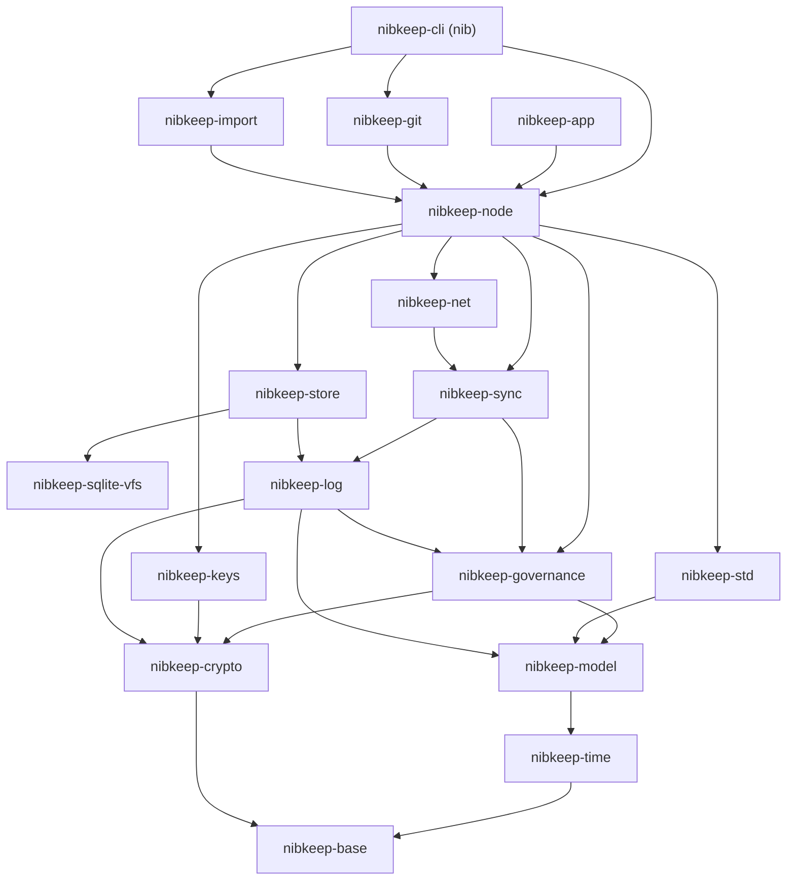

# NibKeep development plan

> [!NOTE]
> **Status: draft.** Last updated 2026-11-25.
> How NibKeep gets built: which Rust crates implement the layers of the [design guidelines](Design.md), in what order, and how each step is tested. The design guidelines say *what* to build and why. The [technical design](Technical-design.md) says how it is built.

## Contents

1. [Approach](#1-approach)
2. [From layers to crates](#2-from-layers-to-crates)
3. [Engineering conventions](#3-engineering-conventions)
4. [Testing strategy](#4-testing-strategy)
5. [Phases](#5-phases)
6. [Risks](#6-risks)

## 1. Approach

- **Libraries first.** The layers of the [architecture](Design.md#7-architecture-outline) become Rust libraries. The command-line tool `nib` and every app build on them. No app reaches around the engine's public API ([P8](Design.md#p8-no-privileged-plugins)).
- **Tests first.** Each library starts from unit tests written from the rules in the design guidelines, before the code that satisfies them.
- **Step by step.** Each phase ends with something usable, or with scenarios from the design guidelines that run as tests. A phase starts only when the one before it is done.
- **Crates when needed.** The crate map below is the target. A crate is created when a phase needs it, not up front.
- **Decisions in writing.** Technical decisions and their reasons are in the [technical design](Technical-design.md), changed in place when a decision changes. Product decisions are in the design guidelines.
- **Documents as a book.** The documents read on GitHub as they are, and as a book built with [mdBook](https://rust-lang.github.io/mdBook/). Continuous integration builds the book, checks every link in both forms, and publishes the book from `main` on [GitHub Pages](https://nibkeep.github.io/nibkeep/).

## 2. From layers to crates

### 2.1 Crate map

| Crate | Layer | What it does | I/O |
| --- | --- | --- | --- |
| `nibkeep-base` | Foundations | IDs, BLAKE3 hashes tagged with their algorithm, canonical encoding, shared error types | No |
| `nibkeep-time` | Foundations | EDTF dates and ranges, the rules of time travel, hybrid logical clocks for system time | No |
| `nibkeep-crypto` | Security | Versioned envelopes, keys that can be destroyed, signatures, Argon2id, keys sealed with HPKE and X-Wing, sealed blobs | No |
| `nibkeep-model` | Data model | Entities, types as data, fields and qualifiers, relationship entities, secret fields, concurrent values, merging and splitting entities | No |
| `nibkeep-log` | Data model | Each space's log of signed, hash-linked changes; applying what `nibkeep-governance` decides counts; history and "as of" queries; ordered lists, and long text later | No |
| `nibkeep-testkit` | Tests | Repeatable randomness, a clock set by hand, test folders, child processes for crash tests, LazyFS mounts, test pictures | – |
| `nibkeep-store` | Storage | The log file, the state file and search, the blob store, records of which device holds what | Yes |
| `nibkeep-keys` | Security | The key file, opened by a passphrase or the platform keystore; unlocking and fresh confirmation | Yes |
| `nibkeep-sqlite-vfs` | Storage | The layer between SQLite and the file system that encrypts the state file, with `unsafe` code ([technical design](Technical-design.md#75-the-state-file)) | Yes |
| `nibkeep-std` | Vocabulary | The standard vocabulary: types for everyday subjects, such as people, organizations, books, films, games, logins and folders, which the project curates and spaces install ([Data model](spec/model.md#1-names)) | No |
| `nibkeep-governance` | Security | Users, replicas, spaces, members, roles, groups, claims, invitations, revocation, key distribution and rotation; the rules of which changes count; each space's roster | No |
| `nibkeep-node` | Engine | Everything an app needs behind one API: open a library, query, change, import, sync, manage devices, spaces and trees | Yes |
| `nibkeep-cli` | App | The command-line tool, in `apps/nib`, with the binaries `nib` and `nibsync` | Yes |
| `nibkeep-app` | App | What the core of every app answers alike, as JSON: the library held between the app's calls, set up, unlocked and locked, synced, with devices added and spaces joined, the spaces on a device, recovery codes and syncing from login ([technical design](Technical-design.md#17-apps)) | Yes |
| `nibkeep-generate` | Tests | The library generator behind the compatibility fixtures and the benchmarks, and `nibkeep-bench` | Yes |
| `nibkeep-sync` | Sync | Set reconciliation, blob transfer and proofs that a replica holds a copy, as a state machine without I/O. The planner and the removal of copies are in `nibkeep-node` | No |
| `nibkeep-net` | Transports | Connections through iroh, and discovery on the home network that announces no names; relays and bundles on a USB drive later | Yes |
| `nibkeep-bonjour` | Transports | Apple's DNS-SD, by which replicas find each other on macOS and iOS, with `unsafe` code for its C interface | Yes |
| `nibkeep-passwords` | Domain | Password records: the password generator, one-time codes, clipboard handling; importers and exporters later | Partly |
| `nibkeep-end-to-end` | Tests | The end-to-end tests of `nib`, which reach it only as a program ([technical design](Technical-design.md#18-end-to-end-tests)) | – |
| `nibkeep-drives` | Storage | The physical drives under a volume and their partition tables, as Windows reports them, with `unsafe` code for its calls ([technical design](Technical-design.md#96-where-the-copies-are)) | Yes |
| `nibkeep-thumbnails` | Storage | Thumbnails of pictures, decoded in memory-safe Rust ([technical design](Technical-design.md#98-thumbnails)) | No |
| `nibkeep-git` | Engine | Runs the person's own Git for the repositories in trees, shielded from variables that point it elsewhere. `nib` uses it; the engine knows nothing of it ([technical design](Technical-design.md#15-trees)) | Yes |
| `nibkeep-import` | Engine | Importers on the engine's public API, such as for Google Takeout archives, read in place ([technical design](Technical-design.md#912-importers-and-where-files-came-from)) | Yes |
| `nibkeep` | Engine | NibKeep under one name: the API of `nibkeep-node` at its root, and as modules the crates whose types that API uses: `base`, `model`, `time`, `vocabulary` (`nibkeep-std`) and `crypto` | Yes |
| `nibkeep-plugins` | Plugin host | Runs plugins, WebAssembly components, compiled or interpreted, with limits on every call ([technical design](Technical-design.md#171-plugins)); capabilities in phase 9 | Yes |

Crates without I/O are plain, synchronous Rust. They are the easiest to test and to build for phones. Only the storage, keystore, network and engine crates touch disks, keystores, networks or the clock.

### 2.2 Dependencies

Arrows point from a crate to the crates it uses. Left out of the diagram:

- `nibkeep-testkit`, which the tests of every crate use;
- the crates that use no other crate of the workspace: `nibkeep-bonjour`, used by `nibkeep-net`; `nibkeep-drives`, used by `nibkeep-node`; and `nibkeep-thumbnails` and `nibkeep-passwords`, used by `nib`;
- `nibkeep`, which gives the engine and the crates whose types its API uses, such as IDs, values and dates, one name.



### 2.3 Workspace layout

```text
nibkeep/
├── Cargo.toml          workspace: shared package settings, dependencies and lints
├── crates/             the libraries
├── apps/
│   └── nib/            package nibkeep-cli: binaries nib and nibsync
├── fixtures/           compatibility fixtures, never deleted
├── fuzz/               fuzz targets
├── book.toml           the documents as a book, built with mdBook
├── scripts/            benchmarks, device runs, checks of the documents
└── docs/
    ├── SUMMARY.md      the book's table of contents
    ├── Design.md, Technical-design.md, Plan.md, Known-limits.md, Agents.md
    └── spec/           the formats that NibKeep stores and sends
```

## 3. Engineering conventions

- **Workspace.** Edition 2024, with shared `[workspace.package]` settings (the license, MIT OR Apache-2.0, and the minimum Rust version), shared `[workspace.dependencies]` and shared `[workspace.lints]`.
- **Safety.** `unsafe` code is forbidden except in the crates that the [technical design](Technical-design.md#1-code-layout) names. Clippy warnings, pedantic ones included, fail the build.
- **Formatting** with tabs (`hard_tabs = true` in `rustfmt.toml`).
- **Determinism.** Code without I/O takes clocks and random number generators as parameters, so every test is reproducible.
- **Async** only inside `nibkeep-net`, because iroh needs it. The engine and everything below it are synchronous.
- **Errors** with `thiserror`, in the libraries and in `nib`. No logging library is in use yet; `tracing` is the choice once one is needed. No secret goes into a log, an error or a panic message.
- **Secrets** live in types that wipe themselves from memory (`zeroize`).
- **Formats.** Every format that is stored or sent is versioned and specified in `docs/spec/` before anything relies on it ([P3](Design.md#p3-your-data-outlives-nibkeep)).
- **Versions.** Formats and programs are numbered separately. Each format has its own version, a whole number stated in its specification ([version 1 of the formats](#version-1-of-the-formats)). The crates and `nib` follow [semantic versioning](https://semver.org/), as Cargo expects, and stay at 0.x while the engine's API still changes freely. Each release names the format versions it reads and writes. A 0.x release still keeps data for good: that promise belongs to the formats, not to the program's version number.
- **Dependencies.** As few as possible ([P9](Design.md#p9-small-core-proven-building-blocks)). Their licenses must be permissive, such as MIT, Apache-2.0, BSD, ISC or Zlib, or MPL-2.0, so that closed apps and app stores stay possible. `cargo-deny` checks this, and checks them against the RustSec advisory database. `cargo-about` generates the license notices that apps must show.
- **Phones from the start.** Continuous integration also builds the crates for iOS and Android, so nothing that phones cannot run slips in.
- **Project files.** `LICENSE-MIT`, `LICENSE-APACHE` and `COPYRIGHT`; `CONTRIBUTING.md`, with the DCO sign-off; `CODE_OF_CONDUCT.md`; and `SECURITY.md`, with private vulnerability reporting.

## 4. Testing strategy

"Never lose data" ([P1](Design.md#p1-never-lose-data)) makes two promises, each tested in its own way:

- Nothing that was committed is lost, whatever crashes, fails or arrives.
- Data that one version of NibKeep wrote stays readable by every later version.

| Kind of test | Where | Examples |
| --- | --- | --- |
| **Unit tests, written first** | Every crate | "Concurrent writes to one field keep both values" |
| **Property tests** with `proptest` | Model, log, sync, time, encodings, indexes | Replicas that receive the same changes in any order end up equal; every value survives encoding and decoding; the search index finds what a scan of every statement finds |
| **Test vectors** | Crypto, encodings, formats | Published vectors for XChaCha20-Poly1305, ChaCha20-Poly1305, XAES-256-GCM, Argon2id, Ed25519 and HPKE with X-Wing ([list](spec/crypto.md#9-test-vectors)); NibKeep's own vectors once a format is specified |
| **Compatibility fixtures** | Every format that is stored or sent | `nibkeep-generate` builds, from a fixed seed, a library that uses every feature of the engine, and grows with it. Its files are committed in `fixtures/` for every version of every format and never deleted. Every later version must read them to the same state and, once exports and history are compared, to the same export and hashes |
| **Crash and power-loss tests** | Storage, trees | A child process killed while it writes changes, imports blobs, commits a tree's secret files or updates a tree's copy. Power cuts with [LazyFS](https://github.com/dsrhaslab/lazyfs), a file system that drops, on command, data written but not synced: the library must then open, hold everything committed and be sound, and a tree's copy must hold whole versions. LazyFS creates, renames and deletes files at once, so real power cuts on a Raspberry Pi test the syncing of directories. Later: torn writes and a full disk |
| **Fuzzing** with `cargo-fuzz` | Everything that reads untrusted input | Stored records first: canonical CBOR, changes and payloads, wrapped keys, the key file, values, statements and types, envelopes, sealed blobs, and the text of dates, names and identifiers. What is read must write back as it was read, and nothing sealed opens with the wrong key. Also the messages of pairing, sync and invitations, and the packs of backups. Later, the importers for CSV, KDBX and Google Takeout. Every input that once failed stays in the seeds, which every push replays |
| **Deterministic simulation** | Engine, then sync | Random sequences of commands, replayable from a seed, checked after every step against a model of what the library should show, also after restarts that rebuild the search index. Each run counts the situations worth testing, such as competing values and refused edits, and fails if one never comes up. Replicas that sync in pairs over connections that break off converge (`nibkeep-sync`). A simulation of its own has an infected replica: a device or an AI agent's replica that writes whatever its key can sign, while the honest devices keep the guarantees below. It covers the personal space, and is to cover spaces with members ([Known limits](Known-limits.md#what-no-test-covers)). Later: several devices in the engine's simulation, crashes and reordering |
| **Scenario tests** | Engine | Each scenario in the [design guidelines](Design.md#5-scenarios) becomes a test named after it, such as `s09_shopping_history`, as soon as its pieces exist |
| **Command-line tests** | `nib` | The output of every command, run in the test process with fixed randomness and time |
| **End-to-end tests** | `nib` | The program itself, as a person or a script runs it, on devices that are folders of one computer, each with its own environment: alone, syncing over the home network, and killed while they write. Each test ends with `nib verify` on every device. They are in `nibkeep-end-to-end` ([technical design](Technical-design.md#18-end-to-end-tests)) |
| **Verification** | Engine and `nib` | `nib verify` checks every change, key and blob, and compares an export with the library, in tests and on real libraries |
| **Mutation testing** with `cargo-mutants` | Core crates, from time to time | Bugs planted on purpose, which some test must catch |
| **Benchmarks** | Engine, storage and search, through the Rust API, `nib` and `nib mcp`, and a first sync | Importing 10,000, 100,000 and a million entities, opening a library and building its index, searching, showing an entity as of a day, verifying; peak memory and disk space per entity ([below](#benchmarks)) |
| **Real devices** | An Android phone, an iPhone, Linux, Windows and macOS computers, a Raspberry Pi | The test suite and crash tests on real hardware and storage, with `scripts/test-on-device.py`: on Android; on an iPhone from a Mac, with Xcode's `devicectl` (without the crash tests, since an iOS app may not start a process); on a Raspberry Pi over SSH. Power cuts on a Raspberry Pi with `scripts/power-cut.py`: at a random moment while the Pi writes, an ESP32-C6 cuts its 5 V supply through a MOSFET. Emulators and simulators in CI between runs on real devices |

Quick tests run on every push. The end-to-end tests run by hand when a change touches `nib`, syncing or storage, since they need the home network's multicast. The long tests run by hand too: the simulations with many new seeds, in an optimized build that keeps the checks of a debug build; every fuzz target for five minutes; and 200 power cuts. Long runs of the property tests will join them.

**Test data.** The compatibility fixtures live in this repository and change in the same commit as the code that reads them, so no change can break old files unnoticed. Corpora that are large or not ours to publish, such as photos with unusual metadata, Takeout archives and exports of other password programs, are to live elsewhere, pinned by their hashes; none is used yet. A person's real data never goes into any repository. It is checked in place, with read-only imports, `nib verify` and exports, while the originals stay where they are ([P1](Design.md#p1-never-lose-data)).

The scenario tests double as a progress report: the scenarios that pass show what NibKeep can do.

**Guarantees that tests keep,** beyond the scenarios, written first in each phase:

- Replicas converge whatever the order of changes, payloads and keys. Concurrent writes keep both values. Concurrent moves in an ordered list neither lose nor duplicate items. A change with a bad signature is rejected.
- After a restart or a crash, exactly what was committed is there. A damaged blob is detected. The state file always equals the state rebuilt from the log.
- A purged value never comes back when its payload or key is sent again. A purge never changes which value is current. After a purge, neither file holds what was purged.
- Secret fields never enter the search index or the state file unsealed. A sentinel password never shows up in logs, panic messages or crash reports. Copying marks the clipboard as sensitive and clears it.
- A pairing or invitation code allows three tries and expires, and a wrong one shows on both sides. A new device tries each device that announces its code's first two digits. Changes from a revoked device that the revoker had not received are set aside.
- An AI agent's replica gets no secrets key, no tool result holds anything secret, and every replica refuses the agent's purges and its changes that govern a space.
- A tree's path that leaves its folder, names `.nib` or a `.git`, or goes through a link is never written or cloned into. An edited copy never loses its edits. `.nibignore` leaves out what `git check-ignore` would for the same rules. No credential in a remote's address is recorded.
- Nobody acts on a role they did not know they had. Only admins accept set-aside changes, and accepting never lifts a role's limits. No change leaves a space without a direct admin.

### Benchmarks

The design targets up to 10 million entities per space ([section 3](Design.md#3-goals-and-non-goals)). Benchmarks show how close NibKeep is to that, and what each change of architecture costs. The first ones showed that building the state and the search index in memory each time a space opens cannot reach the target, so both moved to disk ([the state file](Technical-design.md#75-the-state-file)). Benchmarks are not tests: they record numbers and flag slowdowns.

- **Data.** Every machine imports the same real data: about 138,000 entities from Wikidata and MusicBrainz, whose core data is in the public domain, plus a simulated household for what no source holds, such as a dog weighed for ten years (S13, S15 and S16). A script fetches the data once, and it is kept as a numbered revision in the results repository, since Wikidata changes every day. A new revision starts a new series of results, so one is added rarely: when a typical library changes, such as by holding files, not for each new type or field. One commit measured on both revisions bridges the two series. The importer's recipe has a number too, raised when what the importer makes of the data changes; a new recipe also starts a new series, and a test fails when the import of a sample changes without one. Two kinds of data are measured by hand: libraries of any size that `nibkeep-generate` makes from a seed, with every feature, secrets and files among them; and the real data with every form of every name, which shows what the data costs rather than the code. `CONTRIBUTING.md` describes both, under Real data.
- **Measures.** The usual runs keep the few numbers that decide whether NibKeep is usable, so machines and commits compare at a glance:
  - the time to open a library, with its index;
  - the 95th percentile of searches for a first page of 50, which is what a person waits for while typing;
  - entities imported per second;
  - changes received per second in a new replica's first sync;
  - peak memory, which matters on phones;
  - disk space per entity, which matters for the target;
  - `nib find` and `nib edit`, each without unlocking.

  All but the last come from `nibkeep-bench`, which prints JSON. By hand, it also measures searches that list every match, showing an entity (also as of a day), and verifying a library. Small, hot code such as encoding and hashing is to be measured with [criterion](https://crates.io/crates/criterion) once that is needed.
- **Through each interface.** Most measures go through the engine's Rust API: they show what NibKeep itself costs. `nib find` and `nib edit` run as processes of their own, as a script would run them: each starts, unlocks the keys, opens the spaces it needs and builds their indexes, does the work and prints. `nib` reports the time of each of these phases, so that unlocking can be told apart: a passphrase makes it cost a fixed fraction of a second by design, and every machine unlocks with one. Through `nib mcp`, by hand, a scripted client with no language model makes a few tool calls. The server opens the library once, so these measure each call and bursts of calls, such as an AI agent importing a hundred films. A new replica's first sync is measured through the Rust API.
- **Sizes.** The real data on every machine. By hand, generated libraries of a million entities on computers with at least 8 GB of memory, and of 10 million now and then where memory allows. A Raspberry Pi 3B is left out: with 1 GB of memory and a slow processor, it took 36 seconds to open 50,000 entities of real data, too slow until opening no longer grows with the library. It stays in the power-cut tests.
- **Budgets.** Opening a space should take less than 2 seconds with 100,000 entities on an Android phone, and with a million on a desktop computer. The state on disk is meant to keep it well within that. A `nib` command, unlocking aside, should take less than half a second with 100,000 entities on a desktop computer. If it takes longer, a process that keeps the library open between commands is due ([open questions](Technical-design.md#20-open-questions)). The real data has more than 100,000 entities, so the usual runs check both budgets directly.
- **Machines.** Numbers compare only on the same machine, and each run is repeated and its median taken. The results repository describes each machine: its system, model, processor, memory and disk as the system reports them, by which a run finds its machine, and what a person adds by hand, such as the memory's speed. Each result also records the machine's own measures: one core's time for a fixed piece of work, the time to write and sync a page, and the disk's speed with a large file. They show what holds a machine back, a slow core or a slow disk. A machine whose system, processor, memory or disk changes is another machine, with a label of its own. Benchmarks run on the maintainers' own machines, by hand or on a timer, never in continuous integration, whose virtual machines have little in common with real ones.
- **Results** go to a private repository of their own, one line per run, with a branch for each branch of the code that was measured, starting from main's results. A run more than about 20% worse than the last three on the same machine, series, data revision and recipe is flagged. `CONTRIBUTING.md` says how to record and compare results, under Benchmarks.

The numbers as the formats reached version 1 are the baseline for every later change.

## 5. Phases

### Done so far

Each phase below is built, and its scenarios run as tests: S2, S3, S5, S9, S12 and S14 as tests named after them; S7, S11 and S17 as the tests of revocation, logins and languages; and S6, S13, S15 and S16 through the tests of their pieces, with no test of the scenario yet. What each phase brought is in the [technical design](Technical-design.md), and what is still imperfect in [Known limits](Known-limits.md).

| Phase | What it brought |
| --- | --- |
| 0. Groundwork | The workspace, its conventions, continuous integration on Linux, Windows and macOS |
| 1. Core libraries | Encoding, time, cryptography, the data model and the log, as tested Rust without I/O; S2, S5 and S9 |
| 2. Persistence on one device | The log file, sealed blobs, the key file and the platform keystores; crash tests |
| 3. The engine and `nib` | Types, entities, search, history and time travel, values that change, languages, users, relationships and the standard vocabulary, files and checkouts, storage policies, purging any value, export and import; the state file on disk, encrypted, shared by several programs; batches; the fixtures, simulation, fuzzing, power-loss tests and `nib verify`; S6, S9, S12, S13, S15, S16 and S17 |
| 4. Your own devices | Pairing and sync over the home network, revocation and new keys (S7), AI agents' replicas and `nib mcp` |
| 5. Password records | Password records, the password generator and one-time codes, secret files, copies of a replica, drives without a journal; the sync role and syncing from login; S11 |
| Trees | Folders with history on several computers, with their Git repositories ([technical design](Technical-design.md#15-trees)) |
| Secrets in trees | A project's `.env` and keys kept in its tree as sealed secret files, read and written only where the space's secrets are ([technical design](Technical-design.md#151-secrets-in-trees)) |
| 6. Sharing, steps 1 to 5 | Spaces of one's own and moves; members, roles and invitations; leaving, removal and new keys; one entity per change; one sealed copy per replica; groups in spaces and inside groups, through every level, with direct members and keeping out; claims to the admin role |
| 7. Files and photos across devices | Where the copies are, counted by disk; regular checks and repair; thumbnails; the planner, which keeps on each device what its role wants, fetches a file on opening it, and removes copies once other disks prove theirs; backups on drives and shares, without keys; archive nodes and backups that wait before purging; importers for folders and Google Takeout, recording where each file came from; S3 and S14 |
| Recovery codes | A printed code that brings back a user's spaces, roles and secrets from a backup, or from a library that no longer unlocks, and revokes the lost devices ([technical design](Technical-design.md#111-recovery-codes)) |
| AI agents on the person's replica | `nib mcp enable` connects an AI client on the person's own computer, with no pairing code, second folder or passphrase ([technical design](Technical-design.md#14-ai-agents)) |
| Devices that choose their spaces | Each device holds only the spaces chosen for it, with their keys and secrets ([technical design](Technical-design.md#1310-devices-that-choose-their-spaces)) |
| Version 1 of the formats | Formats that from now on change only by new versions ([below](#version-1-of-the-formats)) |

**Still to do from these phases:**

- **Phase 6:** S10 (circles) as a test.
- **Password records:** importers and exporters for CSV and KeePass's KDBX, perhaps as plugins; and an outside security review.
- **Sync without the Internet** between two phones, or a phone and a computer, over Bluetooth Low Energy, if iroh's transport for it works.
- **Recovery** with no backup, through another member's device, and on a phone, from a backup that the engine reads through the system's folder picker: with relays, or when there is a need.
- **Thin clients,** and old versions thinned out by policy, when a phase needs them.

### Version 1 of the formats

The formats are at version 1. From now on a format changes only by a new version, which every later version of NibKeep reads.

Every change to a format makes a new version. Its specification says whether engines that know only the version before can still read and write what it stores, as with a new kind of value or a new table, or must leave it alone ([engines of different versions](Technical-design.md#710-separate-apps-on-one-library)). That is what a minor or a major version number would say, so formats need no semantic versioning. Each program records in the replica the versions its engine reads, and an engine that finds a later version changes nothing and asks for an update.

What comes next is meant to add to the formats, never to change them:

- Phase 8 adds relays as a new version of the sync protocol, and what replicas say about them as ordinary statements.
- Phase 9 adds plugins' approvals and pinned versions as ordinary entities, as long as the app that runs a plugin enforces its limits, rather than a rule that every replica applies, as for AI agents.
- A change to which changes count, such as recovering through another member's device ([technical design](Technical-design.md#111-recovery-codes)), would be a new version of the log, which every device needs before it counts. A design that can add instead does so.

The fixture of version 1 is `fixtures/libraries/v1`. From now on fixtures are only ever added (`fixtures/README.md`).

### Guards for builds under development

`nib` opens the nearest library above the current folder, or else the one that `NIBKEEP_LIBRARY` names. So a build under development, run inside a folder of someone's own library, would act on that library. The tests keep to their own folders with a ceiling. Two guards cover the rest, and both are built:

1. **The repository's `.cargo/config.toml`** sets `NIBKEEP_CEILING` to the repository's folder and empties `NIBKEEP_LIBRARY` for whatever cargo starts in the repository, such as `cargo run` and the tests. A build under development then finds only libraries inside the repository's folder (`apps/nib/tests/development.rs`).
2. **The agents' rules** in `AGENTS.md` allow a build under development only on scratch libraries. This also covers a `nib` run straight from `target/`.

### Later phases

Both come after version 1 of the formats, and are meant to add to the formats only. Each will be planned in detail when it comes closer.

- **Phase 8. Phones and the Internet.** Sync over the Internet through self-hostable relays; file providers. Scenarios S1 (Grandma's story) and S4 ("That Christmas").
- **Phase 9. Plugins.** Plugins' capabilities and approvals, once they are decided ([open questions](Technical-design.md#20-open-questions)), on the host that runs them ([technical design](Technical-design.md#171-plugins)). Scenario S8 (installing a plugin).

## 6. Risks

- **Scope.** A broad vision can keep a project for technical users only, for years. Every phase must end with something usable, and later phases wait.
- **Sync is hard to get right.** The deterministic simulations and the end-to-end tests are there to find problems while they are cheap to fix.
- **Cryptography mistakes.** Only reviewed algorithms and libraries, published test vectors, a written threat model, and an outside review before anyone else's data depends on it.
- **One maintainer.** The technical design, the specifications and a small core keep the project understandable for the next person.
- **Phones.** Constraints found late are expensive, which is why continuous integration builds for iOS and Android from the start.
