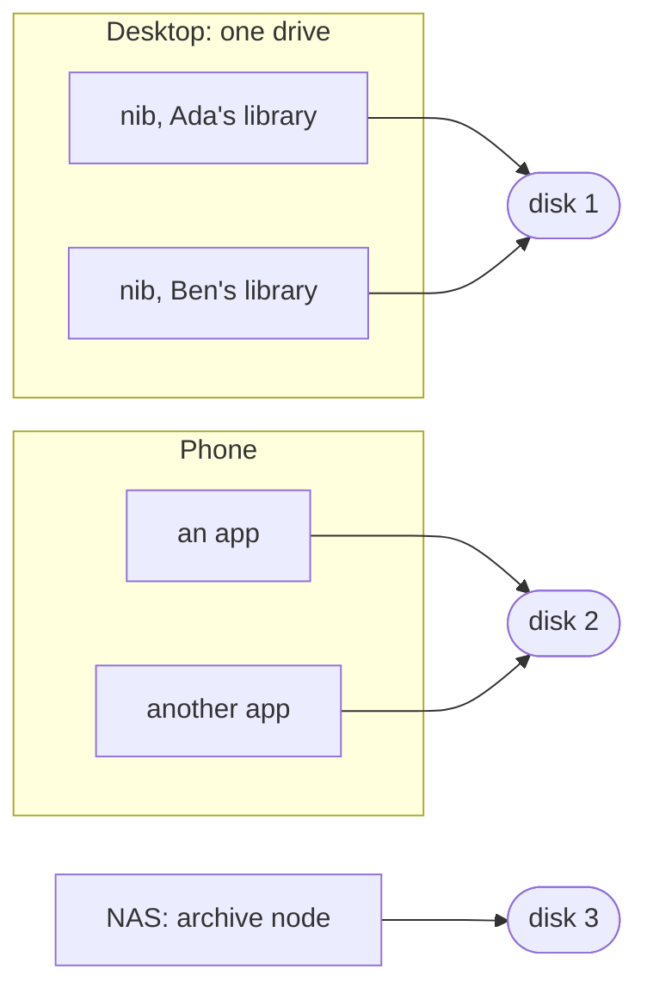
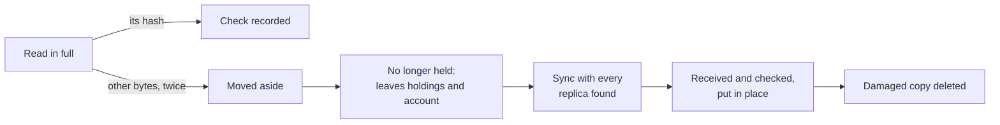
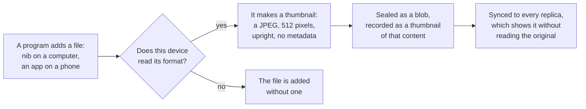
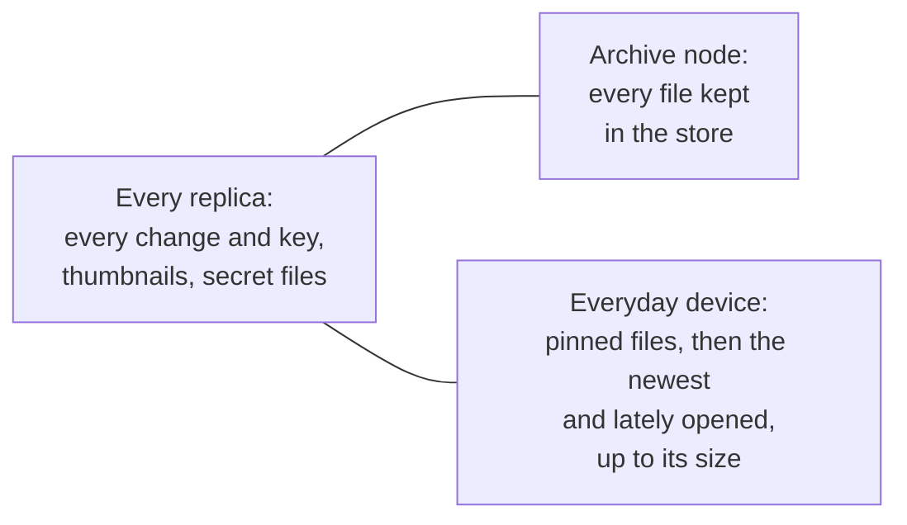
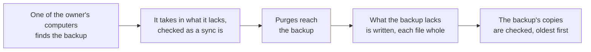
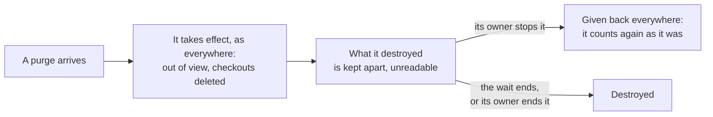
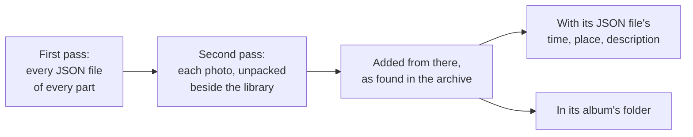
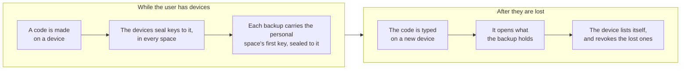
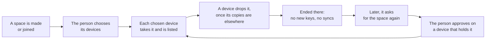
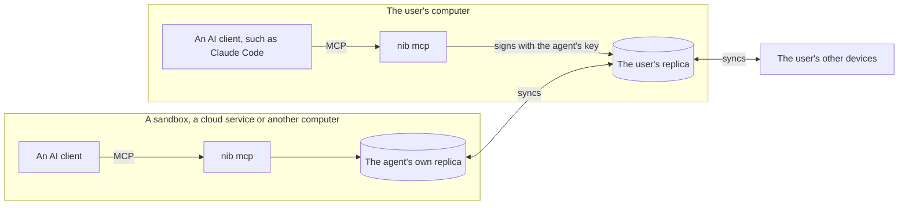

# Technical design

This page holds the technical design that NibKeep has settled on, with the reasons in brief. Formats are specified precisely in the [specifications](spec/README.md); this page says what was chosen and why. What NibKeep is for, and its concepts, are in the [design guidelines](Design.md); what is missing or imperfect in [Known limits](Known-limits.md); and what comes next in the [development plan](Plan.md).

A decision is changed here, in place, with its reasons; the history of the page keeps the older ones. A decision that needs discussion first is talked through, then written here. The formats are at version 1: a format changes only by a new version, which every later version of NibKeep reads. What came before version 1, and how versions are numbered, is in [the plan](Plan.md#version-1-of-the-formats).

## 1. Code layout

- **Crates when needed.** The workspace follows the crate map of the [development plan](Plan.md#2-from-layers-to-crates). A crate is made when a phase first needs it. Libraries live in `crates/` and are named `nibkeep-*`. The crate `nibkeep` itself holds no code of its own: it gives the engine and the crates of its API one name. `nib` is taken on crates.io, so the command line is no crate of that name. Apps live in `apps/`: the command line is the package `nibkeep-cli`, in `apps/nib`, with the binaries `nib` and `nibsync`.
- **Dependencies point down.** The crates without I/O (`nibkeep-base`, `nibkeep-time`, `nibkeep-crypto`, `nibkeep-model`, `nibkeep-governance`, `nibkeep-log`, `nibkeep-std` and `nibkeep-sync`) touch no disk, network or system clock, and take randomness and time from their caller. They test quickly and deterministically, and build for phones. A boundary that turns out wrong is changed on purpose, not quietly.
- **Apps use only the engine's public API,** that of `nibkeep-node`, which the crate `nibkeep` gives at its root, with the crates whose types that API speaks in as its modules, so that an app could become a plugin ([P8](Design.md#p8-no-privileged-plugins)).
- **`unsafe` is forbidden in the workspace,** with a few crates as marked exceptions: `nibkeep-sqlite-vfs` (the calls SQLite makes into the encrypting VFS), `nibkeep-bonjour` (Apple's DNS-SD), `nibkeep-drives` (Windows' calls that read a drive's partition table), `nibkeep-end-to-end` (process groups and jobs), and `nibkeep-generate` (the one call with which `nibkeep-bench` asks Windows for its peak memory). Such a crate states the workspace's lints itself without the ban, and every `unsafe` block says why it is sound.
- **Fakes** that tests of several crates share are in `nibkeep-testkit`.
- **Published packages** are all but the tools of the tests and benchmarks: `nibkeep-testkit`, `nibkeep-generate` and `nibkeep-end-to-end`. Each published package carries the two licenses as copies of the workspace's, since Cargo packs only what is in a package's own folder, and names the others by version beside their path; a test of the scripts keeps both true.
- **Trees stay in `nibkeep-node`,** whose purges must reach their copies in every program. They may move into a crate of their own once the engine keeps a record of every plain copy NibKeep writes, which purges act on, so it needs to know nothing of trees.

## 2. Encoding, identifiers and hashes

- **A codec of NibKeep's own** for a subset of CBOR, in `nibkeep-base`: integers, byte and text strings, arrays, maps with integer or text keys, decimal fractions (tag 4), UUIDs, `true`, `false` and `null`. It writes RFC 8949's core deterministic encoding and rejects every other encoding when reading. Hashes and signatures need exactly one encoding per value. General CBOR crates accept non-canonical input, and `dcbor` brought features NibKeep does not need, a pre-1.0 API and a license outside the allowed list. The codec has no dependencies, is tested against RFC 8949's examples, an independent decoder and a property test, and is fuzzed.
- **No floating point.** Decimals keep their exact digits instead.
- **Every structure has a JSON form,** defined with it. JSON is never hashed or signed ([Encoding](spec/encoding.md#4-json)).
- **Identifiers are UUIDv4,** made from 16 random bytes that the caller supplies, so that nothing below the engine reads the system's random number generator. UUIDv7 would sort better in databases, but every ID would reveal when its entity was made, which the signed history records more reliably, and a photo from 1975 would carry the date of its import. A device maps IDs to compact numbers in its own database instead, as the state file does with entities. Each kind of identifier is a Rust type of its own.
- **Hashes are BLAKE3,** tagged with their algorithm from day one, as multihashes in binary and `blake3:` with hexadecimal in text; Git's long migration from SHA-1 shows the cost of not tagging. BLAKE3 won over SHA-256 for verified streaming: a device can fetch and check any range of a file, so a video plays before it has fully arrived. A blob's hash is its identity whatever its storage policy, since two algorithms would give one file two IDs. Exports include SHA-256 sums, so files can be checked with standard tools. Data with an unknown algorithm is rejected until support is added.

## 3. Time

- **EDTF levels 0 and 1, implemented by NibKeep** in `nibkeep-time`, together with the rules of time travel, which EDTF leaves open ([Time](spec/time.md)). Level 2 comes when someone needs it.
- **Seasons** are the meteorological seasons of the northern hemisphere. Southern seasons are off by half a year, a known limit.
- **A qualified date** (`~`, `?`) widens its range by one unit of its precision on each side, and is never certain. A date with a time of day means the date as written, whatever its time zone.
- **Time travel** answers "yes", "uncertain" or "no" for every date, and "date unknown" for a fact without one.
- **System time is a hybrid logical clock.** Timestamps never go backwards, respect cause and effect, and stay close to wall-clock time, so "as of" a date means what people expect. A device refuses a change dated more than ten minutes ahead of its own clock, until its clock catches up.

## 4. Cryptography

- **Libraries:** the RustCrypto and dalek crates, with `hpke` and X-Wing. They are pure Rust, build for every target, and are maintained together. `cargo deny` watches them for advisories.
- **Envelopes** use XChaCha20-Poly1305. Its 24-byte nonces can be random, so devices encrypt with a shared key without coordinating, and it is fast and constant-time in software on every processor. AES-256-GCM's 12-byte nonces are too short to pick at random over a space key's lifetime.
- **Databases that stay on one device,** the state file ([section 7.5](#75-the-state-file)) and the sync role's `sync.sqlite`, use XAES-256-GCM: they are read page by page, where AES instructions make it two to three times faster. Everything that travels between devices stays XChaCha20-Poly1305, since some devices, such as a Raspberry Pi 3B, have no AES instructions.
- **Keys travel with HPKE** in base mode, with X-Wing, HKDF-SHA256 and ChaCha20-Poly1305, the suite of age's post-quantum recipients. Recorded traffic stays confidential against a future quantum computer. A public key for sealing is 1,216 bytes, a sealed key about 1.2 KB, which is fine for rare events such as pairing and rotation.
- **Signatures are Ed25519,** verified strictly, over a context and the message. A post-quantum signature (ML-DSA-65, 3,309 bytes) on every change would cost far more than it protects: a signature forged in the future reveals nothing recorded today. Suite numbers leave room for ML-DSA, and for P-256, which secure hardware supports.
- **Passphrases** go through Argon2id with RFC 9106's parameters, after normalization to NFC. Keys for separate purposes are derived with BLAKE3.
- **Randomness** comes from the caller, as a random number generator, so tests run with fixed seeds.

The formats are in the [cryptography specification](spec/crypto.md).

## 5. Data model

### 5.1 Statements and operations

- **Every value is a statement:** a random ID, the entity, the field, the value and its qualifiers. Qualifiers map field names to values, as in Wikidata, and say such things as when a value was true and where it came from.
- **Two operations change data.** An assertion adds a statement and names the statements it supersedes; a retraction supersedes statements without adding one. The current statements are those asserted and not superseded. Concurrent writes do not supersede each other, so both values stay until a person chooses, and no clock is needed to notice them.
- **Replicas converge by construction:** the current state is a function of the set of operations, and a past state is the same function over fewer of them.
- **Names are global and namespaced,** such as `org.nibkeep.name`, so types combine like traits and share fields. Fields named `org.nibkeep.` are defined by NibKeep alone; definitions of them by apps or spaces are passed over.
- **Values carry their kind.** Values of a kind an app does not know are kept unchanged.
- **An entity's types, its deletion and its merge** into another entity are statements on reserved fields, so they sync and keep history like the rest. A merge is a redirect, so links keep working, and loops of merges resolve alike everywhere.
- **Types never remove data.** They list optional fields with a kind and a multiplicity (one value, many, or the last writer wins), and mark fields secret and roles.
- **The cost** is a statement ID and qualifiers per value, and a header, signature and key per change: about 6 KB per entity on disk with its history and indexes.

### 5.2 Types in a space

- **A type that a space defines** is an entity of the type `org.nibkeep.type-definition`, named in `org.nibkeep.type-name`. Each of its fields is an entity of the type `org.nibkeep.field-definition`, linked to the type by `org.nibkeep.field-of`, with its name, its kind, and where they differ from the defaults, its multiplicity, secrecy and role. So two devices that add fields at once both add them, and types keep history and sync.
- **Standard names are the vocabulary's alone.** `nib type add` defines no type or field whose name starts with `std.` that the vocabulary does not give, so that a field that a later version adds to a standard type never meets another kind of it in a space, which would keep that version from adding the type's new fields there. A person adds fields of their own to a standard type, and a type of theirs may list a standard field, as the vocabulary defines it.
- **Definitions have derived IDs,** computed from the type's name and what each statement says, the same in every space. Two devices that install a type at once write one definition, and a library made anew from its export, whose `nib init` installs the standard vocabulary again, does not define its types twice. An ID that the space knows already, as after a person deleted part of a definition, is drawn at random instead, as for migrations ([5.7](#57-migrations)). An export of a library whose definitions took random IDs adds to the importing space's own definitions what they lack, rather than a second copy.
- **Deleting a type** of the space's own deletes its definitions, as any entity is deleted: hidden and kept, so the space's types leave it out, with the fields that only it lists, until it is restored whole (`Library::delete_type`, `deleted_types`, `restore_type`). Deleted definitions are found by reading the space's entities, as deleted entities are listed, since the index of values leaves deleted entities out. A type is deleted only once no entity that is not deleted has it, so that no entity is left with a type that no definition makes. A standard type is not deleted, as the vocabulary installs it again, nor one that NibKeep or an app defines in code, and an AI agent deletes and restores none, as definitions are the library's records ([section 14](#14-ai-agents)). Weighed and not taken: leaving entities with the type, which restoring would bring back exactly, but which kept the type in every count and list as an unknown one.
- **The types of a space** are those that NibKeep and apps define in code, combined with those the space defines. Definitions of one type combine into the union of their fields; definitions of one field combine so that the most careful counts. Types defined in code are never stored.
- **Labels** say how a type or field is shown: text in a language, at most one per language, kept in the definition. Apps show the label that best matches the reader's languages, and the name only when there is none. Defining a type adds labels only in languages it has none in, and never replaces one. The standard vocabulary labels its types and fields in English, and titles in English the types whose entities have no names, such as a portrayal, which apps fill with its participants' names. Entities that define types are never found by search.
- **What is secret is the space's decision,** not one type's: an app asks the library which fields are secret. Marking a field secret later protects only the values written after. NibKeep's structural fields can never be secret.

### 5.3 Decimals, quantities and names

- **Decimal** is a kind: a decimal fraction with the precision it was entered with, so 1.80 m and 1.8 m are different values.
- **Quantity** is a kind: a decimal with a unit in UCUM's case-sensitive codes, such as `kg` or `[lb_av]`. It is stored as entered and converted only to be shown, rounded to the reading's significant digits, so every app shows the same. A field definition can name a unit, which says what it measures and how to show it; a value in a unit of another dimension is kept and flagged. The model stores only the codes; apps bring a UCUM table.
- **Compound measurements,** such as blood pressure, are entities of their own that a field refers to. Dense sensor data stays in files. Derived values, such as a body mass index, are computed when shown, never stored.
- **Name** is a kind, with parts: `full`, which apps show and every name has, and for people given and family names, additional names such as patronymics, a prefix and a suffix. `org.nibkeep.name` holds the name of every entity that has one, people, cities, companies, devices and spaces alike, one name at a time, in as many forms as needed. Aliases that are not spellings of the name, such as nicknames, need fields of their own; pen names are agents of their own.
- **A field whose name ends in `.name` or `.title`** can name an entity that has no `org.nibkeep.name`. Importers avoid such names for fields that do not name the record.

### 5.4 Values that change over time

A value holds until the next one: an employer and a dog's weight are recorded and shown alike. There is no separate mechanism for measurements.

- **The form of the date decides.** A value dated with an interval is a *state*, shown while the interval holds. A value dated with a single date, or a date and time, is an *event*, shown from the moment it happened.
- **In a field with one value,** each value shows from its start until the next value starts, and a state no longer than its interval. Values are ordered by their starts as written: a date from the beginning of its first day, a date and time at that time whatever its offset. The order is total and the same on every device; only values with the same start compete. A value without a valid time comes before every dated one, and one written without a valid time into a field with dated values gets a date. Identical current statements show as one.
- **In a field with many values,** each value shows by its own valid time, and the one that started later shows first unless another is marked preferred.
- **Three kinds of edit.** A change in the world adds a dated value and supersedes nothing, so offline devices never conflict over ending the previous value. A correction sets the field: it supersedes what the writer's app showed, and the new value keeps the valid time of what it replaces, or gets the moment it was set. A wrong value in the past is corrected by superseding that statement alone.

The rules are in the [data model specification](spec/model.md#6-current-values).

### 5.5 Languages, scripts and forms

- **A language qualifier on each value,** `org.nibkeep.language`, with a BCP 47 tag, so a language can describe any value, recordings included. A value without one is in an unknown language.
- **Forms of one value,** such as one name in several scripts, name the first form's statement in an `org.nibkeep.alternative` qualifier. Adding a form changes nothing already there, forms from two offline devices add up, and forms count as one value: they never compete, share one place in time, and show in the form that suits the reader.
- **Transformed text** is tagged with RFC 6497's extension, such as `uk-Latn-t-uk` for a transliteration and `en-t-ru-t0-und` for a machine translation.
- **Readers rank languages and scripts** as RFC 4647 ranges, with likely scripts added from CLDR. Apps choose by extended filtering, then the preferred form, and show something rather than nothing. A machine translation never comes before what a person wrote, unless the reader cannot read it.
- **Translation only on request:** on screen, never stored, or stored when a person asks, as a form marked as a machine translation.
- **Search indexes every form,** so a person is found by any spelling of their name, and an entity by its former names.

### 5.6 Users and the people in the data

- **A user** has devices, belongs to spaces and signs changes through its devices. **A person** is an entity in the data, and most people in the data never use NibKeep.
- **Each space a user belongs to** holds a record of the user, readable by every member, with the user's name and, in `org.nibkeep.linked-person`, the person the user is in that space. In the personal space the user alone writes it; in a shared space, the link holds when an admin's statement and the user's own agree.
- **A new library** makes a user, its device, its personal space and a person linked to the user. An export imported into it links the user to the person of the export's user instead, and deletes the person it made, while that one holds only its name ([Export](spec/export.md#7-importing)).
- **History names** the person linked to the user in that space, in the reader's best form, or else the user. Changes by an AI agent show as the user's through the AI agent, such as "Ada, through Claude".
- **Words.** *Agent* keeps its meaning from the provenance standards: a person, group or pen name in the data. Software is always an *AI agent*.

### 5.7 Migrations

- **A migration moves statements to a newer shape** of a type: to new fields, or to new entities, such as a book's publication date to its edition. Once real data is in, every change to the standard vocabulary beyond a new field reaches existing spaces this way. A field never changes its meaning: a new meaning takes a new name, as in the AT Protocol's Lexicon. A migration never changes once released either: one that does something else takes another name.
- **Ordinary changes.** A migration's changes count by roles as any other's do: in a shared space, editors' and admins' devices migrate, and a viewer's reads the old shape until one of them does. The one rule of the log it brings is that an AI agent writes no note of a migration, below.
- **IDs derived from what it replaces.** A statement it writes takes its ID from the space, the migration's name, the statements it replaces and its place among what it writes from them; an entity it makes, from the entity it is made for and a label. So devices that run it at once write one statement, which counts once, and make one edition rather than two. An ID never hashes what a statement says: a secret statement's ID is in its change's header, which relays read, and a password hashed into it could be guessed offline. Derived from the replaced IDs, the ID of any old statement's copy is known to every device, which the code that runs migrations needs to carry a correction made meanwhile over to the new shape.
- **What it writes depends on its inputs alone,** in a fixed order, so that devices write the same statement under each ID: an entity it writes to is derived, never searched for. Forms of one value keep their group, as a correction does. Of a field whose last writer wins it writes only the value shown, as every copy is recorded at the migration's time, and copies would tie.
- **Two changes may assert one statement.** It counts from the earliest, and a purge takes every change that asserted it, which the state records; a secret statement sealed twice opens as the earliest seals it, a device keeps the record key of each sealing, as the earliest may arrive last, and a purge destroys every record key of it. So a value that two members' devices migrated at once is purged through both changes, which only an admin may do, as for a value another member wrote.
- **A note, not proof.** Each value it writes names the migration and the statements it replaced, in `org.nibkeep.migrated-from`. History names the device that ran it, as for purges and moves, and can show the note. Values compare without it, so a migrated copy and the same value typed again stay one. Older engines would compare with it, which is why it came before version 1. An AI agent writes none, as for a move's note. A purge of a migrated value is to follow the note to the statements it replaced, which hold the value in its old shape: otherwise a purged password would stay in the history of its old field.
- **Predictable IDs** let a device that may write an entity plant a retraction, or another statement, under an ID that a migration will write. That is no more than editing the value, and history shows it; a migrating device that finds the ID taken while the statements it replaces are current writes under a random ID.

The rules are in the [data model specification](spec/model.md#12-migrations).

## 6. The log

### 6.1 Changes

- **Changes form a graph,** as in Git and Automerge. Each change names the changes its author had seen last, and is identified by the BLAKE3 hash of its encoding. A replica that holds a change holds everything it builds on. A space has one root: a second change without parents is rejected.
- **The header is signed and readable.** Each change is signed by its author's replica. Relays and replicas without the keys check signatures and order, and see who wrote when, how changes depend on each other, and their sizes, but not their content.
- **Each change has a key of its own.** Its payload is sealed with a random *change key*, wrapped with a key derived from the space key. Neither the sealed payload nor the wrapped key is part of the signed change: they are stored beside it and travel with it, so a purge can delete them while the change, and every hash that names it, stays.
- **The header commits to what is sealed:** the hash of the sealed payload, the hash of the change key, and for each secret statement, its ID and the hash of its record key. Envelopes do not commit to their key, so without these hashes one payload could open to different contents under two keys given to different devices. A payload or key that does not match its hash is dropped, and the replica waits for the right one.
- **Secret values are sealed again,** each with a record key of its own wrapped with the space's secrets key. Replicas without the secrets key store and pass them on unread.
- **Timestamps** are hybrid logical clock times later than the parents', so the changes up to any time form a state the space really had. They are the authors' claims: a member can backdate a change, though not before what it builds on.
- **A change that governs the space says so in its header.** Governing changes set members, roles, replicas and keys, hold nothing else, and are never purged.
- **Cost:** about 250 bytes per change for its signature, key and hashes.

### 6.2 One entity per change

- **Every change is about one entity.** Its assertions are statements of that entity, and its retractions supersede statements of that entity, or statements its assertions replace. An action on many entities is a change for each, saved in one batch. So a purge of one entity takes only its own changes, and the other files of a commit, or the other photos of a move, keep their history as their authors wrote it.
- **Three kinds are exempt:** governing changes; purges, which state again what they purge around; and definitions of types with their fields, which go together, so a new space's standard vocabulary is one change.
- **The engine keeps the rule.** It saves what a program asks it to write as a change per entity, in the order each entity first comes, definitions first, in one batch, all or none. Content that the write's own definitions make secret, unsealed, is refused before anything is saved. No replica can check another's changes, whose payloads are sealed; a writer that breaks the rule only makes purges of its changes state more again.
- **The price:** about 330 bytes per extra change, and an action on many entities reaches other devices change by change, so it can show half done while it syncs. Nothing makes such an action all or nothing; a tree's commit waits for all its parts. Parts within one change were considered and rejected: two units of the log, and rules that three reviews could not settle.

### 6.3 Accepting changes

- **Accepting depends on the header alone:** its form, space, signature, key epoch, time, parents and purges. Its operations apply once its payload and key are there; until then, and for good once purged, it adds nothing. A payload that opens but has the wrong form is ignored. Whatever order changes, payloads and keys arrive in, every replica decides the same.
- **A change waits for its parents.** Replicas limit how many changes may wait, and remember changes that can never be accepted.
- **A change by a key that no governing change lists is refused** until one does, so keys nobody added cannot fill a replica.
- **Opening a space does not check every signature again.** The log file tags each change under the replica's storage key when it stores it, and every read of a change checks the tag. `nib verify` reads every signature.

### 6.4 Purging

Purging destroys keys, so every copy, on every device and in every backup, becomes unreadable once it learns of the purge. History cannot be rewritten as Git does: changes are signed and live on devices that may be offline for weeks. Any value can be purged, whether or not its field was marked secret.

- **What a purge names is in its signed header:** the changes whose keys and payloads it destroys, the secret statements whose record keys it destroys, and the sealed hashes of blobs whose keys it destroys. Every replica acts on it, a relay without keys too, and it stays in force even if the purging change is purged later.
- **A purge reaches only its ancestors:** the changes it names must be ancestors, and the secret statements sealed in ancestors, which every replica checks from headers; one that names others is rejected for good. Blobs may be named freely.
- **Purging a value** purges every change that asserted it: `nib purge` finds every such change it can see. A copy asserted concurrently somewhere that had not seen the purge needs a further purge, which `nib purge` offers when it arrives.
- **A secret value** is purged through its record key alone.
- **Restating.** The purging change states again what else the purged changes held, with the same statement IDs, and states as retractions what they replaced of values that stay, so those stay replaced. For which value is current, a restated value counts from the time of the change it came from, so a purge never changes what is current. In history it appears from the purge on, written by whoever purged, with a note: nothing proves what the purged change held, so a purge cannot forge the past, and restating gives no power beyond an ordinary edit. A purge holds nothing but what it restates.
- **Each author's changes are purged apart,** so that a purge takes no right from the authors of what it purges, except a purge of content, which must take every value that holds the content at once. An editor whose member signed every change a purge purges may purge that purge too.
- **What is left** is the purged change's header, as Git keeps a skeleton: its author, time, parents and hashes. That a change was purged, and by which change, stays visible.
- **Derived data follows.** The state file is written anew under a new key, so nothing purged can be read from it; the cost grows with the log, by design (1.5 seconds for 31,681 changes on a desktop). The log file relies on SQLite's secure deletion and a checkpoint that truncates its write-ahead log.
- **Who may purge** is decided by role ([section 13.4](#134-what-counts)), with a fresh confirmation.
- **Copies that wait.** An archive node or a backup keeps what a purge destroys apart for a while, 30 days by default, so that no mistake or infected device wipes data everywhere at once; meanwhile its owner can stop the purge, by a change that *restores* what it destroyed, which then counts again as it was ([9.11](#911-copies-that-wait)).

The rules are in the [log specification](spec/log.md#7-purging-values).

### 6.5 Which changes count

Every replica must decide alike which changes count, from governing changes, whatever order they arrive in.

- **Listing.** A space's first change governs it and lists its author. Every other governing change counts only if its author's key is listed by a counting governing change before it, and an ordinary change only if its author's key is listed by one. In every space, the personal one too, a key is listed only by its own signed listing, on a record derived from the space and the key ([13.3](#133-members-roles-and-who-is-who)). Who the replicas are, their keys and the keys sealed to them come from what counting governing changes assert, never from the state, which ordinary changes write to as well.
- **Setting aside.** A change that does not count is *set aside*: kept and passed on, but its operations are not applied and its header purges nothing. If it was applied before, the state is built again without it, and what its purges destroyed is no longer marked purged, so it comes back from replicas that never applied it.
- **Accepting.** An ordinary set-aside change can be accepted after review, by a counting `org.nibkeep.accepted` statement, and then counts with its own author and time. A governing change is never accepted, so accepting a lost device's changes cannot bring back what it governed.
- **Undecided cases,** such as rings of three or more replicas that revoke each other, count for nothing.
- **Room for later rules.** A governing change may state a field whose name starts with `org.nibkeep.` and that the version does not know: it keeps the statement, with no effect, and in a space with members needs an admin for it, as for an operation of a kind it does not know. So a governing field that a later version adds leaves older engines taking in the rest of each change, revocations included. A field the version knows, which may hold data, never stands in a governing change, as that is never purged. The version knows each field of NibKeep's own that its programs define, which a test checks. Those fields are fixed at version 1: a field that a later version adds, even one that holds data, is kept in a governing change as an unknown one is, or older and newer engines would decide such a change differently.
- **Holes, decided before version 1.** Each known hole in which changes count was weighed: does its fix need a rule of the log ([Known limits](Known-limits.md#2-trade-offs-we-accept))? Four do, and are built:
  - one rule of listing in every space, the personal space too, built ([13.3](#133-members-roles-and-who-is-who));
  - plain writes to a field secret for good, which count only where the field's mark builds on them, built ([section 12](#12-secrets));
  - governing statements that a version does not know, kept with no effect, so that a later version can add governing fields, built (below);
  - every governing change wrapped with the space's first key, and one wrapped with another refused, so that every replica reads every governing change it holds, built ([section 11](#11-revocation-and-new-keys)).

  The others need no rule. Engines can settle two secrets set up at once, a space's entry with a wrong first key, and a space lost with the device that made it; a later version can do that. These are accepted, as a fix would cost more than it saves: conflicting statements of a key's number; what a trusted replica wrote before its revocation; a secret statement's hidden entity; the personal space's equal replicas; claims that members who conspire date back; groups that hold each other; and a removed member's changes that build on none of the removal, set aside for review.

Revocations, roles and AI agents add their own rules to this, in sections [11](#11-revocation-and-new-keys), [13](#13-sharing) and [14](#14-ai-agents).

### 6.6 Ordered lists and long text

- **An ordered list** keeps each item's position on its membership, as a fractional key in a field whose last writer wins, as in Kleppmann's work on moving list elements and in Figma. Moving one item never loses or duplicates it, and no list library is needed. Items inserted at one place at once on two devices may interleave, which lists ordered by hand can bear.
- **Long text** waits until notes need it. A CRDT library, such as Loro, Automerge or Yjs, is chosen then.

## 7. A device's library

### 7.1 Library folders and replicas

- **A library is a folder,** and NibKeep keeps its data in the folder's `.nib`, as Git keeps `.git`. The rest of the folder is the person's, and `nib file add` takes those files like any others, never what is in `.nib`.
- **`nib init`, where it finds no library,** in the folders upwards or named by `--library` or `NIBKEEP_LIBRARY`, makes the current folder a library, or the one `--library` names, as `nib init --join`, `nib recovery from-copy` and `nib recovery restore` do in their ways. So does an argument that only a new library takes, such as `--name` or `--passphrase`, wherever it is run. It refuses a folder inside a `.nib`, also through a link. In a library, `nib init` makes a folder a tree instead ([section 15](#15-trees)): one command never does both.
- **The user is named after the account,** as `whoami` prints it, and the person linked to the user after the full name that the system holds for the account, if it holds one that differs; the user goes by the person's name. `--name` names both. A person can rename either later, as both are entities like any other.
- **Other commands find the library** by `--library`, else the nearest folder upwards whose `.nib` holds a library, or is a file that names the library of the tree in that folder ([section 15](#15-trees)), else the one `NIBKEEP_LIBRARY` names in full, or fail and say how to start one. There is no default library: a library that commands used without naming or finding it would be out of sight, and a command typed in the wrong folder would change it unnoticed. `NIBKEEP_LIBRARY` counts only outside every library's folder, and `nib init` reads it only to make a tree in that library: it never makes a library there. `nib status` names the library's folder. The search goes up to the root, as Git's does ([Known limits](Known-limits.md#rules-and-behaviour) says what that means on a shared computer).
- **A `.nib` keeps each replica in `replicas/<random name>/`:** its place file, key file (`keys.cbor`), library file (`library.cbor`, which names the user, the device and the personal space, and holds identifiers, not secrets) and spaces. A new replica's folder is made under a temporary name and renamed into place. Opening uses the replica that is *here* ([section 7.2](#72-copies-of-a-replica)) and passes over the others, which are copies.
- **The engine keeps a library in the directory it is given.** `nib` gives it a folder's `.nib`; apps on phones give it a folder of their own.
- **Paths are full paths** as the file system resolves them, for origins and checkouts alike. A library folder that moves leaves their records behind, and `nib status` shows them as gone.

The layout is in the [storage specification](spec/storage.md#1-layout).

### 7.2 Copies of a replica

Whatever copies a replica's folder makes a second copy with its keys: a system's backup restored onto a new disk, a folder copied by hand, a program that syncs folders between computers, or a cloned virtual machine. Two copies sign with one key and announce one endpoint, so history cannot tell them apart, revoking one revokes both, and they never sync with each other. Copies are caught when they open, before they write.

- **A place file** records where a replica is. It is written first, when the replica is made, and never again. It holds the drive's serial, the folder's ID on its file system, which a move keeps and a copy does not, the folder's path from the drive's mount point, by which a replica is placed where folder IDs do not last, as on FAT and exFAT, and there the volume's UUID as macOS makes it, since macOS lets no program read a drive's serial. A library made on a Mac on a FAT stick records that UUID alone, which Windows does not make, and one made on Windows the serial alone, so the other system tells sticks apart by path. A folder moved on FAT keeps its recorded path, so a copy put later at that path counts as the replica. On the drive the system runs from, it also holds the computer's ID, so computers cloned from one image do not take each other's replicas. All but the path are kept as hashes keyed with a salt in the file; the path is kept as text. The check needs no key, so it runs before anything is unlocked.
- **A replica is here** when its drive and folder match, or on FAT and exFAT, when its recorded path leads to this folder or to nothing any more. A value that either side could not read is not compared. A replica on a USB stick, or on a data drive moved into a new computer, stays the same replica.
- **On a phone,** an app's folder records the phone's ID alone, kept where no backup takes it: on Android, a keyed hash made with a key of Android's keystore; on iOS, a keychain item of this device only, shared by the apps and extensions that share the folder.
- **Nothing writes to a copy.** It is never opened, as SQLite writes even to read, never on the network, and never deleted, moved or renamed, as a program that syncs folders would do the same to the original. A replica's folder without a readable place file may still be arriving, and is never offered for removal. `nib` says how much room a copy takes; the person deletes it.
- **A copy helps a new device start** (`nib recovery from-copy`). When the person asks, another device adds this computer by pairing, and the new replica takes in what the copy holds, read from a private copy of its databases, defensively and checked as a sync is, and takes the copy's secrets if they open here. It then offers to revoke the copy's device, if the person says it is gone. Only where no other device can add this computer does the copy's own key, from a private copy, add the new device, which takes the spaces that the copy holds, and asks before it takes a space given to it later where the copy did ([13.10](#1310-devices-that-choose-their-spaces)), then revokes the copy's device.
- **A program that syncs `.nib`** between computers makes each find the other's replica as a copy and leave it alone, since each computer writes only its own replica's folder. `nib` says once what such a program costs: every key file on every computer and at its provider, and deletions and restored versions reaching every computer.
- **Not caught:** a drive cloned block by block, a snapshot mounted beside its file system, computers cloned with their drives and IDs, and on FAT, a folder moved and then copied before either was opened. This is no guard against theft: revoking the device is.
- **Checkouts and copies.** A replica on a removable drive records its checkouts as on the computer that wrote them, so they show as gone elsewhere. Once a copy's device is revoked, purges no longer delete its checkouts on this computer.

The place file is specified in [Storage](spec/storage.md#1-layout).

### 7.3 Where a replica may live

- **Not on a network drive.** SQLite's write-ahead log does not work across computers, so a replica is neither made nor opened on a file system the system reports as remote.
- **Not in a cloud drive's folder** where the system may leave a file's content in the cloud until it is opened, as with OneDrive, iCloud Drive and Google Drive.
- **On FAT, exFAT or ext2 only when asked.** These keep no journal, and a stick pulled out while a library writes can damage files later, unseen until read: a trial with power cuts on exFAT had one blob overwritten two cuts later. With the guard below, 60 cuts under a tree with secret files on an exFAT stick lost nothing: the drive's check fixed SQLite's write-ahead logs after about half of them, with clusters allocated past their ends, and the libraries were sound after. `nib init --allow-fat` (also with `--join` and `--from-copy`) allows it for that library and writes `fat-allowed`. Such a replica is guarded: while it is open, its folder holds `in-use`, with locks on `in-use.lock` and `in-use.gate`. A program that finds `in-use` while nobody holds the lock opens nothing, asks for nothing, and says which check of the drive to run. After the check, `nib verify --drive-checked` verifies the whole replica. The guard sees a removal only while the replica was open, and not a volume made dirty by another program; a program stopped by a crash leaves the mark too, and the check then finds nothing, which is harmless. NTFS, ext3, ext4, Btrfs, XFS, ZFS, F2FS and APFS are allowed.
- **On a removable drive,** a replica moves with the drive between computers. A key in a keystore stays on the computer that made it, so such a replica opens elsewhere only with a passphrase, and says so. Phones keep their replicas in an app's own folder.
- **Not in Android's backups or transfers.** A restored copy is the old phone's replica again, and the key file in a backup is open to guessing. `android:allowBackup="false"`, and data extraction rules that exclude every domain, keep an app's data out; temporary copies of secret files live in the cache folder. A new phone starts empty and pairs. On iOS, an app's folder is kept out of iCloud's and the computer's backups.

### 7.4 The log file

- **SQLite, through rusqlite,** built from source so every platform runs the same version. It is proven, supported through 2050, and a recommended storage format of the US Library of Congress.
- **One log file per space.** It holds what the log's formats define (encoded changes, sealed payloads and wrapped keys) and, outside the history, the latest pages of the replicas' accounts and what this device alone knows: its checks, when it last opened each file, and what it keeps apart while a purge waits. Any SQLite reader can extract them ([P3](Design.md#p3-your-data-outlives-nibkeep)). It is not encrypted page by page, since what it holds is encrypted already.
- **Write-ahead logging with full synchronization,** so a change is on disk when saving it returns, except inside a batch, where the batch's end is.
- **Secure deletion,** and a checkpoint that truncates the write-ahead log after a purge, so no copy of a destroyed key stays in the files. Copies that the disk keeps on its own, such as old blocks under wear levelling, are out of reach; disk encryption covers them.
- **Turso was tried and rejected:** its crate for Rust programs always compiles C, it refused `DELETE` on the tables the log file uses, it ignored `secure_delete` silently, and it was slower. Trying it again means the same checks: a build with a C compiler that always fails, the log file's statements, and the benchmarks.

### 7.5 The state file

Nothing derived is authoritative: derived data is stored only as a cache, checked before use, rebuilt when it does not match, and always rebuildable from the log.

- **The state and the search index live on disk,** in the *state file* beside each log file, and are read as needed. Memory holds the entities in use, the changes waiting for parents, and the heads, so it no longer grows with the space, and opening takes about the same time at any size. Building the state in memory took 0.9 GB and several seconds for 120,000 entities, and would not reach the design's 10 million per space.
- **The log keeps only what checking new changes needs:** headers, which form the history's graph, the heads, waiting changes and keys. Graph checks, such as whether a purge names only ancestors, are queries on the log file, helped by each change's depth, as Git's commit graph is.
- **History is a query.** Each statement keeps when it was first recorded, the change that first asserted it, and when it was superseded. The state of a past day and the author of a statement are read, not replayed.
- **Queries read what they need of many entities at once,** as each read is a round trip to SQLite.
- **The state file records how far it goes:** the sequence and tag of the last log change it covers. Opening compares them and applies only what follows. A state file that is ahead, names a change the log does not hold there, has another format version or is damaged is deleted and built again, and the space says so meanwhile.
- **It may lag behind the log.** The log file is synchronized before a change counts as saved; the state file takes in many changes per transaction, in batches and in bursts ([section 7.7](#77-saving-in-batches)). After a crash it is consistent, possibly behind, and catches up.
- **It is encrypted page by page,** with a random key of its own, wrapped with a key derived from the device's storage key, every page authenticated. Secret values are in it only sealed, opened in memory after unlocking, so locking changes nothing on disk.
- **A VFS of NibKeep's own, in Rust, under stock SQLite** encrypts it. Each page is a record of a 24-byte random nonce, the ciphertext and a 16-byte tag, in XAES-256-GCM; so is each record of its write-ahead log. Associated data names the file and the record's place, never a path, so a library can move. A header checks the key and holds the database's own random key, sealed under the key it is opened with. The VFS opens only state files and their write-ahead logs, refuses journals and temporary files, keeps temporary data in memory, and tells SQLite only what SQLite's own Unix VFS assumes: a power cut damages only what was being written. A record that fails to authenticate reads as zeros while SQLite recovers its write-ahead log, which ends the log there, and is an error anywhere else. Reading costs two to three times what it does unencrypted, which the cache pays once per page.
- **Rejected for the state file:** SQLite3 Multiple Ciphers, which worked and was fast, but has one maintainer, needs a patched rusqlite build, delays SQLite's fixes and would put the log file through its C; SQLCipher, which needs OpenSSL; `sqlite-plugin`, with unsafe defaults for a real disk; and values encrypted one by one, which cannot be searched by prefix.
- **Purging writes it anew:** once the purge is saved in the log file, the state file is deleted and made again in place, under a new key, and takes in every change. A crash in between leaves a file that still holds a purged change's operations, which opening finds by the file's record of the changes it applied, deletes and builds again.
- **Changes are checked whenever they are read** from the log file, by tag and ID. Someone who can write to the disk without the keys can put back older pages, which authenticate: the device then shows stale data until a check against the log finds it, and only that device, since only changes travel.
- **Verifying a library** builds the state again from the log and compares. A property test checks that the state file always equals the state built again.
- **Memory:** SQLite keeps 32 MiB of the state file's pages, taken as used, and up to 128 MiB while a transaction writes it, so a large batch, or building the search index anew, does not read the same pages again and again. With SQLite's default of 2 MiB, building the index for 10,007 entities took three times as long; the larger cache raised a generator's peak memory from 17 to 60 MB, and the write slowdown that once kept the default went away with bursts. Entities are numbered in the state file.

### 7.6 Search

- **Search finds what entities show,** on any day: every value that is current, including values that hold on other days, such as former names, and every form of a name. Of a field whose last writer wins, only the value written last is found.
- **Secret fields are never indexed,** even while unlocked. A login is found by its title and website, and revealing its password still asks.
- **NibKeep's structural fields,** and fields that hold keys and positions, are found by their values but not by their words.
- **Words** are compared without regard to case or accents, and the last word of a query also matches the start of a word, so results come while typing. Words split at every character that is neither a letter nor a digit, so scripts written without spaces are found only by whole runs for now.
- **A space is searched only while open,** which is while its keys are unlocked.
- **The index** keeps, for each word, the statements that hold it, and the entity each shows under. A search reads those of each whole word, rarest first, keeping the entities that hold every one. It reads those of the last word's beginning too, unless that starts more than four times as many statements as the rarest whole word holds; then it checks the words of each candidate's own statements instead, as reading a word's statement costs a fraction of checking a candidate. A search tells statements apart by their numbers in the state file, and never reads the statements themselves, whose rows hold their values.
- **A page of results costs less than all of them:** naming entities and following links take most of a search's time. `nib find` and MCP's `find` list the first 50 of each space: the same first ones as a full search, and only those are named. Entities found through links come after every entity found by its words, so links are followed only when no more than a page is found by words. Otherwise the count of the rest leaves out what links would find, and says it is a minimum: for `leviathan` in the generated library of 10,000 entities, 1,617 more.

### 7.7 Saving in batches

Whoever makes many changes at once knows it and says so. Synchronizing every change made imports slow, above all on Windows, where small writes and synchronizations of files are slow.

- **A batch** is a run of changes to one space, saved together: one transaction of each file spans it, and its end commits the log file, synchronized, then the state file. A savepoint before each change lets a refused change roll back alone, so a batch saves exactly what single changes would have saved.
- **A change in a batch is saved when the batch ends.** A crash before that loses the whole batch; a resumable importer notes its progress after a batch ends.
- **A failure of the files ends the batch:** none of it is saved, and its later changes are refused until it ends.
- **Only changes go in a batch,** made here or received, with the record keys that come with them. Purging, changes that govern, importing or receiving blobs and their keys, and opening secrets are refused while one is open. A space has one batch at a time.
- **The engine runs a closure as a batch.** Changes it made that were not refused are saved when it returns, and its error is returned.
- **A batch holds both files' write locks,** so other writers wait, up to five seconds. Batches stay short: `nib import` ends one after 1,000 entities, the generator's import of real data after 1,000 changes or a second, and a tree's commit after 1,000 parts. `nib mcp`, `nib file add` and the Takeout importer save change by change, which bursts cover.
- **Bursts.** A change made on its own within 100 ms of the last goes into the state file with it, up to 1,000 changes or a second. While another program has the space open, the changes of a burst commit one by one. The log file still synchronizes every change made on its own.
- **A sync saves what it receives in batches,** as an importer does: up to 1,000 changes and record keys or a second. A batch also ends before a change that governs, which is received alone, and before one that waiting changes wait for, which may govern; after a change that purges; before blob keys and blobs; at the end of each space; and whenever the sync is about to wait for the other device, or to send it items, so that nothing received waits on the network to be saved. A space counts as synced only once its last batch is saved. A crash loses the open batch, which the other device sends again, as every sync reconciles anew. A new replica's first sync of a library of 10,000 entities, 31,694 changes, took 45 s on the desktop while each change received synchronized the log file, and 8 s in batches.
- **A purge received in a batch** acts once the batch is saved: the files of the blobs whose keys it destroyed go, the write-ahead log is truncated, and the state file is written anew if the purge took away what it holds. A purge cannot be rolled back to its savepoint alone, as the log in memory has acted on it already, and a change that arrives may let a waiting purge count.
- **While another program has the space open,** a sync saves each item as it comes, as the changes of a burst commit one by one then: back-to-back batches would keep the other program from writing for as long as the sync lasts.
- **Not chosen:** bigger changes, as a change is what is signed, synced and purged; less synchronization, which could lose a change after saving returned.

### 7.8 Several programs on one replica

Separate apps share one replica where they can reach the same folder ([apps on one library](Design.md#611-apps-on-one-library)): two apps side by side, an app and its own extension, `nib` beside an app. iOS gives apps no channel but files, so no process can serve the others.

- **Readers together, writers in turn.** The log file uses SQLite's write-ahead log in normal locking mode. A write is a transaction that takes the write lock at once, waiting if another process holds it. A write to both files takes the log file's lock first, so two processes never wait for each other.
- **The state file** does the same through the VFS, which hands locking and shared memory to SQLite's default VFS and keeps encrypting pages itself. The shared-memory file stays unencrypted: it holds page numbers, the database's size and SQLite's non-cryptographic checksums of frames, which confirm a guess only for someone who knows the rest of every frame. It is deleted when the last connection closes, and shared memory of NibKeep's own is the way out if that ever matters.
- **Each process notices what others wrote** by SQLite's count of changes, and catches up inside its write transaction before it writes.
- **Nothing stays open while an app is suspended,** as iOS ends an app that holds a lock in a shared container: apps close their connections when they leave the foreground, and end a sync first, whose batch of what it received holds the write locks for up to a second.
- **The space lock** is held shared by every process with the space open, and exclusively to write the state file anew after a purge. A purge marks that it waits; the others close the space at their next transaction and open it again afterwards.

### 7.9 Blobs

- **NibKeep seals what it writes.** Every blob in its store is sealed with a random key of its own: imports, copies received from other devices, and derived data such as thumbnails. Only per-blob keys can be destroyed, which purging needs.
- **A sealed blob is stored and travels under the hash of its sealed bytes,** never its content hash, so a disk does not reveal which known files it holds, while a device without keys can still check its copies. The content hash travels only inside encrypted data.
- **One sealed copy per replica.** A replica keeps sealed blobs in one directory for all its spaces, and each space keeps its own wrapped key for them. Adding content that the replica holds sealed for another space wraps the key it holds for the new space, after reading the copy whole and checking its hash, never for a space that purged that sealed hash. Keys are reused only within their kind, secret or ordinary.
- **Two sealed copies of one content,** made on two devices before they synced, are both valid. A replica settles on the one with the smallest sealed hash: it fetches that one when a peer holds it, even while it holds another, and its planner then lets the larger go without proofs, as its disk keeps the content in the smaller ([9.9](#99-the-planner)). Only within one space: a copy that another space of the replica keeps a key for stays, as that space may lack the smaller's key.
- **A purge in one space** destroys that space's keys alone, and that space alone ignores the purged sealed hashes if they arrive again. A replica keeps a sealed blob while any of its spaces keeps a key for it. Before a purge, an app says which other spaces on its replica hold the same content.
- **Writing and crashes.** Each space writes new blobs through a temporary folder of its own. A purge deletes a file at once where no other space keeps a key for it, and opening the library deletes files a crash left with no key in any space.
- **What a disk shows.** A replica without a space's keys that holds two spaces sees which sealed blobs they share, which their sizes hinted at already ([7.3](Design.md#73-security-model)).
- **Viewing decrypts in memory,** a chunk at a time, so a video can start anywhere. Nothing plain is written to disk.
- **A device refuses each blob** after which its disk would have less than 1 GiB free.

The formats are in the specifications of [cryptography](spec/crypto.md#6-sealed-blobs), the [log](spec/log.md#6-blob-keys) and [storage](spec/storage.md#3-blobs).

### 7.10 Separate apps on one library

NibKeep is a platform for apps by any vendor, as a cloud drive is, with no server and typed data rather than files alone ([6.11](Design.md#611-apps-on-one-library)).

- **One replica for each container that apps can share,** such as one developer's apps on iOS, or a folder on a computer. The apps hold every key of it between them, so only apps that trust each other share one. The first app makes it, a later one finds it, and it stays while any of them is installed.
- **An app that cannot share a container keeps a replica of its own,** with the spaces the user grants it, and syncs with the others, on the same device as with another. It joins by a code from another device, or, on the same device, by a link to an app that has the library, where the user approves; both apps then show a short code to compare. A space is the finest grant: an app granted a space reads all of it but its secret values. On one iPhone, two such apps reach each other only through a folder both were given in the Files app, or through the user's other devices.
- **Keys are kept per app, or per developer,** in the platforms' keystores. What each platform allows is tried on the devices before the design relies on it.
- **Removing an app gives no notice.** Its replica's keys go with its container: they are in its key file there, and a keystore keeps at most the key that opened that file, which opens nothing without it, as on iOS, where keychain items outlive the app. The other replicas notice that it stopped syncing and ask the user: a removed app leaves the list without a change of keys, while a lost device is revoked and the keys are rotated. Its copies stop counting once they go unchecked for 8 weeks ([9.7](#97-checking-and-repair)).
- **Files reach other apps through the platform's file provider:** File Provider on iOS and macOS, DocumentsProvider on Android, cloud files on Windows. Structured data does not travel that way.
- **Engines of different versions** share replicas and sync. What travels (changes, values and types) is read by older and newer engines alike, and an older engine passes on what it does not understand. The stored files of a shared replica change only in ways that its older engines read ([storage](spec/storage.md#16-engines-of-different-versions)):
  - **One number for all the replica's stored files.** The replica's engines file holds the version of its stored files as a whole, and each program that opens it: its name, the latest version its engine reads, its engine's version, and when it last opened the replica. The one number guards every file, also those with no version of their own, such as the index of trees and the sync role's records.
  - **An older engine** reads the number before any other file but the place files. If it is later than the engine reads, the engine opens nothing, writes nothing, and asks the person to update its app.
  - **A newer engine** raises the number only once every program listed reads the new version, and before it writes any file of that version. A removed app leaves its entry, so such an engine names the programs it waits for, with when each last opened the replica, for the person to update them or say they are gone. Each file's own version still guards it from a program that opened the replica before the number changed: a log file or state file of a later version is refused, never made anew.
  - **Programs name themselves,** such as `nib` or `nibsync`, and record themselves as they open the replica, rewriting the file at most once a day, so that opening mostly reads it alone.
  - **Not chosen:** only a version for each file, which leaves the files without one unguarded, and asks a newer engine to know which version of each file every older one reads; and recording engines' versions without their programs, which would keep an old version listed after its app was updated.
  - State files are to be kept one for each version of their format, so apps of different versions do not rebuild each other's; a purge rewrites its own version's and deletes the others.
- **Not chosen:** every app opening one replica, which works only where apps can share files and gives every app every key; and one process that holds the replica for the others, which works only on computers.

Joining by a link, state files per format version and file providers are not built yet.

## 8. Keys at rest and unlocking

- **One key file per replica,** with two compartments that open separately: the *replica* compartment, with the replica's signing, decryption and storage keys and the space keys, and the *secrets* compartment, with the secrets keys and the replica's secrets decryption key ([section 12](#12-secrets)).
- **Each compartment's key** comes from a passphrase, through Argon2id, or from the platform's keystore, which holds a random compartment key. Keystores hold small secrets well, and large, changing ones poorly. The key file says which keystore service keeps a compartment's key.
- **Keystores are reached through `keyring-core`:** Keychain on macOS, Credential Manager on Windows, Secret Service on Linux. Each program picks the store when it starts; tests use its mock store, and never the real keyring of the machine they run on (`NIBKEEP_NO_KEYSTORE`).
- **The replica compartment opens when a program starts;** the secrets compartment opens each time the person confirms, and is forgotten after a timeout. A *closed* library keeps its keys unlocked, and its secrets if they were, so an app can open the library for each operation without asking again.
- **`nib init` protects the keys with the keystore,** or with a passphrase given `--passphrase` or where there is no keystore. `nib` derives the key on every command, so its passphrases use RFC 9106's low-memory parameters (64 MiB, three passes). `nib protect` changes the protection.
- **On Android,** the library's key is in the keyring store, released without a prompt. The secrets' key is kept under a service of its own, `org.nibkeep.confirmed`: an AES-256-GCM key in Android's keystore that works only after a strong biometric or the screen lock, for each use, encrypts the secrets' compartment key. A prompt in front of a key that opens anyway would guard only the screen. The prompt is Android's own, with no dialog before it, and the compartment key goes to the engine directly. Setting up, protecting anew and asking another device for the secrets ask too, so the person sees it work first. It needs Android 11 and a screen lock, or the secrets take a passphrase. Removing the screen lock destroys the key: an app says so, and once the person agrees, forgets the compartment and asks another device for the secrets, which are lost if no other device holds them.
- **On computers,** keystores release their keys to any program of the user's without asking, so the secrets' own passphrase is what asks. Windows Hello and Touch ID come later; keys made inside secure hardware come with the P-256 suite.
- **What is protected.** A stolen device without its passphrase or confirmation yields encrypted keys only. Someone who can write the key file can make unlocking slow or impossible, but changes to the protection are detected. Keys are wiped from memory that the code controls, and encoded without copies left in reallocated buffers.

The format is in the [key file specification](spec/keys.md).

## 9. Files

### 9.1 Originals and sealed copies

- **Originals stay where they are,** as they are. NibKeep records where a file was found (an *origin*: a path on a device, the modification time, the size and content hash) and sends sealed copies where the storage policy says. It never encrypts, moves or deletes an original without asking. A device keeps no sealed copy of an original it holds, unless its policy asks.
- **An origin records what it found:** its content and size. A new version changes the file, not the origin, so an original of an older version is never taken for a copy of the current one. It is named by its path and its device, as an origin has no name of its own.
- **No origin in a temporary folder.** A file in the system's temporary folder, such as an AI agent's scratch folder, is soon gone, and its path tells nothing lasting: it goes into the store, as a copy that is no original does, and no origin records where it was. A library that is itself in the temporary folder, as a test's is, records them as usual.
- **A file of a tree** is different: its identity is its ID, not its content ([section 15](#15-trees)).
- **Plain copies in the store,** as reflinks on trusted devices, are left out; a policy option could add them later.

### 9.2 Checkouts

A *checkout* is a plain copy that NibKeep writes on request: to open a file in another app, edit it, share it, or fill a folder a media server reads.

- **A checkout is an entity of the type `std.checkout`:** the file (`std.checkout-of`), the device (`std.checked-out-on`), the full path (`std.path`), and the content, size and modification time written. It syncs, so a purge deletes copies on every device. A search that matches its path finds the file.
- **`nib file checkout FILE [PATH]`** writes the current version, from the store or from an original on this device whose hash still matches. It never replaces anything. It writes a hidden temporary file beside the place, checks it against the content hash and synchronizes it, then records the checkout, and only then puts the copy in place. A crash leaves at most a stray temporary file or a record of a copy that is gone, never an unrecorded plain copy.
- **A copy is unchanged** when its hash is the recorded content. NibKeep reads and checks a copy before deleting it or recording its edits; size and modification time only say what to read. Times are recorded to the second, so an edit made in the second the copy was written, keeping its size, shows only when the copy is read.
- **`nib file checkin`** makes a copy's edits a new version, always sealed into the store, then deletes the copy and its record; `--keep` keeps it as a checkout of the new version. Recording an edit and ending a checkout are two operations of the engine, as a drive app records a version on save and ends the checkout to free space. A copy is deleted only where another copy on the device holds its content. An edit of an older version is refused unless forced.
- **`nib file add` never takes a checkout,** and `nib mcp` offers none: an AI agent does not write plain copies where it chooses.

### 9.3 Storage policies

Storage policies say how many copies a file needs, where, and whether it is kept in NibKeep's store or where it already is ([storage policies](Design.md#68-device-roles-and-storage-policies)). Which replica keeps which file is the planner's ([9.9](#99-the-planner)).

- **A policy is an entity** of the type `org.nibkeep.storage-policy`, in the space whose files it governs: a name, copies (`org.nibkeep.policy-copies`, at least 1), how many away from home (`policy-away`), how many on archive nodes (`policy-archived`), and where they are kept (`policy-kept`: `store` or `in-place`). While competing values wait for a person, the strictest counts.
- **A rule is an entity** of the type `org.nibkeep.storage-rule`, ordered by a fractional `org.nibkeep.position`, naming the policy it chooses. Its conditions must all hold: a type (`rule-type`), a field present (`rule-has`, such as `std.camera-make`), a folder on a device that holds every place the file was found (`rule-folder`, `rule-device`), a media type or its prefix, and a size. A rule without conditions chooses for every file. Conditions are fields, so rules can be built before views bring a query language.
- **Choosing.** A file's own choice (`org.nibkeep.policy`) wins; else the first rule that holds; else the store with two copies, so no file goes uncounted. The choice is worked out when needed and never stored, so a changed rule changes every file it chooses for.
- **Defaults,** installed the first time a space needs policies: Critical (3 copies, 1 away, in the store), Standard (2 copies, 1 archived, in the store) and Replaceable (1 copy, in place); rules for files from a camera (Standard), this device's downloads folder (Replaceable, one rule per device), and anything else (Standard, asking above 1 GiB). Their IDs derive from the space's ID, and the downloads rule's from the device's too, so they are never installed twice, even after deletion, and two devices that install them at once install the same entities.
- **Adding a file** chooses its policy before reading it in full, from its size, folder, media type and headers. A file kept in the store is read once into it; one kept in place is read once to hash it, and nothing is sealed. A copy kept in place counts while its size and modification time are unchanged and a check read it intact in the last 8 weeks ([9.7](#97-checking-and-repair)); the regular check, `nib verify` and exports check its hash. NibKeep never changes or deletes such a file.
- **The question about large files,** "Can you get this again?", is asked only on a terminal, and its answer adds a rule for that folder, so it is asked once per folder. The 1 GiB threshold keeps photos and most phone videos below it (a minute of 4K from an iPhone is about 170 MB) while films go above; NibKeep only asks, so a low line costs little.
- **A file kept in place that another app edits** becomes a new version of the same file when it is added again, and a moved one is found by its hash. A different file saved under the same name is not handled: only replaceable files are kept in place, and names are labels. Without a terminal, as for an AI agent, the file goes into the store, and `nib file add` names the command that adds a rule.
- **A replica that sends a file it keeps in place** to another replica seals it first.
- **Changing a policy moves nothing on its own.** `nib policy check` shows what is not met; removing a copy from the store waits for the planner, which checks first that enough copies exist right then.
- **Copies count disks,** across devices, as each replica's account says ([section 9.6](#96-where-the-copies-are)).
- **Commands:** `nib policy list | show | new | edit | remove`, `nib policy rule new | remove | move`, `nib policy set ENTITY POLICY [--clear]`, `nib policy why` and `nib policy check`. Only these and the engine's API write policies; `nib edit` refuses NibKeep's own fields.

The rules are in the [storage policies specification](spec/policies.md).

### 9.4 Purging a file's content

- **One change purges content everywhere.** `nib purge FILE std.content=` purges every value that holds the content, in any field, current or past, on every entity, which it names before the person confirms; and the same change destroys the keys of every sealed copy of it that the replica knows. A value left behind would refer to content nothing can read.
- **Checkouts follow.** An unchanged checkout of purged content is deleted with its record, at once on the device that purges and after the next sync elsewhere. An edited one holds the person's work, so it stays, and `nib status` lists it. A copy on a drive that is not plugged in is deleted once it can be reached.
- **Originals are listed, never deleted.**
- **Reach.** A sealed copy that the purging replica has no key for, because it was made where it has not synced since, keeps its key until a purge is made again. Plain copies outside NibKeep's control stay.

### 9.5 Secret files

Scans of passports, recovery sheets and key files need the secrets, as passwords do.

- **A secret file is an entity of the type `std.secret-file`:** its name, its content in the secret field `std.secret-content`, its media type and size, the records it is attached to (`std.attached-to`, seen from the record as `std.attachments`), and its folders. Its name, media type and size are ordinary, so "do I have a scan of my passport?" is an ordinary search. A separate type keeps policies, origins and checkouts away from secret files.
- **Its blob key is wrapped twice:** inside with the secrets key, outside with the space key. Only a replica that holds both opens it; the others keep it and pass it on. Its content hash is sealed too.
- **Adding seals it into the store** with the secrets unlocked, and records no origin, since a path and a hash would tell every replica where a plain copy may be. `nib file add --secret --to RECORD` says that the original is still there.
- **No plain copy is recorded.** An app shows images from memory, and opens anything else in another app through a temporary copy, in its cache folder on Android, the user's runtime folder on Linux and the system's temporary folder elsewhere, deleted when the secrets lock or at the next start after a crash. Saving a copy writes it where the person chooses, after saying that NibKeep will neither protect it, know of it, nor delete it on a purge. `nib file checkout` refuses secret files; `nib secret save` writes a copy.
- **In a tree,** a secret file has plain copies that NibKeep records and writes, where the tree's roots and the file's path say, as every file of a tree has; its content and hash stay sealed ([15.1](#151-secrets-in-trees)).
- **Nothing is derived** from a secret file: no thumbnails, no text, nothing search reads. Storage policies do not apply: every replica keeps every secret file, sealed. Exports leave them out.
- **Purging a secret file** purges its content, with the secrets unlocked: the change destroys the record key of each secret-field value that holds it, and every secret blob key opened for it.
- **Content is sealed once for each kind of key.** The same content in an ordinary file stays readable through that file, which the engine reports, and purging one leaves the other.
- **A file is secret from when it is added.** Making an ordinary file secret later comes later.
- **Forged keys.** A replica without the secrets cannot check the inner layer of a wrapped key, and never replaces a key it kept, so forged keys that arrive first can take a blob's place there; the replicas that hold the secrets keep the good key and pass it on. An infected replica cannot make a secret file, as it can neither seal for the secrets key nor write a secret field plainly.

### 9.6 Where the copies are

Phase 7 counts copies across devices before anything is copied or removed ([Plan](Plan.md#phase-7-files-and-photos-across-devices), step 1). Each replica tells the others what it holds, and `nib policy check` counts copies by disk.



- **Copies count disks,** as a copy is lost with its disk. A replica's disk is the physical drive that holds its folder: named by its partition table, by the GUID of a GPT or the signature of an MBR, which every system reads alike from the same drive, so partitions of one drive count once; else by the file system's serial, which the place file reads already ([7.2](#72-copies-of-a-replica)); else, on the drive the system runs from, by the computer's ID, so that two replicas on one computer never count twice where nothing else is read, as on macOS. A file system over several drives, as RAID or LVM makes, counts as one disk. Linux reads the partition table's ID from udev, Windows from the layout of each drive under the volume, which it asks the drives for (`nibkeep-drives`), without starting a program; both write it in one form, and an ID of zeros names nothing. A drive whose name could not be read is read again next time, and a name read later replaces the guess in the replica's account. Drives cloned block by block share a name, and count once, which counts too few copies rather than too many. On a phone the disk is the phone, named on Android by the ID that Android gives the apps of one developer, so that they count once; on iOS such apps share a replica already. A replica whose disk nothing names counts as a disk of its own.
- **A disk's ID differs from space to space:** the BLAKE3 hash of what names the drive, keyed with a key derived from the space's ID. Replicas on one disk show one ID within a space, so two users of one computer count once in a space they share, while the IDs of one disk in two spaces cannot be linked without the drive's own name.
- **The person marks devices,** in the personal space: as archive nodes (`org.nibkeep.device-role`, `archive`; any other device is an everyday device), and as kept away from home (`org.nibkeep.away`). NibKeep cannot tell where a device is, so only the person's mark counts, and a laptop that travels is not away. Where no device is an archive node, a policy that asks for a copy on one is never met, and the check says to mark one.
- **Each replica gives an account of what it holds in each space:** its disk; its device's role and mark; the space's changes it holds, by its heads; the sealed blobs it holds, with when it last read each in full and found it intact; and its device's plain copies that are unchanged, the originals kept in place and the checkouts, by file and content. An account is split into pages: one for the disk, the marks and the heads, and one for each first byte of the sealed hashes, and of the IDs of plain copies, so that a blob that comes or goes re-signs a page of a few hundred entries rather than the whole account.
- **Pages are signed by the replica's own key, and sealed with the space key.** Other replicas pass them on but cannot change them, and a disk without the space's keys shows nothing of them. Only the pages of a listed replica of the space that is neither revoked nor removed count, as for who syncs ([10.1](#101-transport-and-connections)), so a lost phone's copies stop counting once it is revoked.
- **Only the latest page counts.** Each page has the time it was issued, later than the replica's last page of the same kind; a replica keeps one of each and drops the older. Pages live in the log file outside the history: an account changes whenever blobs come or go, and a signed change for each would add a change per blob per device.
- **Pages travel as items of the reconciliation** ([10.3](#103-reconciliation)), so each sync passes on every replica's latest pages, those of replicas that the peer never meets too.
- **A replica brings its own pages up to date** before it reconciles a space in each sync, but once a minute at most while the space's state stays the same, as when it syncs with several replicas one after the other: from its heads, its blob files, the space's record of checks, and the size and modification time of its plain copies. It keeps the pages that a sync brings together, when the sync saves what it received. Accounts only count and show copies, so a page that cannot be saved, as while another program holds the log file, waits for the next sync, and the sync goes on. What a sync brings, such as blobs or a device's new mark, shows in its account at its next sync, so a mark made on one device shows elsewhere after two.
- **Counting.** A file's copies are on the disks whose latest pages hold its current content, sealed or as an unchanged plain copy; this replica counts what it holds now, the others by their accounts. A disk counts once, however many replicas on it hold the file, and counts as away, or as an archive node's, only if the replicas on it agree. `nib policy check` counts, for each policy, the files with fewer disks, fewer away, or fewer on archive nodes than it needs, and says when each disk's account was issued; `nib file where FILE` names each disk's devices and replicas, how each holds the file, and when it last checked it.
- **The space's changes count too,** against the space's Critical policy, as the [design guidelines](Design.md#68-device-roles-and-storage-policies) give the metadata of every space. A disk holds a change when its account's heads are that change or build on it. The check says how many disks hold all of the space's changes, how many of them are away, and how many of the newest changes are held here alone. A head that this replica has not received yet hides what it builds on, so a disk that is ahead counts as holding less, never more.
- **Accounts are claims.** An infected replica can claim copies it lacks, or a role or mark its device was not given, though not for another replica. So accounts only count and show; from step 4, no copy is removed on an account's word, and a removal first asks the replicas that are to keep the other copies to prove, right then, that they hold them.
- **Size.** An account takes about 41 bytes for each blob a replica holds, and every replica keeps the accounts of all the space's replicas: a million blobs on ten replicas take about 400 MB of each log file. Every replica keeps every account whole for now; an everyday device that keeps few blobs could keep only counts of the others' accounts, which is not built. A page is at most 4 MiB, and taken only while the disk keeps 1 GiB free after it, as blobs are, so that no replica fills another's disk with pages.
- **Backups** count too, as [9.10](#910-backups) says. How checks keep accounts honest about old copies is in [9.7](#97-checking-and-repair).

### 9.7 Checking and repair

Disks lose data without a word, and a copy that nobody reads may have been lost long ago. So the replicas read their copies regularly ([Plan](Plan.md#phase-7-files-and-photos-across-devices), step 2), a damaged sealed blob comes again from another replica, and a damaged original is reported.



- **The holder of the sync role checks** ([10.5](#105-the-sync-role)), on a thread of its own with a library of its own, as it runs each sync: `nibsync` from login, an app while it is open, `nib sync --serve`. It looks every 5 minutes whether checks are due, and checks for a minute at a time, finishing the file it reads, so that it lets go of the role promptly; the next run waits out the rest the last one still owed. A replica whose role no program holds is not checked; `nib verify` still checks everything at once, by hand, and records its checks too.
- **What a check reads.** Each sealed blob the replica holds, read in full against its sealed hash, as receiving checks it. That needs no key, so the blobs of secret files, and those whose keys have not come yet, are checked too, while the secrets stay locked. Keys are checked when the library opens, and a bad one is dropped and comes again by sync. Each original that this device keeps in place, and each unchanged checkout, read in full against its content. `nib verify` also opens each blob with its key, against its content hash.
- **A round reads every copy once in 4 weeks.** Blobs go in the order of their sealed hashes, plain copies in the order of their files' IDs, each from where the last check stopped, so a day's checks change about 9 of an account's 256 pages of each kind. The holder keeps up with the round: by each day of it, it has read that day's share of the bytes, so a device that was off catches up when it runs again. It takes at most a fifth of the disk's time, resting after each file four times as long as reading it took, so that checking never takes the disk from the person. Where the round stands is in the sync records ([10.5](#105-the-sync-role)).
- **Each check is recorded.** An intact blob's time goes to every space that keeps a key for it, as `nib verify` records it now, and an account gives each blob the latest time any of the replica's spaces records, as they share its file, so a key that comes after the file, as to a move's new space, finds it checked. Receiving a blob records a check too, as the receiver read it whole, and sealing one does already. A plain copy's check goes to its space's log file: the place, the content it should hold, when it was read, and whether it held that content. Its first check is when it was added or written. Accounts carry the times, now of plain copies too.
- **A damaged sealed blob** is read again, and if its bytes still differ, it is moved aside under the blob lock, to `damaged/` in the replica's folder. It is kept, not deleted, as it may be all there is of its content. The replica then no longer holds it: the blob leaves its holdings and its account, and the holder syncs at once with every replica it finds. A sync brings it as any blob the replica lacks, checked against its sealed hash before it is put in place, and the damaged copy goes. Another replica's copy that is damaged too arrives with the wrong hash and is refused, so the next replica's is taken. A read that fails, rather than giving other bytes, is not damage: it is tried again in the next round. As each round begins, the copies aside are read again, and one that reads intact after all, as after a bad read, goes back in place. A damaged copy that no replica can replace stays aside, reported by `nib status` and by each `nib verify`, until its content is purged. The damage is recorded as the copy moves, so that nothing that fails later loses it, and a copy found aside without a record, as after a crash, is recorded at the next check.
- **A damaged original.** An original whose size or modification time changed was edited or replaced: it stops counting, as it does now, and that is no damage. One whose size and time are unchanged but whose content is not is damaged, or was edited within the second its time records; one whose size or time changes while it is read was edited then, and is read again in the next round. It stops counting too, and is reported until it holds its content again or its origin goes. NibKeep never writes over it, not even from a sealed copy elsewhere; `nib file checkout` writes the content where the person chooses. A checkout that changed is an edit, as now.
- **What a check finds shows on every device,** as a failing disk is often one nobody looks at, such as an archive node's. Each account's head page says how many copies its replica found damaged in the last 4 weeks, and how many are damaged still. `nib policy check` names those disks and says they may be failing; `nib status` shows where this replica's round stands, what it found damaged, and what came again. `nib verify` also moves a damaged blob aside, but only one whose bytes differ from its sealed hash: a blob whose bytes are intact but do not open to its content has a wrong key, which moving it would not mend.
- **A copy counts while it was checked in the last 8 weeks,** two rounds, as its account says. An older one does not count, and `nib policy check` shows it as unchecked, with its disk and when its account was issued. So the copies of a device that stopped syncing, as when its app was removed, stop counting after 8 weeks, and count again with its next account. Backups, checked when they are plugged in, are in [9.10](#910-backups).
- **Not checked regularly:** log files and state files. Their pages are sealed, so damage shows when they are read, and `nib verify` runs SQLite's check of each log file. Repairing a damaged log file from other replicas comes later.

### 9.8 Thumbnails

A thumbnail is a small picture of a photo or a video that every device keeps, so that a phone shows the whole library while the originals stay on an archive node ([Plan](Plan.md#phase-7-files-and-photos-across-devices), step 3). It is the first derived data: made from a file's content, never the only copy of anything, and made again from the original whenever needed.



- **Of what.** Each ordinary file whose content is an image or a video, told by its bytes rather than its name: photos, screenshots, scans, animations and videos. Never a secret file ([9.5](#95-secret-files)). A thumbnail belongs to a content, not to a file: files that hold the same content share one, each version of a file has its own, and an older version's stays as long as its content does. Files of trees get none, so a commit stays as fast as it is ([15](#15-trees)). Pictures in fields, such as books' covers, are not files, and get none yet.
- **What it is.** A JPEG whose longer side is 512 pixels, or the picture's own size if that is smaller, at quality 80, turned upright as the picture's orientation says, with no metadata: no EXIF and no place. About 40 KB, so 50,000 photos take about 2 GB on every device. A video's thumbnail is its frame a tenth of the way in, at most 10 seconds; an animation's is its first frame.
- **An entity of the type `std.thumbnail`:** the content it was made from (`std.thumbnail-of`), its own content (`std.content`), its media type, width and height (`std.media-type`, `std.width`, `std.height`), how it was made (`std.made-with`, such as `nibkeep 1`), so that a later version can make again what an older one made, and the picture hash of what it shows (`std.picture-hash`), by which copies of a photo are linked ([9.12](#912-importers-and-where-files-came-from)), where the thumbnailer makes one. Its blob is sealed with a key of its own, as every blob is ([7.9](#79-blobs)), in the file's space, and it is a change of its own ([6.2](#62-one-entity-per-change)), saved after the file's. Every replica keeps every thumbnail of its spaces, whatever originals the planner has it keep ([9.9](#99-the-planner)).
- **The device that adds a file makes its thumbnail,** if it reads the file's format: `nib file add` and `nib file checkin` on a computer, and an app on a phone. A device that cannot read the format adds the file without one, and no other device makes one for it on its own: a thumbnail is made where the file comes in, and shown everywhere else as it is. A picture that fails to decode is added without one too, and an add never fails because of its thumbnail.
- **The engine records, the program reads pictures.** A program hands the engine what reads pictures (`Thumbnailer`), and the engine reads each picture, from the store or where it was found and checked against its hash, makes its thumbnail on the computer's other cores, and records it as it comes. Decoding a photo of 12 megapixels takes about 120 ms on the desktop, several times longer than sealing it, so `nib file add` hands its pictures over in rounds of 64 files, and no more pictures are in hand at once than about 96 MB, which keeps decoding within about a gigabyte; a thumbnailer that makes nothing for a minute, as one that a crafted picture sends round for ever, is left to finish alone. Recording a thumbnail never fails an add or a check-in, which say why one is missing; an import cut short keeps the thumbnails of the rounds it finished. On the desktop, adding 100 such photos took 4.5 s with their thumbnails, against 2.6 s without.
- **Computers read JPEG, PNG, GIF, WebP, BMP and TIFF,** with decoders in memory-safe Rust, the same on every system, each limited in the pixels and memory a picture may take, so that a picture made to exhaust them fails alone. They are built into `nib`. Nothing else is built in or called, so HEIC and HEIF, AVIF, JPEG XL, camera RAW and video added from a computer have no thumbnail; RAW files that take the form of TIFF, as Nikon's, Sony's and DNG do, are refused rather than shown by their small previews. Building libheif and FFmpeg in would bring C code under the LGPL, HEVC's patents and tens of megabytes to every app; calling an installed `ffmpeg` would make thumbnails depend on what each computer happens to have, and put a large program in C in reach of every file added.
- **Phones read their own formats.** A phone's HEIC photos and its videos get their thumbnails from the phone, with the system's decoders, as an app adds them; a computer then shows them without reading HEIC. A phone's decoders are written in C, so they read only the files the phone adds, never content that came from another device, and an infected device cannot reach them with a crafted file. On Android, an app makes them of what the person picks: pictures with `ImageDecoder`, upright, and a video's frame with `MediaMetadataRetriever`, on white, as a JPEG at quality 80. It hands each to the engine with the file (`Library::record_thumbnails_made`), which records it for a content that is a picture's or a video's and lacks one; the app first reads the JPEG back with the decoder in Rust, which refuses one larger than a thumbnail, and takes its size and picture hash from what it read, so that photos link as copies whichever device made their thumbnails. An app on an iPhone is to do the same.
- **`nib file thumbnails`** makes the missing thumbnails of the files this replica holds, whichever device added them, with the decoders above: for files added before thumbnails existed, and once a newer engine reads more formats. It goes newest first, by when a photo was taken, else when it was added. A thumbnail purged alone is made again only this way.
- **Two at once.** Two devices that make a thumbnail of one content before they sync, as when both add the same photo, both record theirs. Every device shows the one made the newest way, by the version that `std.made-with` ends with, the first recorded among those. The device that made another purges it whole, its own content too unless another value holds that, as a purge of content takes a thumbnail, once it holds the one shown, so that it shows a picture all along: its holder of the sync role does so in each pass of removals ([9.9](#99-the-planner)), as a member may purge what they wrote. A device that never syncs again leaves its own.
- **Purging a content purges its thumbnails.** `nib purge` of a content also purges, in the same change, every value of every thumbnail made from it, but its marks of a move, and its own content too, unless another value holds that, as the thumbnail of another picture alike may; it names them before the person confirms. Purging only a thumbnail's `std.thumbnail-of` takes nothing else: that value names a content without holding it. What a move leaves behind takes, when it is purged, the thumbnails of the content purged with it.
- **A move takes along** the thumbnails of the contents it moves as files' ordinary content ([13.1](#131-spaces-and-moves)); a thumbnail that a file staying behind still shows, as the other of two files with one content, is written anew in the other space, and stays. A secret file takes no thumbnail, even of content that an ordinary file has too.
- **Searches never find thumbnails,** whose media type and way of making are no words of a picture.
- **Checked and exported like nothing special:** the regular check reads a thumbnail as any sealed blob, and a damaged one comes again from another replica. Exports leave thumbnails out, as they are made again from the originals.
- **What shows:** `nib show` of a file names its thumbnail and its size; `nib status` says, for each space, how many pictures and videos it has and how many of them have a thumbnail; `nib file thumbnail FILE PATH` writes one, for scripts and tests; `nib purge` names the thumbnails it purges.
- **Later:** the decoders that Windows and macOS bring, for HEIC and video added there; the previews that camera RAW files embed; pictures in fields; larger previews.

### 9.9 The planner

Until now every replica kept every file of its spaces. The planner lets each device keep what its role wants, while every file keeps the copies its policy asks for ([Plan](Plan.md#phase-7-files-and-photos-across-devices), step 4). It is built in three parts: what each replica keeps and asks for, and fetching a file on opening it; removing copies safely; and with that removal, one of two sealed copies, what a move leaves behind, files that leave the store, and thumbnails made twice.



- **Every replica keeps every change and key,** and the blobs that no file holds as its content: thumbnails, secret files ([9.5](#95-secret-files)) and pictures in fields, such as books' covers. They are small, or the person's most guarded files, and every device shows them.
- **An archive node keeps every blob of its spaces,** but the contents that only files kept in place hold, whose policy keeps them where they were found ([9.3](#93-storage-policies)): every version of every file, so that any archive node alone can serve any file and give the others back what they lose. A full disk refuses blobs, as before, and the check says so.
- **An everyday device keeps** the current content of the files pinned to it, which the person pins only to a device that holds the file's space ([13.10](#1310-devices-that-choose-their-spaces)), and of the files of trees with a root on it ([15](#15-trees)); then the current content of the other files, but those that only files kept in place hold, newest first, by the later of when a photo was taken, else when the content was recorded, and when the file was last opened on this device, each that still fits within the device's size, pinned files counted first, so that one large file passes over to the smaller ones after it. A file opened in the last 10 minutes is kept whatever the size, so that opening a file fetches it. Older versions are left to the archive nodes. Files that hold one content count it once, by the newest of them.
- **While no device of a space is an archive node,** as the accounts of its replicas and this replica's own marks say, every replica keeps every blob of the space, as before, so that nobody who never marks one loses a copy. Once one is, the everyday devices keep what is theirs, and no device fetches a file only because it lacks copies: a policy is met by archive nodes, and `nib policy check` says what lacks copies and when to mark one.
- **A device's size** is set by the person, in the personal space, as roles and marks are ([9.6](#96-where-the-copies-are)): `org.nibkeep.keeps-up-to`, in bytes. Without one, a computer keeps up to a tenth of the size of the disk its replica is on, and a phone keeps thumbnails alone, as its photos stay in its own gallery. `nib device mark --keeps SIZE`, or `--keeps default`.
- **Pins** are the person's too, in the personal space, so other members never see them: each a value of `org.nibkeep.pinned` on the device, a reference to a file in any space of the person's. `nib file pin FILE [--device NAME]` and `nib file unpin FILE`; pinning on another device of the person's takes effect there at its next sync.
- **When a file was last opened** is this device's alone: the log file of the file's space records it, outside the history, and it does not sync. `nib file checkout` records it.
- **Sync sends a blob only when it is asked for.** Sealed blobs leave the set that reconciliation compares ([10.3](#103-reconciliation)): every replica receives every blob key, so it knows every sealed blob of its spaces, and asks for those it keeps and lacks. Each side asks, once the changes, keys and accounts of the space have come, for the sealed blobs that it wants, lacks, and that the other side's account lists, or for all of them if it keeps no account of the other side; the other sends those it holds, received as before. An account is brought up to date as each sync begins, so it lists what its replica holds then. Of two sealed copies of one content, a replica asks for the one with the smallest sealed hash of those the other side holds, unless it holds a smaller one already. So a phone that keeps thumbnails alone asks for little, and no sync goes over the many blobs it lacks.
- **Opening a file the device lacks fetches it.** The engine records the file as opened, which makes the replica want it whatever its size, and syncs with the replicas on the home network whose accounts list a sealed copy of its content; the copy arrives checked against its sealed hash, as any blob does, and is then held as any other. A program that does not hold the sync role asks the holder for those syncs ([10.5](#105-the-sync-role)). If none of those replicas is found, opening fails, and names their devices. A file held only as an original kept in place on another device cannot be fetched yet.
- **Removing a copy** is only for a copy that the device no longer keeps, as above, and only once the other copies are proven right then. The holder of the sync role removes a little at a time, in passes ([10.5](#105-the-sync-role)): 5 minutes after it takes the role, then every 5 minutes, or 10 seconds after a pass that had room for no more, at most 1,024 copies in a pass, a window of them from a random place, so that copies whose proofs keep failing do not take every pass's room. For each copy, the pass chooses other disks whose copies together meet the strictest policy of the files that hold or held its content without this one ([9.3](#93-storage-policies)): as many disks as the policy's copies, as many of them archive nodes' as it asks, each with a replica found on the network whose latest account lists the sealed copy, checked in the last 8 weeks. It syncs with a replica on each disk that may stand for it, those chosen and the others too, and asks each to prove that it holds the sealed copy now, counting the proofs that come, so that a disk that cannot prove, as one whose account is stale, is made up for by another; a replica asked holds its copy for a while, so asking every disk delays those disks' own removals of it a little: to answer, with the BLAKE3 hash keyed with a fresh random key, 8 random ranges of 1 KiB of the sealed bytes, which the remover checks against its own copy, which it still holds. A replica that lost the file, or claims what it never held, cannot answer, and proving reads 8 KiB rather than the file. An original kept in place proves only where the policy keeps the content in place (below).
- **Holds.** Before it answers, each prover records a hold in its sync records: it will not remove that blob for 10 minutes. A remover counts a proof for 8 minutes after it asked, by its own monotonic clock, so that the hold stands still when its copy goes. It then marks the copy in its sync records as being removed, unless it holds that copy for another replica, deletes it, and clears the mark; meanwhile it proves it to nobody. So two devices that remove one file at once each hold it for the other, and neither removes. A device that holds a copy for another leaves its own removal of that copy out of its passes until the hold ends, as asking the other to prove its copy would hold that one in turn, and the two would keep each other from removing for as long as both tried; once a hold ends, one goes first, and the other then holds the file for it, and later finds its copy unproven. Whether the proofs stand is asked just before the copies go, after the slower work of the pass. A prover reads at most 64 KiB for each challenge, and answers one message of at most 1,024 challenges in a space's sync. An account is only a claim ([9.6](#96-where-the-copies-are)), and no copy is removed on its word. Once a copy goes, the remover issues its account anew, so the others soon stop counting it.
- **What stays.** A copy that another space of the replica keeps a key for, as for a while after a move, stays, as that space may keep it. A copy whose damaged twin is kept aside is asked for whether the device keeps it or not, so that it comes again and the damaged copy goes ([9.7](#97-checking-and-repair)); the planner then removes it as any other. `nib sync` removes nothing, as the holder plans; `nib sync --serve` says what each pass removed.
- **Two sealed copies of one content.** Of two that a replica holds in one space, the one with the larger sealed hash goes in a pass, under the same marks and holds, but without proofs, as the disk keeps the content in the other; a replica that holds only the larger fetches the smaller first ([7.9](#79-blobs)).
- **What a move leaves behind,** when it holds content that the old space's replicas would lose, is purged in a pass of the mover's holder rather than after the new space's first sync ([13.1](#131-spaces-and-moves)): once the copies of that content in the new space are proven, this replica's own and, on other disks, as many as make the copies that the new entity's policy asks for, and at least one, so that another device holds the new entity, as the purge always waited for. The mover keeps its own copy there until then, as it checks the others' proofs against it; a purge checks again that the move counts, and one that fails waits for the next pass. Archive nodes' copies count as the policy asks only once the new space has an archive node, and copies away from home are not asked for until relays, so that a move's leftovers neither wait for ever on a library without either, nor go while the new space holds fewer copies than its policy's count. Leftovers without content are purged after the first sync, as before.
- **Files that leave the store.** A content that only files kept in place hold, as when a file's policy changes from the store to in place, is kept sealed by no device, but an everyday device's pinned, tree or lately opened files ([9.3](#93-storage-policies)). Its sealed copies go by the same removal, where the device that holds an unchanged original proves it: the remover puts a plain challenge, of 8 random ranges of the content's own bytes, which that device answers from the original, and which the remover checks against its sealed copy, opened. An original counts as a copy only while its policy keeps the content in place, and is chosen before a sealed copy there; only an origin's original, which recorded the content it found, proves or counts, never a checkout's copy, which NibKeep deletes and the person edits. The remover's own unchanged original counts without proof, as its own records say, if a check found it holding the content in the last 8 weeks. Nothing holds an original, which NibKeep never removes, and a person may still edit or delete it, as such a policy allows. Once the last sealed copy goes, other devices cannot fetch the file, as no sealed copy is left ([Known limits](Known-limits.md)).
- **Thumbnails made twice.** Of two thumbnails of one content, the one not shown is purged by the device that made it, in its passes ([9.8](#98-thumbnails)).
- **The holder of the sync role plans,** as it checks ([9.7](#97-checking-and-repair)): what it asks for in each sync, and what it removes, a little at a time.
- **Trimming to the size.** An everyday device whose files take more than its size, as one that held everything before the planner, comes down to its size by these passes, as fast as the other disks prove their copies. A file whose policy the other disks do not meet without this one stays, above the size if need be: a Standard file while an archive node holds its only other copy, as Standard asks for two, and one whose policy needs a copy away from home until relays.

### 9.10 Backups

A *backup* is a folder on a USB drive, on a drive kept away from home, or on a network share, that a person's computers fill with the sealed changes, keys and blobs of the spaces they choose, and take in from ([Plan](Plan.md#phase-7-files-and-photos-across-devices), step 5). It holds no keys and no database: a drive pulled out loses nothing but the file being written, and whoever finds one reads nothing.



- **A backup is its owner's,** an entity of the type `org.nibkeep.backup` in their personal space, as their devices' marks are ([9.6](#96-where-the-copies-are)), so other members never see its name: its name; the spaces it holds (`org.nibkeep.backup-space`, each space's ID as text); the policies whose files it keeps (`org.nibkeep.backup-policy`), if only some; whether it is kept away from home (`org.nibkeep.away`); and its folder's path from the root of the drive or share that holds it (`org.nibkeep.backup-folder`). `nib backup new FOLDER` makes the folder, which must be new or empty, writes in it the backup's ID and a `README.txt` that says what the folder is, and records the backup; `nib backup list | edit | update | remove` do the rest. Removing a backup forgets it, and the folder stays for the person to delete, as a copy of a replica does ([7.2](#72-copies-of-a-replica)). Other people's devices never see the record, and leave the folder alone; carrying a space to a relative on a drive waits for the bundles that come with relays.
- **What it holds.** Of each of its spaces, and of the groups they add, at any level, as a sync carries them ([10.1](#101-transport-and-connections)): every change, wrapped record key and wrapped blob key that the computers that update it hold; and the sealed blobs that an archive node keeps ([9.9](#99-the-planner)), every version of every file kept in the store, or only of the files of the policies it keeps, and every thumbnail and secret file, which every replica keeps. A finder sees what a stolen log file shows: the sizes of the blobs, when changes were made, and which keys signed them. No key file, space key or secrets key is ever on it, so restoring from one takes a device that holds the space's keys, until recovery codes ([11.1](#111-recovery-codes)) cover the loss of every device: they add the personal space's first key, sealed to the code, and the personal space's changes and keys, but not its files unless the backup holds that space, to every backup of a user who has one.
- **Files, not a database.** Changes, keys and small blobs go into *packs*: files of the very messages that a sync sends of those items ([10.3](#103-reconciliation)), each written once, named by its BLAKE3 hash, and at most 64 MiB. A blob larger than 1 MiB has a file of its own, named by its sealed hash, as in a replica's store ([7.9](#79-blobs)). An update writes a pack of what is new in each space; once a space has more than 16 packs smaller than 16 MiB, the next update writes those anew as one, leaving out what the others repeat. A file for each change would be slow on FAT, and on a large exFAT drive, whose clusters take 128 KiB each, would take about 4 GB for a library of 10,000 entities, and 6 GB rather than 2 for 50,000 thumbnails.
- **Each file is written whole:** into the backup's `tmp/`, synchronized, renamed into place, and read back against its hash. A drive pulled out loses at most the file being written, which the next update deletes. While a computer writes the backup, its folder holds `in-use`, under the lock `lock`, as a replica on FAT does ([7.3](#73-where-a-replica-may-live)); a backup on FAT, exFAT or ext2 found with `in-use` and nobody holding the lock, after a drive pulled out while written, which can damage other files on such a file system, counts its copies again only once they are read back. Unlike a replica, it needs no check of the drive first: every file is named by its hash, so damage shows when it is read, and is written again.
- **Updating.** The holder of the sync role on each of the owner's computers ([10.5](#105-the-sync-role)) looks every 30 seconds for each of the owner's backups: at its folder's path on each drive and share mounted, and where this computer last found it. A backup found is updated at once, and while it stays, again an hour after once new changes came, or a day after if none did; `nib backup update` updates one by hand. A look waits at most 10 seconds for the drives and shares, and leaves out for a while a share that does not answer, so that a network share whose server went away never holds up the holder. An update holds the backup's lock, so that two computers never write one share at once, and:
  1. reads every pack, and checks it against its name; one that fails is set aside, in the backup's `damaged/`, and what it held is written again, while one that does not read, as a later version's, is left as it is;
  2. takes in what the replica lacks, as a sync receives what another replica sends, checked alike ([10.3](#103-reconciliation)), each change as from its author, so that what a removed device made after its removal stays out: changes, keys, and the sealed blobs that the replica keeps and lacks. So a drive that someone tampered with can lose copies but forge nothing, and a laptop that never meets the desktop gets its changes and files by the drive;
  3. applies the purges that the replica knows, once the backup's wait for each has passed ([9.11](#911-copies-that-wait)): a pack that holds what they destroyed is written anew without it, and a purged blob's file goes, unless another space of the backup keeps a key for it;
  4. writes what the backup lacks: a pack for each space of the changes and keys it lacks, and the blobs that it keeps and lacks and the replica holds, thumbnails and secret files first, then those of the policies that ask for the most copies, then the newest; it stops before its drive would keep less than 1 GiB free, and says what did not fit;
  5. checks the backup's copies, as below.

  An update needs no key to write or check, and runs on a thread of its own, beside the holder's syncs and checks. Taking a space or a policy off a backup stops writing them; what the backup holds of them stays. A device updates only the spaces of a backup that it holds, and its update names the others, each with the devices of the person's that hold it ([13.10](#1310-devices-that-choose-their-spaces)). A space taken on keeps the files of the same policies there: the defaults by their kind, the others by name.
- **Checks.** Each update reads every pack, and so every small blob. Then it reads the blob files that were last read in full 4 weeks ago or more, the oldest first, at the drive's full speed, as it was plugged in for this, and writes the backup's `record.cbor` at least once a minute as it goes, so that a drive pulled out loses at most a minute of checks, and the next computer goes on where this one stopped. A damaged file is written again from the replica's copy, or set aside if it holds none, and counted, as on a device ([9.7](#97-checking-and-repair)). `nib backup list` says, for each backup, where this computer finds it, how many updates it has had, how many files it holds, how much of it is still to check, and how many copies were found damaged lately.
- **Counting.** A backup counts as a disk ([9.6](#96-where-the-copies-are)): the drive that holds its folder, named as a replica's would be, so that a backup and a replica on one drive count once; on a network share, whose drive no system names, the backup itself, so that a backup on a NAS that runs NibKeep too counts twice, which `nib backup new` says. It is away from home if marked so, and counts as an archive node's copy, as it keeps what one does; but it does not make the space's everyday devices keep only theirs ([9.9](#99-the-planner)), which waits for a device that is an archive node, as a drive in a drawer gives no file back when one is opened. Its copies count for 8 weeks after each was last read in full, as a device's do, so a backup visited less often shows unchecked in `nib policy check`, by name.
- **Accounts of backups.** The computer that updates a backup issues the backup's account in each space it holds, signed by its own replica, as pages about that backup: a head with the backup's disk, its mark, the space's changes it holds and what checks found damaged, and the number of the update, which the backup's record keeps and each update raises; and the pages of its sealed blobs, with their checks. They travel as a replica's pages do ([10.3](#103-reconciliation)). Of the pages about one backup, those of the replica whose head names the latest update count, so the last computer to update it speaks for it, and every member's devices count it, by name on the owner's. A replica keeps pages of each other replica about 8 backups at most, so that an infected device cannot fill the others' disks with made-up backups; and a backup that its owner removed counts no longer on the owner's devices.
- **Removals.** A backup stands for a copy in a removal only on the computer it is plugged into, which reads it itself: the remover answers its own challenge from the backup's file, against its own copy, then and there ([9.9](#99-the-planner)). Proofs of a backup through another device would let one infected device invent backups, prove them all from its one copy, and have other devices remove copies that are really one. With a backup plugged in, an everyday device trims down, and a move's leftovers are purged, counting it; and a file whose policy needs a copy away from home, such as a Critical one, leaves an everyday device too, while the backup kept away is plugged into it, which otherwise waits for relays.
- **Phones.** On Android, an app makes and updates backups in folders that the person picks in the system's picker, on a USB drive or a memory card, once for each backup; the app keeps leave to use the folder. Android shows a USB drive to apps only through the picker: it has no path that an app can open. The engine reaches every backup through a small interface of files: listing a folder, opening a file to read, making a new one to write, moving a file into another folder under its name, and deleting one. On computers, the file system stands behind it; on Android, the picked folder, whose files the app opens and hands to the engine as file descriptors, so that reading, writing and synchronizing go to the drive as on a computer.
  - **What the picker cannot do.** It replaces no file in one step, and moves a file only under its own name. So each file is written in `tmp/` under its own name, and moved into place; `record.cbor` and `recovery.cbor` are replaced by deleting the old one first, and an update that finds one of them in `tmp/` and none in its place moves it there before it empties `tmp/`, so an app ended between the two steps loses neither.
  - **Which folders.** Only folders on the drives that Android's own storage lists: not the phone's own storage, the disk that the phone's replica is on, nor folders of other apps' providers, such as a cloud drive's, which backups do not support yet. The folder is recorded by its path on the drive, which the picker gives, so that a computer finds it; a backup made on a computer is found on the phone once the person picks its folder. Its disk is named by the drive's file system serial, which the picker gives too, where a computer may name the drive by its partition table: so a backup that a phone updated last and a replica on the same drive count as two disks.
  - **When.** The phone updates a backup when the person asks, as phones sync only while an app is open; Android ending the app midway leaves the backup as a pulled drive does. A backup on a phone stands for no copy in a removal, as the planner's passes run on computers.
  - **On iOS,** the Files app gives a folder that the file system stands behind, so the interface needs nothing more there.
- **Not chosen:** a key file on the backup under a passphrase, which would restore without a device but leave whoever finds the drive a passphrase to guess; a file for each item, slow on FAT and large on exFAT; a copy of each log file, written whole at each update, which would put a database on the drive; backups that every member's devices update, whose records the other members would see; on Android, a backup in an app's own folder on the drive, which needs no picker, but which Android deletes with the app.
- **Later:** a backup in a cloud drive's folder, the encrypted copy away from home that the [design guidelines](Design.md#68-device-roles-and-storage-policies) name, needs checks that do not download everything every 8 weeks, and comes with relays.

The layout is in the [storage specification](spec/storage.md#6-backups), and the records in [Identity](spec/identity.md#1-users-people-devices-and-replicas).

### 9.11 Copies that wait

A purge destroys keys on every device that learns of it ([6.4](#64-purging)), so a mistake, or a device that turned against its user, could wipe a file everywhere at once. An archive node or a backup *waits*: it keeps what a purge destroys for a while, 30 days by default, during which its owner can stop the purge, which gives back what it destroyed ([Plan](Plan.md#phase-7-files-and-photos-across-devices), step 6).



- **Which copies wait.** Archive nodes and backups, 30 days by default; their owner sets each from 1 to 365 days, or none: `org.nibkeep.waits`, in days, on the device or the backup in the personal space, as marks are ([9.6](#96-where-the-copies-are)); `nib device mark --waits DAYS|none|default`, `nib backup new | edit --waits`. Everyday devices never wait, as they keep only some files. Off by default, the wait would guard only those who know to ask for it. Each replica's account, and each backup's, says how long it waits now ([9.6](#96-where-the-copies-are)), so that other members learn it as they learn its disk.
- **Every purge waits,** one that someone else asked for, as a photo that a relative wants removed, included; so do NibKeep's own, such as of what a move leaves behind, which costs no room, as the new space keeps the same sealed copy. A purge that skipped the wait is the one that an infected device, or a mistake made in a hurry, would make. Before the person confirms, `nib purge` says which copies wait, and for how long: their own archive nodes and backups, as marked, and other members' archive nodes and backups, as their accounts say, so that the relative can be told: gone from every device now, and from the copies that wait by a date. A copy's owner can end its wait early, on that copy.
- **What waits.** On a waiting copy, the purge takes effect at once, as everywhere: what it purged leaves the state and every view, and checkouts and trees' copies of it are deleted. Only what it destroys is kept apart: the sealed payloads and wrapped keys of the changes it purges, the wrapped record keys of its secret statements and the wrapped keys of its blobs, in the space's log file, with the purge and when the replica took it in; and the sealed blobs that no other space keeps a key for, moved to `kept/` in the replica's folder. What is kept apart is purged as far as everything else goes: never sent, proved or counted as a copy, and no state shows it. The holder of the sync role destroys it in its passes once the wait is over ([10.5](#105-the-sync-role)), deleting it from the log file, whose secure deletion and truncated write-ahead log leave no copy, as a purge does ([7.5](#75-the-state-file)).
- **On a backup,** an update applies a purge, as it applies every purge ([9.10](#910-backups)), only once the backup's wait has passed since the update that first brought it, which the backup's record keeps: until then the packs keep the purge's items, and its blob files stay. Taking in from a backup leaves them out, as a sync would, while they are purged. On a computer it is plugged into, `nib purges` lists what waits on the backup too, by the backup's record; stopping a purge there names in the restore what the backup holds of it, which the update after it takes in, as it takes in whatever the replica lacks; ending its wait updates the backup at once, without it.
- **The wait counts from when the copy learns of the purge:** for an archive node, when its replica takes the purge in; for a backup, the first update that brings it; never from the purge's time, which an infected device could set back. A device's waits are its own: a longer one holds at once, but a shorter one, or none, as when the device stops being an archive node, holds only once the wait before it has passed, so that a device that turned against its user cannot shorten the wait and purge at once. Each replica keeps its device's waits in its personal space's log file, from the time it saw each, outside the history.
- **Stopping a purge** gives back exactly what it destroyed. On the waiting copy, its owner stops a purge (`nib purges stop`): the replica makes a change that *restores* what it kept of what the purge destroyed, a change that holds nothing else and purges nothing, and takes it in. What the change restores is no longer purged, unless a purge that it does not build on purges it too: a restored change's sealed payload and wrapped key are taken in again, here from what was kept and elsewhere from this replica as any change's, checked against the hashes in the change's header, so a restore can forge nothing; a restored statement or blob takes its wrapped keys again, and its file goes back. What was purged counts again as it was, with its authors and times, so an old version stays old; history shows the purge and the restore, by whom. A later purge purges it again.
- **Who may stop a purge** is who could have made it ([13.4](#134-what-counts)): an admin, or an editor for the changes that their member's replicas signed; content only an admin, as only an admin purges it, so a photo that an admin purged as a relative asked does not come back through an editor's archive node. A restore that the member's role does not allow is never made, as it would be set aside and could come to count later, when nobody asks for it. One set aside later, as when its author lost a role without knowing, leaves what it restored purged again, destroyed again where it came back; and a purge that comes to count only after a restore that builds on it, as one set aside and then accepted, leaves what that restore brought back.
- **A waiting copy lets nothing go on another device's word.** Whatever would make it keep less waits as a purge does: a file whose policy takes it out of the store, whose sealed copy otherwise goes once another device proves its original ([9.9](#99-the-planner)), and the device no longer an archive node, which would trim it down on other devices' proofs. The holder's passes record, in its sync records, when they first found each copy that the device holds and no longer keeps, and remove it only once the device's wait at that time has passed since; a shorter wait, as when the device stops being an archive node, holds only after the wait before it. Of two sealed copies of one content, the larger still goes at once, as the disk keeps the content; and a backup removes nothing but what purges destroy.
- **Not chosen:** a purge marked to skip the wait, which an infected device or a hurried mistake marks too; a purge that waits on every replica, as a trash does, with a wait that the purger sets; writing the purged values back as new ones, by which old versions would come back as the restorer's current edits; a statement that sets the purge aside, which would bring back the purged changes where their keys may be gone, losing the rest of what they held, which the purge kept.
- **Limits.** A thief who steals and unlocks a waiting archive node reads what waits there.

The format of a change that restores is in the [log specification](spec/log.md#7-purging-values), with accounts' waits in its section 11; what a replica keeps apart, and a backup's record of what waits, in the [storage specification](spec/storage.md#2-the-log-file); the marks in [Identity](spec/identity.md#1-users-people-devices-and-replicas).

### 9.12 Importers and where files came from

Photos and videos come in from old phones, discs and drives, and from Google Takeout, each stored once, with where it came from ([Plan](Plan.md#phase-7-files-and-photos-across-devices), step 7).



- **A source is a record the person names,** a `std.source` with a name and a description, in the space of its files: `nib file add FOLDER --from NAME` names one, made the first time, one whatever its case. Each origin of a file found there names it (`std.from-source`), with the file's path in the source from the folder given on (`std.source-path`), and its name there where it differs (`std.source-name`), as when an archive cut it short; an origin says already on which device, at which path, when the file was last changed and made there, and its history when it was added ([9.1](#91-originals-and-sealed-copies)). The same file found again elsewhere gets an origin of its own, so a photo from a phone and from Takeout is stored once and shows both. A place has one origin: a file found at the same place, unchanged, is known, as before, whatever source is named, and a source named later is added to an origin that names none. An old phone over MTP, a disc and a drive are folders to a computer, which `nib file add` reads; on a phone, an app adds the photos and videos that a person picks ([9.8](#98-thumbnails)), under no source; importing a whole phone there, under a source, is not built.
- **Takeout's archives are read where they are,** zip and tgz parts all at once, or a folder one was unpacked into, never unpacked first, as a large Takeout would need as much room again. A first pass reads every JSON file of every part, as a photo's may be in another part than the photo; a tgz part, a stream, is read twice for it. The second reads each photo and video into a scratch folder on the library's disk, so that a large video does not fill a smaller disk, such as one in memory, adds it from there as found at the archive's path followed by the path within it, and deletes it. Only Google Photos is taken: the product folders under `Takeout/` that hold a photo's JSON file, whatever the language of their names; Drive, Mail and the rest are left out, and counted, and so are the files that systems leave in folders, hidden ones, `Thumbs.db` and `desktop.ini`. Each part is named as the file system resolves it, so that an import named another way finds what an earlier one added. A photo found before at the same place, unchanged, is not read again, so an import cut short goes on where it stopped, and one made again adds nothing. `nib import PART…` imports from the source `Google Photos` unless `--from` names another, making thumbnails as it goes.
- **A photo is matched with its JSON file by name,** by Takeout's habits: `IMG_1234.jpg.json`; the copy's number after the extension, `IMG_1234.jpg(1).json` for `IMG_1234(1).jpg`; an edited copy, `IMG_1234-edited.jpg` in the languages Google Photos uses most, sharing its original's; the later `.supplemental-metadata` before `.json`; and names cut at 51 characters, `.json` included, which a cut name of at least 40 matches by its start. Failing that, it is matched by the JSON file's `title`, the name as uploaded, also where Takeout cut the photo's own name, if one file alone has it. A photo without a JSON file comes in with what it says of itself, and a photo's JSON file whose photo is in no part is reported.
- **What the JSON file says wins** where it and the photo disagree, as that is where corrections made in Google Photos are: when it was taken, unless the photo's own time is the same moment, written in local time, which then stays, with the offset from UTC that the difference shows if it had none (`taken_of`); where, but 0, 0, which means nowhere; and its description. On a file the library holds already, it replaces a value that only the photo said, never one that someone set in the library. Favorites and the names of people that Google recognized are left out for now: people come with faces, rather than as loose names.
- **Albums become folders:** each album's folder that holds an album's JSON file becomes a `std.folder` with its name and description, inside a folder named after the source, and a photo in several albums is in each; an import made again reuses them by name. Google's folders of years, as `Photos from 2019`, hold no such file, and become nothing. A file is in folders by `std.in-folder`, which files now have, as logins do.
- **Copies and edits are linked, never merged.** A photo resized or saved again, as Google Photos keeps one in storage saver, or as a phone sends one, is a file of its own, with its own content and origins, and refers to the larger by `std.copy-of`, whose reverse name is `std.copies`; an edit, as Google Photos keeps beside its original, refers to it by `std.edit-of`, whose reverse name is `std.edits`. A person who wants one file merges them (`nib merge`), and one who removes a link keeps it removed: a file that ever had one is never linked again.
- **A copy is told by its thumbnail.** Each thumbnail records a picture hash, which the decoders in Rust make, also of a thumbnail that a phone made, a difference hash of 64 bits: the picture made grey and 9 by 8 parts small, a bit for each part darker than the next. Resizing and saving again flip a few bits, of parts almost as bright as their neighbours; another picture differs in about half. Once a file's thumbnail is made, the engine looks for photos taken the same second, as their `std.taken` is written in any time zone or none (the same moment, or the same local time in a zone that places use or used), with thumbnails of the same proportions, within one part in 50, and picture hashes at most 6 bits apart. Photos found in one folder, by their path in a source or on a device, are never copies of each other, as photos of a burst are alike. The smaller is the copy, in one order, so that copies never link round to themselves: by pixels, as a photo's width and height say, one that says none being smaller, then by bytes, then by ID. Each copy is linked to the file it looks most like, by the fewest bits apart, then the largest, and an edit is never linked as a copy of its original. Times are found through the index of values, by each way a copy may write the same second, under 90 lookups, so no import reads the whole library for it. An error while linking leaves the thumbnails made, and is reported apart.
- **An edit is told by its name,** as Takeout writes it: `IMG_1234-edited.jpg` beside `IMG_1234.jpg` in the same folder, in the languages that Google Photos uses most, whatever the extensions, as an edit of a HEIC photo is saved as a JPEG; of several originals so named, the one of the edit's extension, else one that is no video, as a Live Photo's video shares its photo's name. It is linked once both are imported, in whichever order the archive holds them, and before their thumbnails are made, so that the edit is never taken for a copy. A file gone or moved away is linked to nothing.
- **The importers live in a crate of their own,** `nibkeep-import`, on the engine's public API, as the [Plan](Plan.md#2-from-layers-to-crates) asks, so that a plugin can take them over: `Library::add_file_from` adds a file with a `FileFrom`, its source with its path and name there, where it was found when the file read is a copy, as unpacked from an archive, which then goes into the store, values and a time that replace what it says of itself, and folders; `found_before` gives the file imported already from a place, without reading it; `link_edit` links an edit to its original; `folder_named` finds or makes a folder; `scratch_folder` gives a folder on the library's disk.
- **Not chosen:** unpacking an archive before importing, which needs as much room again; a source as text on each origin, which could neither be renamed nor list what came from it; the photo's own metadata winning over Google's, which would lose dates corrected there; albums as ordered lists, whose order Takeout does not give; resized copies merged into their originals, which would lose a copy's own origins and leave a wrong match nothing to undo but a split; copies told by the content's bytes or EXIF data alone, which Google changes when it saves a photo again; perceptual hashes of the whole picture made apart from thumbnails, which would read every photo twice.

The fields are in the [data model](spec/model.md#10-relationships).

## 10. Sync between devices

### 10.1 Transport and connections

- **iroh,** QUIC with TLS 1.3, endpoints known by a key, **on the home network only.** Relays are off and nothing is published to DNS until phase 8. iroh brings about 200 crates, all under `nibkeep-net`. A Noise handshake over TCP would have been a handshake to design, and phase 8 needs iroh's relays anyway.
- **Transports are pluggable** behind one sync protocol: iroh on the home network now, relays over the Internet in phase 8, and later bundles on a USB drive for a relative without Internet, or Bluetooth where iroh supports it.
- **Not IPFS.** It is built for public content among strangers: its DHT reveals what a node provides and asks for, content is readable by anyone who knows its CID, and a full node is heavy for a phone. IPFS can be an export target for content that is meant to be public. Freenet is set aside for the same reason, though its split between contracts and delegates is a model for plugins.
- **Each replica's endpoint key** is derived from its signing key, and its record names it, so its other replicas know whom to look for.
- **Each connection proves the replica.** TLS proves the endpoint key; then each side signs, with its replica's signing key, a value exported from the TLS session and both endpoint keys. So a peer is a listed replica, for this connection alone.
- **Who syncs a space:** a peer whose signing key belongs to a listed, unrevoked replica of the space. A replica syncs a space it has nothing of yet with its user's other replicas, and with a group's replicas once a group gives it the space. The hello names only the spaces both sides hold, so nobody learns of spaces they are not in. Revoked replicas are refused and not looked for.

The protocol is in the [sync specification](spec/sync.md).

### 10.2 Finding replicas

- **DNS-SD over mDNS** (RFC 6763), as Bonjour, Avahi and Android do, so each can find the others. A replica announces the service `_nibkeep._udp.local.` under its endpoint ID in z-base-32, on the host `<endpoint ID>.local.`, with its IPv4 addresses and port, and always a TXT record, empty but for `announced` while it pairs (`nibkeep-pair-NN`, with the code's first two digits) or invites someone to a space (`nibkeep-invite-NN`). It announces no names, so a stranger on the network learns nothing of whose devices these are.
- **Only home networks:** a replica announces on the interfaces of home networks, and takes in only addresses on them. A replica that ends says so; one that vanishes is forgotten within two minutes.
- **Computers and Android use `mdns-sd`,** which shares UDP port 5353 with the system's responder and needs no async runtime. **Apple's systems use Bonjour** (`nibkeep-bonjour`): iOS allows nothing else without an entitlement, and an iOS app declares `_nibkeep._udp`. `swarm-discovery` was dropped: Bonjour and Avahi could list its services but not resolve them.

### 10.3 Reconciliation

- **Range-based set reconciliation with `negentropy`** over what a space holds: its changes by timestamp, each marked complete or not, its wrapped record and blob keys, and its replicas' accounts. Differences are found in a few round trips whatever the shape of the history. Exchanging heads would need a round trip per step, and keys have no heads. `iroh-docs` has another model.
- **Sealed blobs are asked for,** not reconciled: each side asks for those it keeps and lacks, as [9.9](#99-the-planner) says, so a device that keeps few files does not go over the many it lacks in every sync.
- **Then each side sends what the other lacks,** parents first, each change with its payload and keys. A change whose payload one side lacks shows as a difference.
- **After each sync,** a replica gives the space keys it holds to listed replicas that lack them ([section 11](#11-revocation-and-new-keys)).
- **Building the set reads every change** of a space, which is quick up to hundreds of thousands of changes; larger spaces will keep it on disk.

### 10.4 Pairing

- **A short code checked with SPAKE2,** from RustCrypto's `spake2`, compatible with Magic Wormhole's protocol, pinned at 0.5.0-pre.0 until 0.5 is released. The existing device shows a code such as `37-482-177`, and the new one types it. The first two digits find the device, the rest is secret, and the code expires after ten minutes.
- **A code takes three tries,** and the device that shows it shows each that failed. Only two digits are announced, so two pairings at once whose codes share them (1 in 90) can each reach the other's device first: the new device tries each that announces its digits in turn, and each code survives the other's try. A person who mistypes the code types it again, rather than asking for a new one. An attacker gets three guesses in a million instead of one; Magic Wormhole's default code gives one in 65,536.
  - **Not chosen:** a code that works until it matches, which gives an attacker as many guesses as it can make in ten minutes; announcing three digits, which costs a digit to type, or one of the six secret ones, and still fails one time in 900; and digits that no device announces, which the device would have to listen for before it shows a code, and which two devices that start within a second would still share.
- **The device that shows the code proves it first:** its message of SPAKE2 comes with a tag under the agreed key, and the new device sends its keys and names only once the tag checks. So a program that announces every pair of digits learns nothing of the new devices that try it, but gets one guess at each one's code, as before. SPAKE2 gives either side one guess for each exchange, whichever proves first, and the proof rides on the answer the device sends anyway, so it costs no round trip. The same holds for invitations, where the new user's ID and name wait for the admin's proof.
- **The PAKE's key only authenticates,** bound to the TLS session. Space keys travel sealed to the new replica's X-Wing key, so a recording gives a quantum computer no key. A wrong code shows on both sides: on the new device once every device that announced its digits failed, the code not matching on one of them.
- **The existing replica lists the new one** in a governing change: its signing key, its X-Wing key and its owner, the user. The new replica trusts the replica that paired it for its first sync. Pairing gives the personal space's keys; every other space reaches a replica through the personal space ([section 13.1](#131-spaces-and-moves)).
- **`nib device pair`** shows the code, and **`nib init --join`** takes it.

### 10.5 The sync role

One program syncs each replica: the one that holds its *sync role*. Every program reads and writes the replica itself; only the network goes through the holder, so one key is announced on one port.

- **The role is a lock** on `sync.lock` in the replica's folder, a lock of the open file (`flock`, `LockFileEx`). The system releases it when the holder ends, even by a crash, and two engines in one process exclude each other too. Only the replica that is here has a role; a copy's is never taken.
- **Who takes it.** Every program that keeps the replica open and unlocked for a while takes it or waits: apps, `nib sync --serve` and `nibsync`. The first takes it; when it ends, another takes it at once. A program lets go when it locks the library, and on phones when it leaves the foreground.
- **What the holder does.** It answers every replica that connects, and connects to the others: when it takes the role, when another replica appears (after a random wait of a few seconds), a few seconds after new changes came into the replica, and when asked. Only new changes count, so each change sets off at most one sync per holder with each other replica, and syncing ends once every replica has it. Two syncs of one replica can run at once. Beside the syncs, it checks the replica's copies ([9.7](#97-checking-and-repair)), and removes those that the replica no longer keeps, in passes that sync with the replicas whose proofs they need ([9.9](#99-the-planner)).
- **The others ask through the replica,** in `sync.sqlite`, a database in the replica's folder encrypted as the state file is. Files are the one channel between apps that every platform has. The holder records there which program holds the role, and for each other replica, whether it is on the network, when it was seen and synced, what came and went, or why it failed. `nib device list` shows it.
- **Pairing borrows the network,** since only the program the person uses may have the secrets unlocked to give. It locks `sync.lent`; whichever program holds the role runs no endpoint while it is locked, and records so; the program pairs, and the holder starts again when it is unlocked. `nib init --join` takes no role while it joins, as no other program has the new replica open yet.
- **`nib sync`** asks the holder, or takes the role while it syncs; **`nib sync --serve`** takes the role and keeps it, or waits for it.
- **Ports:** the first free UDP port from 53300 to 53309, then any. A firewall rule for those ten ports lets every library of a computer through.
- **Phones.** On Android each app keeps a replica of its own and holds the role while in the foreground. On iOS, apps by one developer are to share a replica in their container and take the role as on computers ([7.10](#710-separate-apps-on-one-library)). Leaving the foreground, an app releases `sync.lock` and `sync.lent` and closes `sync.sqlite`, as iOS ends a suspended app that holds a lock in a shared container. A phone syncs while an app is open.
- **Limits.** A program that hangs while it holds the role stops syncing for all until it ends. Two syncs at once may bring one change twice, which receiving ignores.

### 10.6 Syncing from login

A computer should stay in step, and be reachable, with no app open.

- **`nibsync`,** the engine without a window, serves the libraries the person chose, from login, one process for each person on a computer, a thread per library. It holds each library's sync role with keys from the keystore, and never asks for a passphrase or unlocks the secrets. A program of its own shows the person one name for one job.
- **"Sync from login"** is turned on and off for each library with `nib sync --at-login on | off`. It needs the library's keys in the keystore; `nib` says that it is needed, with what that means: every program of the person's account then opens it without asking.
- **The list** is a file, `sync-at-login`, in this computer's folder within NibKeep's state folder: `~/.local/state/nibkeep` (or `$XDG_STATE_HOME/nibkeep`) on Linux, `%LOCALAPPDATA%\NibKeep` on Windows, which no roaming profile carries. The computer's folder is named by a hash of its ID, so a program that syncs home folders makes no two computers write one file. The list names the copy of `nibsync` that serves, and each library's folder and the ID of this computer's replica. Programs replace it whole under the lock `sync-at-login.lock`. It holds paths, no keys.
- **The service** serves only the replica that is here with the listed ID, follows the list as it changes, ends when the list is empty or names another copy, and ends with the session (on Linux, also when logind says the session is closing). It opens a library anew for each sync, so new keys count at once, and after `nib protect` it reads the new key. Protecting a library with a passphrase turns syncing from login off. Before reading a key, it checks whether the keystore entry is locked, as after an automatic login on Linux, and waits for the person to unlock the keyring rather than show an unasked prompt.
- **`sync-at-login.status`,** written by the service alone, says for each library whether it holds the role, waits for it or for the keyring, or why it cannot serve.
- **One service runs, the newest.** It holds the lock on `sync-at-login.running`. `nib` has a copy beside it, and an app that turns syncing from login on ships one beside its program. A program that starts names its own copy in the list, and in the login entry, when the listed copy is gone or older, and starts it if none runs, unless the person turned the login entry off. So the service always has the newest engine, which reads every replica that apps write. An installer that replaces the listed copy points the list at none first.
- **The login entry** is the platform's own, where people find startup programs: an XDG autostart entry `~/.config/autostart/nibsync-COMPUTER.desktop` on Linux, a `Run` value `NibKeep Sync COMPUTER` on Windows, and a login item registered with `SMAppService` on macOS. `COMPUTER` keeps one computer's entry from removing another's. A program makes the entry only when the person turns syncing on. An entry the person turned off stays off. Not chosen: a systemd user unit, which starts at any login while the keyring is locked; a Windows service, which needs the person's password and the administrator; a scheduled task, where nobody looks.
- **A sandboxed Mac app's login item,** as a probe on a MacBook showed in November 2026: a free personal team signs a sandboxed app and its login item with an App Group and Keychain Sharing; the login item starts at login, keeps reaching the local network after its app quits, and reads the app's key from the data protection keychain without a prompt. But it cannot resolve the app's security-scoped bookmark (Cocoa error 259), so from login it can serve only libraries in the group's shared container, not one in a folder that the person chose.
- **Windows' firewall.** Turning syncing from login on asks the administrator once for one rule, "NibKeep": any program, private networks only, UDP 53300 to 53309 and 5353. A rule by port lets every NibKeep program through, as Windows' per-program rules would turn some holders away. Blocked programs stay blocked, and public networks get no rule. On Linux and macOS NibKeep changes no firewall; the documentation names the ports.
- **Phones** sync while an app is in the foreground. Background sync on Android, and background refresh on iOS, need decisions of their own.

## 11. Revocation and new keys

A lost or stolen device is revoked from another one: it can no longer sync or read new data, its changes that never reached another device wait for review, and nothing is lost.

- **A revocation is `org.nibkeep.revoked`** on the replica's record, naming the key it revokes, so a revoked replica cannot have another's key revoked in its place. The record stays, so history keeps naming it. A revocation is final.
- **A revoked replica's changes count** only if every counting revocation of it builds on them: only what each replica that revoked it had. The others are set aside for review ([section 6.5](#65-which-changes-count)): of two replicas that revoke it at once, only what both had counts, even if one had more. A revoked replica cannot add replicas after its revocation, as that listing is set aside, and so is everything the added replica signs. Counting what other replicas had received would need every receipt in the history; counting what others built on could be feigned.
- **Two replicas that revoke each other,** each before it saw the other's revocation: the one added to the space first stays. A key that lists itself, as only the space's first change may, does not count for when it was added, so a thief cannot backdate its own listing. A thief holding the user's oldest device keeps it, a known limit, which roles in shared spaces narrow.
- **The two revocations meet everywhere.** A replica that counts another revoked still hears it, if it would stay by revoking back each replica that revoked it: it takes what that one made without knowing of its revocation, set aside unless its own revocation of the revoker comes among it, as from a removed member, and sends it nothing, neither changes nor keys nor files. Otherwise a device that took an infected device's revocation of another before that one's revocation of the infected device would refuse the other for good, and keep syncing with the infected device. So a revocation from a device added before the revoked one is final, and one from a device added after it lasts only until the revoked device revokes that one back, whenever it does; a lost device is revoked from the oldest device at hand.
- **A new space key** comes with each revocation, sealed to each remaining replica as `org.nibkeep.space-key` on its record, with its number and hash; pairing grants keys the same way. The number is random, so two keys made at once differ; the newest is the one whose rotation came last.
- **Every governing change is wrapped with the space's first key,** which every replica holds, and one wrapped with another key is refused: so every replica that holds a governing change reads it, and none decides otherwise for want of a key. Else a device that turned bad could give a new key to some devices and not to others, and wrap with it a revocation that only some of them read, and they would stay so, as nobody gives a revoked device a new key. Not chosen: the rule for revocations alone, which would leave the same hole in removals, a device's drop of a space and AI agents stopped.
- **Revoking on what it reads.** A replica builds a revocation, or a change of roles, on no governing change whose payload it has not read, nor on what builds on one: a device that turned bad may send a device its revocation without the payload, and that device's own revocation of it would otherwise build on that revocation, and be set aside, though the revoked device would stay by revoking it back. Only these leave such changes out, as only for them does what they build on decide who stays; a new key that left them out would never be safe.
- **Giving keys.** After each sync, a replica seals the keys it holds to each listed replica that lacks them, which reaches a replica paired while a revocation was on its way.
- **Writing.** A replica writes with its newest *safe* key, whose rotation builds on every counting revocation and removal. When it has none, as after two revocations at once, it makes one.
- **A revoked device is not erased** when it learns of its revocation: a forged revocation would destroy data, and a revoked device hears nothing anyway, as every replica refuses it or sends it nothing.
- **`nib device revoke`** revokes a device with all its replicas, after showing what it would revoke, or with `--yes`. It says by name if the device held the secrets, which it can still read as saved until then, so the person changes the passwords that matter. A device revoked in the personal space is revoked in every space where it is listed, each with a new key. AI agents never revoke.
- **What a revoked device added goes with it.** In the personal space, a device that it added and that the revoking device never heard of no longer counts, by the rule above. In a space shared with others, the revoking device may have learned of such a device from another member, so the rule above keeps it there. Yet nothing tells it from a device that a thief paired on the stolen one, and the person cannot name it, as the personal space does not list it. So in every space where the revoking device is listed, the person's devices that a revoked device added, there or in another space, and that none of the person's remaining devices heard of, are revoked too, with what they added in turn. The revoking device's own copy of the personal space may be behind, so it waits until each other remaining replica, but AI agents', another app's on the same computer too, has told it all that it held after it learned of the revocation, as that replica's account in the personal space says: a device that one of them paired is known by then, and stays. One that it only heard of from the revoked device is not, as the personal space no longer counts that listing. A device listed by a recovery code counts as added by the device that named the code in that space. This runs after each sync, as the listing or the accounts may come later. One that a device still at hand added too stays; so does one that added itself alone, as on a record made for it, as nothing tells whose it is. A phone still in the person's hand that the stolen laptop paired is then out of every space, as it is already out of the personal space, and is paired again. A remaining replica that never syncs again, as one whose pairing was cut short or an app never opened since, keeps such a device in the spaces, so the person revokes what is no longer used. `nib device revoke` and `nib recovery restore` name the spaces where this happened at once.
- **Limits.** In the personal space every replica governs, so one infected replica can revoke the others before they revoke it. A revoked replica can still read what was written with the keys it held, and every governing change, wrapped with the first key, such as new replicas' public keys and members' roles. [Known limits](Known-limits.md#trust-between-devices) has the rest.

### 11.1 Recovery codes

Decided and built, in `nib`: a code is made, named in the personal space and in the user's other spaces, given those spaces and their keys, and the secrets where the person chooses, kept in each replica's and each backup's recovery file, checked, replaced and revoked, also with a revoked device that made it; and a new device recovers with it, from a backup or a library on this computer that no longer unlocks, the personal space, the user's other spaces and groups, and the secrets that the code holds, lists itself in each space by the code or through a group, revokes the lost devices, but those the person keeps, and introduces itself to the others in the syncs it starts ([Known limits](Known-limits.md#recovery-codes)). A user who lost every device, or the means to unlock them, comes back with a printed *recovery code* and a backup ([6.10](Design.md#610-users-people-and-devices)). The code is a key that vouches for a new device: it holds no data, signs nothing until it is used, and then signs only the new device's listings.



- **The code** is 32 random bytes, written as 65 letters and digits in 13 groups of five. The last character of each group checks the group and its place, as the groups of a BitLocker recovery key check themselves, so a mistyped group is named ([cryptography](spec/crypto.md#8-recovery-codes)). Three keys are derived from it, each with a context of its own: an Ed25519 signing key, the *recovery key*; an X-Wing seed, which space keys are sealed to; and a second X-Wing seed, which secrets keys are sealed to. It is random, so nothing stretches it and nothing guesses it ([6.9](Design.md#69-secrets)). No device keeps the code or its private keys once it is made.
- **Making one** (`nib recovery new [--secrets]`). The device shows the code, the person writes it down or prints it, and types it back, at once or later with `nib recovery confirm`: only then does anything name it, so a code written down wrongly is never relied on. The device says first that the code holds keys and no data, and which backups there are, with when each was last updated. `nib recovery check` takes a code on a device that works, and says whether it stands and opens what was sealed to it.
- **A code's record.** In the personal space, a code is a record of the user's: its recovery key, its two encryption keys, when it was made, and a short name derived from the recovery key, printed beside the code, so that a sheet of paper can be told from another. Which device made it is told by the key that signed the record, never by what the record says. `nib recovery list` shows the codes.
- **The code signs twice, as it is made, and never again:** its recovery key signs its two encryption keys, and what the personal space's entry for it names. Keys are sealed only to encryption keys that the code signed, so no replica puts a key of its own on a code's record and has the space's keys or the secrets sealed to it, which a replica's key of its own guards against for replicas ([section 12](#12-secrets)). That signature names no space, as it binds only keys to a key. The second names the personal space, the person, the space's first change and its first key's hash, and stands on the code's record there, so that each replica and backup copies it into the recovery file (below).
- **In every space.** After each sync, each replica of the user that is not an AI agent's states the user's codes in every space and group where it is listed, each on a record derived from the space, its member's record and the recovery key. In a space reached through a group alone, that record is the member's record in the group, so the space names the code, gives it its keys and takes a new key when the code is revoked, as where the member is in the space itself. A code is named on one of its member's records at a time, and on another only once none that names it gives the member a role, as when one made a direct member is later taken out of the group; it is revoked on each, each with a new key, so that a revocation that the log sets aside on one leaves the others standing. Only a member's own replicas state or revoke that member's codes, as they list and revoke that member's replicas ([section 13.3](#133-members-roles-and-who-is-who)). Each statement carries the code's signature of its encryption keys. The code signs nothing for a space, so a code made before its user joined a space counts there too. Every member sees that a member has a code, and when it was made.
- **Nobody blocks another's code.** A member who copies another member's code onto a record of their own gives that code a say over their own membership alone. The records are apart, one for each member and code, so no statement of one member crowds out another's. In the personal space, where every replica is the user's, a copy for a made-up member shows among the codes, and is revoked there, but it replaces no code, gets no entry in the recovery file, and its statement makes nobody the code's maker.
- **Keys.** Wherever a rule gives a space's keys to a member's replicas, it gives them to the member's codes too. A new space key, after a revocation or a departure, is sealed to each code that stands; after each sync, a replica seals the keys it holds to the codes that lack them; the personal space gives each of the user's other spaces to the code, with an entry that holds its first key ([section 13.1](#131-spaces-and-moves)); and a group gives its spaces alike ([section 13.8](#138-groups)). Each sealed key takes about 1.6 KB.
- **The personal space's first key** cannot come from the log, whose governing changes it wraps. Each replica of the user keeps it, sealed to each of the user's own codes that stands, in a *recovery file* in its folder, with the space's ID, the person, its first change and the key's hash, as a space's entry holds them, and the code's signature of these. Each backup holds the same file, written by the computer that updates it. A recovery takes an entry only where the code signed what it names: a device that turned against its person writes the file it likes on a backup it updates, and could otherwise make it name a person it made up, whom the library brought back would take for its own, or a personal space of its own making under the same ID, as a space's ID says nothing of its first change, and that space would then be the one recovered. Signed, the file can only keep the code from opening it, as a backup can be deleted anyway. A backup of a user with a code also holds the personal space's changes and keys, whatever spaces it names, as the other spaces are reached through it. A backup still holds nothing that opens without a key from elsewhere ([9.10](#910-backups)). A code works with a backup only once that backup was updated after the code was made: `nib recovery list` names, for each code, the backups that carry it and those still to update.
- **The secrets.** A code receives the secrets if it is made on a device that holds them, with them unlocked, as the person chooses then: that device gives each space's secrets keys to the code's secrets encryption key, each with a link ([section 12](#12-secrets)). So the holders know that the code holds them, and give it new secrets keys by themselves, as to any holder. A code made otherwise opens no secrets, and the device says which kind it made. A device that recovers holds no secrets key to check a link with, so it takes the keys that the device which made the code gave it, the one whose statement names the code first on the user's own record in the personal space, as a replica takes those of the replica it asked, and then those whose links a key taken checks. So only the device that made a code gives it the secrets, later too: what another device gave a code that holds none could be a key of that device's own making, which would then seal new values for it to read. `nib recovery list` and `check` count only what a recovery takes.
- **Recovering** (`nib recovery restore`) takes the code and a *source*: a backup, or a library on this computer that no longer unlocks, as after a forgotten passphrase or a lost keystore entry, which is read as a copy is, privately and without its keys ([7.2](#72-copies-of-a-replica)). The new device:
  1. makes keys of its own, as every replica does, and derives the code's keys, which it holds in memory alone;
  2. opens the personal space's first key from the source's recovery file, and takes in what the source holds of the personal space, checked as a sync is, opening the keys sealed to the code;
  3. lists itself in the personal space, in a governing change of its own that carries the code's signature of that listing;
  4. takes the user's other spaces and groups from the code's entries, in the personal space and in the groups, takes in what the source holds of each, and lists itself in each the same way, on the member's record that the entry names; a space reached through a group alone lists it through the group, by its own anchor of the group's changes, as no other device of the user's is left to anchor them, and other members' devices know nothing of it yet; a space that the source holds nothing of does not come back, and is named;
  5. takes the secrets, if the code holds them, protected as the person chooses then, never by the library's passphrase, and then holds them as a replica that took a copy's secrets does: the person is asked only once the personal space is taken in, which tells whether the code holds them, and a device whose code holds none says whether the library had secrets that went with the lost devices;
  6. shows the user's other devices, and revokes them, all of them unless the person keeps some, as one still at hand; the replica of a library that no longer unlocks, which it reads, is revoked in any case, as nothing unlocks it any more. With them go the devices that they added in the spaces and groups it took and that the personal space it took does not list ([section 11](#11-revocation-and-new-keys)): a backup holds such a device where the computer that last updated it learned of a new device from another member before its own devices told it, and no device of the user's is left to revoke it. It names the spaces that the revoked devices held, by their choices, and that did not come back, with the kept devices that hold each, which revoke there after their next sync with it, and those that only the revoked devices held ([13.10](#1310-devices-that-choose-their-spaces)). One that the backup does not list anywhere needs nothing: what a revoked device listed counts only where the revocation builds on it;
  7. forgets the code's keys, updates the backup, and syncs.

  Until it has updated the backup, nobody knows the new replica, as it syncs only after: a recovery that fails removes it, and one cut short, as by a crash, leaves its folder marked, so that the library does not open, and a recovery run again removes it and starts over. A listing that an update cut short left on the backup is one more lost device, which the next recovery revokes. Going on where it stopped would keep what was taken in, but would have to tell what was done from what was half done, at each step.

  A library on this computer is named by its folder, and is read from its replica that is here, or else from its one copy with a recovery file, as a library restored from another computer's backup holds. `nib recovery restore` without a source takes the library where it makes the new one: the library comes back *in place*, so that apps, which keep their library in one folder, and syncing from login find it where it was. The new replica is made beside the old one, and its mark names the old one's folder, so that the two count as one library while the recovery runs, and a crash leaves no second replica here. Once the new replica is whole, a file beside the mark says so, and from then on it is the library: a crash before that starts the recovery over from the old folder. Then the old folder is set aside, under a hidden name beside it, and the mark goes; where another program holds a file of it open, as Windows refuses to move it then, it stays behind the mark, and the library sets it aside as it next opens. The folder set aside opens no more, and what it held came back, but for secrets that the code did not hold, so the person deletes it; nothing is deleted for them. A library elsewhere, or a copy, is left as it was, as copies always are.
- **The log's rule,** the same in the personal space and in spaces with members: a governing change by a key that nothing listed counts if it lists its own author with a signature of a recovery key, over the space, the new replica's record, its owner and its keys, and a counting change that it builds on, by a replica of that owner, states that recovery key for that owner. In a space with members it carries the replica's own listing too, as every listing there does. A code's signature for one space, record or key says nothing of another.
- **A device listed by a code has its member's role at once,** an admin's too, as any device of the member has. Members see such a listing as what it is: "Leo's new device was added with his recovery code".
- **A device in hand beats a code.** Of two replicas that revoke each other, one listed *through a code* loses to one that was not, whatever their ages: one that a code listed, or that a replica listed through a code listed, back along who listed whom. Between two of one kind, the one added first stays, as before ([section 11](#11-revocation-and-new-keys)). A replica that lists itself by a code counts as added at that change. Its listing is its own change, so a revocation of it that does not build on that listing sets the listing aside too, and with it the replica; one who revokes a device learns its key from its listing, so this takes only those who name a key they never saw listed. So someone who finds the paper while the user still holds a device cannot keep that device out, unless their revocation arrives before the user acts. Ranking by age alone would let a found code beat every device added after it was made.
- **Introducing itself.** Other members' devices, and those of the person's that it kept, do not know the new device, and a sync refuses a key that no space lists ([sync](spec/sync.md#3-syncing)). So the new device sends its listings first, in its hello as it connects: the code's signed listing of its key, for each space and group that lists it so and that it shares with the device it connects to, which holds those IDs already. The other side takes a listing where a code that it gives that space's keys to signed it, one that stands for a member with a role there, and syncs that space with the new device as with any replica, which brings the change that lists it; from then on the log decides whether it counts, as for a listing taken from a backup. A listing by a code that a replica does not hold, knows as revoked, or of a member who left or was removed, introduces nobody, so strangers, and those who left, still fill nobody's log; one who found the paper could list a device by it anyway. Only the new device connects then, as the others do not know its endpoint yet. It sends its listings in every sync it starts, as it cannot tell who knows it already; each takes some 200 bytes.
- **Revoking a code** names its recovery key, as a revocation names a replica's key, from any replica of the user, in a field of its own, on the code's record: so a revocation of a code never revokes a replica, whatever key it names, and one member's says nothing of another's record for the same code. A listing by a revoked code counts only if every counting revocation of the code builds on it, as a revoked replica's changes do. The user's replicas carry the revocation into every space, each with a new space key, and a new secrets key where the code held the secrets. A new code of the user's own replaces those before it: they are revoked once every backup of the user carries the new one, or at once if the person says so, and until then the device says to keep the old paper, as a backup not updated since opens with the old code alone. Revoking a device names the codes that its replicas signed, and asks whether they go too. A member who leaves or is removed has their codes ended with their replicas.
- **A code lasts** until it is revoked, and may be used again: it signs listings and nothing else, so two uses do not clash as two copies of a replica would. A recovery ends by asking for a new code, which the person may put off. A listing by a code can be dated back as far as the code's own statement, so while a used code stands, whoever finds the paper later can list a device that counts as older than the recovered one, and wins if the two revoke each other. Once the used code is revoked, such a listing no longer counts.
- **AI agents** make, state and revoke no code, and a code lists no AI agent's replica.
- **What a found code gives.** With a backup, or a library that no longer unlocks, everything its user had, and their roles: it is kept as safely as a passport. Alone it gives nothing to someone who holds none of its user's spaces: a listing builds on changes of the space, which only the space's replicas and backups hold. With any copy of a space that names the code, such as a removed member's, it lists a device there, which then receives what the code's keys open.
- **Limits.** The code restores what a source holds: without a backup or a library here, nothing of the personal space comes back. An infected replica can make a code of its own, as it can pair a device of its own: it shows among the devices, and is revoked there. One of the lost devices that a thief holds unlocked beats the recovering device if the two revoke each other, as any device in hand does.
- **Later, with the formats ready for it:** recovering with no backup, through another member's device, which shows a code as an invitation does, and gives back the user's roles in the spaces the two share; recovering on a phone, which would read a backup through the system's folder picker, as updates do ([9.10](#910-backups)); and relays, which can hold the recovery file.
- **Not chosen:** a replica on paper, listed in every space by a statement that it signed once, for no space in particular, and making changes itself when used. Its statement could be copied by another member onto a record of their own, to claim the code first; used twice, it would be two copies of one replica; and history would hold changes by a code. A code that works once, which leaves a person who recovered with nothing until they print again. Words instead of characters, whose lists are English first. A code for someone else to get in after the user is gone, which shared spaces and claims are for ([6.10](Design.md#610-users-people-and-devices)).

## 12. Secrets

Passwords and other secret values are sealed with a space's secrets key, which only devices the person chooses receive ([6.9](Design.md#69-secrets)). The library's passphrase never opens the secrets, on any device.

- **A key to receive them.** A replica's secrets compartment holds an X-Wing *secrets decryption key*. Its public half is on the replica's record as `org.nibkeep.secrets-encryption-key`, stated by the replica itself with its *key of its own*, the key that its record, derived from that key, lists ([13.3](#133-members-roles-and-who-is-who)). Nothing else could stand for the replica.
- **Asking.** A replica that holds no secrets keys asks a replica the person chooses, with `org.nibkeep.secrets-from`, which only its key of its own can state. It makes its secrets compartment, protected by a passphrase or keystore entry of its own, never by the library's passphrase. A replica whose compartment is lost asks again with a new key.
- **Giving** happens when the person chooses, with the secrets unlocked: each secrets key of each space both replicas share, sealed to the asker's secrets encryption key, as `org.nibkeep.secrets-key` on its record, naming the hash of the key it was sealed to. Nothing gives the first keys on its own after a sync. No replica gives to one that asked another, or to an AI agent's.
- **Taking.** A replica takes keys while its secrets compartment is open, only from the replica it asked, signed by that replica's key of its own, sealed to the key it asked with, and matching the stated hash. So a replica that never held the secrets cannot give another a key of its own making, which would then seal new values for it to read. Checking a key against values sealed already would not do: a replica can seal values of its own.
- **Who holds them.** The replica that sets up the secrets states its own key, that it takes them from itself, and gives the keys to itself, so the records say which replicas hold them. A library's secrets are then here, asked for, kept elsewhere, or not set up anywhere; where only revoked replicas held them, they are lost, and may be set up anew. `nib device list` shows who holds them and who asks.
- **Adding a device.** The pairing request carries the joiner's secrets encryption key if the person set the secrets up on it as it joins, and the sponsor, with its secrets unlocked, gives the keys in the change that lists the new replica. The joiner then states that it asks the sponsor.
- **New secrets keys.** After a departure, or the revocation of a replica that held them, the first holder with its secrets unlocked makes a new secrets key and gives it to the holders. A holder takes a key from a replica other than the one it asked only if the gift carries a *link*: a tag made with a secrets key the holder holds already, which only a past holder can make. Holders give new keys by themselves to the replicas known to hold the secrets, never to one that only says it does. Until a new key is made, new secret values are sealed with the old one, inside changes sealed with the new space key. Secret values already sealed are not sealed anew, so a revoked holder can still read what it could before.
- **Secret fields stay secret for good.** Defining a type with a secret field also states the field's name as `org.nibkeep.secret-field`, in a governing change on the replica's own record. A field so named is secret in the space whatever its types say later, since governing statements are never retracted or purged, and an AI agent's never count. A value of it written in plain counts only where that mark builds on it, as written before the field became secret. Otherwise a replica without the secrets could replace a password: it would name the password's statement in a change whose parents leave the mark out, as superseding needs no ancestry. An honest plain write made at the same time on another device is set aside too. Taking a secret value away without the secrets stays possible, and is accepted: a holder restores it from history, as with a deletion, while a replaced password would pass for the real one. After each sync, a replica that is not an AI agent's states the fields its types make secret that no statement names yet. A field marked secret by mistake stays secret. In a shared space, only an admin makes a field secret for good ([section 13.4](#134-what-counts)).
- **Limits.** An infected replica can claim to hold secrets of its own making, which open nothing of the others' ([Known limits](Known-limits.md#trust-between-devices) has the rest).

## 13. Sharing

Members, roles and groups are NibKeep's own, built on each space's governing changes, with ideas from Keyhive. Keyhive itself was a pre-release that would have replaced pairing, revocation and the secrets, with none of the rules for admins; `p2panda-auth` removes both of two managers who remove each other.

### 13.1 Spaces and moves

- **Spaces of one's own.** A user makes spaces besides the personal one, which is never shared. The personal space lists them, each with its first key sealed to each of the user's replicas that are to hold it, and naming its first change, which alone the space takes as its first. Which of the user's devices hold a space is chosen ([13.10](#1310-devices-that-choose-their-spaces)): those that the person gives it to, as they make or join it, pair a device, or approve a device's request. A new space installs the standard vocabulary, and keeps its own types and storage policies.
- **One library.** Listing and search cover every space a replica holds, show each entity's space, and name the spaces of the user's that they did not look in. A new entity goes to the space the program chooses (`Library::choose_space`, `--space`), by default the personal space. Links may point into other spaces.
- **Sharing means moving** ([6.7](Design.md#67-spaces-members-and-devices)). Moving needs the right to edit in both spaces. AI agents do not move entities. `nib move ENTITY --to SPACE` lists what a folder or list would take, and moves with `--yes`.
- **A move writes a new entity** in the other space, with its current values. The types it brings are defined first, in changes of their own. Its files' keys are wrapped for the other space, so a replica still keeps one sealed copy. Writing under the same ID would let two concurrent moves put one ID in two spaces.
- **The old entity is marked** with `org.nibkeep.moved-into`. Lookups, listings and links follow the mark where the replica holds the new space and the new entity counts; a replica that holds only the old space shows the old entity as it was, marked as moved to a space it cannot read. Two concurrent moves make two entities. An edit that reaches the old space after the move stays there.
- **History moves with the entity,** unless the person chooses otherwise: its past statements, each replaced as it was in the old space, so competing values stay competing. They show as the mover's, carried from the old space, with the author and time the old space recorded as the mover's note, in four qualifiers of NibKeep's own that comparisons of values leave out. Only the old space proves them. Views of a time before the move find the entity in the old space, or say that its earlier history moved. Before bringing history to a space with members the old space lacks, an app names them and asks. Of a field whose last writer wins, only the value shown moves.
- **What stays behind is purged,** unless the person chooses otherwise (`nib move --keep-behind`): every value the old entity had before the move, except the marks, and its content where no other entity of that space holds it.
- **Where a file's plain copies are goes with it.** Its origins and checkouts, which say that a device holds the file at a path, go with it where that device is one of the mover's own that holds the new space ([13.10](#1310-devices-that-choose-their-spaces)), so that the new space still knows of an original that it may count as a copy or write a checkout from, and that device keeps checking it there; the original itself stays where it is. Only those of a content that moves: one that recorded a version the move leaves behind stays, so that the new space never sees that version. The others, of other members' devices, which the mover cannot tell, or of the mover's own that do not hold the new space, could neither prove nor count a copy there, and would show their paths to its members: they stay, and are purged with what stays behind, deleted ones too, so that nothing left there holds the file's content. A moved checkout's copy stays, recorded in the new space, and adding it to the old space is refused as adding any checkout is. The mover purges what their role allows there; the rest waits for an admin of the old space, whose app shows the request only if its replica holds the new space and the new entity counts there with the same values and content. The purge waits until the new entity counts and another device holds it, and where it holds content, until that content's copies in the new space are proven, as many as its policy's count, so it never removes the last copy ([9.9](#99-the-planner)). `nib purge --behind` lists the requests, and with an entity handles one. Before the move, an app names who will stop seeing the entity. Where no admin of the old space holds the new one, what was left behind stays. A content purge behind also takes the content from an entity another member added concurrently, as any admin's purge of content does. A move that the new space's admin sets aside after its purge behind counted leaves the entity in a set-aside change, which that admin may accept.
- **Folders and lists move with what they hold,** through every level, each entity once, and an entity with the files attached to it and to nothing else that stays (`std.attached-to`), as apps show them in it; an app first shows how many go and which lists of the old space they are in. A tree, and a folder or list that holds part of one, does not move; trees will move whole when they are shared.
- **Secret values move** only with the secrets of both spaces unlocked. A move refuses a secret value whose field is not secret in the other space, unless an admin of the other space moves it, which makes the field secret for good there, or the values stay behind (`--leave-secrets`). A move sets up the new space's secrets first where the mover may. Secret files move with their content.

### 13.2 Ownership

- **An entity's owners are the admins of its space.** The personal space is its user's. A person who should own things that the family also sees is an admin of a space that holds them, *Leo's* beside *Family*, with the family as editors or viewers; every member's library merges the spaces they belong to. Ownership depends neither on who added an entity nor on what it says. History shows who added each value, as "added by".
- **Giving is moving** to the new owner's space. To add for someone else, a parent imports straight into the child's space; for a child without a device, the parent makes the space and invites the child as an admin later. Once the child is an admin, an app offers the parent to step down to a viewer, as an editor keeps the right to purge their own changes. An app offers "Give to…" on a record, folder or entity: the person chooses one of their other spaces, or someone new, for whom a space named after them is made, such as *Leo's*, whose admin they are until they invite the new owner as one; the move then goes as any other. A space of the name made before is given to again, rather than a second.
- **Not chosen:** the right to purge given change by change, with offers to confirm. A change could only be given whole, content needed an admin, and 2,000 photos took about 250 KB of governing changes.

### 13.3 Members, roles and who is who

- **A member is a user or a group,** with a role: admin, editor or viewer ([roles](Design.md#67-spaces-members-and-devices)). The space's creator is its first admin. A user who is a member has a record in the space, which names the user's ID, fixed when made, with a role as a governing statement. A member is their record, and rights follow it. Of concurrent role statements for one member, the lower counts.
- **A replica's listing is its own** in every space, the personal one too. Its record has an ID derived from the space and the replica's key. In the personal space this keeps an infected replica from listing a key on another's record, which would leave that replica no key of its own and so no secrets, and from stating an encryption key for another, dated early, which new space keys would be sealed to, even after its own revocation; pairing has the new replica sign its listing once the grant tells it who it is. A listing counts only if it carries the listed key's own signature of the space, the record's owner, whether it is an AI agent's, and the hash of its encryption key. Only a member's own replicas list or revoke that member's replicas. So nobody takes over, marks or crowds out a key they do not hold.
- **A key's owner at a change** is what the listings among the change's ancestors say, the latest in the log's order. A change a replica made before it held its own listing has no member, and counts for nothing.
- **One person across spaces** only where one key signed listings in both, never by the user ID that a joiner states.
- **The personal space keeps the simpler rules:** all its replicas are one user's, who may do anything there.

### 13.4 What counts

- **A change counts if its author's role at the change allows it.** That role is what the counting governing changes it builds on give, lowered by each counting change that lowers it and does not build on it. Nobody acts on a role they did not know they had, and what someone did without knowing they had lost a role, or been removed, is set aside, as a revoked replica's changes are. A removed admin's unknowing governing changes, members they added included, are set aside too.
- **Each operation names the one entity it changes,** and supersedes statements of that entity alone, so a replica judges a change by role from the change itself, also where the statements it names were purged. A retraction of secret statements is an operation of its own kind that names no entity, so members do not learn which entity's secret changed and when; it counts from an editor.
- **Only admins accept** set-aside ordinary changes, after review (`nib space show | accept`). An accepted change counts only if the role its author had by its ancestors allowed it and it breaks no rule on secret fields.

| Role | Changes that count |
| --- | --- |
| Every member | Their own member's record, but its role and user; their replicas' and devices' records; listing and revoking their own replicas; giving the space keys they hold, and making a new key; giving the secrets keys they hold; showing they saw a claim or a rejection; confirming a link to a person; anchors of group changes; leaving |
| Editor | Also every ordinary change that purges nothing, but to other members' records, replicas and devices; secret statements; purges of the changes their member's replicas signed, and of purges of those, and restores of them; claims |
| Admin | Everything: members and roles, links to people, purges and restores of anything, content included, fields secret for good, setting up the secrets, accepting, rejecting claims, allowing AI agents |

- **Content goes only with an admin's purge,** since the same content may be in several members' values. Editors purge their own changes and ask an admin for the content.
- **A field becomes secret for good** in a shared space only by an admin's statement. An admin's replica states it by itself for the fields that NibKeep's and apps' types mark secret; a field that a type defined in the space marks secret stays secret by that type until an admin chooses.
- **An AI agent's replica** may do what both its user's role and [section 14](#14-ai-agents) allow.

### 13.5 Never without an admin

- **Each space keeps at least one direct admin,** a user, never only a group: groups never hold the admin role.
- **Of two admins who remove or demote each other,** each before seeing the other's change, the one who became an admin first stays, and the other's change is set aside. When someone became an admin is the earliest change, by timestamp and then ID, that made them one and whose author was an admin before it, back to the first change, whether those changes count or not, so seniority depends on no change it decides.
- **A change that would leave no direct admin** while members remain does not count. Of changes that do so only together, the later does not count. An admin who is the only direct admin cannot leave while others remain, and an app asks them to appoint another. While a space has one direct admin, inviting someone suggests making them a second.
- **Only losing every admin,** through lost devices or a death, leaves none, and a claim mends that ([section 13.9](#139-claims-to-the-admin-role)).

### 13.6 Leaving, removing and new keys

- **A member leaves** by taking their own role away; the last member's leaving closes the space. Removing a member, or their leaving, ends every replica of theirs in the space.
- **A removed member's replicas** are sent their removal and what it builds on, and nothing after; from them, a replica takes only what they made without knowing, until they hold their removal. So a removed member learns of it, and what they did meanwhile comes in for review. Their replica changes nothing in the space after, keeps what it holds, read only, and lists nobody. Invited again, the device comes back as a new member. A revoked replica, perhaps a thief's, is not synced with at all. A member who lost their only device is removed and invited anew. A replica takes a key sealed to it in a set-aside change if a member's replica made it, so admins can read what they review.
- **A new space key** follows any departure or revocation, from any remaining member's replica, given and written as [section 11](#11-revocation-and-new-keys) says, with one more test for giving: its maker was a member's unrevoked replica by the changes its rotation builds on. These tests apply to secrets keys too.
- **Secrets in shared spaces.** Only an admin's replica sets them up, with the first secret value written there, and holders are those reached by gifts from it. A setup's key has a random number, so two setups at once give two keys, and holders get both. A member's own replicas pass a space's secrets to each other by themselves, each gift linked with a key of the personal space; another member's replica asks a holder, whose person gives (`nib --space SPACE secret ask | give`). The replica that removes a member makes a new secrets key at once if its secrets are unlocked; otherwise the first holder that unlocks does.
- **Someone removed keeps everything they had.** Changing what they knew, such as shared passwords, stays with the people.
- **Cost.** Each new key is sealed to each replica: a family of ten with three devices each is 30 sealed keys, about 49 KB.

### 13.7 Invitations

- **An admin invites with a code,** as pairing does: eight digits, once, for ten minutes, checked with SPAKE2, over the protocol `nibkeep/invite/1`. The invitation states the role, and may name the person the new user is (`nib space invite [--as PERSON]`, `nib space join`). A joiner whose library holds the space already refuses. A joiner with no library makes one as it joins, which `nib` leaves to `nib init` for now ([Known limits](Known-limits.md#spaces)); if joining fails, the library stays, and the person joins from it.
- **The steps.** The joiner sends its user's ID and name, its replica's keys, and its device's and app's names. It asks for the space's secrets afterwards, from a device that holds them ([section 12](#12-secrets)). The admin's device shows who asks, and says when a member's record names the same user ID or the user was a member before. Once the admin confirms, the joiner's key signs its listing, the admin's device commits the record, role and listing, and sends the space's first key as a space entry; later keys come through the space's records. The admin's replica commits the member only once the joiner holds the space, and keeps it if the first sync fails; inviting the same device again makes it the same member. The joiner lists the space in its personal space, and its user's other replicas sign their listings as they learn of it.
- **A former member who comes back is a new member,** senior as an admin only from the return. A key the space revoked is never listed again.
- **Links between users and people** are ordinary statements on the member's record, one by an admin and one by the user, each replacing only its own; which side made one comes from the key that signed it (`nib space link`).

### 13.8 Groups

Decided and built. Groups make the extra spaces of ownership cheap: one code puts a person in a group, and the group in every space that includes it. A family of five with eleven spaces needs five codes instead of twenty.

- **A group is a space with members and no data,** with the same roles, rules and invitations. It holds only governing changes, all wrapped with its first key, which never changes. It can be a member of a space or of another group, as an editor or a viewer, never as an admin, so seniority never passes through a group.
- **Joining a space takes both sides.** An admin of the space who is a member of the group adds the group, and asks in the group, naming the space, its first change and the addition, with the space's name sealed to the group's admins. The group is a member once a group admin agrees and a counting anchor in the space names that agreement. A group admin can withdraw the agreement, for good, which takes the group out as a removal does.
- **A space follows each group's log,** at every level, kept by every replica of the space in a log of the group's own, synced with the space, and decided by the group's own rules, so every replica decides alike. The space's members therefore see who is in its groups, with their devices' names and endpoints. Through a group inside a group, a member has the lowest role on the way: the space's knowledge of the outer group says the inner group's role there, which must not be none, and its knowledge of the inner group says whether that group agreed and the member's role in it.
- **Within a space, each group is decided as if it were in the space,** by its own rules among its changes that the space's anchors name, the groups inside it left out: what those give counts in the space through the space's own anchors of them. So a group's changes by its members through the groups inside it, which are never an admin's, such as their anchors there, count in the group itself but not in what it gives a space. Deciding each group with the groups inside it, again within each, would cost twice as much for each level, which one member could make deep.
- **Groups that hold each other give nothing through the cycle,** as a path passes each group once. A program refuses to add a group to a space or a group that the group holds at some level, and anchors no group where the group holds the space, as their anchors would answer each other's for ever; only two admins acting at once make such a cycle. Every path counts, however many there are. Groups that share the groups inside them multiply the paths, so a replica never lists them. For each role, it asks whether some path keeps that role or more at every record it passes, walking back from the person's records in groups. A walk that passes a group twice gives no more than the same path without the cycle, so walks find what paths give.
- **Anchors.** A group change takes effect in a space at the space's governing changes that name the group's heads. The replica that changes a group writes an anchor in each space it holds that the group reaches; another writes one if, after a sync, none names that change yet. An anchor counts only if its author is a member at the anchor, by the group changes it knows. A space knows groups at every level through its own anchors alone. So a removal from a group takes effect in a space the remover's replica does not hold only once another replica anchors it; meanwhile, what the removed member writes there counts if a first anchor builds on it.
- **Lowering through a group** (a removal, demotion, revocation or withdrawal) takes effect, at changes that do not know it, at its *first anchors*: what a first anchor builds on stays, the rest is set aside. A group change that the group's own rules set aside gave nothing, and a removal set aside took nothing.
- **One person, many paths.** A person's records in a space and its groups are one member where a chain of keys joins them, never by user ID; they get the highest role over every path, and through a group the lower of the group's and theirs. A removal from one path ends only the keys no other path lists; a revocation ends a key on every path. An app's "Remove from this space" removes the direct record and keeps the person out.
- **Keys.** A group gives the spaces it is in to its members' replicas, also those of its members through the groups inside it, and to their recovery codes ([11.1](#111-recovery-codes)), with an entry per space, sealed to each replica or code, from a replica of an admin of the group that holds the space, only for spaces the group agreed to join. The space takes as its first change only one that such an entry names, with the group's agreement, so no device of the group plants one of its own making; the log keeps this in memory only, so a program tells it again whenever it opens the library or a space that another program took; so too for a group's own log, whose first change a space's record of the group names. Where a group cannot be read then, a space that nothing named a first change for takes none until the library opens again, rather than any. An entry counts only from an admin, so a space that no admin of the group holds reaches the group once one of them is in it. Not chosen: an entry from any member's replica. Nothing in the group vouches for a space's first key, so one infected device of a member could give another a key of its own making, or an entry that seals nothing of use, and keep it from the space; closing that needs each space's first change to state the hash of its first key, and a device to start a space over when the key it was given is not that one, which was tried and set aside as too much to get right for what it gives. A departure through a group gives the space a new key, and a new secrets key if it holds secrets; the two tests of keys apply through the group changes a rotation knows.
- **What a group's admins can do.** A group's admin can add anyone to the group, and so to every space the group is in, and can bring back under a new library someone a space keeps out; the space's admins see such members, and taking the group out is their remedy. Through a group inside a group, the inner group's admins decide who is in every space the outer group is in. An app shows a space's admins every group that reaches it.
- **Direct members and keeping out.** An admin can make a member through a group a direct member, such as to make them an admin, with no code: the new record names one of their keys, and once the person confirms, their keys list themselves on it, which joins it to their record in the group. A member through a group can leave one space and stay in the group, and an admin can keep one such member out, naming them by their keys, on the space's records derived from them: a new device on their record in the group is kept out too, as its key joins theirs, while a new library, as a group's admin can bring, is not. Keeping out ends their replicas as a removal does, so a kept-out replica still takes the keys given it, which letting them back in needs, as it cannot read the change that lets it back before it holds the new key.
- **Which anchors count** decides what the groups give, which decides which anchors count. A replica takes every anchor that can count to count, and decides again with those that counted until they are those it took; after eight rounds it takes fewer each time, and sets aside those it does not take, so that every replica that holds the same changes ends alike. An anchor that names a group change the replica does not hold yet counts once it does.
- **A replica follows a group for good** once a governing change of the space, or of a group it follows, adds it, as an anchor of a group it no longer followed could no longer count. It takes the changes of the keys that such a group lists, and only of those, as a record of the group names the group's first change, so no other log is taken for it. The log keeps what it follows in memory: a program follows the groups again whenever it opens the space.
- **A group's every change is wrapped with its first key,** its ordinary ones too, so that the replicas of its spaces read its members' names and endpoints and sync with them; a program writes no entity of its own in a group. A replica that is in a space and not in a group keeps the group's log read only, with the first key that the anchor of the agreement gives, or, for a group inside a group, the first anchor of the inner group in the space.

### 13.9 Claims to the admin role

Decided and built.

- **A direct member who can edit claims** the admin role with a governing change on their own record; AI agents and viewers cannot, nor a member through a group alone, who has no record to become an admin on and is made a direct member first. Every member's replica that receives a claim or a rejection makes a change that builds on it, to show it saw it, and an app shows the claim. A claim or rejection is *seen* at the earliest such change by a replica of another user, whether that change counts or not, so that seeing depends on who is who alone, never on roles that the claim itself may change.
- **The 30 days start when the claim is seen,** and the claim takes effect 30 days later, by the claimant's timestamps: at each of the claimant's changes, 30 days after the earliest change that saw it and that the change builds on. A claim no other user's device has seen does not take effect, and a claim dated back cannot shorten the wait. A device decides what a claim gives its user now by the latest wall clock time it was given, and once the claim is settled the claimant's device states the admin role on their record, as the rules of never being without an admin go by the records.
- **An admin's rejection counts** if it is seen within 30 days after the claim took effect, however it is dated, and sets aside what the new admin did as an admin. In those 30 days the new admin can do nothing beyond undoing: no purge, acceptance, rejection of claims, new admins, or lowering a senior admin. Afterwards the claim is settled, and the new admin is junior to every admin before.
- **A claimant lowered below an editor, or removed, gets nothing from the claim,** so an admin who returns may remove them instead of rejecting. A claim whose statement is retracted is withdrawn, and gives nothing either.
- **Concurrent claims each take effect.** Members who conspire can date a claim back by showing early that they saw it: claims guard against one member or one stolen device.

### 13.10 Devices that choose their spaces

Built: the choices in the log, consent and taking, dropping, and what reads who holds a space ([Plan](Plan.md#devices-that-choose-their-spaces)); it came before [version 1](Plan.md#version-1-of-the-formats), as it adds a rule to the log and changes who is given keys. Each device of a user holds only the spaces chosen for it, as an AI agent's replica does ([section 14](#14-ai-agents)), rather than every space of its user. So a phone keeps none of the spaces that only computers need, such as a project's: neither their trees' records, nor their secret files, nor their keys and secrets keys.



- **What a device holds.** The personal space, and each space given to it with the person's consent that it has not declined or dropped. AI agents' replicas keep the spaces chosen when they were paired.
- **A device's choice** of a space is its own, as a listing is ([13.3](#133-members-roles-and-who-is-who)): the canonical encoding of `[space, record, key, number, holds, signature]`, where `record` is the record derived from the space and the device's key, `number` counts the device's choices of that space from 1, `holds` says whether it holds the space, and the signature is the key's, with a context of its own, of the rest. The device states it on its own record in the personal space, where its user's other devices read it, and on its record in the space, where every member's devices read it. Another replica of the user may carry it into the space, never make it, so no device takes a space from another or gives it one it declined. Of a device's choices of a space, the one with the highest number stands, so choices that cross need no order. A device states a choice to hold a space as it takes it, and a device with no choice in a space holds it.
- **An entry is consent.** The personal space's entry of a space ([13.1](#131-spaces-and-moves)), the space's first key sealed to a device, is given only with the person's consent: to the devices they choose when they make or join a space, or when they pair a device; and to a device whose request they approve on a device that holds the space. A device takes an entry that its choices do not decline, as its mark below says, asks to be listed, and is listed by any device of its user that holds the space, as every device is now. A device that has no entry, or that dropped the space, asks with a choice that holds it, and the person approves on a device that holds the space, as the secrets are asked for ([section 12](#12-secrets)): that device gives the entry, or lists the device again. A device that holds the space shows such a choice as a request where the asking device has no entry and is not listed there, or where its choice that stands there is a drop with a lower number. Consent is given by the device where the person gives it, which seals the entries it can: nothing records it for other devices to act on, so a device that it could not give a space, as one it does not hold, asks for it. A group's admin gives a space to every replica of the group's members ([13.8](#138-groups)); each device of a member takes it as a space made elsewhere.
- **New spaces.** Each device states, as its own, as it states its choices, whether it takes a space given to it later or asks first; computers take them and phones ask, by default, and the person changes it on that device. The statement counts only where the device's own key made it, and, governing the personal space, is never purged; a device that states none takes them. So no other device can have a phone take what it was given. A device paired as a phone states it after its first sync, as its grant says. When the person adds a device, they choose, on the device that shows the code, which of its spaces the new device gets, after saying whether it is a computer or a phone: every space for a computer, the personal space alone for a phone, each of which they may change there; the new device takes those. When the person makes or joins a space, the devices that take new spaces get it, and the others too where the person chooses. A device that asks takes an entry only when the person says so there, and shows each space of its user that it does not hold: one with an entry, to take; one without, to ask for.
- **The names of spaces.** A device that holds a space keeps the space's names on a record in the personal space derived from the personal space and the space, and brings them up to date after a sync, so that every device of the user shows each space by name, those it does not hold too.
- **Dropping** waits until the device's own changes in the space have synced, as another disk's account holds its heads; as many disks as the space's Critical policy asks for hold all the space's changes ([9.6](#96-where-the-copies-are)); and the copies elsewhere of the blobs it holds that their policies need are proven, as the planner proves them before it removes one ([9.9](#99-the-planner)). The device marks the space as being dropped, in a file of the space's folder, and the planner keeps none of the space's blobs meanwhile: the holder of the sync role removes the device's copies in its passes, a little at a time, each once the copies elsewhere that its policy asks for are proven, and one that no file holds, as a thumbnail's or a secret file's, once one other disk proves its copy, as every replica keeps those. The drop waits until no blob of the space that no other space of the replica keeps is left here. It also waits while no other replica that remains in the space holds the space's secrets, where this device holds them. It is refused while a tree's copy of the space, or a checkout edited since it was written, is on the device, which the person deals with first ([section 15](#15-trees)); unedited checkouts are deleted with the space; originals kept where they were found are the person's own files, and stay, no longer counted. A drop that would leave the space below its policies is refused, and says what is missing: fewer other disks than its Critical policy asks for, or files, or blobs held here such as older versions and thumbnails, whose copies on other disks would fall short, as their accounts say, which the device could then never remove; so is one that would leave the space on no other device of the person's that remains, as no device of theirs could then approve a request there or carry a revocation into it. The device then states its choice not to hold the space, in the personal space and in the space, syncs it with such a device, and once that device's account in the personal space builds on the drop, while its choice still holds the space, deletes the space from its folder, once no other program has the space open: its unedited checkouts, the blobs for which no other space of the replica holds a key, its secrets keys where they are unlocked, else after a later sync while they are, its key, and then its log and state files, the mark last, so that a power cut leaves the space whole or gone, as a folder with the mark and no key is deleted as the library opens. A checkout edited after the drop stays, the person's own file. A space that the person left is dropped the same way, but at once, without waiting for copies, which are no longer theirs to keep, nor for another device. Taking the space back before the choice is stated takes the mark away; after, the device asks for it as for any space it dropped, and the device that approves gives it the space's entry where it had none, as the device that made the space.
- **Ended, not revoked.** A standing choice not to hold a space ends the device's replica there, as a removal ends a member's ([13.6](#136-leaving-removing-and-new-keys)): no key is sealed to it any more, its account no longer counts, what it writes after counts for nothing, and a sync sends it only what ended it, so that it can hand over its choice and see that it arrived. The space's other replicas give it a new key, and a new secrets key where the device held the secrets. The dropping device makes neither: a key whose rotation builds on the device's own drop is never safe. A dropped device keeps what opens the space as it was at the drop, given a copy of its log, as a revoked device does: its entry and the keys sealed to its encryption keys, but nothing made after. Revocation stays the only way out for good.
- **Coming back.** Only a choice of the device's own to hold the space, with a higher number, brings it back: a device of its user that holds the space carries it there, once the person approves, and a listing of it again changes nothing. It is then given every key made meanwhile, as when a space allows AI agents again.
- **The rules in the log.** A choice counts in a space from its device, or carried by a replica of its device's member there. A change by the device counts only where, by the governing changes it builds on, the device holds the space, and not where a counting choice to drop the space, with a higher number, neither builds on it nor is built on by it, as for AI agents that a space stops allowing ([13.4](#134-what-counts)). The personal space is always held; a choice of it counts for nothing. A revocation or a removal ends a device whatever its choices say.
- **Weighed and not taken.** Giving each space, at every sync, to every device of the user that takes new spaces and lacks it, as every device was given every space before: a computer that the person paired without a space would get it at the next sync, so consent is given once, where the person gives it. A device's mark for new spaces signed by its key and numbered, as a choice is: it is never carried into another space, so the key that made the change says whose it is. Dropping as a revocation of the device's own key in the space: it added no rule, but it was final, so taking the space back meant pairing the device anew, and a revoked device learns nothing in a sync, so it could not see that its drop arrived. Dropping as deleting the device's copy alone: it left the device listed, given new keys and secrets keys, and able to sync the space again, so a phone that dropped a project kept what would open it. Proving every copy at once as the person asks for the drop: a space with many files would need many proofs in one sync, which stand 8 minutes, while the planner's passes remove a little at a time and the drop waits for them.
- **What it costs.**
  - *Revocation.* A device revokes another in the spaces it holds ([section 11](#11-revocation-and-new-keys)); in the others, the revoked device stays until a device of the user that holds them syncs, and meanwhile it may sync them with other members. The revoking device names those spaces, and its user's devices that hold them. Where it was the only device of the user that held a shared space, the revoked device keeps the user's place there, syncing with the other members and given their new keys, until an admin removes the user and invites them again; a recovery code does not help, as a device listed through a code loses to the device in hand.
  - *Groups.* A member's devices are listed in a group's spaces through the group ([13.8](#138-groups)), so a device that never took such a space is still one of its replicas: its keys are sealed to it, and it could sync it. Its decline or drop goes into the space only once a device of its user that holds the space carries it. Until then it keeps the space off its disk, and its user's devices give it none of the space's secrets. A later version may let a device decline in the group's log, which every replica of the space reads.
  - *Fewer copies.* A space may be on fewer disks, so a drop is refused below its policies, and the checks count what remains.
  - *Search.* A device does not search a space it does not hold, so lists and searches name the spaces they did not look in.
  - *Carrying.* A device that does not hold a space no longer carries it between two computers that never meet, until relays.
- **Elsewhere.** A device of the user is known to hold a space's secrets, for its user's devices to give them by themselves ([section 12](#12-secrets)), only where its standing choice of that space, in the personal space, holds it; and a directly listed device is listed only where it holds the space, so the rules that read who is listed read who holds. Besides: a file's origins and checkouts move with it only where their device holds the new space ([13.1](#131-spaces-and-moves)); a pin names a file in a space that its device holds ([9.9](#99-the-planner)); a backup's update names the spaces of the backup that the device does not hold, which it neither takes in nor writes, with the devices of the person's that hold each, so that one that none holds, which no update adds to any more, is seen ([9.10](#910-backups)); a recovery names the spaces that the devices it revokes held and that did not come back, with the kept devices that hold each, which revoke there, and those that only the revoked devices held ([11.1](#111-recovery-codes)); and a device made from a copy of a replica takes the spaces the copy holds, but one it drops, and asks before it takes a space given to it later where the copy did ([7.2](#72-copies-of-a-replica)). Which devices hold a space is read from their newest choices in the personal space, so a device that asked for a space and was not given it yet shows among them.
- **What it allows later.** The same choice, signed by an AI agent's key and carried by the replica that keeps it, can end that key in a space, as enabling AI agents anew with other spaces needs ([section 14](#14-ai-agents)).

## 14. AI agents

An AI agent works for a user with a key of its own, so that its changes are told apart and it can be revoked alone ([Agents](Agents.md)). Where its client runs as the user on a computer that holds the user's replica, the key lives in that replica. An agent kept apart, in a sandbox, a cloud service, under another account or on another computer, gets a replica of its own.



- **One command, on the user's computer.** `nib mcp enable`, in a library's folder, lets AI agents on this computer work on the user's replica, as apps that reach one folder share one replica ([6.11](Design.md#611-apps-on-one-library)), and registers the server with the AI clients it finds. There is no second replica, folder, passphrase or device record, and nothing to sync: the agent's changes are in the user's replica as it makes them, and the program that syncs this device sends them on. `nib mcp disable` undoes it.
- **The agent's key.** The first time a client connects, `nib mcp serve` makes it a key, named after the client as the client names itself in the protocol's `clientInfo`, such as "Claude Code", unless `--agent NAME` names it. The name is fixed by the server's first request: a later request that names another client is refused, so that a client cannot make keys by renaming itself, and a client that names itself as one already known takes that one's key. The user's replica lists the key as an AI agent's replica on this computer's device record, with no folder of its own, in a governing change that asserts `org.nibkeep.ai-agent`, as a pairing does, and keeps its private half sealed with its storage key. So every replica treats the agent's changes as a paired agent's, by the rules below, and history names them "Ada, through Claude Code": nothing in the log's rules or in which changes count is new. Changes signed with the key are written under the lock that programs sharing one replica take, so that two sessions of one client never write as the key at once.
- **Consent.** `nib mcp serve` serves a user's replica only after `nib mcp enable` there. The command is the user's consent, kept in the replica's local settings, so that no program hands an AI agent the user's replica by mistake. `--in SPACE` names the spaces besides the personal one that its agents may read and write, as pairing does ([not yet](Known-limits.md#ai-agents)). `nib mcp disable` withdraws the consent, revokes the keys that the replica made for AI agents, and takes the server out of the clients that `enable` registered it with.
- **Any AI client.** The server's line names no client: `nib mcp serve --library FOLDER`, with the full paths, is the same for every client, which names itself when it connects. `nib mcp enable` registers it under a name taken from the library's folder, such as `nibkeep-to-read`, with each AI client it finds on the computer: through the client's own command where it has one, such as `claude mcp add`, or else in its configuration file, and says which files it changed. With `--client NAME` it registers with that client alone; with `--print` it registers with none and prints the line and the `mcpServers` entry in JSON that most clients take, for the person to paste anywhere. It knows Claude Code and Codex, through `claude mcp add` and `codex mcp add`, and never writes a client's configuration file itself. A client is one entry in a table: how to find it, how to add a server, and how to take it away, so that a new client costs an entry, and a client with none still works from the printed line. A client's session that already runs sees the server only once it starts anew, as clients load their servers when a session starts.
- **What `nib mcp` holds there.** On the user's replica, the process holds the replica's keys and offers only the tools below. It never signs with the replica's own key, never unlocks the secrets, as it asks for nothing, and reads only the spaces where the agent's key is listed. Every replica sets aside the agent's changes that the rules below refuse, whatever the process does. An agent that runs programs as the user can run `nib` itself, so the keys in the process give it nothing it lacked. It opens the library for each tool call and closes it after, so that `nib` and apps keep using it, and syncs nothing itself: its `sync` tool says that the program that syncs this device sends the changes on.
- **Agents kept apart** cannot reach the user's folder, so each gets a replica of its own. `nib device pair --ai-agent NAME [--in SPACE]` pairs it, named after it, with a device record of its own; `nib init --join` takes the code where it runs. There, `nib mcp serve` serves that replica alone, unlocked through the keystore or `--passphrase-file`, never on a terminal, and keeps the library open while it runs. It syncs by itself: when it starts, before a tool call if it last synced over a minute before, and a few seconds after the agent's last change.
- **Whose key.** A key is an AI agent's if the change that first lists it says so, so it stays one, and a user's replica never becomes one.
- **Spaces.** An AI agent's key counts only in the spaces its user chose, when enabling or when pairing. Enabling anew with other spaces moves every key that the replica made for AI agents to those spaces, listing and ending them there; a paired agent is paired anew. In a shared space, its listing counts only where the latest `org.nibkeep.ai-agents` statements by admins allow AI agents, and every member sees which AI agents can read it. Stopping them ends their keys there, as a removal does, with a new key for the space; allowing them again brings back those listed before. A sponsor who is an admin of a chosen space allows AI agents there first. The personal space is held only if chosen ([not yet](Known-limits.md#spaces)).
- **What counts.** An AI agent's change counts only if it governs nothing, purges nothing, seals nothing, and asserts only fields that are not NibKeep's own, or the few every entity has: its name, its types, whether it is deleted, what it is merged into, and ordered lists' fields. Of NibKeep's own types it may give only that of a person or a list's member. So it sets nothing of users, devices, replicas, spaces, types or storage policies. Its other changes are set aside, and never accepted. Every replica decides this from the header and the payload alike. It may take values away and delete any entity, which history shows and stating the value again undoes. The engine, writing as an AI agent, also refuses what every replica would take but that changes the library's own records, such as a replica's, a type definition or a storage policy, or a Git repository's record, whose rest a clone trusts: it takes none of their statements away, and deletes, restores or merges none of them, nor takes away, anywhere, a statement of a field of NibKeep's own that it may not assert. A rule for every replica was weighed and not taken: a retraction names only the statements it takes away, and a deletion only its entity, so it would need retractions to name their fields, a change of the formats, and deletions judged by what other changes say of the entity. An AI agent that writes its changes by other means can still do so, which history shows and undoes.
- **No secrets.** It never holds a secrets key, and no secret field becomes readable to it, since secret fields are secret for good ([section 12](#12-secrets)). It can record that the user has an account, never what signs in to it.
- **`nib mcp serve`** is a server of NibKeep's own, synchronous, over standard input and output, offering tools alone: `status`, `show`, `find`, `list`, `history`, `types`, `new`, `edit`, `merge`, `sync`, `tree_log`, `tree_diff` and `tree_blame`. Each runs the `nib` command of the same name with `--json` and returns its JSON; an error is a tool result marked as an error. A tool's description is its command's help in the tool's words: an example as the tool's arguments, and the command's options by the names of its parameters. Purging, secrets, devices, import, export, verifying, policies, languages, defining types, adding files, checkouts and Git references are not offered. The tools' descriptions hold the rules of [Working with AI agents](Agents.md). It serves the protocol's revision of 2026-07-28 and clients that start with `initialize`, as the protocol keeps a feature for a year after deprecating it. The official SDK, `rmcp`, had three major versions in 2026 and brings Tokio.
- **Revoking** takes an AI agent's key alone, by its name or ID, with its replica where it has one, and leaves the user's other replicas on that computer.
- **Weighed and not taken.** On the user's computer, a replica of the agent's own, as agents kept apart have: it took a pairing code, a folder, its own keys and device record, and a program syncing the two replicas, and kept from an agent running as the user nothing that `nib` does not give it anyway. A replica of the agent's own inside the user's folder: it spares the folder and the passphrase, but keeps a second replica, and the syncing.

## 15. Trees

A *tree* is a folder whose files NibKeep tracks by their paths, with every version, as Git tracks a working tree, for personal files that must not go to a forge. Its history is NibKeep's own: signed, encrypted, synced without a server, and purged on every copy. There are no branches, tags, stashes or locks; concurrent edits are competing values, as in every field.

- **Entities.** A tree is a `std.tree`, named after its folder, in a space. Its folder on a device is a *root*, a `std.tree-root` with the tree, the device and the full path; a root counts only on the replica that recorded it. A file of a tree is a `std.file` with `std.in-tree`, `std.tree-path` and `std.executable`, and its identity is its ID, never its content: two files with one content are two files, stored once. A symbolic link is a `std.symbolic-link` with its target as text, and is never followed. Files of trees have neither origins nor checkouts; `nib file add` leaves trees' folders out.
- **Paths** are relative to the tree's folder, with `/`, in NFC. A move keeps the file: setting `std.tree-path` moves it, and history keeps the old path, so log and blame follow it. A commit takes a file gone from one path and found with the same content at another as moved; `nib mv` moves a file on disk and in the tree at once. Bytes are kept as they are, with no conversion of line endings. Windows has no executable bit, so a commit there keeps the one recorded. A tree's folder that moves leaves its root behind: `nib status` says so, and naming the new place records it.
- **`nib init`** in a library makes a folder a tree, after saying that its files become the tree's copies, which a purge deletes where unedited. A tree is never inside another tree, nor in a folder that holds a Git repository, nor inside `.nib` or `.git`. `nib init FOLDER` looks for the library from that folder, as Git looks for a repository, and then from the current folder, as `git worktree add` does: in the library's folder, any folder on the computer can be made a tree.
- **A tree's folder outside the library's folder holds a `.nib` file** that names the library, in one line, `library: FOLDER`, as a worktree's `.git` file names its repository. Commands run in the tree's folder find the library by it, so the person never names the library: `--library` and `NIBKEEP_LIBRARY` are for scripts and tests. `nib init` and `nib clone` write it wherever commands in the tree's folder would not find the library otherwise, and never commit it, as no `.nib` is part of a tree. Elsewhere they take away a file in its place, such as one copied there with the folder, which would take the commands over; a folder there stays, as the library's own does where the tree's folder is the library's. `nib init` on a tree's folder settles the file the same way, as after the library's folder moved.
  - A command follows the file only if the library keeps a tree in that very folder on this device, and otherwise refuses, saying so, rather than look further. Otherwise a `.nib` file from elsewhere, such as in an archive, could point commands at the person's library. `nib init` is the exception for the folder it makes a tree, as in a copy of a tree's folder, as it writes the file anew. Nor does a command leave `NIBKEEP_CEILING` for a library above it. What concerns the library's place, `nib verify --drive-checked` and `nib sync --at-login`, runs before the library opens, so before the file could be checked, and refuses to follow it.
  - A file lost, as to a crash right after the tree started, is written again by `nib init FOLDER` in the library's folder, for a folder that is already one of the library's trees.
  - The engine reads and writes it (`nibkeep_node::pointer`), so that every program that starts trees writes one file the same way.
  - Weighed and not taken: the current folder's library for `nib init` alone, which left every later command in the tree's folder to fail as before; and a list of libraries in this computer's state, which would have meant unlocking each library to find the one that keeps a tree in the folder.
- **`.nibignore` files,** in Git's syntax, read by the `ignore` crate with its other sources turned off, say what commits leave out. Always left out: `.nib`, every `.git`, the inside of a folder that holds a Git repository, and copies NibKeep wrote beside files, which the index marks. Hidden files are taken. A committed file stays when a `.nibignore` comes to name it.
- **A commit** (`nib commit`) records new files, versions, moves, deletions and executable bits. Its first change makes a `std.revision` with its message (`std.message`) and how many parts it has (`std.parts`); each further change records one entity and names the revision with `std.committed-in`. A commit has one revision, which history shows once. Its parts share the commit's moment, and a view of a moment between them shows the tree as before the commit, so a view shows a commit whole or not at all. Every version is sealed into the store and kept, whatever its policy, and versions are not thinned out. Another device's commit is written only once all its parts arrived, unless `nib update --partial` or `nib clone` takes them, after which the copy keeps them. A commit of one's own cut short by a crash is listed, and the next commit takes in the rest.
- **The index.** Each replica keeps the state of its copy in an index in its own folder, sealed with its storage key: for each path, the version written or committed last, with the copy's size and time then. It is derived, so a replica that loses it reads every file: a copy that matches no version counts as edited from an unknown one, committed only with force, and a file not there counts as not written here yet, never as deleted. A folder that cannot be read, or a copy with none of the tree's files left, as on a drive that is not mounted, is no deletion unless the person forces it. Size and time say what to read, never what to replace: NibKeep checks a copy's hash before replacing or deleting it.
- **Crashes and power cuts.** A copy is written beside its place and saved before it goes in place, and its folder is saved after, also after a move, before the index or a commit records it. An update, a revert or a commit that a crash cuts short may leave copies that the index does not know yet, which the next status, commit or update takes in before it compares: a copy that holds the tree's version counts as written; one that a move left aside, under a temporary name, goes back to its path; one that a move put at the tree's new path, holding the version that the index has at the old one, is recorded there; and a file whose version or path a part of this replica's own commit set last, which the index has otherwise, takes the tree's, and its copy is read again. Otherwise a copy would look deleted at one path and new at the other, which a commit would record as another file, or edited from a version older than the tree's, which a commit would refuse. With the secrets locked, the tree's version of a secret file is unknown, so an update first notes in the index the versions of secret files it will write, and a copy that holds one counts as written.
- **The copy is the tree's.** A purge deletes unedited copies of purged content on every device, takes the content out of every index, and each replica remembers what was purged, so no commit seals it again.
- **Files on disk change only when the person asks:** sync brings changes, and `nib update`, `restore`, `revert` and `rm` write them; `nib pull` syncs, then updates. `nib clone TREE [FOLDER]` writes a tree, by default into a folder named after the tree in the current folder, and records its root, which is how a tree reaches another computer; with `--at REVISION` or `--as-of MOMENT` it writes a picture of the past, which is no root, into an empty or new folder.
- **A copy goes into a folder that holds files too,** such as the tree's Git repositories, or an older copy of its files, and replaces none of them. A file at a path of the tree that holds the tree's version counts as written; one that holds an older version of its file, whose content the store holds, counts as behind, and `nib update` brings it up to date; and one that holds anything else stays, as an edit of the tree's version, which `nib diff` shows, a commit records, and `nib restore` replaces, keeping it beside. Its entry in the index never says that it is unchanged, so it is always read. A value with no content behind it, which any replica may state, an AI agent's too, makes no file an older version, as the update would write over it beyond recall; `nib status` reads older versions the same way after an index is lost. Two such files stay out of commits instead, marked, until the person renames or deletes them, after which an update writes the tree's: one that cannot be read, which would otherwise look like a second file at the path, and one that the tree's rules would make secret where the tree's file is not, as a private key at a path where another device or member committed an ordinary file, which a commit would otherwise record in the open. A folder that holds another library is refused, as its `.nib` folder would take the commands there over, and so is one where a checkout has its copy at a path of the tree, as both would keep that file. The Git repositories at the paths that the tree records stay as they are, and are not cloned; anything else at such a path stays too, and is listed as not cloned, with why. What the tree does not have stays too, and the next commit takes it in, unless `.nibignore` leaves it out: `nib clone` counts it. Taking a file that holds something else as a second file at its path, as two devices that add one path make, was weighed: it would leave two files to settle where the person meant one.
- **Writing is safe whatever a change says.** An edited copy never loses its edits. Writing never follows a link, never writes outside the tree's folder, and never into `.nib` or `.git` by any spelling Windows or macOS read as one, nor inside a folder that holds a Git repository. One infected device must not damage another.
- **Conflicts.** Two versions of a file, two paths, or two files at one path are competing values, which `nib status` lists. `nib update` merges text three ways, from the version all of them superseded, with Git's conflict markers (`diffy`), and writes another version that is not text beside the file, as `NAME.conflict-DEVICE`. A file deleted on one device while another edited it, moved it or changed its executable bit stays in the tree, its deletion competing with what the other did. So a bit taken away is stated false, rather than retracted: the log shows it, and a deletion that did not see it competes with it. A commit settles a conflict once an update has written every competing version out. A file is text if its first 8,000 bytes hold no zero byte.
- **Going back writes the copy and records nothing,** for the person to review and commit: `nib restore PATH` writes an older version or a deleted file; `nib revert REVISION` undoes one revision, merged three ways with later ones, and refuses where a copy it changes has edits, as `git revert` does.
- **A restore keeps the edits it takes away.** Every other system's restore, or revert of a file, discards a copy's edits that are not committed, but a tree's copy never loses them: `nib restore` moves such a copy beside its path first, as `NAME.orig`, or the first free of `NAME.orig-2` and on, as Mercurial's revert keeps one, marked before it moves so that no commit takes it in, and `nib status` lists it until it is deleted or renamed. A crash between the move and the write leaves the edits beside, and the path looking deleted, which status shows.
- **`nib rm PATH`** deletes the copies of the tree's files there, and the folders they leave empty, for the next commit to record, as Git's rm does; a copy with edits only with `--force`. It looks at every copy named before it deletes any, and records nothing.
- **History** is read, never stored: `nib log`, `diff` and `blame`, which follows moves, and `nib show REVISION`, which shows what one revision changed, from the tree as its author had it without the commit to the tree with it, as `git show` does. Commands that read history take a tree by name with `--tree`, so an AI agent, whose replica holds no copy, reads them through `nib mcp`.
- **Git repositories are references.** A folder that holds one is a `std.git-repository` with its path, remotes (`std.git-remote`), branch, upstream, and commit only if the person pins it (`nib commit --pin`). `nib` runs the person's own Git through `nibkeep-git`, isolated from environment variables that point elsewhere; the engine knows nothing of Git. No credentials are recorded. Writing or updating a tree clones missing repositories, after listing each with its address and the device that recorded it and asking: only `https` and `ssh` addresses, never one whose host or user starts with `-`, never one an AI agent's replica recorded, without submodules. `nib status` names repositories that hold work their remotes lack, each as a Git repository, so that their commits and pushes are not taken for the tree's.
- **Secrets go into trees as secret files** ([15.1](#151-secrets-in-trees)), as every replica of the space reads a tree's other files, an AI agent's too.
- **Commands named as other version control systems name theirs,** so that whoever knows Git, Mercurial, Subversion, Fossil or Jujutsu knows them:
  - `nib status`, `commit`, `mv`, `rm`, `log`, `diff`, `blame`, `restore`, `revert`, `update`, `pull` and `clone` are at the top, and `push` is another name for `sync`. What only trees have went into the commands that do the like, rather than a command of its own: `nib status --secrets` lists the secret files, and `nib commit --pin` pins a Git repository.
  - The short names of Mercurial and Subversion work too: `st`, `ci`, `up`, `rename`, `remove`, `annotate` and `backout`. So do Git's `commit -a` and `rm -r`, and `diff --from A --to B`.
  - Where the systems disagree, the commands take the commonest meaning. `revert` undoes a revision, as in Git, and a path given to it points to `restore`. `update` writes what has arrived, as in Subversion, Mercurial and Fossil. `pull` syncs and then updates, as in Git, and `push` syncs.
  - Making a library makes no tree. A library is made once on each computer and holds many trees, and the files it keeps by their content are no tree's. So `nib init` makes a tree where it finds a library, from the folder to make a tree or else from the current folder, and a library where it finds none, as `git init` makes a repository wherever it runs, and says which it made; `nib recovery` brings a library back. An argument that only a library takes, such as `--name` or `--join`, makes a library; one that only a tree takes, a folder, a message or `--yes`, makes a tree, or fails where no library is found. No argument of one kind is taken with the other.
  - There is no staging area. A staged version would be a third state between the copy and the tree, sealed early, and purges, secrets, updates and crashes would all have to handle it. A commit takes paths instead, and new files need no adding.
  - `nib status` in a tree's folder shows the tree's status. Elsewhere, or with `--library-wide`, it shows the library's, which `nib mcp serve` always asks for.
  - Commands that other systems have and trees do not fail and say what to do instead: `add`, `checkout`, `branch`, `tag`, `stash`, `reset`, `rebase` and `fetch`.
- **Costs.** Every version is a whole sealed copy: no deltas or chunks, which would clash with a key for each blob. A tree takes room twice on each device that writes it, and each file costs about 6 KB as an entity, so build outputs go into `.nibignore`. Two paths that differ only in case, or names Windows forbids, cannot be written there and are listed. Trees are for computers: `nib` does everything with them.

### 15.1 Secrets in trees

Built. A project's `.env`, its keys and its other secrets go into its tree as secret files ([9.5](#95-secret-files)), with their history. Every replica keeps them sealed, and only devices that hold the space's secrets read them or write them on disk, so a computer without the secrets gets the tree without them. A file that differs on each computer, as a `.env` often does, stays in `.nibignore`.

- **A secret file of a tree** is a `std.secret-file` with `std.in-tree`, `std.tree-path`, `std.executable` and `std.committed-in`, and its content in the secret field `std.secret-content`. So every replica keeps every version, nothing is derived from it, and purging works as for any secret file. Its path, size and media type, and the revisions that changed it, are ordinary, as a secret file's name, size and media type are; its content and its content hash are sealed.
- **Its plain copies are recorded.** The tree's roots and the file's path say where its copies are, as for every file of a tree, which a secret file elsewhere never says. The person chose a working copy there, and what is in it stays sealed.
- **Which files are secret** is decided once for each file, when a commit, or `nib init`, first takes it in. A new file is secret if a built-in name or a line of a `.nibsecret` file matches its path, or the tree had a secret file at that path; otherwise it is ordinary. The commit names the new secret files. `nib commit --ordinary PATH` takes in as ordinary a new file that would be secret, and `--secret PATH` takes in as secret one that would not. `.nibignore` still leaves out what it names, secret or not.
- **The built-in names,** in Git's ignore syntax, which no tree turns off: `.env` and `.env.*`, but not `.env.example`, `.env.sample` or `.env.template`, and `.envrc`; `*.pem`, `*.key`, `*.p12` and `*.pfx`; SSH's private keys, `id_rsa`, `id_dsa`, `id_ecdsa` and `id_ed25519`, with their `_sk` forms; and `.netrc`.
- **`.nibsecret` files,** in Git's ignore syntax, read as `.nibignore` files are, name what else is secret, such as `terraform.tfvars`. They are ordinary files of the tree, where people see them, and a commit reads this device's copies, so a line counts here once it is written here. `nib status --secrets` lists the tree's secret files, and its ordinary files that a built-in name or a `.nibsecret` matches, which stay ordinary until made secret.
- **Lines taken away elsewhere.** A change from another device that takes a line out of a `.nibsecret`, by editing, moving or deleting it, is written only after `nib update` names it and the person agrees; without a terminal, it is listed and not written. Any replica of the space can change the file, an AI agent's too.
- **A file once secret stays secret,** whatever a `.nibsecret` says later, wherever it moves, and whatever its types say later: the commit reads its history, since an AI agent's replica may take a type away. A file keeps its kind when it moves, so an ordinary file renamed to `.env` stays ordinary. A file of a tree that a change gave the type of secret files stays in its tree, and is never sealed as ordinary again. A commit names a new ordinary file whose content, if not empty, a secret file of the tree holds, as a copy the secrets do not protect.
- **A secret file belongs for good to the tree whose commit made it,** read from its history. One made otherwise, or taken into another tree later, is never written as a tree's: any replica of the space can set a file's tree and path, an AI agent's too.
- **Making a committed file secret.** `nib commit --secret PATH`, for a file committed as ordinary, records a new secret file at its path, deletes the old file from the tree, and purges the contents of its old versions on every device, after saying how many it takes and asking ([9.4](#94-purging-a-files-content)). A content that another file of the space holds too stays, and is named, as the secrets never protected it. The file's history in the tree starts again there.
- **Committing.** A commit needs the secrets unlocked for any change of a secret file: to seal a new version, and to move or delete one, as only the versions the secrets open tell whether it changed elsewhere meanwhile. `nib` asks for the secrets' passphrase on a terminal, and where the library has no secrets yet, sets them up, as a first secret value does. In a shared space whose secrets no device holds yet, the first secret file sets up the space's on an admin's device, as a first secret value does there ([13.6](#136-leaving-removing-and-new-keys)). Where the secrets are locked or not on this device, or there is no terminal, a commit that would record a change of a secret file refuses and names it. Where this device may not set up a space's secrets, as a member who is no admin, or another device holds them, it refuses and says why. `--leave-secrets` commits the rest and lists what it left.
- **Writing.** `nib update`, `clone`, `restore` and `revert` write secret files only with the secrets unlocked, asking for them on a terminal; on Unix, only the owner may read the copies. Without the secrets, they write the rest, and they and `nib status` list the secret files not written. A secret file merges as any other, with the secrets unlocked, and a version written beside it, as `NAME.conflict-DEVICE`, is written the same way. A secret file and an ordinary file at one path are never merged into one copy: the other is written beside, as of any two files at one path.
- **Moves by other devices.** A secret file that another device moved is written at its new path only after `nib update` names the move and the person agrees; without a terminal, the move is listed, and the copy stays where it was. A move could put a plain copy where a web server or a sync program publishes it.
- **With the secrets locked,** a replica stands in, for each secret file that its copy holds, the version that the index says it last wrote or committed, so that the copy is neither written over nor deleted, nor taken for a change; which version the tree holds, the secrets tell once they open. A secret file of which the copy holds nothing is *sealed*: `nib status`, `update`, `clone` and `restore` name it. A commit's part counts as arrived by its `std.committed-in`, whether or not its secret version opens, so the rest of the commit is written. The index keeps the sealed hashes it knows of each secret version it wrote or committed, so a purge of one deletes its unedited copies on every device, whether the secrets are unlocked or not; a purge of the same content in an ordinary file leaves a secret file's copy, and the other way round.
- **History.** `nib log` names secret files as any other. `nib diff` and `nib show` show that a secret file changed, and `nib diff` its lines only with `--secrets` and the secrets unlocked, and `nib blame` reads a secret file only with `--secrets`; `nib mcp` offers no such option, and an AI agent's replica could not open them anyway. `nib clone --at` and `--as-of` write secret files of the past only with the secrets unlocked.
- **Limits.** Where the user is an admin, as in the personal space, every replica of theirs may purge, so an infected one can purge the statement that made a file secret, and with it what makes its path secret, before the next commit; the built-in names and `.nibsecret` still hold.

## 16. The engine and `nib`

- **The engine is synchronous:** a `Library` that opens a replica and does what programs need. `nibsync` runs a thread per library, and no async handle has been needed.
- **`nib` takes its randomness, clock, prompts, keystore, clipboard and terminal from an environment,** so its tests run every command in the test process, with fixed randomness and time, and check what each command prints exactly.
- **Every command can print JSON** with `--json`, following the [encoding's JSON conventions](spec/encoding.md#4-json).
- **One command per process.** `nib` opens the library, works and exits; `nib mcp serve`, `nib sync --serve` and `nibsync` keep it open while they run.
- **Few levels, and a summary for each command.** A command has subcommands only where it names a thing with several acts, such as `nib space`; what one subcommand alone would do goes into the command that does the like, as `nib status --secrets` and `nib commit --pin` do. `new` makes something, and `add` brings in what exists, such as files. A command's first line is a summary that fits a line of 80 columns; `nib --help` lists the commands by what they work on, with the other names that some answer to, and the rest of each shows with its own `--help`. Options that most commands ignore are not on them: `--port` is only on the commands that take connections, and `--timings`, for measuring `nib`, works everywhere and is not listed. `nib mcp` alone shows its help, as a server that waits on standard input would only seem to hang at a terminal.
- **The commands,** each with `--help`:

  ```text
  nib init [--name NAME] | --join CODE [--allow-fat]  outside a library, a library in this folder's .nib, new or joined
  nib init [FOLDER]                                     in a library, a folder made a tree
  nib type add | show | list                            types and their fields
  nib new | edit | show | list | merge                  entities; edit --form adds a form in another language
  nib find                                              search
  nib history                                           every value an entity had, when and by whom
  nib show --on DAY | --as-of MOMENT                    time travel: a day in the world, the record by a moment
  nib languages                                         the languages values are shown in
  nib secret set | show | history | copy | save         secret fields and files, after a fresh confirmation
  nib secret generate | code | clear | purge            a new password, a one-time code, clearing a field, purging one value
  nib secret ask | give | from-copy                     the secrets, given to devices the person chooses, or taken from a copy
  nib purge [--behind]                                  removing any value or file for good; what moves left behind
  nib purges [stop | end]                               purges that wait on this device: stopping one, or ending its wait
  nib file add [--secret | --from SOURCE] | checkout | checkin   files, secret files and plain copies, and their sources
  nib file thumbnails                                   making the thumbnails that files lack
  nib file where | pin | unpin                          where a file's copies are; keeping a file on a device
  nib policy ...                                        storage policies and their rules
  nib export | import                                   ordinary files, JSON and SHA-256 sums; import takes Google Takeout's too
  nib status | verify                                   what is stored and where; checking the library
  nib device pair | list | mark | revoke | review | accept   devices and AI agents' replicas; roles, sizes and waits
  nib backup new | list | update | edit | remove        backups on drives and shares
  nib recovery new | confirm | list | check | revoke    recovery codes
  nib recovery restore [SOURCE] | from-copy             a library brought back, with a code or from a copy
  nib sync [--serve | --at-login on|off]                syncing, once, waiting, or from login; also nib push
  nib space new | list | show | rename | invite | join | role | link | leave | remove | accept | ai-agents
  nib space add-group | remove-group | agree | withdraw | make-direct | confirm | let-in
  nib space claim | reject                              claims to the admin role
  nib move ENTITY --to SPACE                            moving between spaces
  nib status | commit | mv | rm | log | diff | blame | restore | revert | update | pull | clone
                                                      trees, as other version control systems name their commands
  nib status --secrets, nib commit --pin                what only trees have
  nib protect                                           protecting the keys anew
  nib mcp serve | enable | disable                      the server for AI agents, and AI agents on the person's replica
  ```

- **Identity in brief:** the first changes of the personal space record the replica's key and its owner, then the user, the person, the device, the replica and the space, each in a change ([Identity](spec/identity.md)).

## 17. Apps

Apps are programs of their own on the engine. Each opens a library as [separate apps on one library](#710-separate-apps-on-one-library) describes, and takes the engine's crates as any Rust program does. An app's design is kept with the app.

## 18. End-to-end tests

- **Rust tests that run `nib` as a program,** in `crates/nibkeep-end-to-end`, which does not depend on `nib`'s code. They run several programs at once, wait for what one prints, such as a pairing code, kill a program mid-write, and pass values between devices. Transcripts in files (trycmd) run one command at a time, cram and bats need a POSIX shell, and Python would be a second toolchain.
- **A device is a set of folders** on one computer: its library, home, state, temporary folder, passphrase file and Git settings. Each command runs with that device's environment alone, in UTC and English, in a session or console of its own, and is ended with everything it started. It has no terminal, unless the test types what `nib` reads only from one, such as the secrets' passphrase, a recovery code and the questions it asks only a person: then a pseudo-terminal of the command's own is its controlling terminal, standard input and standard error, as a person's terminal is, and its standard output stays apart, to compare. Only on Unix: std starts no program in a Windows pseudo-console, which takes an attribute of `CreateProcessW` that std does not give in stable Rust. Devices find each other by real mDNS on any free port, so the tests need a network that carries multicast.
- **Switches for tests only take something away:** `NIBKEEP_NO_KEYSTORE`, `NIBKEEP_STATE`, `NIBKEEP_NO_LOGIN_ENTRY` and `NIBKEEP_CEILING`. The workspace's `.cargo/config.toml` sets `NIBKEEP_CEILING` to the workspace's folder, and empties `NIBKEEP_LIBRARY`, for whatever cargo starts in the workspace, so that a build under development never opens a library in or above the workspace's folder, such as the project's own ([the plan](Plan.md#guards-for-builds-under-development)). Nothing makes randomness or time predictable in the program; what varies is replaced by placeholders before output is compared with snapshots kept in the test (`snapbox`). No end-to-end test touches a keystore.
- **Every test ends by checking every device:** `nib verify` finds the library sound, the passphrase and other named secrets appear nowhere in plain, and nothing was written into the home folder or Git's settings.
- **A failure leaves its folders** in `target/tmp`, with `commands.sh`, which lists what ran, in order, with each device's environment, to read or run again.
- **They run when asked,** with `cargo end-to-end`, when a change touches `nib`, syncing or storage. They are compiled, not run, in CI.

## 19. Decided, not built yet

What the [design guidelines](Design.md) promise and nothing builds yet, beyond the [Known limits](Known-limits.md) of what is built:

- **The rest of the planner** ([9.9](#99-the-planner)): removing copies whose policy needs one away from home, once relays come, but where a backup kept away is plugged in; backups on iPhones ([9.10](#910-backups)); and thin clients.
- **Old versions thinned out** by a file's storage policy, such as to hourly, then daily, then weekly copies, with versions a person pins kept, and trees' files left alone. Every version is kept until then.
- **Derived data beyond thumbnails** ([9.8](#98-thumbnails)): previews, transcodes, transcripts and extracted text, each linked to the original it was made from, and corrections of it kept as ordinary data.
- **Views and collections beyond lists:** saved queries with a presentation (list, table, gallery, board, calendar, map, folder tree), which storage rules will also be written as.
- **Relays,** so that devices that never meet on one network sync, in phase 8.
- **Pairing by QR code,** besides the typed code, and **safety codes** that two members compare in a space with secrets, as Signal users do.
- **A space that asks for confirmation for its ordinary fields too,** as for its secret fields.
- **Signed releases,** and reproducible builds later.
- **Background sync on phones,** and the login item on macOS.
- **Keys inside secure hardware,** with the P-256 suite; Windows Hello and Touch ID.
- **Rotating secrets keys with values sealed anew,** so that a revoked holder cannot read old secrets.
- **Making an ordinary file secret** outside trees, which trees do ([15.1](#151-secrets-in-trees)).
- **Importers and exporters for CSV and KeePass's KDBX,** as plugins, and **no core dumps** from the programs that hold secrets.
- **Separate apps:** joining by a link, and file providers ([section 7.10](#710-separate-apps-on-one-library)).
- **Running migrations** ([5.7](#57-migrations)): the code that runs one, shows first what it would change, as `nib purge` does, carries over to the new shape a correction made while devices migrated, and writes under a random ID where the derived one is taken; purges that follow a migrated value's note to the statements it replaced; and an editor told before purging a value that another member's device migrated too, which only an admin may purge. It comes with the first change to the standard vocabulary after version 1, and changes no format.

## 20. Open questions

Each is decided here, with its reasons, when its time comes.

- **Long text:** which CRDT library, such as Loro, Automerge or Yjs, when notes need it.
- **Reading old shapes** without migrating them ([5.7](#57-migrations)): translating between a type's shapes when reading, with lenses as in Cambria, instead of or besides rewriting, so that a viewer's device in a shared space shows what no editor's has migrated yet; and a type that marks a field as replaced by another shape, so that apps write only the new one.
- **A process that keeps a library open** between `nib` commands, as `ssh-agent` keeps keys, only if commands go over their budget ([Plan](Plan.md#benchmarks)). Opening is not what is slow since the state is on disk: 6 ms for 10,007 entities, when `nib list` took 0.16 s, mostly reading and decrypting pages that a lasting process would keep in memory.
- **Memory for caches:** an option of the engine through which an app with a tight budget, such as an iOS AutoFill extension with about 120 MB, says how much it can afford when it opens a library, rather than a setting stored in the library that other apps share. SQLite's soft heap limit could cap all of a process's caches at once.
- **Libraries:** for UCUM units, and for language tags and RFC 4647 matching.
- **Time travel at scale:** "as of" queries across the whole graph may need indexes on time ranges, as in XTDB, a bitemporal database that answers such queries on both axes.
- **Owners within one space,** if wanted after all, would need the entities each change is about named in its header, such as by keyed hashes of their IDs.
- **Adding files through `nib mcp`,** for files in the library's folder.
- **Plugins:** the runtime and how plugins are approved ([open questions](Design.md#8-open-questions)).
