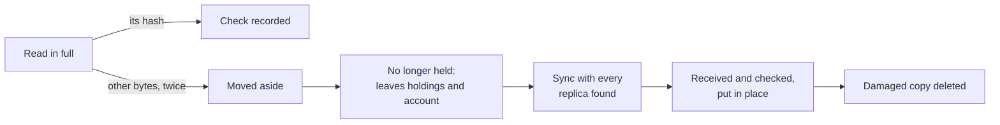
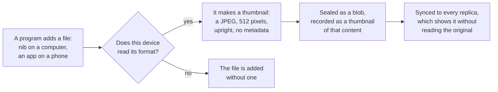
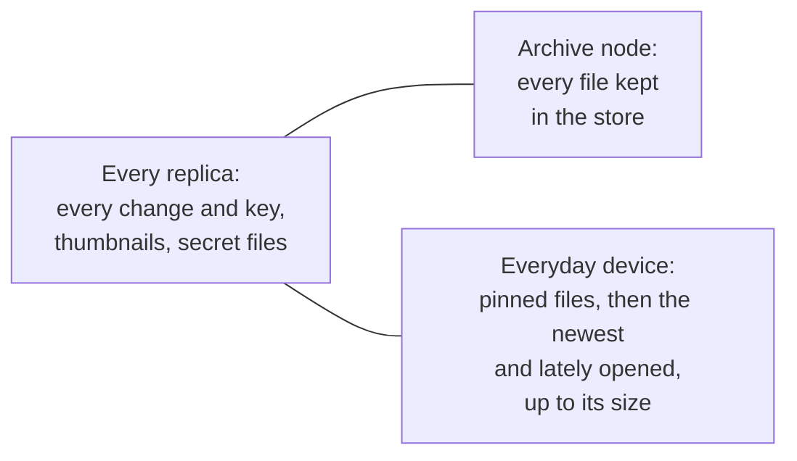
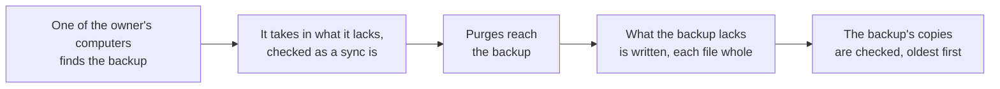
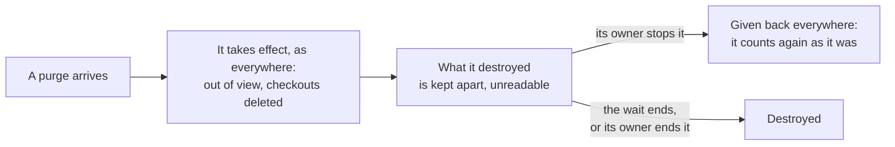
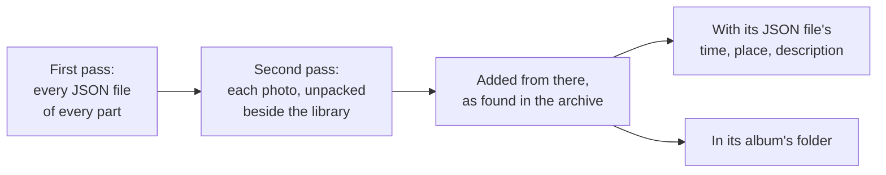
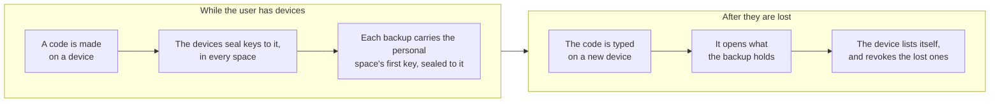
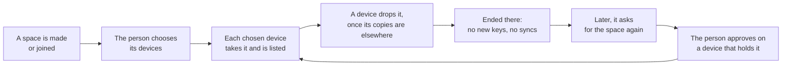
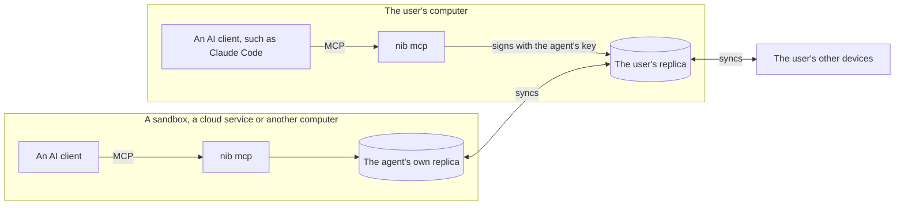

# Technical design

This page holds the technical design that NibKeep has settled on, with the reasons in brief. The [specifications](spec/README.md) define the formats precisely. The [design guidelines](Design.md) say what NibKeep is for, [Known limits](Known-limits.md) what is missing or imperfect, and the [development plan](Plan.md) what comes next.

A decision is changed here, in place, with its reasons; the page's history keeps the older ones. The formats are at version 1. A format changes only by a new version, which every later version of NibKeep reads ([how versions are numbered](Plan.md#version-1-of-the-formats)).

## 1. Code layout

- **Crates when needed.** The workspace follows the crate map of the [development plan](Plan.md#2-from-layers-to-crates), and a crate is made when a phase first needs it. Libraries live in `crates/` and are named `nibkeep-*`. The crate `nibkeep` has no code of its own: it gives the engine and its API one name. Apps live in `apps/`. The command line is the package `nibkeep-cli` in `apps/nib`, with the binaries `nib` and `nibsync`, as the name `nib` is taken on crates.io.
- **Dependencies point down.** The crates without I/O (`nibkeep-base`, `nibkeep-time`, `nibkeep-crypto`, `nibkeep-model`, `nibkeep-governance`, `nibkeep-log`, `nibkeep-std` and `nibkeep-sync`) touch no disk, network or system clock. They take randomness and time from their caller, so they test quickly and deterministically, and build for phones. A boundary that turns out wrong is changed on purpose, not quietly.
- **Apps use only the engine's public API,** that of `nibkeep-node`, which the crate `nibkeep` gives at its root. So an app could become a plugin ([P8](Design.md#p8-no-privileged-plugins)).
- **`unsafe` is forbidden in the workspace,** except in a few marked crates: `nibkeep-sqlite-vfs` (the calls SQLite makes into the encrypting VFS), `nibkeep-bonjour` (Apple's DNS-SD), `nibkeep-drives` (Windows' calls that read a drive's partition table), `nibkeep-end-to-end` (process groups and jobs), and `nibkeep-generate` (the one call with which `nibkeep-bench` asks Windows for its peak memory). Every `unsafe` block says why it is sound.
- **Fakes** that tests of several crates share are in `nibkeep-testkit`.
- **All packages are published** but the test and benchmark tools, `nibkeep-testkit`, `nibkeep-generate` and `nibkeep-end-to-end`, and `nibkeep-app`, while its API still changes freely. Each published package carries copies of the workspace's two licenses, since Cargo packs only what is in a package's own folder.
- **Trees stay in `nibkeep-node`,** as their purges must reach their copies in every program. They may move out once the engine records every plain copy NibKeep writes.

## 2. Encoding, identifiers and hashes

- **A codec of NibKeep's own** for a subset of CBOR, in `nibkeep-base`: integers, byte and text strings, arrays, maps with integer or text keys, decimal fractions (tag 4), UUIDs, `true`, `false` and `null`. Hashes and signatures need exactly one encoding per value. So the codec writes RFC 8949's core deterministic encoding, and rejects every other encoding when reading. It has no dependencies. It is tested against RFC 8949's examples, an independent decoder and a property test, and is fuzzed.
- **No floating point.** Decimals keep their exact digits instead.
- **Every structure has a JSON form.** JSON is never hashed or signed ([Encoding](spec/encoding.md#4-json)).
- **Identifiers are UUIDv4,** made from 16 random bytes that the caller supplies. UUIDv7 would sort better in databases, but every ID would reveal when its entity was made: a photo from 1975 would carry the date of its import. A device maps IDs to compact numbers in its own database instead. Each kind of identifier is a Rust type of its own.
- **Hashes are BLAKE3,** tagged with their algorithm: multihashes in binary, and `blake3:` with hexadecimal in text. Data with an unknown algorithm is rejected until support is added. BLAKE3 won over SHA-256 for verified streaming: a device can fetch and check any range of a file, so a video plays before it has fully arrived. A blob's hash is its identity whatever its storage policy, since two algorithms would give one file two IDs. Exports include SHA-256 sums for standard tools.

## 3. Time

- **EDTF levels 0 and 1, implemented by NibKeep** in `nibkeep-time`, with the rules of time travel, which EDTF leaves open ([Time](spec/time.md)). Level 2 comes when someone needs it.
- **Seasons** are the meteorological seasons of the northern hemisphere. Southern seasons are off by half a year, a known limit.
- **A qualified date** (`~`, `?`) widens its range by one unit of its precision on each side, and is never certain. A date with a time of day means the date as written, whatever its time zone.
- **Time travel** answers "yes", "uncertain" or "no" for every date, and "date unknown" for a fact without one.
- **System time is a hybrid logical clock.** Timestamps never go backwards, respect cause and effect, and stay close to wall-clock time, so "as of" a date means what people expect. A device refuses a change dated more than ten minutes ahead of its own clock, until its clock catches up.

## 4. Cryptography

- **Libraries:** the RustCrypto and dalek crates, with `hpke` and X-Wing. They are pure Rust, build for every target, and are maintained together. `cargo deny` watches them for advisories.
- **Envelopes** use XChaCha20-Poly1305. Its 24-byte nonces can be random, so devices can encrypt with a shared key without coordinating. AES-256-GCM's 12-byte nonces are too short to pick at random over a space key's lifetime.
- **Databases that stay on one device** use XAES-256-GCM: the state file ([section 7.5](#75-the-state-file)) and the sync role's `sync.sqlite`. They are read page by page, which AES instructions make two to three times faster. What travels between devices stays XChaCha20-Poly1305, which is fast in software, since some devices, such as a Raspberry Pi 3B, have no AES instructions.
- **Keys travel with HPKE** in base mode, with X-Wing, HKDF-SHA256 and ChaCha20-Poly1305, the suite of age's post-quantum recipients. So recorded traffic stays confidential against a future quantum computer. A public key for sealing is 1,216 bytes and a sealed key about 1.2 KB, which is fine for rare events such as pairing and rotation.
- **Signatures are Ed25519,** verified strictly, over a context and the message. A post-quantum signature (ML-DSA-65, 3,309 bytes) on every change would cost far more than it protects, as a signature forged in the future reveals nothing recorded today. Suite numbers leave room for ML-DSA, and for P-256, which secure hardware supports.
- **Passphrases** go through Argon2id with RFC 9106's parameters, after normalization to NFC. Keys for separate purposes are derived with BLAKE3.
- **Randomness** comes from the caller, so tests run with fixed seeds, and nothing below the engine reads the system's random number generator.

The formats are in the [cryptography specification](spec/crypto.md).

## 5. Data model

### 5.1 Statements and operations

- **Every value is a statement:** a random ID, the entity, the field, the value and its qualifiers. Qualifiers map field names to values, as in Wikidata. They say such things as when a value was true and where it came from.
- **Two operations change data.** An assertion adds a statement and names the statements it supersedes; a retraction only supersedes. Concurrent writes do not supersede each other, so both values stay until a person chooses, and no clock is needed to notice them.
- **Replicas converge by construction:** the current state is a function of the set of operations, and a past state is the same function over fewer of them.
- **Names are global and namespaced,** such as `org.nibkeep.name`, so types combine like traits and share fields. Only NibKeep defines fields named `org.nibkeep.`.
- **Values carry their kind,** so values of a kind an app does not know are kept unchanged.
- **An entity's types, its deletion and its merges** are statements on reserved fields, so they sync and keep history like the rest. A merge is a redirect, so links keep working. Loops of merges resolve alike everywhere.
- **Types never remove data.** They list optional fields, each with a kind and a multiplicity (one value, many, or the last writer wins), and mark fields as secret or as roles.
- **The cost** is a statement ID and qualifiers per value, and a header, signature and key per change: about 6 KB per entity on disk, with its history and indexes.

### 5.2 Types in a space

- **A type that a space defines** is an entity of the type `org.nibkeep.type-definition`, and each of its fields an entity of the type `org.nibkeep.field-definition`. So two devices that add fields at once both add them, and types keep history and sync.
- **Standard names are the vocabulary's alone.** `nib type add` defines no type or field whose name starts with `std.` unless the vocabulary gives it. So a field that a later version adds to a standard type never meets another kind of it in a space. A person can still add fields of their own to a standard type.
- **Definitions have IDs derived from what they state,** the same in every space. So two devices that install a type at once write one definition, and a library made anew from its export does not define its types twice.
- **Deleting a type** of the space's own hides its definitions until it is restored, as for any entity (`Library::delete_type`, `deleted_types`, `restore_type`). It is allowed only once no entity that is not deleted has the type, so no entity is left with a type that nothing defines. Standard types, which the vocabulary installs again, and types defined in code are not deleted. An AI agent deletes and restores no type ([section 14](#14-ai-agents)). Leaving entities with the type was rejected, as every count and list would show it as unknown.
- **The types of a space** combine those that NibKeep and apps define in code, which are never stored, with those the space defines. Definitions of one type combine into the union of their fields. Definitions of one field combine so that the most careful one counts.
- **Labels** say how a type or field is shown: at most one text per language, kept in the definition. Apps show the label that best matches the reader's languages, and the name only when there is none. The standard vocabulary labels its types and fields in English. Search never finds the entities that define types.
- **What is secret is the space's decision,** not one type's: an app asks the library which fields are secret. Marking a field secret protects only the values written after. NibKeep's structural fields can never be secret.

The rules are in the [data model specification](spec/model.md#8-types).

### 5.3 Decimals, quantities and names

- **Decimal** is a kind: a decimal fraction with the precision it was entered with, so 1.80 m and 1.8 m are different values.
- **Quantity** is a kind: a decimal with a unit in UCUM's case-sensitive codes, such as `kg` or `[lb_av]`. It is stored as entered and converted only for display, rounded to the reading's significant digits, so every app shows the same. A field definition can name a unit, and a value in a unit of another dimension is kept and flagged. The model stores only the codes; apps bring a UCUM table.
- **Compound measurements,** such as blood pressure, are entities of their own that a field refers to. Dense sensor data stays in files. Derived values, such as a body mass index, are computed when shown, never stored.
- **Name** is a kind, with parts: `full`, which every name has, and for people, given and family names, additional names such as patronymics, a prefix and a suffix. `org.nibkeep.name` holds the name of every entity that has one, one name at a time, in as many forms as needed. Nicknames and other aliases need fields of their own; pen names are agents of their own.
- **A field whose name ends in `.name` or `.title`** can name an entity that has no `org.nibkeep.name`, so importers avoid such names for fields that do not name the record.

### 5.4 Values that change over time

A value holds until the next one, so an employer and a dog's weight are recorded and shown alike. There is no separate mechanism for measurements.

- **The form of the date decides.** A value dated with an interval is a *state*, shown while the interval holds. A value dated with a single date, or a date and time, is an *event*, shown from the moment it happened.
- **In a field with one value,** each value shows from its start until the next value starts, and a state no longer than its interval. Values are ordered by their starts as written. The order is total and the same on every device, so only values with the same start compete.
- **In a field with many values,** each value shows by its own valid time. The one that started later shows first, unless another is marked preferred.
- **Three kinds of edit:**
  - A change in the world adds a dated value and supersedes nothing, so offline devices never conflict over ending the previous value.
  - A correction sets the field: it supersedes what the writer's app showed. The new value keeps the valid time of what it replaces, or gets the moment it was set.
  - A wrong value in the past is corrected by superseding that statement alone.

The rules are in the [data model specification](spec/model.md#6-current-values).

### 5.5 Languages, scripts and forms

- **A language qualifier on each value,** `org.nibkeep.language`, with a BCP 47 tag, so any value can have a language, recordings included.
- **Forms of one value,** such as one name in several scripts, name the first form's statement in an `org.nibkeep.alternative` qualifier. Forms from two offline devices add up. Forms count as one value: they never compete, and show in the form that suits the reader.
- **Transformed text** is tagged with RFC 6497's extension, such as `uk-Latn-t-uk` for a transliteration and `en-t-ru-t0-und` for a machine translation.
- **Readers rank languages and scripts** as RFC 4647 ranges, with likely scripts added from CLDR. Apps choose by extended filtering, then by the preferred form, and show something rather than nothing. A machine translation never comes before what a person wrote, unless the reader cannot read it.
- **Translation only on request:** shown on screen, or stored when a person asks, as a form marked as a machine translation.
- **Search indexes every form,** so a person is found by any spelling of their name.

### 5.6 Users and the people in the data

- **A user** has devices, belongs to spaces and signs changes through its devices. **A person** is an entity in the data. Most people in the data never use NibKeep.
- **Each space a user belongs to** holds a record of the user, readable by every member. It holds the user's name and, in `org.nibkeep.linked-person`, the person the user is in that space. In the personal space only the user writes it. In a shared space, the link holds when an admin's statement and the user's own agree.
- **A new library** makes a user, its device, its personal space and a person linked to the user. Importing an export into it links the user to the export's person instead ([Export](spec/export.md#7-importing)).
- **History names** the person linked to the user in that space, in the reader's best form, or else the user. Changes by an AI agent show as the user's through the AI agent, such as "Ada, through Claude".
- **Words.** *Agent* keeps its meaning from the provenance standards: a person, group or pen name in the data. Software is always an *AI agent*.

### 5.7 Migrations

- **A migration moves statements to a newer shape** of a type: to new fields, or to new entities, such as a book's publication date to its edition. Every change to the standard vocabulary beyond a new field reaches existing spaces this way. A field never changes its meaning: a new meaning takes a new name, as in the AT Protocol's Lexicon. Likewise, a migration never changes once released.
- **Ordinary changes.** A migration's changes count by roles like any other's. In a shared space, editors' and admins' devices migrate, and a viewer's device reads the old shape until one of them does.
- **IDs derived from what it replaces,** so devices that run a migration at once write one statement, and make one edition, not two. An ID never hashes what a statement says: a secret statement's ID is in its change's header, which relays read, so a password hashed into it could be guessed offline.
- **What it writes depends on its inputs alone,** so every device writes the same statement under each ID.
- **Two changes may assert one statement.** It counts from the earliest, and a purge takes both. So purging a value that two members' devices migrated at once needs an admin, as for a value another member wrote.
- **A note, not proof.** Each value a migration writes names the migration and the statements it replaced, in `org.nibkeep.migrated-from`. Values compare without the note, so a migrated copy and the same value typed again stay one. An AI agent writes no note; this is the one rule of the log that migrations add. A purge of a migrated value is to follow the note, or a purged password would stay in the history of its old field.
- **Predictable IDs** let a device plant a statement where a migration will write. That gives it no more than editing the value would, and history shows it.

The rules are in the [data model specification](spec/model.md#12-migrations).

## 6. The log

### 6.1 Changes

- **Changes form a graph,** as in Git and Automerge. Each change names the changes its author had seen last, and is identified by the BLAKE3 hash of its encoding. A replica that holds a change holds everything it builds on. A space has one root: a second change without parents is rejected.
- **The header is signed and readable.** Relays, and replicas without the keys, check signatures and order. They see who wrote when, how changes depend on each other, and their sizes, but not their content.
- **Each change has a key of its own.** Its payload is sealed with a random *change key*, which is wrapped with a key derived from the space key. Both travel beside the signed change, not inside it. So a purge can delete them while the change, and every hash that names it, stays.
- **The header commits to what is sealed:** the hashes of the sealed payload and of the change key, and each secret statement's ID with the hash of its record key. Envelopes do not commit to their key, so without these hashes one payload could open to different contents on different devices.
- **Secret values are sealed again,** each with a record key of its own, wrapped with the space's secrets key. Replicas without the secrets key pass them on unread.
- **Timestamps** are hybrid logical clock times later than the parents', so the changes up to any time form a state the space really had. They are the authors' claims: a member can backdate a change, but not before what it builds on.
- **A change that governs the space says so in its header.** Governing changes set members, roles, replicas and keys. They hold nothing else, and are never purged.
- **Cost:** about 250 bytes per change for its signature, key and hashes.

### 6.2 One entity per change

- **Every change is about one entity.** An action on many entities is a change for each, saved in one batch. So a purge of one entity takes only that entity's changes, and the other files of a commit, or the other photos of a move, keep their history.
- **Three kinds are exempt:** governing changes; purges, which restate what they purge around; and definitions of types with their fields, so a new space's standard vocabulary is one change.
- **The engine keeps the rule.** It saves what a program writes as one change per entity, in one batch, all or none. It refuses unsealed content that the write's own definitions make secret. No replica can check another's changes, as their payloads are sealed. A writer that breaks the rule only makes purges of its changes restate more.
- **The price:** about 330 bytes per extra change. An action on many entities also syncs change by change, so it can show half done meanwhile; a tree's commit waits for all its parts. Parts within one change were rejected: they make two units of the log, with rules that three reviews could not settle.

### 6.3 Accepting changes

- **Accepting depends on the header alone:** its form, space, signature, key epoch, time, parents and purges. The change's operations apply once its payload and key are there; until then, and for good once purged, it adds nothing. Every replica decides the same, whatever order changes, payloads and keys arrive in.
- **A change waits for its parents.** Replicas limit how many changes may wait, and remember changes that can never be accepted.
- **A change by a key that no governing change lists is refused** until one does, so keys nobody added cannot fill a replica.
- **Opening a space does not check every signature again.** The log file tags each change under the replica's storage key when it stores it, and every read checks the tag. `nib verify` checks every signature.

### 6.4 Purging

Purging destroys keys. Every copy, on every device and in every backup, becomes unreadable once it learns of the purge. History cannot be rewritten as in Git, because changes are signed and live on devices that may be offline for weeks. Any value can be purged, whether or not its field was marked secret.

- **A purge names what it destroys in its signed header:** the keys and payloads of changes, the record keys of secret statements, and the keys of blobs. Every replica acts on it, relays without keys too. It stays in force even if the purging change is purged later.
- **A purge reaches only its ancestors,** which every replica checks from headers. A purge that names others is rejected for good. Blobs may be named freely.
- **Purging a value** purges every change that asserted it; `nib purge` finds every such change it can see. A copy asserted concurrently on a device that had not seen the purge needs a further purge, which `nib purge` offers when the copy arrives.
- **A secret value** is purged through its record key alone.
- **Restating.** The purging change restates what else the purged changes held. A restated value counts from the time of its original change, so a purge never changes which value is current. In history it appears from the purge on, written by whoever purged, with a note. Nothing proves what the purged change held, so a purge cannot forge the past, and restating gives no power beyond an ordinary edit.
- **Each author's changes are purged apart,** so a purge takes no right from the authors of what it purges. The exception is a purge of content, which must take every value that holds the content at once.
- **What is left** is the purged change's header, as Git keeps a skeleton: its author, time, parents and hashes. That a change was purged, and by which change, stays visible.
- **Derived data follows.** The state file is written anew under a new key. The cost grows with the log, by design (1.5 seconds for 31,681 changes). The log file relies on SQLite's secure deletion and a checkpoint that truncates its write-ahead log.
- **Who may purge** is decided by role ([section 13.4](#134-what-counts)), with a fresh confirmation.
- **Copies that wait.** An archive node or a backup keeps what a purge destroys apart for 30 days by default, so no mistake or infected device wipes data everywhere at once. Meanwhile its owner can stop the purge by a change that *restores* what it destroyed ([9.11](#911-copies-that-wait)).

The rules are in the [log specification](spec/log.md#7-purging-values).

### 6.5 Which changes count

Every replica must decide alike which changes count, from the governing changes, whatever order they arrive in.

- **Listing.** A space's first change governs it and lists its author. Any other governing change counts only if an earlier counting governing change lists its author's key. An ordinary change counts only if a counting governing change lists its author's key. In every space, the personal one too, a key is listed only by its own signed listing ([13.3](#133-members-roles-and-who-is-who)). Who the replicas are, their keys and the keys sealed to them come only from counting governing changes. They never come from the state, which ordinary changes write to as well.
- **Setting aside.** A change that does not count is *set aside*: kept and passed on, but not applied, and its header purges nothing. If it was applied before, the state is built again without it, and what it purged comes back from replicas that never applied it.
- **Accepting.** An ordinary set-aside change can be accepted after review, by a counting `org.nibkeep.accepted` statement. It then counts with its own author and time. A governing change is never accepted, so accepting a lost device's changes cannot bring back what it governed.
- **Undecided cases,** such as rings of three or more replicas that revoke each other, count for nothing.
- **Room for later rules.** A governing change may state an `org.nibkeep.` field that the version does not know. The engine keeps it with no effect, so older engines still take in the rest of the change, revocations included. A known field that may hold data never stands in a governing change, as governing changes are never purged. The set of known fields is fixed at version 1: a later field, even one that holds data, counts in a governing change as unknown, or engines of different versions would decide the change differently.
- **Known holes.** Each known hole in which changes count was weighed: does its fix need a rule of the log ([Known limits](Known-limits.md#2-trade-offs-we-accept))? Four do, and are built:
  - one rule of listing in every space, the personal space too ([13.3](#133-members-roles-and-who-is-who));
  - plain writes to a field secret for good count only where the field's mark builds on them ([section 12](#12-secrets));
  - governing statements that a version does not know are kept with no effect, so a later version can add governing fields;
  - every governing change is wrapped with the space's first key, and one wrapped with another is refused, so every replica reads every governing change it holds ([section 11](#11-revocation-and-new-keys)).

  The others need no rule. A later version can settle two secrets set up at once, a space's entry with a wrong first key, and a space lost with the device that made it. The rest are accepted, as a fix would cost more than it saves: conflicting statements of a key's number; what a trusted replica wrote before its revocation; a secret statement's hidden entity; the personal space's equal replicas; backdated claims by members who conspire; groups that hold each other; and a removed member's changes that build on none of the removal, which are set aside for review.

Revocations, roles and AI agents add rules of their own, in sections [11](#11-revocation-and-new-keys), [13](#13-sharing) and [14](#14-ai-agents). The rules are in the [log specification](spec/log.md#8-which-changes-count).

### 6.6 Ordered lists and long text

- **An ordered list** keeps each item's position on its membership, as a fractional key in a field whose last writer wins, as in Kleppmann's work on moving list elements and in Figma. Moving an item never loses or duplicates it. Items inserted at one place at once on two devices may interleave, which lists ordered by hand can bear.
- **Long text** waits until notes need it. A CRDT library, such as Loro, Automerge or Yjs, is chosen then.

## 7. A device's library

### 7.1 Library folders and replicas

- **A library is a folder.** NibKeep keeps its data in the folder's `.nib`, as Git keeps `.git`. The rest of the folder is the person's: `nib file add` takes those files like any others, but never what is in `.nib`.
- **`nib init` makes a library where it finds none,** looking upwards and at `--library` and `NIBKEEP_LIBRARY`. It makes the current folder a library, or the one `--library` names. `nib init --join`, `nib recovery from-copy` and `nib recovery restore` do likewise. An argument that only a new library takes, such as `--name` or `--passphrase`, makes one wherever it runs. A folder inside a `.nib` is refused, also through a link. Inside a library, `nib init` makes a folder a tree instead ([section 15](#15-trees)); one command never does both.
- **The user is named after the account,** as `whoami` prints it, and the linked person after the account's full name, if that differs. The user then goes by the person's name. `--name` names both.
- **Other commands find the library** by `--library`; else in the nearest folder upwards whose `.nib` holds a library, or names the library of the tree in that folder; else in the folder that `NIBKEEP_LIBRARY` names in full. Otherwise they fail and say how to start one. There is no default library, as a command typed in the wrong folder would change it unnoticed. `NIBKEEP_LIBRARY` counts only outside every library's folder, and `nib init` uses it only to make a tree in that library. The search goes up to the root, as Git's does ([Known limits](Known-limits.md#rules-and-behaviour) says what that means on a shared computer).
- **A `.nib` keeps each replica in `replicas/<random name>/`,** with its place file, key file, library file and spaces. Opening uses the replica that is *here* ([section 7.2](#72-copies-of-a-replica)) and passes over the others, which are copies.
- **The engine keeps a library in the directory it is given:** a folder's `.nib` for `nib`, an app's own folder on a phone.
- **Paths are full paths** as the file system resolves them, for origins and checkouts alike. If a library folder moves, `nib status` shows their records as gone.

The layout is in the [storage specification](spec/storage.md#1-layout).

### 7.2 Copies of a replica

Anything that copies a replica's folder makes a second copy with its keys: a system backup restored onto a new disk, a folder copied by hand, a program that syncs folders between computers, or a cloned virtual machine. The two copies sign with one key. History cannot tell them apart, revoking one revokes both, and they never sync with each other. So NibKeep catches copies when they open, before they write.

- **A place file,** written once when the replica is made, records where it is: the drive's serial, and the folder's ID, which a move keeps and a copy does not. On FAT and exFAT, whose folder IDs do not last, the folder's path places it instead. On the drive the system runs from, the computer's ID keeps computers cloned from one image from taking each other's replicas. The check needs no key, so it runs before anything is unlocked.
- **A replica is here** when its drive and folder match, or, on FAT and exFAT, when its recorded path leads to this folder or to nothing any more. So a replica on a USB stick, or on a data drive moved into a new computer, stays the same replica.
- **On a phone,** the place file records only the phone's ID, kept where no backup takes it: on Android, a hash keyed in Android's keystore; on iOS, a keychain item of this device only, shared by the apps and extensions that share the folder.
- **Nothing writes to a copy.** A copy is never opened, as SQLite writes even to read, and never put on the network. It is never deleted, moved or renamed, as a program that syncs folders would do the same to the original. `nib` says how much room a copy takes; the person deletes it.
- **A copy helps a new device start** (`nib recovery from-copy`). When the person asks, another device adds this computer by pairing. The new replica then takes in what the copy holds, checked as a sync is, and the copy's secrets if they open here. It offers to revoke the copy's device, if the person says that device is gone. Only where no other device can add this computer does the copy's own key add the new device. The new device then takes the spaces that the copy holds, and asks before it takes a space given to it later where the copy did ([13.10](#1310-devices-that-choose-their-spaces)). Then it revokes the copy's device. Where the disk has no room for all that the copy holds, nothing is made and nothing revoked, as the copy's device may alone hold what would be left out ([7.9](#79-blobs)).
- **A program that syncs `.nib`** between computers makes each computer find the other's replica as a copy and leave it alone, since each writes only its own replica's folder. `nib` says once what such a program costs: every key file ends up on every computer and at the provider, and deletions and restored versions reach every computer.
- **Not caught:** a drive cloned block by block, a snapshot mounted beside its file system, computers cloned with their drives and IDs, and on FAT, a folder moved and then copied before either was opened. This is no guard against theft; revoking the device is.
- **Checkouts and copies.** A replica on a removable drive records its checkouts as on the computer that wrote them, so they show as gone elsewhere. Once a copy's device is revoked, purges no longer delete its checkouts on this computer.

The place file is specified in [Storage](spec/storage.md#11-which-replica-is-here).

### 7.3 Where a replica may live

- **Not on a network drive,** as SQLite's write-ahead log does not work across computers.
- **Not in a cloud drive's folder** where the system may leave a file's content in the cloud until it is opened, as with OneDrive, iCloud Drive and Google Drive.
- **On FAT, exFAT or ext2 only when asked.** These keep no journal, so a stick pulled out while a library writes can damage files later, unseen until read. In a trial with power cuts on exFAT, one blob was overwritten two cuts later. `nib init --allow-fat` (also with `--join` and `--from-copy`) allows such a drive for that library. NTFS, ext3, ext4, Btrfs, XFS, ZFS, F2FS and APFS are allowed.
- **A replica on such a drive is guarded.** While it is open, its folder holds the mark `in-use`. A program that finds the mark left behind opens nothing, and says which check of the drive to run. After the check, `nib verify --drive-checked` verifies the whole replica. With the guard, 60 cuts under a tree with secret files on an exFAT stick lost nothing. The guard sees a removal only while the replica was open, not a volume made dirty by another program ([Storage](spec/storage.md#13-drives-without-a-journal)).
- **On a removable drive,** a replica moves with the drive between computers. A key in a keystore stays on the computer that made it, so elsewhere such a replica opens only with a passphrase.
- **Not in Android's backups or transfers.** A restored copy is the old phone's replica again, and the key file in a backup is open to guessing. `android:allowBackup="false"`, and data extraction rules that exclude every domain, keep an app's data out. Temporary copies of secret files live in the cache folder. A new phone starts empty and pairs. On iOS, an app's folder is kept out of iCloud's and the computer's backups.

### 7.4 The log file

- **SQLite, through rusqlite,** built from source so every platform runs the same version. It is proven, supported through 2050, and a recommended storage format of the US Library of Congress.
- **One log file per space.** It holds the encoded changes, sealed payloads and wrapped keys. Outside the history, it holds the latest pages of the replicas' accounts, and what only this device knows, such as its checks. Any SQLite reader can extract them ([P3](Design.md#p3-your-data-outlives-nibkeep)). It is not encrypted page by page, since its content is encrypted already.
- **Write-ahead logging with full synchronization,** so a change is on disk when saving it returns, or, inside a batch, when the batch ends.
- **Secure deletion,** and a checkpoint that truncates the write-ahead log after a purge, so no copy of a destroyed key stays in the files. Copies that the disk keeps on its own, such as old blocks under wear levelling, are out of reach; disk encryption covers them.
- **Turso was tried and not taken.** Trying it again means the same checks: a build with a C compiler that always fails, the log file's statements, secure deletion, and the benchmarks.

The format is in the [storage specification](spec/storage.md#2-the-log-file).

### 7.5 The state file

Nothing derived is authoritative. Derived data is stored only as a cache: checked before use, rebuilt when it does not match, and always rebuildable from the log.

- **The state and the search index live on disk,** in the *state file* beside each log file. Memory holds the entities in use, the waiting changes and the heads, so it does not grow with the space, and opening takes about the same time at any size. A state in memory took 0.9 GB for 120,000 entities, and would not reach the design's 10 million per space.
- **The log keeps only what checking new changes needs:** headers, heads, waiting changes and keys. Graph checks, such as whether a purge names only ancestors, are queries on the log file, helped by each change's depth, as in Git's commit graph.
- **History is a query.** Each statement keeps when it was first recorded, the change that first asserted it, and when it was superseded. So the state of a past day and the author of a statement are read, not replayed.
- **Queries read what they need of many entities at once,** as each read is a round trip to SQLite.
- **The state file records the last log change it covers,** so opening applies only what follows. A state file that is ahead, names a change the log does not hold there, has an earlier format version or is damaged is deleted and built again. The space says so meanwhile. One of a later format version is left as it is, and the space does not open ([7.10](#710-separate-apps-on-one-library)).
- **It may lag behind the log.** The log file is synchronized before a change counts as saved, while the state file takes in many changes per transaction ([section 7.7](#77-saving-in-batches)). After a crash it is consistent, possibly behind, and catches up.
- **It is encrypted page by page,** with a random key of its own, wrapped with a key derived from the device's storage key. Every page is authenticated. Secret values are in it only sealed, so locking changes nothing on disk.
- **A VFS of NibKeep's own, in Rust, under stock SQLite** encrypts it, with XAES-256-GCM. The associated data names no path, so a library can move. Reading costs two to three times what it does unencrypted, which the cache pays once per page ([Storage](spec/storage.md#4-encrypted-databases)).
- **Rejected for the state file:** SQLite3 Multiple Ciphers, which worked and was fast, but needs a patched rusqlite build and would put the log file through its C; SQLCipher, which needs OpenSSL; `sqlite-plugin`, whose defaults are not safe on a real disk; and values encrypted one by one, which cannot be searched by prefix.
- **Purging writes it anew,** under a new key, so nothing purged can be read from it.
- **Stale pages.** Someone who can write to the disk without the keys can put back older pages of the state file, which still authenticate. That device then shows stale data until a check against the log finds it. Other devices are not affected, since only changes travel.
- **Verifying a library** builds the state again from the log and compares. A property test checks that the state file always equals the state built again.
- **Memory:** SQLite keeps 32 MiB of the state file's pages, and up to 128 MiB while a transaction writes it, so a large batch does not read the same pages again and again. With SQLite's default of 2 MiB, building the index for 10,007 entities took three times as long. The larger cache raised a generator's peak memory from 17 to 60 MB.

The format is in the [storage specification](spec/storage.md#5-the-state-file).

### 7.6 Search

- **Search finds what entities show,** on any day: every current value, including values that hold on other days, such as former names, and every form of a name. Of a field whose last writer wins, only the value written last is found.
- **Secret fields are never indexed,** even while unlocked. A login is found by its title and website, and revealing its password still asks.
- **NibKeep's structural fields,** and fields that hold keys and positions, are found by their values, not by their words.
- **Words** are compared without regard to case or accents. The last word of a query also matches the start of a word, so results come while typing. Words split at every character that is neither a letter nor a digit, so scripts written without spaces are found only by whole runs for now.
- **A space is searched only while open,** which is while its keys are unlocked.
- **The index** keeps, for each word, the statements that hold it and the entity each shows under. A search reads the statements of each whole word, rarest first. It reads those of the last word's beginning too, unless that beginning starts more than four times as many statements as the rarest whole word holds. Then it checks each candidate's own words instead, which then costs less.
- **A page of results costs less than all of them,** as naming entities and following links take most of a search's time. `nib find` and MCP's `find` list and name the first 50 of each space, the same first ones as a full search. Entities found through links come after every entity found by its words, so links are followed only when words find no more than a page. Otherwise the count of the rest leaves out what links would find, and says it is a minimum: for `leviathan` in the generated library of 10,000 entities, 1,617 more.

### 7.7 Saving in batches

A program that makes many changes at once knows it, and says so. Synchronizing every change makes imports slow, above all on Windows, where small writes and file synchronizations are slow.

- **A batch** is a run of changes to one space, saved together in one transaction of each file. Its end commits the log file, synchronized, then the state file. A savepoint before each change lets a refused change roll back alone, so a batch saves exactly what single changes would have saved.
- **A change in a batch is saved when the batch ends.** A crash before that loses the whole batch, so a resumable importer notes its progress after each batch.
- **A failure of the files ends the batch,** and none of it is saved.
- **Only changes go in a batch,** made here or received, with their record keys. While a batch is open, purges, governing changes, importing or receiving blobs and their keys, and opening secrets are refused. A space has one batch at a time.
- **A batch holds both files' write locks,** so other writers wait, up to five seconds. So batches stay short: `nib import` ends one after 1,000 entities, the generator's import of real data after 1,000 changes or a second, and a tree's commit after 1,000 parts.
- **Bursts.** `nib mcp`, `nib file add` and the Takeout importer save change by change. A change made on its own within 100 ms of the last goes into the state file with it, up to 1,000 changes or a second. The log file still synchronizes every such change.
- **A sync saves what it receives in batches,** as an importer does: up to 1,000 changes and record keys, or a second. A batch also ends:
  - before a change that governs, which is received alone, and before one that waiting changes wait for, which may govern;
  - after a change that purges;
  - before blob keys and blobs;
  - at the end of each space;
  - whenever the sync is about to wait for the other device, or to send it items, so nothing received waits on the network to be saved.

  A space counts as synced only once its last batch is saved. A crash loses the open batch, which the other device sends again. A new replica's first sync of a library of 10,000 entities, 31,694 changes, took 45 s when each change received synchronized the log file, and 8 s in batches.
- **A purge received in a batch** acts on the files once the batch is saved. It cannot be rolled back to its savepoint alone, as the log in memory has acted on it already.
- **While another program has the space open,** the changes of a burst commit one by one, and a sync saves each item as it comes. So that program can still write.
- **Not chosen:** bigger changes, as a change is what is signed, synced and purged; and less synchronization, which could lose a change after saving returned.

### 7.8 Several programs on one replica

Separate apps share one replica where they can reach the same folder ([apps on one library](Design.md#611-apps-on-one-library)): two apps side by side, an app and its own extension, or `nib` beside an app. iOS gives apps no channel but files, so no process can serve the others.

- **Readers together, writers in turn.** Both files use SQLite's write-ahead log in normal locking mode. A write takes the write lock at once, and waits if another process holds it. A write to both files takes the log file's lock first, so two processes never wait for each other.
- **The state file's VFS** leaves locking and shared memory to SQLite's default VFS. The shared-memory file stays unencrypted. It holds page numbers, the database's size and SQLite's non-cryptographic checksums of frames, which confirm a guess only for someone who knows the rest of every frame. Shared memory of NibKeep's own is the way out if that ever matters.
- **Each process notices what others wrote** by SQLite's count of changes, and catches up before it writes.
- **Nothing stays open while an app is suspended,** as iOS ends an app that holds a lock in a shared container. Apps close their connections when they leave the foreground. They end a sync first, as its batch holds the write locks for up to a second.
- **The space lock** is held shared by every process with the space open, and exclusively to write the state file anew after a purge. The others close the space at their next transaction and open it again afterwards.

The locks are specified in [Storage](spec/storage.md#14-several-programs).

### 7.9 Blobs

- **NibKeep seals what it writes.** Every blob in its store is sealed with a random key of its own: imports, copies received from other devices, and derived data such as thumbnails. Only per-blob keys can be destroyed, which purging needs.
- **A sealed blob is stored and travels under the hash of its sealed bytes,** never its content hash. So a disk does not reveal which known files it holds, while a device without keys can still check its copies. The content hash travels only inside encrypted data.
- **One sealed copy per replica.** A replica keeps sealed blobs in one directory for all its spaces, and each space keeps its own wrapped key for them. A space that adds content the replica already holds sealed checks that copy, and wraps its key for itself. Keys are reused only within their kind, secret or ordinary.
- **Two sealed copies of one content,** made on two devices before they synced, are both valid. A replica settles on the one with the smallest sealed hash, and its planner lets the larger go ([9.9](#99-the-planner)).
- **A purge in one space** destroys only that space's keys. A replica keeps a sealed blob while any of its spaces keeps a key for it. Before a purge, an app says which other spaces on its replica hold the same content.
- **What a disk shows.** A replica without a space's keys that holds two spaces sees which sealed blobs they share, which their sizes hinted at already ([7.3](Design.md#73-security-model)).
- **Viewing decrypts in memory,** a chunk at a time, so a video can start anywhere. Nothing plain is written to disk.
- **A device refuses each blob** after which its disk would have less than 1 GiB free.

The formats are in the specifications of [cryptography](spec/crypto.md#6-sealed-blobs), the [log](spec/log.md#6-blob-keys) and [storage](spec/storage.md#3-blobs).

### 7.10 Separate apps on one library

NibKeep is a platform for apps by any vendor, as a cloud drive is, but with no server and with typed data rather than files alone ([6.11](Design.md#611-apps-on-one-library)).

- **One replica for each container that apps can share,** such as one developer's apps on iOS, or a folder on a computer. The apps hold all its keys between them, so only apps that trust each other share one. It stays while any of them is installed.
- **An app that cannot share a container keeps a replica of its own,** with the spaces the user grants it, and syncs with the others. It joins by a code from another device. On the same device, it can also join by a link to an app that has the library, which the user approves; both apps then show a short code to compare. A space is the finest grant: an app granted a space reads all of it but its secret values. On one iPhone, two such apps reach each other only through a folder both were given in the Files app, or through the user's other devices.
- **Keys are kept per app, or per developer,** in the platforms' keystores. What each platform allows is tried on devices before the design relies on it.
- **Removing an app gives no notice;** its replica's keys go with its container. The other replicas notice that the app stopped syncing and ask the user. A removed app leaves the list without a change of keys, while a lost device is revoked and the keys are rotated. The app's copies stop counting once they go unchecked for 8 weeks ([9.7](#97-checking-and-repair)).
- **Files reach other apps through the platform's file provider:** File Provider on iOS and macOS, DocumentsProvider on Android, cloud files on Windows. Structured data does not travel that way.
- **Engines of different versions** share replicas and sync. What travels (changes, values and types) is read by older and newer engines alike, and an older engine passes on what it does not understand. A shared replica's stored files change only in ways that its older engines read ([storage](spec/storage.md#16-engines-of-different-versions)):
  - **One number for all the replica's stored files,** in the replica's engines file, with each program that opens the replica and the latest version its engine reads. The number also guards files that have no version of their own, such as the index of trees and the sync role's records.
  - **An older engine** that finds a later number opens nothing, writes nothing, and asks the person to update its app.
  - **A newer engine** raises the number only once every listed program reads the new version. A removed app leaves its entry, so the engine names the programs it waits for, for the person to update them or say they are gone.
  - **Not chosen:** only a version for each file, which leaves the files without one unguarded; and recording engines' versions without their programs, which would keep an old version listed after its app was updated.
  - State files are to be kept one for each version of their format, so apps of different versions do not rebuild each other's. A purge is to rewrite its own version's and delete the others.
- **Not chosen:** every app opening one replica, which works only where apps can share files, and gives every app every key; and one process that holds the replica for the others, which works only on computers.

Joining by a link, state files per format version and file providers are not built yet.

## 8. Keys at rest and unlocking

- **One key file per replica,** with two compartments that open separately. The *replica* compartment holds the replica's signing, decryption and storage keys and the space keys. The *secrets* compartment holds the secrets keys and the replica's secrets decryption key ([section 12](#12-secrets)).
- **Each compartment's key** comes from a passphrase, through Argon2id, or from the platform's keystore, which holds a random compartment key. Keystores hold small secrets well, and large, changing ones poorly.
- **Keystores are reached through `keyring-core`:** Keychain on macOS, Credential Manager on Windows, Secret Service on Linux. Tests use its mock store, never the real keyring of the machine they run on (`NIBKEEP_NO_KEYSTORE`).
- **The replica compartment opens when a program starts.** The secrets compartment opens each time the person confirms, and is forgotten after a timeout. A *closed* library keeps its keys unlocked, and its secrets if they were, so an app can open the library for each operation without asking again.
- **`nib init` protects the keys with the keystore,** or with a passphrase if given `--passphrase` or if there is no keystore. `nib` derives the key on every command, so its passphrases use RFC 9106's low-memory parameters (64 MiB, three passes). `nib protect` changes the protection.
- **On Android,** the library's key is in the keyring store, released without a prompt. The secrets' compartment key is kept under a service of its own, `org.nibkeep.confirmed`. An AES-256-GCM key in Android's keystore encrypts it, and works only after a strong biometric or the screen lock, for each use. A prompt in front of a key that opens anyway would guard only the screen. The prompt is Android's own, with no dialog before it, and the compartment key goes straight to the engine. Setting up, protecting anew and asking another device for the secrets ask too, so the person sees it work first. It needs Android 11 and a screen lock; otherwise the secrets take a passphrase. Removing the screen lock destroys the key: the app says so and, once the person agrees, asks another device for the secrets, which are lost if no other device holds them.
- **On computers,** keystores release their keys to any program of the user's without asking, so the secrets' own passphrase is what asks. Windows Hello and Touch ID come later; keys made inside secure hardware come with the P-256 suite.
- **What is protected.** A stolen device without its passphrase or confirmation yields only encrypted keys. Someone who can write the key file can make unlocking slow or impossible, but changes to the protection are detected. Keys are wiped from memory that the code controls, and encoded without copies left in reallocated buffers.

The format is in the [key file specification](spec/keys.md).

## 9. Files

### 9.1 Originals and sealed copies

- **Originals stay where they are,** unchanged. NibKeep records where it found a file, as an *origin*: a path on a device, the modification time, the size and the content hash. It sends sealed copies where the storage policy says, and never encrypts, moves or deletes an original without asking. A device keeps no sealed copy of an original it holds, unless its policy asks.
- **An origin records the content it found.** A new version changes the file, not the origin, so an original of an older version is never taken for a copy of the current one. An origin has no name of its own: its path and device name it.
- **No origin in a temporary folder,** such as an AI agent's scratch folder. Such a file is soon gone, so it goes into the store with no origin.
- **A file of a tree** is different: its identity is its ID, not its content ([section 15](#15-trees)).
- **Plain copies in the store,** such as reflinks on trusted devices, are left out; a policy option could add them later.

### 9.2 Checkouts

A *checkout* is a plain copy that NibKeep writes on request: to open a file in another app, edit it, share it, or fill a folder that a media server reads.

- **A checkout is an entity of the type `std.checkout`:** the file (`std.checkout-of`), the device (`std.checked-out-on`), the full path (`std.path`), and the content, size and modification time written. It syncs, so a purge deletes copies on every device. A search that matches its path finds the file.
- **`nib file checkout FILE [PATH]`** writes the current version, from the store or from an original on this device whose hash still matches, and never replaces anything. It writes and checks a hidden temporary file, records the checkout, and only then moves the copy into place. So a crash never leaves an unrecorded plain copy.
- **A copy is unchanged** when its hash is the recorded content. NibKeep reads and checks a copy before it deletes it or records its edits.
- **`nib file checkin`** makes a copy's edits a new version, sealed into the store, then deletes the copy and its record; `--keep` keeps it as a checkout of the new version. Recording an edit and ending a checkout are separate engine operations, as in a drive app. A copy is deleted only where another copy on the device holds its content. An edit of an older version is refused unless forced.
- **`nib file add` never takes a checkout,** and `nib mcp` offers none: an AI agent does not write plain copies where it chooses.

### 9.3 Storage policies

Storage policies say how many copies a file needs, where, and whether it is kept in NibKeep's store or where it already is ([storage policies](Design.md#68-device-roles-and-storage-policies)). Which replica keeps which file is the planner's job ([9.9](#99-the-planner)).

- **A policy is an entity** of the type `org.nibkeep.storage-policy`, in the space whose files it governs. It has a name, a number of copies (`org.nibkeep.policy-copies`, at least 1), how many of them away from home (`policy-away`) and on archive nodes (`policy-archived`), and where they are kept (`policy-kept`: `store` or `in-place`). While competing values wait for a person, the strictest counts.
- **A rule is an entity** of the type `org.nibkeep.storage-rule`, ordered by `org.nibkeep.position`. It chooses its policy for a file when all its conditions hold: a type, a field present (such as `std.camera-make`), a folder on a device, a media type and a size. Conditions are fields, so rules work before views bring a query language.
- **Choosing.** A file's own choice (`org.nibkeep.policy`) wins; else the first rule that holds; else the store with two copies, so no file goes uncounted. The choice is never stored, so a changed rule changes every file it chooses for.
- **Defaults** come the first time a space needs policies: Critical (3 copies, 1 away, in the store), Standard (2 copies, 1 archived, in the store) and Replaceable (1 copy, in place). Rules choose Standard for files from a camera, Replaceable for a device's downloads folder, and Standard for anything else, asking above 1 GiB. Their IDs derive from the space's ID, so two devices that install them at once install the same entities, and none is installed twice.
- **Adding a file** chooses its policy before reading the file in full, from its size, folder, media type and headers. The file is then read once: into the store, or only to hash it if it is kept in place. NibKeep never changes or deletes a file kept in place. It counts as a copy while its size and modification time are unchanged and a check read it intact in the last 8 weeks ([9.7](#97-checking-and-repair)).
- **The question about large files,** "Can you get this again?", is asked only on a terminal. Its answer adds a rule for that folder, so it comes once per folder. At 1 GiB, photos and most phone videos stay below and films go above; NibKeep only asks, so a low threshold costs little. Without a terminal, as for an AI agent, the file goes into the store.
- **A file kept in place that another app edits** becomes a new version when it is added again, and a moved one is found by its hash. A different file saved under the same name is not handled: only replaceable files are kept in place.
- **A replica that sends a file it keeps in place** seals it first.
- **Changing a policy moves nothing by itself.** `nib policy check` shows what is not met, and the planner removes a copy only once enough others are proven ([9.9](#99-the-planner)).
- **Commands:** `nib policy list | show | new | edit | remove`, `nib policy rule new | remove | move`, `nib policy set ENTITY POLICY [--clear]`, `nib policy why` and `nib policy check`. Only these and the engine's API write policies; `nib edit` refuses NibKeep's own fields.

The rules are in the [storage policies specification](spec/policies.md).

### 9.4 Purging a file's content

- **One change purges content everywhere.** `nib purge FILE std.content=` purges every value that holds the content, in any field, current or past, on every entity, and names them before the person confirms. The same change destroys the keys of every sealed copy that the replica knows. A value left behind would refer to content nothing can read.
- **Checkouts follow.** An unchanged checkout of purged content is deleted with its record: at once on the purging device, after the next sync elsewhere, and on a drive once it is plugged in. An edited one holds the person's work, so it stays, and `nib status` lists it.
- **Originals are listed, never deleted.**
- **Reach.** A sealed copy made where the purging replica has not synced since keeps its key until the purge is made again. Plain copies outside NibKeep's control stay.

### 9.5 Secret files

Scans of passports, recovery sheets and key files need the secrets, as passwords do.

- **A secret file is an entity of the type `std.secret-file`:** its name, its content in the secret field `std.secret-content`, its media type and size, the records it is attached to (`std.attached-to`, seen from the record as `std.attachments`), and its folders. Name, media type and size are ordinary, so "do I have a scan of my passport?" is an ordinary search. A separate type keeps policies, origins and checkouts away from secret files.
- **Its blob key is wrapped twice:** inside with the secrets key, outside with the space key. Only a replica that holds both opens it; the others keep it and pass it on. Its content hash is sealed too.
- **Adding seals it into the store** and records no origin: a path and a hash would tell every replica where a plain copy may be. `nib file add --secret --to RECORD` reminds the person that the original is still there.
- **No plain copy is recorded.** An app shows images from memory, and opens other files through a temporary copy that it deletes when the secrets lock. Saving a copy, as `nib secret save` does, first warns that NibKeep will not protect it, know of it, or delete it on a purge. `nib file checkout` refuses secret files.
- **In a tree,** NibKeep records and writes a secret file's plain copies, as for every file of a tree, and keeps its content and hash sealed ([15.1](#151-secrets-in-trees)).
- **Nothing is derived** from a secret file: no thumbnails, no text, nothing that search reads. Storage policies do not apply: every replica keeps every secret file, sealed. Exports leave them out.
- **Purging a secret file** needs the secrets unlocked. The change destroys the record key of each secret-field value that holds the content, and every secret blob key opened for it.
- **Content is sealed once for each kind of key,** so the same content in an ordinary file stays readable through that file, which the engine reports. Purging one leaves the other.
- **A file is secret from when it is added.** Making an ordinary file secret later comes later.
- **Forged keys.** A replica without the secrets cannot check a wrapped key's inner layer, and never replaces a key it kept, so a forged key that arrives first can take a blob's place there; the replicas that hold the secrets keep the good key and pass it on. An infected replica cannot make a secret file: it can neither seal for the secrets key nor write a secret field in plain.

### 9.6 Where the copies are

NibKeep counts copies across devices before anything is copied or removed. Each replica tells the others what it holds, and `nib policy check` counts copies by disk.


- **Copies count disks,** because a copy is lost with its disk. A replica's disk is the physical drive that holds its folder. NibKeep names it by its partition table, so partitions of one drive count once; else by the file system's serial ([7.2](#72-copies-of-a-replica)); else, on the drive the system runs from, by the computer's ID. A file system over several drives counts as one disk. On Android, the disk is the phone, named so that one developer's apps count once. Drives cloned block by block count once, which errs toward too few copies. The [storage specification](spec/storage.md#11-which-replica-is-here) gives the names.
- **A disk's ID differs from space to space:** it is a hash of the drive's name, keyed by the space. Within a space, two users of one computer count once; across spaces, the IDs of one disk cannot be linked.
- **The person marks devices** in the personal space: as archive nodes (`org.nibkeep.device-role`) or everyday devices, and as kept away from home (`org.nibkeep.away`). NibKeep cannot tell where a device is, so only the person's mark counts. Where no device is an archive node, a policy that asks for a copy on one is never met, and the check says to mark one.
- **Each replica gives an account of what it holds in each space:** its disk, its device's role and mark, its heads, and its sealed blobs and unchanged plain copies, each with when it was last checked ([Log specification](spec/log.md#11-accounts-of-copies)). An account is split into pages by the first byte of each hash or file ID. So a blob that comes or goes re-signs a page of a few hundred entries, not the whole account.
- **Pages are signed by the replica's own key and sealed with the space key.** Other replicas pass them on but cannot change them, and a disk without the space's keys shows nothing of them. Only the pages of listed replicas that are neither revoked nor removed count ([10.1](#101-transport-and-connections)), so a lost phone's copies stop counting once it is revoked.
- **Only the latest page counts.** Pages live in the log file, outside the history: a signed change for each blob that comes or goes would add a change per blob per device. Pages travel as items of the reconciliation ([10.3](#103-reconciliation)), so each sync passes on every replica's latest pages.
- **Counting.** A file's copies are on the disks whose latest pages hold its current content, sealed or as an unchanged plain copy ([storage policies specification](spec/policies.md#5-copies)). A disk counts once, and counts as away or as an archive node's only if all the replicas on it agree. `nib policy check` lists, for each policy, the files that lack copies, with when each disk's account was issued; `nib file where FILE` shows which disks hold a file.
- **The space's changes count too,** against the space's Critical policy, as the [design guidelines](Design.md#68-device-roles-and-storage-policies) ask for every space's metadata. A disk holds a change when its account's heads are that change or build on it. The check says how many disks hold all the changes, and how many of them are away.
- **Accounts are claims.** An infected replica can claim copies it lacks, or a role or mark its device was not given, though not for another replica. So accounts only count and show: no copy is removed on an account's word ([9.9](#99-the-planner)).
- **Size.** An account takes about 41 bytes for each blob, and every replica keeps every account whole: a million blobs on ten replicas take about 400 MB of each log file ([Known limits](Known-limits.md#work-that-grows-with-the-library)).

### 9.7 Checking and repair

Disks lose data silently, and a copy that nobody reads may have been lost long ago. So the replicas read their copies regularly. A damaged sealed blob comes again from another replica, and a damaged original is reported.



- **The holder of the sync role checks** ([10.5](#105-the-sync-role)) wherever it runs: `nibsync` from login, an app while it is open, `nib sync --serve`. It checks for a minute at a time, so it can let go of the role promptly. A replica whose role no program holds is not checked; `nib verify` still checks everything at once, by hand, and records its checks too.
- **What a check reads:** each sealed blob the replica holds, in full, against its sealed hash; and each original kept in place and each unchanged checkout, against its content. Blobs need no key for this, so the blobs of secret files are checked while the secrets stay locked. Keys are checked when the library opens, and a bad one is dropped and comes again by sync.
- **A round reads every copy once in 4 weeks,** in order, each check going on from where the last stopped. After each file, the check rests four times as long as the read took, so it takes at most a fifth of the disk's time and never takes the disk from the person.
- **A damaged sealed blob** is read again. If its bytes still differ, it is moved aside to `damaged/` in the replica's folder: kept, not deleted, as it may be all that is left of its content. The replica then no longer holds it, so it leaves the account, and the holder syncs at once with every replica it finds. A sync brings the blob again, checked against its sealed hash, and the damaged copy goes.
  - A read that fails, rather than giving other bytes, is not damage: it is tried again in the next round.
  - A damaged copy that no replica can replace stays aside, and is reported until its content is purged.
- **A damaged original.** An original whose size or modification time changed was edited or replaced: it stops counting, but it is not damaged. One whose size and time are unchanged but whose content differs is damaged, or was edited within the second its time records. It stops counting too, and is reported. NibKeep never writes over it, not even from a sealed copy.
- **What a check finds shows on every device,** as a failing disk is often one that nobody looks at, such as an archive node's. Each account says how many copies its replica found damaged lately, and `nib policy check` names those disks as possibly failing.
- **A copy counts while it was checked in the last 8 weeks,** two rounds, as its account says. So the copies of a device that stopped syncing stop counting after 8 weeks, and count again with its next account.
- **Not checked regularly:** log files and state files. Their pages are sealed, so damage shows when they are read, and `nib verify` runs SQLite's check of each log file.

### 9.8 Thumbnails

A thumbnail is a small picture of a photo or a video that every device keeps, so a phone shows the whole library while the originals stay on an archive node. It is the first derived data: made from a file's content, never the only copy of anything, and made again from the original whenever needed.



- **Of what.** Each ordinary file whose bytes are an image or a video: photos, screenshots, scans, animations and videos. Never a secret file ([9.5](#95-secret-files)), and no file of a tree, so a commit stays fast ([15](#15-trees)). A thumbnail belongs to a content, not to a file: files with the same content share one, and each version has its own.
- **What it is.** A JPEG at quality 80 whose longer side is 512 pixels, or less for a smaller picture. It is upright and has no metadata: no EXIF and no place. At about 40 KB, 50,000 photos take about 2 GB on every device. A video's thumbnail is its frame a tenth of the way in, at most 10 seconds; an animation's is its first frame.
- **An entity of the type `std.thumbnail`:** the content it was made from (`std.thumbnail-of`), its own content, its media type, width and height, how it was made (`std.made-with`, such as `nibkeep 1`, so a later version can make again what an older one made), and the picture hash that links copies of a photo (`std.picture-hash`, [9.12](#912-importers-and-where-files-came-from)). It is sealed in the file's space, as a change of its own after the file's ([6.2](#62-one-entity-per-change)).
- **The device that adds a file makes its thumbnail,** if it reads the format: `nib file add` and `nib file checkin` on a computer, an app on a phone. Otherwise the file is added without one, and no other device makes one on its own: a thumbnail is made where the file comes in, and shown elsewhere as it is. An add never fails because of its thumbnail.
- **The engine records, the program reads pictures.** A program hands the engine what reads pictures (`Thumbnailer`), and the engine makes each thumbnail on the computer's other cores and records it. `nib file add` hands its pictures over in rounds of 64 files, with at most about 96 MB of pictures in hand, which keeps decoding within about a gigabyte.
- **Computers read JPEG, PNG, GIF, WebP, BMP and TIFF,** with decoders in memory-safe Rust built into `nib`, each limited in the pixels and memory a picture may take. Nothing else is built in or called, so HEIC and HEIF, AVIF, JPEG XL, camera RAW and video added from a computer get no thumbnail. Building libheif and FFmpeg in would bring C code under the LGPL, HEVC's patents and tens of megabytes to every app. Calling an installed `ffmpeg` would make thumbnails depend on each computer, and put a large C program in reach of every file added.
- **Phones read their own formats.** A phone makes the thumbnails of its HEIC photos and its videos with the system's decoders, as an app adds them, so a computer shows them without reading HEIC. Those decoders are written in C, so they read only files the phone adds, never content from another device. On Android, the app reads each thumbnail back with the decoder in Rust, which gives its size and picture hash, before it hands it to the engine (`Library::record_thumbnails_made`). So photos link as copies whichever device made their thumbnails.
- **`nib file thumbnails`** makes the missing thumbnails of the files this replica holds, newest first: for files added without one, and once a newer engine reads more formats.
- **Two at once.** Two devices that make a thumbnail of one content before they sync both record theirs. Every device shows the one made the newest way, by `std.made-with`, and of those the first recorded. The device that made the other purges it once it holds the one shown ([9.9](#99-the-planner)).
- **Purging a content purges its thumbnails,** in the same change, and `nib purge` names them before the person confirms. A move takes along the thumbnails of the contents it moves ([13.1](#131-spaces-and-moves)), but a secret file takes none. The [data model](spec/model.md#10-relationships) has the details.
- **Searches never find thumbnails,** and exports leave them out, as they are made again from the originals.
- **What shows:** `nib show` and `nib status` show thumbnails; `nib file thumbnail FILE PATH` writes one, for scripts and tests.
- **Later:** the decoders that Windows and macOS bring, for HEIC and video added there; the previews that camera RAW files embed; pictures in fields; larger previews.

### 9.9 The planner

The planner lets each device keep what its role wants, while every file keeps the copies its policy asks for.



- **Every replica keeps every change and key,** and the blobs that no file holds as its content: thumbnails, secret files ([9.5](#95-secret-files)) and pictures in fields. They are small, or the person's most guarded files, and every device shows them.
- **An archive node keeps every blob of its spaces,** every version of every file, except the contents that only files kept in place hold ([9.3](#93-storage-policies)). So any archive node alone can serve any file and give the others back what they lose.
- **An everyday device keeps** the files pinned to it and the files of trees with a root on it ([15](#15-trees)). It then keeps the newest and most lately opened other files, current versions only, as long as they fit within its size. A file opened in the last 10 minutes is kept whatever the size, so opening a file fetches it. The order is in the [storage policies specification](spec/policies.md#6-what-a-replica-keeps).
- **While no device of a space is an archive node,** every replica keeps every blob of the space, so nobody who never marks one loses a copy. Once one is, the everyday devices keep only theirs, and the archive nodes meet the policies.
- **A device's size** is set by the person in the personal space (`org.nibkeep.keeps-up-to`; `nib device mark --keeps SIZE`, or `--keeps default`). Without one, a computer keeps up to a tenth of its disk, and a phone keeps thumbnails alone, as its photos stay in its own gallery.
- **Pins** are the person's too, in the personal space, so other members never see them (`org.nibkeep.pinned`; `nib file pin FILE [--device NAME]` and `nib file unpin FILE`). A file is pinned only to a device that holds its space ([13.10](#1310-devices-that-choose-their-spaces)).
- **When a file was last opened** is this device's alone: the space's log file records it outside the history, and it does not sync.
- **Sync sends a blob only when it is asked for.** Sealed blobs leave the set that reconciliation compares ([10.3](#103-reconciliation)). Every replica receives every blob key, so it knows every sealed blob of its spaces, and asks for those that it wants and lacks and that the other side's account lists. So a phone that keeps thumbnails alone asks for little, and no sync goes over the many blobs it lacks.
- **Opening a file the device lacks fetches it.** The engine records the file as opened, so the replica wants it, and syncs with the replicas on the home network whose accounts list it, through the holder of the sync role ([10.5](#105-the-sync-role)). If none of them is found, opening fails and names their devices. A file held only as an original kept in place on another device cannot be fetched yet.
- **Removing a copy** needs the other copies proven at that moment. The holder of the sync role removes a little at a time, in passes every 5 minutes, at most 1,024 copies each ([10.5](#105-the-sync-role), [storage policies specification](spec/policies.md#7-removing-copies)).
  - For each copy, a pass chooses other disks whose copies meet the strictest policy of the files that hold or held its content. Each needs a replica on the network whose account lists the copy as checked in the last 8 weeks.
  - It asks a replica on every disk that may stand for the copy to prove, right then, that it holds it, so a disk that cannot prove is made up for by another.
  - A proof is the BLAKE3 hash, under a fresh random key, of 8 random ranges of 1 KiB of the sealed bytes, which the remover checks against its own copy. A replica that lost the file, or claims what it never held, cannot answer, and a proof reads 8 KiB rather than the file.
- **Holds.** Before it answers, a prover records a hold: it will not remove that blob for 10 minutes. A remover counts a proof for 8 minutes, by its own monotonic clock, so the hold still stands when its copy goes. A replica proves no copy that it is removing, and removes no copy that it holds for another. So two devices that remove one file at once cannot both remove it: one goes first, and the other then finds its own copy unproven.
- **What stays.** A copy that another space of the replica keeps a key for, as for a while after a move, stays. A copy whose damaged twin is kept aside is fetched even if the device does not keep it, so the damaged copy goes ([9.7](#97-checking-and-repair)). `nib sync` removes nothing, as the holder plans.
- **Two sealed copies of one content.** A pass removes the one with the larger sealed hash without proofs, as the disk keeps the content in the other ([7.9](#79-blobs)).
- **What a move leaves behind,** when it holds content that the old space's replicas would lose, is purged in a pass of the mover's holder ([13.1](#131-spaces-and-moves)), once the new space's copies are proven: the mover's own, and enough others for the new entity's policy, at least one.
- **Files that leave the store.** When only files kept in place hold a content, as after a policy changes from the store to in place, no device keeps it sealed, except an everyday device that pinned it, holds it in a tree or opened it lately. Other sealed copies go by the same removal, with the device that holds an unchanged original proving it from the original. A checkout's copy never counts, as NibKeep deletes it and the person edits it. Once the last sealed copy goes, other devices cannot fetch the file ([Known limits](Known-limits.md)).
- **Trimming to the size.** An everyday device whose files take more than its size comes down to it through these passes, as fast as the other disks prove their copies. A file whose policy the other disks do not meet without this one stays, above the size if need be.

### 9.10 Backups

A *backup* is a folder on a USB drive, on a drive kept away from home, or on a network share. A person's computers fill it with the sealed changes, keys and blobs of the spaces they choose, and take in from it. It holds no keys and no database: a drive pulled out loses nothing but the file being written, and whoever finds one reads nothing.



- **A backup is its owner's:** an entity of the type `org.nibkeep.backup` in their personal space, so other members never see it. It records a name, the spaces it holds (`org.nibkeep.backup-space`), the policies whose files it keeps, if only some (`org.nibkeep.backup-policy`), whether it is kept away from home (`org.nibkeep.away`), and its folder's path on its drive or share (`org.nibkeep.backup-folder`). `nib backup new FOLDER` makes it in a new or empty folder; `nib backup list | edit | update | remove` do the rest. Removing a backup forgets it, and leaves the folder for the person to delete ([7.2](#72-copies-of-a-replica)). Carrying a space to a relative on a drive waits for the bundles that come with relays.
- **What it holds.** Of each of its spaces, and of the groups they add ([10.1](#101-transport-and-connections)): every change, wrapped record key and wrapped blob key; and the sealed blobs that an archive node keeps ([9.9](#99-the-planner)), or only those of the policies it keeps, with every thumbnail and secret file. A finder sees what a stolen log file shows: the sizes of the blobs, when changes were made, and which keys signed them.
- **No key is ever on it,** so restoring from it takes a device that holds the space's keys, or a recovery code ([11.1](#111-recovery-codes)). For a user with a code, every backup also holds the personal space's first key, sealed to the code, and the personal space's changes and keys.
- **Files, not a database.** Changes, keys and small blobs go into *packs*: files of the very messages that a sync sends ([10.3](#103-reconciliation)), each written once, named by its BLAKE3 hash, and at most 64 MiB. A blob larger than 1 MiB has a file of its own, named by its sealed hash ([7.9](#79-blobs)).
- **Each file is written whole:** into `tmp/`, synced, renamed into place, and read back against its hash. While a computer writes the backup, its folder holds `in-use`, under the lock `lock`, as a replica on FAT does ([7.3](#73-where-a-replica-may-live)).
- **Updating.** The holder of the sync role on each of the owner's computers ([10.5](#105-the-sync-role)) looks for the owner's backups every 30 seconds, on each mounted drive and share, and where it last found each. It updates a backup at once when it finds it. While the backup stays, it updates it again an hour after new changes came, or a day after if none did; `nib backup update` updates one by hand. A share that does not answer within 10 seconds is skipped for a while, so it never holds up the holder. An update holds the backup's lock, and:
  1. reads and checks every pack, and sets a damaged one aside;
  2. takes in what the replica lacks, checked as a sync checks it ([10.3](#103-reconciliation)), each change as from its author: so a drive that someone tampered with can lose copies but forge nothing, and a computer that never meets another still gets its changes and files;
  3. applies the purges that the replica knows, once the backup's wait has passed ([9.11](#911-copies-that-wait));
  4. writes what the backup lacks: thumbnails and secret files first, then the files of the policies that ask for the most copies, then the newest, until its drive would keep less than 1 GiB free;
  5. checks the backup's copies, as below.

  An update needs no key. A device updates only the spaces of a backup that it holds, and names the others with the devices that hold them ([13.10](#1310-devices-that-choose-their-spaces)). Taking a space or a policy off a backup stops writing it; what the backup holds of it stays.
- **Checks.** Each update reads every pack. It then reads the blob files last read in full 4 weeks ago or more, oldest first, at the drive's full speed, as the drive was plugged in for this. It saves its progress in `record.cbor` at least once a minute, so the next computer goes on where this one stopped. A damaged file is written again from the replica's copy, or set aside ([9.7](#97-checking-and-repair)).
- **Counting.** A backup counts as a disk ([9.6](#96-where-the-copies-are)): the drive that holds its folder, so a backup and a replica on one drive count once. On a network share, whose drive no system names, the disk is the backup itself, so a backup on a NAS that also runs NibKeep counts twice. It counts as an archive node's copy, and as away from home if marked so. But it does not let the everyday devices keep only theirs ([9.9](#99-the-planner)), as a drive in a drawer gives no file back when one is opened. Its copies count for 8 weeks after each was last read in full.
- **Accounts of backups.** The computer that updates a backup issues the backup's account in each space, signed by its own replica ([Log specification](spec/log.md#11-accounts-of-copies)). The account of the latest update counts, so the last computer to update a backup speaks for it. A replica keeps the pages of each other replica about 8 backups at most, so an infected device cannot fill the others' disks with made-up backups.
- **Removals.** A backup stands for a copy in a removal only on the computer it is plugged into, which reads the backup's file itself ([9.9](#99-the-planner)). Otherwise one infected device could invent backups, prove them all from its one copy, and have other devices remove copies that are really one. While a backup kept away is plugged in, an everyday device can also let go of a file whose policy needs a copy away from home, such as a Critical one.
- **Phones.** Android shows a USB drive to apps only through the system's folder picker, with no path that an app can open. So an app makes and updates backups in folders that the person picks. The engine reaches every backup through a small interface of files, which on Android the app serves from the picked folder.
  - The folder is recorded by its path on the drive, so a computer finds it too. The phone's own storage, which is its replica's disk, is not offered.
  - A phone names the drive by its file system serial, where a computer may name it by its partition table, so a backup that a phone updated last and a replica on the same drive count as two disks ([Known limits](Known-limits.md#files-copies-and-backups)).
  - The phone updates a backup when the person asks, as phones sync only while an app is open. A backup there stands for no copy in a removal, as removals run on computers.
- **Not chosen:**
  - a key file on the backup under a passphrase: it would restore without a device, but leave whoever finds the drive a passphrase to guess;
  - a file for each item: slow on FAT, and large on exFAT, whose clusters on a large drive take 128 KiB each: about 4 GB for a library of 10,000 entities;
  - a copy of each log file, written whole at each update: that would put a database on the drive;
  - backups that every member's devices update: the other members would see their records;
  - on Android, a backup in an app's own folder on the drive: it needs no picker, but Android deletes it with the app.
- **Later:** a backup in a cloud drive's folder, the encrypted copy away from home that the [design guidelines](Design.md#68-device-roles-and-storage-policies) name. It needs checks that do not download everything every 8 weeks, and comes with relays.

The layout is in the [storage specification](spec/storage.md#6-backups), and the records in [Identity](spec/identity.md#1-users-people-devices-and-replicas).

### 9.11 Copies that wait

A purge destroys keys on every device that learns of it ([6.4](#64-purging)), so a mistake or an infected device could wipe a file everywhere at once. So an archive node or a backup *waits*: it keeps what a purge destroys for a while, 30 days by default. Meanwhile its owner can stop the purge, which gives back what it destroyed.



- **Which copies wait.** Archive nodes and backups, 30 days by default. Their owner sets each from 1 to 365 days, or none (`org.nibkeep.waits` in the personal space; `nib device mark --waits DAYS|none|default`, `nib backup new | edit --waits`). Everyday devices never wait, as they keep only some files. The wait is on by default: off, it would guard only those who know to ask for it.
- **Every purge waits,** including one that someone else asked for, and NibKeep's own: a purge that skipped the wait is the one that an infected device, or a hurried mistake, would make. Before the person confirms, `nib purge` says which copies wait, and for how long. So a relative who asked for a photo to go can be told: gone from every device now, and from the copies that wait by a date. A copy's owner can end its wait early.
- **What waits.** On a waiting copy, the purge takes effect at once: what it purged leaves the state and every view, and checkouts of it are deleted. Only what it destroys is kept apart: its sealed payloads and wrapped keys in the space's log file, and its sealed blobs in `kept/` in the replica's folder. Nothing kept apart is sent, proved or counted as a copy. Once the wait is over, the holder of the sync role destroys it, as a purge does ([7.5](#75-the-state-file)).
- **On a backup,** an update applies a purge ([9.10](#910-backups)) only once the backup's wait has passed since the update that first brought it. On a computer it is plugged into, `nib purges` lists what waits there too.
- **The wait counts from when the copy learns of the purge,** never from the purge's own time, which an infected device could set back. A longer wait holds at once, but a shorter one, or none, holds only once the wait before it has passed. So an infected device cannot shorten the wait and purge at once.
- **Stopping a purge** gives back exactly what it destroyed. The copy's owner stops it there (`nib purges stop`): the replica makes a change that *restores* what it kept, and holds nothing else. What it restores is checked against the hashes in the changes' headers, so a restore can forge nothing. What was purged counts again as it was, with its authors and times, so an old version stays old. History shows the purge and the restore.
- **Who may stop a purge** is who could have made it ([13.4](#134-what-counts)). So only an admin restores content, as only an admin purges it: a photo that an admin purged at a relative's request does not come back through an editor's archive node. A restore that the member's role does not allow is never made, as it could come to count later, when nobody asks for it.
- **A waiting copy lets nothing go on another device's word.** A policy that takes a file out of the store, or a device no longer marked as an archive node, would let other devices' proofs trim it. So the holder removes such a copy only once the device's wait has passed since a pass first found it no longer kept. A backup removes nothing but what purges destroy.
- **Not chosen:**
  - a purge marked to skip the wait: an infected device or a hurried mistake would mark it too;
  - a purge that waits on every replica, as a trash does, with a wait that the purger sets;
  - writing the purged values back as new ones: old versions would come back as the restorer's current edits;
  - a statement that sets the purge aside: it would bring back the purged changes where their keys may be gone, losing the rest of what they held.
- **Limits.** A thief who steals and unlocks a waiting archive node reads what waits there.

The format of a change that restores is in the [log specification](spec/log.md#7-purging-values), with accounts' waits in its section 11; what a replica keeps apart, and a backup's record of what waits, in the [storage specification](spec/storage.md#2-the-log-file); the marks in [Identity](spec/identity.md#1-users-people-devices-and-replicas).

### 9.12 Importers and where files came from

Photos and videos come in from old phones, discs and drives, and from Google Takeout. Each is stored once, with where it came from.



- **A source is a record the person names:** a `std.source` with a name and a description, in the space of its files. `nib file add FOLDER --from NAME` names one. Each origin of a file found there names the source (`std.from-source`), with the file's path there (`std.source-path`) and its name there where it differs (`std.source-name`). The same file found elsewhere gets an origin of its own, so a photo from a phone and from Takeout is stored once and shows both.
- **Old phones (over MTP), discs and drives** are folders to a computer, which `nib file add` reads. On a phone, an app adds the photos and videos that the person picks ([9.8](#98-thumbnails)), under no source.
- **Takeout's archives are read where they are,** zip and tgz parts all at once, or a folder one was unpacked into. A first pass reads every JSON file of every part, as a photo's JSON file may be in another part. The second reads each photo and video into a scratch folder on the library's disk, adds it as found at its path in the archive, and deletes it. Only Google Photos is taken; Drive, Mail and the rest are left out and counted. A photo found before at the same place is not read again, so an import cut short goes on where it stopped. `nib import PART…` imports from the source `Google Photos` unless `--from` names another.
- **A photo is matched with its JSON file by name,** following Takeout's habits:
  - `IMG_1234.jpg.json`;
  - the copy's number after the extension: `IMG_1234.jpg(1).json` for `IMG_1234(1).jpg`;
  - an edited copy, `IMG_1234-edited.jpg` in the languages Google Photos uses most, shares its original's;
  - the later `.supplemental-metadata` before `.json`;
  - names cut at 51 characters, `.json` included, which a cut name of at least 40 matches by its start.

  Failing that, it is matched by the JSON file's `title`, the name as uploaded, if only one file has it. A photo without a JSON file comes in with what it says of itself.
- **What the JSON file says wins** where it and the photo disagree, as corrections made in Google Photos are there: when it was taken, where (except 0, 0, which means nowhere), and its description. A photo whose own time is the same moment, written in local time, keeps it, with the offset from UTC that the difference shows (`taken_of`). The JSON file never replaces a value that someone set in the library. Favorites and the names of people that Google recognized are left out for now: people come with faces, not as loose names.
- **Albums become folders** (`std.folder`), inside a folder named after the source, and a photo in several albums is in each. Google's folders of years, such as `Photos from 2019`, become nothing.
- **Copies and edits are linked, never merged.** A photo resized or saved again, as Google Photos keeps one in storage saver or as a phone sends one, is a file of its own that refers to the larger by `std.copy-of` (reverse name `std.copies`). An edit refers to its original by `std.edit-of` (reverse name `std.edits`). A person who wants one file merges them (`nib merge`). A link that a person removes stays removed.
- **A copy is told by its thumbnail.** Each thumbnail records a picture hash: a difference hash of 64 bits, from the picture made grey and 9 by 8 parts small. Resizing and saving again flip a few bits; another picture differs in about half. Once a file's thumbnail is made, the engine looks for photos taken the same second, in any time zone, with thumbnails of the same proportions within one part in 50, and picture hashes at most 6 bits apart.
  - Photos found in one folder are never copies of each other, as photos of a burst are alike.
  - The smaller is the copy, and each copy is linked to the file it looks most like.
  - Times are found through the index of values, so no import reads the whole library for it.
- **An edit is told by its name,** as Takeout writes it: `IMG_1234-edited.jpg` beside `IMG_1234.jpg` in the same folder, whatever the extensions, as an edit of a HEIC photo is saved as a JPEG. It is linked before the thumbnails are made, so it is never taken for a copy.
- **The importers live in a crate of their own,** `nibkeep-import`, on the engine's public API (`Library::add_file_from`), as the [Plan](Plan.md#2-from-layers-to-crates) asks, so that a plugin can take them over.
- **Not chosen:**
  - unpacking an archive before importing: it needs as much room again;
  - a source as text on each origin: it could neither be renamed nor list what came from it;
  - the photo's own metadata winning over Google's: it would lose dates corrected there;
  - albums as ordered lists: Takeout does not give their order;
  - resized copies merged into their originals: that would lose a copy's own origins, and leave a wrong match nothing to undo it but a split;
  - copies told by the content's bytes or EXIF data alone: Google changes them when it saves a photo again;
  - perceptual hashes of the whole picture made apart from thumbnails: they would read every photo twice.

The fields are in the [data model](spec/model.md#10-relationships).

## 10. Sync between devices

### 10.1 Transport and connections

- **iroh,** QUIC with TLS 1.3 and endpoints known by a key, **on the home network only.** Relays are off and nothing is published to DNS until phase 8. Its 200 or so crates all sit under `nibkeep-net`. A Noise handshake over TCP would have been a handshake to design, and phase 8 needs iroh's relays anyway.
- **Transports are pluggable** behind one sync protocol: relays in phase 8, and later bundles on a USB drive for a relative without Internet, or Bluetooth where iroh supports it.
- **Not IPFS,** which is built for public content among strangers. Its DHT reveals what a node provides and asks for, anyone with a CID can read the content, and a full node is heavy for a phone. IPFS can be an export target for public content. Freenet is set aside for the same reason, though its split between contracts and delegates is a model for plugins.
- **Each connection proves the replica.** The endpoint key is derived from the replica's signing key and named on its record, so its other replicas know whom to look for. TLS proves the endpoint key. Then each side signs a value exported from the TLS session, and both endpoint keys, with its signing key. So the peer is a listed replica, for this connection alone.
- **Who syncs a space:** its listed, unrevoked replicas. A replica new to a space syncs it with its user's other replicas, or with a group's once the group gives it the space. Revoked replicas are refused and not looked for. The hello names only the spaces both sides hold, so nobody learns of others.

The protocol is in the [sync specification](spec/sync.md).

### 10.2 Finding replicas

- **DNS-SD over mDNS** (RFC 6763), which Bonjour, Avahi and Android all speak. A replica announces `_nibkeep._udp.local.` under its endpoint ID. It announces no names, so strangers learn nothing of whose devices these are. While it pairs or invites, its TXT record carries the code's first two digits (`nibkeep-pair-NN`, `nibkeep-invite-NN`).
- **Home networks only.** A replica announces on them and takes in only addresses there. One that vanishes is forgotten within two minutes.
- **Computers and Android use `mdns-sd`,** which shares UDP port 5353 with the system's responder and needs no async runtime. **Apple's systems use Bonjour** (`nibkeep-bonjour`), as iOS allows nothing else without an entitlement; an iOS app declares `_nibkeep._udp`. Not `swarm-discovery`: Bonjour and Avahi list its services but do not resolve them.

### 10.3 Reconciliation

- **Range-based set reconciliation with `negentropy`** over a space's changes by timestamp, each marked complete or not, its wrapped record and blob keys, and its replicas' accounts. It finds the differences in a few round trips, whatever the shape of the history. Exchanging heads would take a round trip per step, and keys have no heads.
- **Sealed blobs are asked for, not reconciled** ([9.9](#99-the-planner)), so a device that keeps few files does not go over the many it lacks.
- **Then each side sends what the other lacks,** parents first, with payloads and keys. After each sync, a replica gives listed replicas the space keys they lack ([section 11](#11-revocation-and-new-keys)).
- **Building the set reads every change** of a space, which is quick up to hundreds of thousands. Larger spaces will keep the set on disk.

### 10.4 Pairing

- **A short code checked with SPAKE2,** from RustCrypto's `spake2`, compatible with Magic Wormhole and pinned at 0.5.0-pre.0 until 0.5 is released. The existing device shows a code such as `37-482-177`, and the new one types it. The first two digits find the device; the rest is secret. The code expires after ten minutes.
- **A code takes three tries,** and the device that shows it shows each failure. So a person who mistypes just types it again. Two pairings at once may share the two announced digits (1 in 90): the new device then tries each such device in turn, and each code survives the other's try. An attacker gets three guesses in a million; Magic Wormhole's default code gives one in 65,536.
  - **Not chosen:** a code that works until it matches, which allows as many guesses as fit in ten minutes. Three announced digits, which add one to type and still fail one time in 900. Digits that no device announces yet, which each device would have to listen for first, and which two devices starting within a second would still share.
- **The device that shows the code proves it first,** with a tag under the agreed key. The new device sends its keys and names only once the tag checks. So a program that announces every pair of digits learns nothing about new devices, and still gets one guess per code. This costs no round trip. Invitations do the same with the new user's ID and name.
- **The PAKE key only authenticates,** bound to the TLS session. Space keys travel sealed to the new replica's X-Wing key, so a recording gives a quantum computer nothing. A wrong code shows on both sides.
- **The existing replica lists the new one** in a governing change, with its signing key, X-Wing key and owner, and is trusted for the first sync. Pairing gives the personal space's keys; other spaces come through it ([section 13.1](#131-spaces-and-moves)).
- **`nib device pair`** shows the code, and **`nib init --join`** takes it.

### 10.5 The sync role

One program syncs each replica: the holder of its *sync role*. Every program reads and writes the replica itself. Only the network goes through the holder, so one key is announced on one port. The [sync specification](spec/sync.md#5-the-sync-role) has the details.

- **The role is a lock** on `sync.lock` (`flock`, `LockFileEx`), which the system releases when the holder ends, even by a crash. Only the replica that is here has a role, never a copy.
- **Every program that keeps the replica open and unlocked** for a while takes the role or waits for it: apps, `nib sync --serve` and `nibsync`. When the holder ends, another takes over at once. A program lets go when it locks the library, and on phones when it leaves the foreground.
- **The holder** answers every replica that connects. It connects to the others when it takes the role, when one appears, shortly after new changes, and when asked. Only new changes count, so each change sets off at most one sync with each other replica. The holder also checks the replica's copies ([9.7](#97-checking-and-repair)) and removes those no longer kept ([9.9](#99-the-planner)).
- **Other programs ask through `sync.sqlite`,** an encrypted database in the replica's folder, as files are the one channel between apps that every platform has. The holder records there who holds the role and how each other replica was last seen and synced. `nib device list` shows it.
- **Pairing borrows the network,** as only the program the person uses may have the secrets unlocked to give. It locks `sync.lent`, and the holder stops its endpoint meanwhile. `nib init --join` needs no role.
- **`nib sync`** asks the holder, or holds the role while it syncs. **`nib sync --serve`** takes the role and keeps it, or waits for it.
- **Ports:** the first free UDP port from 53300 to 53309, then any. So one firewall rule covers every library on a computer.
- **Phones.** On Android each app keeps its own replica and holds the role in the foreground. On iOS, apps by one developer are to share a replica in their container ([7.10](#710-separate-apps-on-one-library)). An app that leaves the foreground releases its locks and closes `sync.sqlite`, as iOS ends a suspended app that holds a lock in a shared container.
- **Limits.** A program that hangs while holding the role stops syncing for all until it ends. Two syncs at once may bring a change twice, which receiving ignores.

### 10.6 Syncing from login

A computer should stay in step, and be reachable, with no app open. The [sync specification](spec/sync.md#6-syncing-from-login) has the files and steps.

- **`nibsync`,** the engine without a window, holds the sync role of the libraries the person chose, from login: one process per person, a thread per library. It uses keys from the keystore, and never asks for a passphrase or unlocks the secrets. A program of its own gives the person one name for one job.
- **`nib sync --at-login on | off`** turns it on or off for each library. It needs the library's keys in the keystore, so every program of the person's account then opens the library without asking; `nib` says so. Protecting the library with a passphrase turns it off.
- **The list,** `sync-at-login`, names the serving copy of `nibsync`, and each library's folder and this computer's replica ID, but no keys. It lives in this computer's own folder within NibKeep's state folder (`~/.local/state/nibkeep` on Linux, `%LOCALAPPDATA%\NibKeep` on Windows), named by a hash of the computer's ID, so synced home folders never mix two computers' lists.
- **The service** serves only the replica here with the listed ID. It ends with the session, or when the list is empty or names another copy. It opens a library anew for each sync, so new keys, as after `nib protect`, count at once. If the keyring is locked, as after an automatic login on Linux, it waits rather than prompt. `sync-at-login.status` tells what it does for each library.
- **One service runs, the newest.** It holds the lock on `sync-at-login.running`. `nib` ships a copy of `nibsync`, and so does any app that turns syncing from login on. A program that starts names its own copy in the list and the login entry when the listed one is gone or older, and starts it if none runs, unless the person turned the entry off. So the service always reads every replica that apps write. An installer that replaces the listed copy first points the list at none.
- **The login entry** is the platform's own, where people find startup programs: an XDG autostart entry `~/.config/autostart/nibsync-COMPUTER.desktop` on Linux, a `Run` value `NibKeep Sync COMPUTER` on Windows, and a login item registered with `SMAppService` on macOS. `COMPUTER` keeps one computer's entry from removing another's. It is made only when the person turns syncing on, and stays off once the person turns it off. Not chosen: a systemd user unit, which starts at any login while the keyring is locked; a Windows service, which needs the person's password and the administrator; a scheduled task, where nobody looks.
- **On a Mac,** a sandboxed app's login item, signed by a free personal team with an App Group and Keychain Sharing, starts at login. It reaches the local network after its app quits, and reads the app's key from the keychain without a prompt. But it cannot resolve the app's security-scoped bookmark (Cocoa error 259), so from login it serves only libraries in the group's shared container, not one in a folder the person chose.
- **Windows' firewall.** Turning syncing from login on asks the administrator once for one rule, "NibKeep": any program, private networks only, UDP 53300 to 53309 and 5353. Per-program rules would turn some holders away. Blocked programs stay blocked, and public networks get no rule. NibKeep changes no firewall on Linux or macOS; the documentation names the ports.
- **Phones** sync while an app is in the foreground. Background sync on Android, and background refresh on iOS, need decisions of their own.

## 11. Revocation and new keys

A lost or stolen device is revoked from another one. It can no longer sync or read new data, its changes that reached no other device wait for review, and nothing is lost. The [identity](spec/identity.md#4-revoking-replicas) and [log](spec/log.md#8-which-changes-count) specifications have the exact rules.

- **A revocation is `org.nibkeep.revoked`** on the replica's record. It names the key, so a revoked replica cannot get another key revoked in its place. It is final, and the record stays for history.
- **A revoked replica's changes count only if every counting revocation of it builds on them:** only what every revoker had. The rest is set aside for review ([section 6.5](#65-which-changes-count)). So a revoked replica cannot add replicas afterwards. Counting what others had received would need every receipt in the history, and counting what they built on could be feigned.
- **Of two replicas that revoke each other,** each before it saw the other's revocation, the one added to the space first stays. A key that lists itself gets no date from that, so a thief cannot backdate its own listing. A thief who holds the user's oldest device keeps it: a known limit, which roles in shared spaces narrow.
- **Crossing revocations meet everywhere.** A replica still hears a revoked one that would stay by revoking back each of its revokers. It takes in what that one made without knowing of its revocation, set aside unless that includes its revocation of the revoker, and sends it nothing. Otherwise a device that got an infected device's revocation of another before the other's revocation of it would refuse the other for good, and keep syncing with the infected one. So a revocation by a device added before the revoked one is final; one by a device added after it lasts until the revoked device revokes it back. Revoke a lost device from the oldest device at hand.
- **Each revocation brings a new space key,** sealed to each remaining replica as `org.nibkeep.space-key`, as pairing grants keys. Its number is random, so two keys made at once differ. The newest key is the one whose rotation came last.
- **Every governing change is wrapped with the space's first key,** which every replica holds. Any other key is refused. So every replica reads every governing change it holds. Otherwise a bad device could wrap a revocation with a new key that it gave only some devices, and split them for good, as nobody gives a revoked device a key. Removals, a device's drop of a space and stopping AI agents have the same hole, so the rule covers every governing change.
- **A replica revokes only on what it has read.** Its revocations and role changes build on no governing change whose payload it lacks. Otherwise a bad device could send its revocation of a device without the payload. That device's own revocation of it would then build on that revocation and be set aside, though it would stay by revoking back. Only these changes leave such changes out, as only for them does ancestry decide who stays.
- **After each sync,** a replica seals the keys it holds to listed replicas that lack them. This reaches a replica paired while a revocation was on its way. A replica writes with its newest *safe* key, whose rotation builds on every counting revocation and removal. It makes one when it has none, as after two revocations at once.
- **A revoked device is not erased** when it learns of its revocation. A forged revocation would destroy data, and a revoked device hears nothing anyway.
- **`nib device revoke`** revokes a device with all its replicas, after showing what it would revoke, or at once with `--yes`. It does so in every space that lists the device, each with a new key. It names a device that held the secrets, as it can still read them as saved, so the person changes the passwords that matter. AI agents never revoke.
- **What a revoked device added goes with it.** In the personal space, the rules above do this. In a shared space, the revoking device may have heard of such a device from another member, and nothing tells it from one that a thief paired on the stolen device. Nor can the person name it, as the personal space does not list it. So in every space where the revoking device is listed, the person's devices that a revoked device added, there or elsewhere, and that none of their remaining devices heard of, are revoked too, with what they added in turn.
  - The revoking device's copy may be behind, so it first waits until each other remaining replica, but AI agents' and including another app's on the same computer, has reported all it held after learning of the revocation. A device that one of them paired is known by then, and stays. A remaining replica that never syncs again keeps such a device in, so the person revokes what is no longer used.
  - A device that a recovery code listed counts as added by the device that named the code there. A device stays if a device still at hand added it too, or if it added itself alone, since nothing tells whose it is.
  - This runs after each sync. `nib device revoke` and `nib recovery restore` name the spaces where it happened. A phone in hand that the stolen laptop paired drops out of every space, and is paired again.
- **Limits.** In the personal space every replica governs, so one infected replica can revoke the others first. A revoked replica still reads what was written with keys it held, and every governing change, such as new replicas' public keys and members' roles ([Known limits](Known-limits.md#trust-between-devices)).

### 11.1 Recovery codes

A user who lost every device, or the means to unlock them, comes back with a printed *recovery code* and a backup ([6.10](Design.md#610-users-people-and-devices)). The code is a key that vouches for a new device. It holds no data, and signs nothing until it is used, then only the new device's listings. `nib` builds all of this. [Known limits](Known-limits.md#recovery-codes) says what falls short, and the [identity specification](spec/identity.md#11-recovery-codes) has the exact rules.



- **The code** is 32 random bytes, written as 65 letters and digits in 13 groups of five. Each group's last character checks the group and its place, as in a BitLocker recovery key, so a mistyped group is named ([cryptography](spec/crypto.md#8-recovery-codes)). It yields an Ed25519 *recovery key* and two X-Wing seeds, one for space keys and one for secrets keys. Being random, it needs no stretching and cannot be guessed ([6.9](Design.md#69-secrets)). No device keeps the code or its private keys once it is made.
- **Making one** (`nib recovery new [--secrets]`). The device says that the code holds keys and no data, and lists the backups with when each was last updated. The person writes the code down or prints it, then types it back, at once or later with `nib recovery confirm`. Only then is it named anywhere, so a miswritten code is never relied on. `nib recovery check` says whether a code stands and what it opens.
- **A code's record** in the personal space holds its keys, when it was made, and a short name derived from its recovery key. The short name is printed beside the code, to tell sheets apart. The key that signed the record, never its content, tells which device made the code. `nib recovery list` shows the codes.
- **The code signs twice, when it is made, and never again.** It signs its encryption keys, and keys are sealed only to keys it signed, so no replica can slip its own key onto a code's record. A key of its own guards replicas the same way ([section 12](#12-secrets)). It also signs what the personal space's entry for it names (the space, the person, the first change and the first key's hash), for the recovery file.
- **In every space.** After each sync, the user's replicas, but AI agents', state the user's codes in every space and group where they are listed, so each space names the code and gives it keys. A code goes on a record per space, member and code; through a group, the member's record is the one in the group.
  - A code sits on one of its member's records at a time, and moves only once that record no longer gives the member a role. It is revoked on each, so a revocation set aside on one leaves the others standing.
  - Only a member's own replicas state or revoke the member's codes ([section 13.3](#133-members-roles-and-who-is-who)). Every member sees that a member has a code, and when it was made.
  - A code signs nothing for a particular space, so one made before its user joined a space counts there too.
- **Nobody can block another's code.** Copying another member's code onto one's own record gives it a say over one's own membership only, as records are per member and code. In the personal space such a copy shows among the codes and is revoked there, but replaces no code, gets no entry in the recovery file, and makes nobody the code's maker.
- **Keys.** Codes get a space's keys wherever a member's replicas do: new keys after revocations and departures, missing ones after each sync, and the user's other spaces through entries in the personal space ([section 13.1](#131-spaces-and-moves)) and in groups ([section 13.8](#138-groups)). Each sealed key takes about 1.6 KB.
- **The recovery file.** The personal space's first key wraps the log's governing changes, so it cannot come from the log. Each of the user's replicas, and each backup, keeps it in a *recovery file*, sealed to each code that stands, with the code's signature of the entry.
  - A recovery takes only entries the code signed. Otherwise a device that turned against its person could write a backup's file naming a made-up person, or its own personal space under the same ID, as an ID says nothing of a space's first change. The recovered library would adopt either. Signed, the file can at worst fail to open, and a backup can be deleted anyway.
  - The backup of a user with a code always holds the personal space, as the other spaces are reached through it, but nothing that opens without a key from elsewhere ([9.10](#910-backups)).
  - A code works with a backup only once the backup is updated after the code was made. `nib recovery list` names the backups that carry each code and those still to update.
- **The secrets.** A code gets the secrets only if the person chooses so on a device that holds them unlocked. That device gives the code each space's secrets keys with a link ([section 12](#12-secrets)), and the holders then give it new keys as to any holder. Otherwise the code opens no secrets, and the device says so.
  - A recovering device cannot check links, so it takes the keys from the code's maker, the device whose statement first names the code in the personal space, and then those whose links these check. So only the maker gives a code the secrets: a key from another device could be of its own making, and seal new values for it to read.
  - `nib recovery list` and `check` count only what a recovery takes.
- **Recovering** (`nib recovery restore`) takes the code and a *source*: a backup, or a library on this computer that no longer unlocks, which is read as a copy is ([7.2](#72-copies-of-a-replica)). The new device:
  1. makes its own keys, and derives the code's, which it holds in memory only;
  2. opens the personal space's first key from the source's recovery file, and takes in the personal space from the source, checked as in a sync;
  3. lists itself there, in a governing change with the code's signature of the listing;
  4. does the same for each of the user's other spaces and groups that the code's entries give. Where a space is reached only through a group, it anchors the group's changes itself, as no other device of the user's is left. A space the source lacks does not come back, and is named;
  5. takes the secrets if the code holds them, under a protection the person chooses, never the library's passphrase. If the code holds none, it says whether the library had secrets that went with the lost devices;
  6. revokes the user's other devices, except those the person keeps at hand, and always the replica of a library that no longer unlocks. With them go the devices they added that the recovered personal space does not list ([section 11](#11-revocation-and-new-keys)), as a backup can hold such a device when its computer heard of it from another member first. It names the spaces that did not come back, with the kept devices that hold each, which revoke there after their next sync with it, and those that only the revoked devices held ([13.10](#1310-devices-that-choose-their-spaces));
  7. forgets the code's keys, updates the backup, and syncs.

  Nobody knows the new replica until it has updated the backup, so a recovery that fails removes it. So does one where the disk has no room for all that the source holds, as it would revoke the devices that hold what it left out. One cut short leaves its folder marked so that it does not open, and starts over when run again. Resuming would mean telling done from half done at each step. A listing that a cut-short update left on the backup is one more lost device for the next recovery.

  Without a source, the library comes back *in place*, where apps and syncing from login find it. The new replica is made beside the old one, marked as its replacement, so a crash leaves no second replica. Once the new replica is whole, it becomes the library, and the old folder is set aside under a hidden name. Everything in it came back, except secrets the code did not hold, so the person deletes it; nothing is deleted for them. A library elsewhere, or a copy, is left as it was.
- **The log's rule** is the same in every space. A governing change by an unlisted key counts if it lists its own author with the code's signature, and builds on a counting change by a replica of the owner that names the code ([log](spec/log.md#8-which-changes-count)). A code's signature for one space, record or key says nothing of another.
- **A device listed by a code has its member's role at once,** an admin's too. Members see such a listing for what it is: "Leo's new device was added with his recovery code".
- **A device in hand beats a code.** Of two replicas that revoke each other, one listed *through a code* loses, whatever their ages; that is one listed by a code, or by a replica so listed. Between two of one kind, the one added first stays. A replica that lists itself by a code counts as added at that change, and a revocation not built on that listing sets it aside. So someone who finds the paper cannot keep out a device the user still holds, unless their revocation arrives first. Ranking by age alone would let a found code beat every device added after it.
- **Introducing itself.** Other members' devices and the person's kept ones do not know the new device, and a sync refuses keys that no space lists ([sync](spec/sync.md#3-syncing)). So in the hello of every sync it starts, the new device sends the code's signed listings of its key, about 200 bytes each, for the spaces and groups it shares with the other side. The other side takes a listing signed by a code that it gives that space's keys to, for a member with a role there, and syncs; the log then decides. A listing by a code that it does not hold or knows as revoked, or by a member who left or was removed, introduces nobody, so strangers still fill nobody's log.
- **Revoking a code** names its recovery key, in a field of its own on the code's record, from any of the user's replicas. So it never revokes a replica, and one member's revocation says nothing of another's record. A listing by a revoked code counts only if every counting revocation of it builds on it. The revocation reaches every space with a new space key, and a new secrets key if the code held the secrets.
  - A new code replaces the earlier ones once every backup carries it, or at once if the person says so. Until then the device says to keep the old paper, which alone opens a backup not updated since.
  - Revoking a device names the codes its replicas signed, and asks whether they go too. A member who leaves or is removed loses their codes with their replicas.
- **A code lasts** until it is revoked, and may be used again: it signs only listings, so two uses do not clash as two copies of a replica would. A recovery ends by asking for a new code, which the person may put off. While a used code stands, whoever finds the paper can list a device dated back to the code's own statement, which beats the recovered one if the two revoke each other. Once the code is revoked, such a listing no longer counts.
- **AI agents** make, state and revoke no code, and a code lists no AI agent's replica.
- **What a found code gives.** With a backup, or a library that no longer unlocks, it gives everything its user had, roles included, so keep it as safely as a passport. Alone, it gives nothing to someone who holds none of its user's spaces, as a listing builds on the space's changes. With any copy of a space that names it, such as a removed member's, it lists a device there, which then receives what the code's keys open.
- **Limits.** The code restores only what a source holds. An infected replica can make a code of its own, as it can pair a device of its own: it shows among the devices, and is revoked there. A lost device that a thief holds unlocked beats the recovering device, as any device in hand does.
- **Later, with the formats ready for it:** recovering without a backup, through another member's device, which shows a code as an invitation does and gives back the user's roles in their shared spaces; recovering on a phone, through the system's folder picker as updates do ([9.10](#910-backups)); and relays that hold the recovery file.
- **Not chosen:**
  - A replica on paper, listed in every space by one statement and making changes itself when used. Another member could copy its statement to claim the code first, two uses would be two copies of one replica, and history would hold changes by a code.
  - A code that works once, which leaves a person who recovered with nothing until they print again.
  - Words instead of characters, as word lists are English first.
  - A code for someone else to get in after the user is gone. Shared spaces and claims are for that ([6.10](Design.md#610-users-people-and-devices)).

## 12. Secrets

Passwords and other secret values are sealed with a space's secrets key, which only devices the person chooses receive ([6.9](Design.md#69-secrets)). The library's passphrase never opens the secrets, on any device.

- **A key to receive them.** A replica's secrets compartment holds an X-Wing *secrets decryption key*. The replica states the public half on its record as `org.nibkeep.secrets-encryption-key`, with its *key of its own*: the key its record is derived from ([13.3](#133-members-roles-and-who-is-who)). So nothing else can stand for the replica.
- **Asking.** A replica without the secrets asks a holder the person chooses, with `org.nibkeep.secrets-from`, which only its key of its own can state. It protects its secrets compartment with a passphrase or keystore entry of its own, never the library's passphrase. A replica whose compartment is lost asks again with a new key.
- **Giving** happens only when the person chooses, with the secrets unlocked. The giver seals the secrets keys of every space both share to the asker, as `org.nibkeep.secrets-key`, each naming the hash of the key it was sealed to. Outside the personal space, each is linked with the personal space's key (below), so one gift brings every space's secrets. No replica gives to one that asked another, or to an AI agent's.
- **Taking.** A replica takes keys only from the replica it asked: signed by its key of its own, sealed to the key asked with, and matching the stated hash. So a replica that never held the secrets cannot slip another a key of its own and then read what is sealed with it. Checking keys against sealed values would not help, as a replica can seal values of its own.
- **Who holds them.** The replica that sets up the secrets states that it takes them from itself, and gives itself the keys, so the records tell who holds them. `nib device list` shows them, and who asks. If only revoked replicas held them, the secrets are lost, and may be set up anew.
- **Adding a device.** A joiner set up for the secrets sends its secrets encryption key when it pairs. The sponsor gives the keys in the change that lists it, and the joiner then states that it asks the sponsor.
- **New secrets keys.** After a departure, or a holder's revocation, the first holder with its secrets unlocked makes a new secrets key for the holders.
  - A holder takes a key from a replica it did not ask only with a *link*: a tag made with a secrets key it already holds, which only a past holder can make.
  - Holders give new keys by themselves, but only to replicas known to hold the secrets, never to one that only says it does.
  - Until then, new values use the old key, inside changes sealed with the new space key. Values already sealed stay as they are, so a revoked holder still reads them.
- **Secret fields stay secret for good.** Defining a type with a secret field also states the field's name as `org.nibkeep.secret-field`, in a governing change on the replica's own record. Governing statements are never retracted or purged, and an AI agent's never count, so the field stays secret whatever its types say later.
  - A value of it written in plain counts only where the mark builds on it, that is, if it was written before the field became secret. Otherwise a replica without the secrets could replace a password in a change whose parents leave the mark out, as superseding needs no ancestry. An honest plain write made at the same time elsewhere is set aside too.
  - Taking a secret value away without the secrets stays possible: a holder restores it from history, while a replaced password would pass for the real one.
  - After each sync, replicas other than AI agents' state the secret fields of their types that no statement names yet. A field marked secret by mistake stays secret. In a shared space, only an admin makes a field secret for good ([section 13.4](#134-what-counts)).
- **Limits.** An infected replica can claim to hold secrets of its own making, which open nothing of the others' ([Known limits](Known-limits.md#trust-between-devices)).

## 13. Sharing

Members, roles and groups are NibKeep's own, built on each space's governing changes, with ideas from Keyhive. The [Identity](spec/identity.md#9-members-and-invitations) and [log](spec/log.md#8-which-changes-count) specifications state the exact rules.

### 13.1 Spaces and moves

- **Spaces of one's own.** A user makes spaces besides the personal one, which is never shared. The personal space lists them, with each one's first key sealed to the replicas that are to hold it, and its first change, the only one the space takes as its first. The person chooses which devices hold each space ([13.10](#1310-devices-that-choose-their-spaces)). A new space installs the standard vocabulary, and keeps its own types and storage policies.
- **One library.** Listing and search cover every space a replica holds and show each entity's space. A new entity goes to the space the program chooses (`Library::choose_space`, `--space`), by default the personal space. Links may point into other spaces.
- **Sharing means moving** ([6.7](Design.md#67-spaces-members-and-devices)), which needs the right to edit in both spaces. AI agents do not move entities. `nib move ENTITY --to SPACE` lists what a folder or list would take, and moves with `--yes`.
- **A move writes a new entity** in the other space, under a new ID, as two concurrent moves under one ID would put it in two spaces. It takes the current values and the types they need. Its files' keys are wrapped for the other space, so a replica still keeps one sealed copy.
- **The old entity is marked** with `org.nibkeep.moved-into`, which lookups, listings and links follow where the replica holds the new space and the new entity counts. A replica that holds only the old space shows the old entity, marked as moved. Two concurrent moves make two entities. An edit that reaches the old space after the move stays there.
- **History moves with the entity,** unless the person chooses otherwise, so competing values stay competing. Carried statements show as the mover's, with the old author and time as a note in four qualifiers of NibKeep's own that comparisons of values leave out; only the old space proves them. Views of earlier times look in the old space, or say that the history moved. Before bringing history to members the old space lacks, an app names them and asks. Of a field whose last writer wins, only the value shown moves.
- **What stays behind is purged,** unless the person chooses otherwise (`nib move --keep-behind`): the old entity's values but the marks, and its content where nothing else in that space holds it.
  - The purge waits until the new entity counts and another device holds it, and, for content, until the new space's copies that its policy needs are proven, so it never removes the last copy ([9.9](#99-the-planner)).
  - The mover purges what their role allows. An admin of the old space who holds the new one purges the rest once the new entity has the same values and content (`nib purge --behind`); without one, the rest stays. Before the move, an app names who will stop seeing the entity.
  - A content purge behind also takes content that another member added concurrently, as any admin's purge of content does. If the new space's admin later sets the move aside, the entity is left only in a set-aside change, which they may accept.
- **Where a file's plain copies are goes with it.** Origins and checkouts move with the file where their device is one of the mover's own that holds the new space. So that space can still count the original as a copy or check it out. Only those of content that moves go, so the new space never sees a version left behind. Those of other devices stay and are purged with what stays behind: the new space could not prove their copies, and they would show their paths to its members.
- **Folders and lists move with what they hold,** through every level, with the files attached to nothing else that stays (`std.attached-to`). An app first shows how many go and which lists they leave. A tree does not move, nor a folder or list that holds part of one; trees will move whole when they are shared.
- **Secret values move** only with the secrets of both spaces unlocked. A field secret here must become secret for good in the other space, so the mover must be an admin there; otherwise the move is refused, or the values stay behind (`--leave-secrets`). Where the mover may, a move first sets up the new space's secrets. Secret files move with their content.

### 13.2 Ownership

- **An entity's owners are the admins of its space,** whoever added it and whatever it says; history shows who added each value, as "added by". The personal space is its user's. Someone who should own things the family also sees is an admin of a space that holds them, *Leo's* beside *Family*, with the family as editors or viewers; each library merges its member's spaces.
- **Giving is moving** to the new owner's space. A parent imports straight into a child's space. For a child without a device, the parent makes the space and invites the child as an admin later. An app then offers the parent to step down to a viewer, as an editor could still purge their own changes. "Give to…" on a record, folder or entity moves it to another of the person's spaces, or to someone new. For someone new, a space named after them, such as *Leo's*, is made once, and the giver is its admin until they invite the new owner as one.
- **Not chosen:** the right to purge given change by change. A change could only be given whole, content needed an admin, and 2,000 photos took about 250 KB of governing changes.

### 13.3 Members, roles and who is who

- **A member is a user or a group,** with a role: admin, editor or viewer ([roles](Design.md#67-spaces-members-and-devices)). The space's creator is its first admin. A user's member record names their user ID, fixed when made, and holds their role as a governing statement; rights follow the record. Of concurrent role statements for one member, the lower counts.
- **A replica's listing is its own** in every space, the personal one too. Its record's ID is derived from the space and the replica's key, which must sign the space, the owner, whether it is an AI agent's, and its encryption key's hash ([Identity](spec/identity.md#8-spaces-of-ones-own)). Only a member's own replicas list or revoke that member's replicas. So nobody takes over, marks or crowds out a key they do not hold. In the personal space too: an infected replica could otherwise cut another off from the secrets, or state an early-dated encryption key for it, to which new space keys would be sealed even after the infected replica's revocation.
- **A key's owner at a change** is what the latest listing among the change's ancestors says. A change made before its replica held its own listing counts for nothing.
- **One person across spaces** is known only where one key signed listings in both, never by the user ID a joiner states.
- **The personal space keeps the simpler rules:** all its replicas are one user's, who may do anything there.

### 13.4 What counts

- **A change counts if its author's role at the change allows it** ([log](spec/log.md#8-which-changes-count)): the role its counting governing ancestors give, lowered by any concurrent counting change that lowers it. So nobody acts on a role they did not know they had. What someone did after unknowingly losing a role, or being removed, is set aside, as a revoked replica's changes are, members added by a removed admin included.
- **Each operation names the one entity it changes,** and supersedes only that entity's statements, so a replica judges a change by role from the change itself, even after the statements it names were purged. A retraction of secret statements names no entity, so members do not learn which entity's secret changed and when; it counts from an editor.
- **Only admins accept** set-aside ordinary changes, after review (`nib space show | accept`). An accepted change counts only if, by its ancestors, its author's role allowed it, the space allowed AI agents where its author is one, and its author's device held the space. Acceptance never lifts the rules on what an AI agent's change may hold, nor on plain writes to a field secret for good.

| Role | Changes that count |
| --- | --- |
| Every member | Their own member's record, except its role and user; their replicas' and devices' records; listing and revoking their own replicas; giving the space keys they hold, and making a new key; giving the secrets keys they hold; showing they saw a claim or a rejection; confirming a link to a person; anchors of group changes; leaving |
| Editor | Also every ordinary change that purges nothing, except to other members' records, replicas and devices; secret statements; purges of the changes their member's replicas signed, purges of those, and restores of them; claims |
| Admin | Everything: members and roles, links to people, purges and restores of anything, content included, fields secret for good, setting up the secrets, accepting, rejecting claims, allowing AI agents |

- **Content goes only with an admin's purge,** since the same content may be in several members' values. Editors purge their own changes and ask an admin for the content.
- **A field becomes secret for good** in a shared space only by an admin's statement, which an admin's replica makes by itself for the fields that NibKeep's and apps' types mark secret. A field that a type defined in the space marks secret stays secret by that type until an admin chooses.
- **An AI agent's replica** may do what both its user's role and [section 14](#14-ai-agents) allow.

### 13.5 Never without an admin

- **Each space keeps at least one direct admin,** a user, as groups never hold the admin role.
- **Of two admins who remove or demote each other** concurrently, the one who became an admin first stays, and the other's change is set aside. Seniority comes from the earliest change, by timestamp and then ID, that made someone an admin and whose author was already one, whether those changes count or not, so it depends on no change it decides.
- **A change that would leave no direct admin** while members remain does not count; of changes that do so only together, the later does not. The only direct admin cannot leave while others remain, and an app asks them to appoint another. While a space has one direct admin, inviting someone suggests making them a second.
- **Only losing every admin,** through lost devices or a death, leaves none, and a claim mends that ([section 13.9](#139-claims-to-the-admin-role)).

### 13.6 Leaving, removing and new keys

- **A member leaves** by taking their own role away; the last member's leaving closes the space. Leaving or removal ends every replica of the member in the space.
- **A removed member's replicas** are sent their removal and what it builds on, and nothing after, so they learn of it; what they made before they knew comes in for review. Their replica then keeps what it holds, read only, and changes and lists nothing. Invited again, the device comes back as a new member. A revoked replica, perhaps a thief's, is not synced with at all. A member who lost their only device is removed and invited anew. A key sealed in a set-aside change by a member's replica is still taken, so admins can read what they review.
- **A new space key** follows any departure or revocation, from any remaining member's replica. It is given and written as [section 11](#11-revocation-and-new-keys) says, with one more test for giving: by the changes its rotation builds on, its maker was a member's unrevoked replica. The same tests apply to secrets keys.
- **Secrets in shared spaces.** Only an admin's replica sets them up, with the first secret value written there. A setup's key has a random number, so two setups at once give two keys, and holders get both. A member's own replicas pass a space's secrets to each other by themselves; another member's replica asks a holder, whose person gives (`nib --space SPACE secret ask | give`). Removing a member makes a new secrets key at once if the remover's secrets are unlocked, or else at the first holder that unlocks.
- **Someone removed keeps everything they had.** Changing what they knew, such as shared passwords, stays with the people.
- **Cost.** Each new key is sealed to each replica: a family of ten with three devices each is 30 sealed keys, about 49 KB.

### 13.7 Invitations

- **An admin invites with a code,** as pairing does: eight digits, once, for ten minutes, checked with SPAKE2, over the protocol `nibkeep/invite/1` ([Sync](spec/sync.md#7-invitations)). The invitation states the role, and may name the person the new user is (`nib space invite [--as PERSON]`, `nib space join`). A joiner with no library makes one as it joins, which `nib` leaves to `nib init` for now ([Known limits](Known-limits.md#spaces)); if joining fails, the library stays, and the person joins from it.
- **The steps.** The joiner sends its user's ID and name, its keys, and its device's and app's names. The admin's device shows who asks, and says when the user ID is already a member's or the user was one before. Once the admin confirms, the joiner signs its listing and gets the space's first key as a space entry. The admin's replica commits the member once the joiner holds the space, and keeps them if the first sync fails, so inviting the same device again makes it the same member. The joiner asks for the space's secrets afterwards ([section 12](#12-secrets)).
- **A former member who comes back is a new member,** senior as an admin only from the return. A key the space revoked is never listed again.
- **Links between users and people** are ordinary statements on the member's record, one by an admin and one by the user, each replacing only its own (`nib space link`). The signing key says which side made one.

### 13.8 Groups

Groups make the extra spaces of ownership cheap: one code puts a person in a group, and so in every space that includes it. A family of five with eleven spaces needs five codes instead of twenty. The [Identity](spec/identity.md#10-groups) and [log](spec/log.md#9-groups) specifications give the exact rules.

- **A group is a space with members and no data,** with the same roles, rules and invitations. It holds only governing changes, and the ordinary changes that name the group, its members, and their replicas and devices, with the replicas' endpoints. All are wrapped with its first key, which never changes. It is a member of spaces or other groups as an editor or a viewer, never as an admin, so seniority never passes through a group.
- **Joining a space takes both sides.** An admin of the space who is in the group adds the group and asks in it, with the space's name sealed to the group's admins. The group is a member once a group admin agrees and a counting anchor in the space names the agreement. Withdrawing the agreement is final, and takes the group out as a removal does.
- **A space follows each group's log,** at every level: every replica of the space keeps it, syncs it with the space, and decides it by the group's own rules, so every replica decides alike. So the space's members see who is in its groups, with their devices' names and endpoints. Through nested groups, a member has the lowest role on the way.
- **Within a space, each group is decided as if it were in the space,** its inner groups counting only through the space's own anchors of them. Deciding each group with its inner groups again inside it would double the cost at every level, and one member could make the nesting deep.
- **Groups that hold each other give nothing through the cycle,** as a path passes each group once. Programs refuse to make such a cycle, which only two admins acting at once can, and anchor no group that holds the space, as the anchors would answer each other for ever. Every path counts. A replica never lists the paths, which shared inner groups multiply, but walks back from the person's records.
- **Anchors.** A group change takes effect in a space at the space's governing changes that name the group's heads. The replica that changes a group anchors it in each space it holds that the group reaches, and others do after a sync if none has. An anchor counts only if its author is a member at the anchor. A space knows groups at every level through its own anchors alone, so a removal from a group reaches a space once a replica anchors it there.
- **Lowering through a group** (a removal, demotion, revocation or withdrawal) takes effect, for changes that do not know it, at its *first anchors*: what a first anchor builds on stays, and the rest is set aside.
- **One person, many paths.** A person's records in a space and its groups are one member where a chain of keys joins them, never by user ID. They get the highest role over every path; through a group, the lower of the group's and theirs. A removal from one path ends only the keys no other path lists; a revocation ends a key on every path. "Remove from this space" removes the direct record and keeps the person out.
- **Keys.** A replica of a group admin gives each space it holds that the group agreed to join to the group members' replicas and recovery codes, through inner groups too ([11.1](#111-recovery-codes)). The space takes as its first change only one that such an entry names, so no device of the group plants its own. As only an admin's entry counts, a space reaches the group once a group admin is in it. A departure through a group gives the space a new key, and a new secrets key if it holds secrets, with the tests of [13.6](#136-leaving-removing-and-new-keys) applied through the group changes that a rotation knows.
  - Not chosen: an entry from any member's replica. Nothing in the group vouches for a space's first key, so one infected device could give a member a forged or useless key and keep them from the space. Preventing that needs each first change to state its first key's hash, and devices to start a space over on a mismatch: too much to get right for what it gives.
- **What a group's admins can do.** They can add anyone to every space the group is in, and bring back, under a new library, someone a space keeps out. The space's admins see such members, and can take the group out. An inner group's admins decide who is in every space the outer group is in. An app shows a space's admins every group that reaches it.
- **Direct members and keeping out.** An admin can make a member through a group a direct member, for example an admin, with no code. The new record names one of their keys, and their keys list themselves on it once the person confirms. A member through a group can leave one space and stay in the group. An admin can keep one out by their keys, which keeps out their new devices but not a new library. Keeping out ends their replicas as a removal does, but a kept-out replica still takes the keys given to it, as it needs them to read the change that lets it back in.
- **Which anchors count** decides what the groups give, which decides which anchors count. A replica takes every anchor that can count, and decides again until those that count are those it took; after eight rounds it takes fewer each time, so every replica with the same changes ends alike.
- **A replica follows a group for good** once the space, or a group it follows, adds it, as an anchor of a group it stopped following could no longer count.
- **A group's every change is wrapped with its first key,** its ordinary ones too, so the replicas of its spaces read its members' names and endpoints and sync with them. A program writes no entity of its own in a group. Replicas of a space that are not in the group keep its log read only.

### 13.9 Claims to the admin role

A claim mends a space that has lost every admin ([log](spec/log.md#10-claims-to-the-admin-role)).

- **A direct member who can edit claims** the admin role on their own record. AI agents and viewers cannot, nor a member only through a group, who is made a direct member first. Every member's replica that receives a claim or a rejection shows it saw it with a change that builds on it, and an app shows the claim. A claim or rejection is *seen* at the earliest such change by another user's replica, counting or not, so seeing depends only on who is who, never on roles the claim may change.
- **The 30 days start when the claim is seen:** the claim takes effect 30 days later, by the claimant's timestamps. So a claim no other user's device has seen does nothing, and dating it back cannot shorten the wait. A device judges what a claim gives its user now by the latest wall clock time it was given. Once the claim is settled, the claimant's device states the admin role on their record, as the rules of never being without an admin go by the records.
- **An admin's rejection counts** if it is seen within 30 days after the claim took effect, however it is dated, and sets aside what the new admin did as an admin. Meanwhile the new admin can only undo: no purge, acceptance, rejection of claims, new admins, or lowering a senior admin. Then the claim is settled, and the new admin is junior to every admin before.
- **A claimant lowered below an editor, or removed, gets nothing from the claim,** so an admin who returns may remove them instead of rejecting. A retracted claim gives nothing either.
- **Concurrent claims each take effect.** Members who conspire can date a claim back by showing early that they saw it: claims guard against one member or one stolen device.

### 13.10 Devices that choose their spaces

Each device holds only the spaces chosen for it, as an AI agent's replica does ([section 14](#14-ai-agents)). So a phone keeps none of the spaces that only computers need, such as a project's: not their trees' records, secret files, keys or secrets keys. As this adds a rule to the log and changes who is given keys, it is part of [version 1 of the formats](Plan.md#version-1-of-the-formats). The [Identity](spec/identity.md#8-spaces-of-ones-own) and [Storage](spec/storage.md#17-dropping-a-space) specifications give the exact rules.



- **What a device holds.** The personal space, and each space given to it with the person's consent that it has not declined or dropped.
- **A device's choice** of a space is its own, as a listing is ([13.3](#133-members-roles-and-who-is-who)): the canonical encoding of `[space, record, key, number, holds, signature]`, signed by the device and stated in the personal space and in the space. Another replica of the user may carry it into the space but never make it, so no device takes a space from another or gives it one it declined. The highest `number` stands, so crossing choices need no order. A device with no choice holds the space.
- **An entry is consent.** A space's entry in the personal space ([13.1](#131-spaces-and-moves)) seals its first key to a device. Only the person's consent gives one. It goes to the devices they choose as they make or join a space or pair a device, and to a device that asks with a choice to hold the space, once they approve on a device that holds it, as for the secrets ([section 12](#12-secrets)). Consent is recorded nowhere for other devices to act on, so a device that the consenting one could not serve asks later. A device takes an entry that its choices do not decline, and is then listed. A group's admin gives a space to every replica of the group's members ([13.8](#138-groups)).
- **New spaces.** Each device states, by its own key, whether it takes spaces given to it later or asks first, so no other device can make a phone take what it was given. By default computers take them and phones ask; the person changes it on that device. Pairing asks whether the new device is a computer or a phone, and which spaces it gets: by default every space for a computer, the personal space alone for a phone. A device that asks takes an entry only when the person says so there, and shows the spaces it could take or ask for.
- **The names of spaces** are kept in the personal space by the devices that hold each, so every device of the user shows every space by name.
- **Dropping** waits until the space is safe elsewhere. The device's own changes there have synced; as many disks as its Critical policy asks for hold all its changes ([9.6](#96-where-the-copies-are)); the copies elsewhere that its blobs' policies need are proven ([9.9](#99-the-planner)); and another remaining replica holds its secrets where this one does. Meanwhile the device marks the space as being dropped, and its blobs go a little at a time as their copies elsewhere are proven.
  - *Refusals.* A tree's copy of the space, or a checkout edited since it was written, must be dealt with first ([section 15](#15-trees)). A drop that would leave the space below its policies is refused, and says what is missing, as the device could then never remove what it holds. So is one that would leave the space on no other device of the person's, as none could then approve a request there or carry a revocation into it.
  - *Deleting.* The device then states its choice not to hold the space. Once another device of its user that holds the space has it, the device deletes the space, the mark last, so a power cut leaves it whole or gone. Unedited checkouts go with it; originals kept where they were found, and checkouts edited after the drop, stay as the person's own files.
  - *A space the person left* is dropped at once, without waiting for copies, which are no longer theirs to keep, or for another device.
  - *Taking the space back* before the choice is stated removes the mark; after, the device asks for it as for any space it dropped.
- **Ended, not revoked.** A standing choice not to hold a space ends the device there, as a removal ends a member's replica ([13.6](#136-leaving-removing-and-new-keys)). It gets no new keys, its account and later changes count for nothing, and a sync sends it only what ended it, so it sees its choice arrive. The other replicas give the space a new key, and a new secrets key where the device held the secrets. The dropping device makes neither, as a key whose rotation builds on its own drop is never safe. The device keeps what opened the space at the drop, but nothing after. Revocation stays the only way out for good.
- **Coming back.** Only the device's own choice to hold the space, with a higher number, brings it back, carried in by a device that holds the space once the person approves. It then gets every key made meanwhile.
- **The rules in the log.** A choice counts from its device, or carried by a replica of its member. The device's changes count only while it holds the space by the changes they build on, as for AI agents that a space stops allowing ([13.4](#134-what-counts)). The personal space is always held. A revocation or a removal ends a device whatever its choices say.
- **Weighed and not taken.**
  - *Giving each space, at every sync, to every device that takes new spaces and lacks it:* a computer paired without a space would get it at the next sync anyway. Instead, consent is given once, where the person gives it.
  - *Signing and numbering the mark for new spaces as a choice is:* the mark never leaves the personal space, so the key that made the change says whose it is.
  - *Dropping as revoking the device's key in the space:* it needed no new rule, but taking the space back would mean pairing anew. And a revoked device learns nothing in a sync, so it could not see its drop arrive.
  - *Dropping as deleting the device's copy alone:* the device stayed listed and kept getting keys, so a phone that dropped a project kept what would open it.
  - *Proving every copy at once when the drop is asked for:* a space with many files would need many proofs in one sync, and proofs stand 8 minutes. The planner's passes remove a little at a time instead.
- **What it costs.**
  - *Revocation.* A device revokes another only in the spaces it holds ([section 11](#11-revocation-and-new-keys)), and names the others with the devices that hold them. There the revoked device stays, and may sync with other members, until one of those devices syncs. If it was the user's only device in a shared space, it keeps the user's place until an admin removes and reinvites the user. A recovery code does not help, as a device listed through a code loses to the device in hand.
  - *Groups.* A device that never took a space it reaches through a group ([13.8](#138-groups)) is still listed there, with keys sealed to it, until a device of its user that holds the space carries in its decline or drop. Meanwhile it keeps the space off its disk and gets none of its secrets. A later version may let a device decline in the group's log.
  - *Fewer copies.* A space may be on fewer disks, so a drop is refused below its policies, and the checks count what remains.
  - *Search.* A device does not search a space it does not hold, so lists and searches name the spaces they did not look in.
  - *Carrying.* A device that does not hold a space no longer carries it between two computers that never meet, until relays.
- **Elsewhere.** Which devices hold a space is read from their newest choices in the personal space, and other rules follow it:
  - Only those devices are known to hold its secrets, for their user's devices to give them by themselves ([section 12](#12-secrets)), or are listed directly. Only with them do a file's origins and checkouts move ([13.1](#131-spaces-and-moves)), and only to them are files pinned ([9.9](#99-the-planner)).
  - A backup's update skips the spaces the device does not hold, naming the devices that hold each, so a space that nobody holds is seen ([9.10](#910-backups)).
  - A recovery names the spaces of the revoked devices that did not come back, with the kept devices that hold each, which revoke there, and those that only the revoked devices held ([11.1](#111-recovery-codes)).
  - A device made from a copy of a replica takes the spaces the copy holds, except one it drops, and asks before taking later ones where the copy did ([7.2](#72-copies-of-a-replica)).
- **What it allows later.** The same choice, signed by an AI agent's key and carried by the replica that keeps it, can end that key in a space. Enabling AI agents anew with other spaces needs this ([section 14](#14-ai-agents)).

## 14. AI agents

An AI agent works for a user with a key of its own, so its changes are told apart and it can be revoked alone ([Agents](Agents.md)). If its client runs as the user on a computer that holds the user's replica, the key lives in that replica. An agent kept apart, in a sandbox, a cloud service, under another account or on another computer, gets a replica of its own ([Identity](spec/identity.md#5-ai-agents)).



- **One command, on the user's computer.** `nib mcp enable`, in a library's folder, lets AI agents on this computer work on the user's replica, as apps that reach one folder share one replica ([6.11](Design.md#611-apps-on-one-library)). It also registers the server with the AI clients it finds. There is no second replica, folder, passphrase or device record, and nothing to sync. `nib mcp disable` undoes it.
- **The agent's key.** The first time a client connects, `nib mcp serve` makes it a key, named after its `clientInfo`, such as "Claude Code", unless `--agent NAME` names it. The first request fixes the name, so a client cannot make keys by renaming itself; one that names itself as a known client gets that client's key. The user's replica lists the key on this computer's device record as an AI agent's (`org.nibkeep.ai-agent`), as a pairing does, and seals its private half with its storage key. So every replica treats the agent as a paired one, history names its changes "Ada, through Claude Code", and nothing in the log changes. Changes signed with the key take the replica's lock, so two sessions of one client never write as the key at once.
- **Consent.** `nib mcp serve` serves a user's replica only after `nib mcp enable` there: the user's consent, kept in the replica's local settings, so no program hands an AI agent the replica by mistake. `--in SPACE` names the other spaces its agents may read and write, as pairing does ([not yet](Known-limits.md#ai-agents)). `nib mcp disable` withdraws the consent, revokes the keys the replica made for AI agents, and takes the server out of each AI client it knows and finds, through the client's own command.
- **Any AI client.** The server's line, `nib mcp serve --library FOLDER` with full paths, names no client, as each names itself when it connects. `nib mcp enable` registers it with each AI client it finds, under a name from the library's folder, such as `nibkeep-to-read`. It knows Claude Code and Codex, each one entry in a table, and tells each one it finds through the client's own command, `claude mcp add` or `codex mcp add`. It never writes a client's configuration file, and says which clients it told, and what a client that failed said. `--client NAME` picks one of them and refuses any other name. `--print` tells no client, and prints the line and the `mcpServers` JSON entry that most clients take, for any other client; `enable` prints them too when it told none.
- **What `nib mcp` holds there.** On the user's replica, the process holds the replica's keys but offers only the tools below. It never signs with the replica's own key, never unlocks the secrets, and reads only the spaces where the agent's key is listed. An agent that runs programs as the user could run `nib` itself, so this gives it nothing new, and every replica sets aside what the rules below refuse anyway. The process opens the library for each tool call, so `nib` and apps keep using it. It syncs nothing itself: its `sync` tool leaves that to the program that syncs this device.
- **Agents kept apart** cannot reach the user's folder, so each gets a replica of its own. `nib device pair --ai-agent NAME [--in SPACE]` pairs it, with a device record of its own, and `nib init --join` takes the code where it runs. There, `nib mcp serve` serves that replica alone, unlocked through the keystore or `--passphrase-file`, never on a terminal. It syncs by itself: when it starts, before a tool call if it last synced over a minute before, and a few seconds after the agent's last change.
- **Whose key.** A key is an AI agent's if the change that first lists it says so, so it stays one, and a user's replica never becomes one.
- **Spaces.** An AI agent's key counts only in the spaces its user chose when enabling or pairing. Enabling anew with other spaces moves the replica's agent keys to those spaces; a paired agent is paired anew. In a shared space, its listing counts only where the latest `org.nibkeep.ai-agents` statements by admins allow AI agents, and every member sees which agents can read it. Stopping them ends their keys there as a removal does, with a new space key; allowing them again brings back those listed before. A sponsor who is an admin of a chosen space allows AI agents there first. The personal space is held only if chosen ([not yet](Known-limits.md#spaces)).
- **What counts.** An AI agent's change counts only if it governs, purges and seals nothing. It may assert only fields that are not NibKeep's own, or the few every entity has: its name, its types, whether it is deleted, what it is merged into, and ordered lists' fields. Of NibKeep's own types it may give only that of a person or a list's member. So it sets nothing of users, devices, replicas, spaces, types or storage policies. Its other changes are set aside and never accepted. It may take values away and delete any entity, which history shows and stating the value again undoes.
  - The engine, writing as an AI agent, also refuses some changes to the library's own records: a replica's, a type definition, a storage policy, or a Git repository's record, whose rest a clone trusts. It takes none of their statements away, and deletes, restores or merges none of them. Nor does it take away, anywhere, a statement of a field of NibKeep's own that it may not assert.
  - Not taken: a rule for every replica. It would need retractions to name their fields, a change of the formats, and deletions judged by what other changes say of the entity. An agent that writes its changes by other means can still make them, which history shows and undoes.
- **No secrets.** It never holds a secrets key, and no secret field becomes readable to it, since secret fields are secret for good ([section 12](#12-secrets)). It can record that the user has an account, never what signs in to it.
- **`nib mcp serve`** is a server of NibKeep's own, synchronous, over standard input and output, offering tools alone; the official SDK, `rmcp`, brings Tokio. The tools are `status`, `show`, `find`, `list`, `history`, `types`, `new`, `edit`, `merge`, `sync`, `tree_log`, `tree_diff` and `tree_blame`. Each runs the `nib` command of the same name with `--json` and returns its JSON, or a tool result marked as an error. The tools' descriptions are their commands' help, and hold the rules of [Working with AI agents](Agents.md). Purging, secrets, devices, import, export, verifying, policies, languages, defining types, adding files, checkouts and Git references are not offered. It serves the protocol's revision of 2026-07-28, and clients that start with `initialize`, as the protocol keeps a feature for a year after deprecating it.
- **Revoking** takes an AI agent's key alone, by its name or ID, with its replica where it has one, and leaves the user's other replicas on that computer.
- **Weighed and not taken.**
  - *A replica of the agent's own on the user's computer,* as agents kept apart have. It took a pairing code, a folder, keys, a device record and a program syncing the two replicas, yet kept nothing from an agent running as the user that `nib` does not give it anyway.
  - *One inside the user's folder.* It spares the folder and the passphrase, but keeps a second replica and the syncing.

## 15. Trees

A *tree* is a folder whose files NibKeep tracks by their paths, with every version, as Git tracks a working tree. It is for personal files that must not go to a forge. Its history is NibKeep's own: signed, encrypted, synced without a server, and purged on every copy. There are no branches, tags, stashes or locks; concurrent edits are competing values, as in every field. The [data model](spec/model.md#10-relationships) has the entities, and the [storage specification](spec/storage.md#15-trees) the index.

- **Entities.** A tree is a `std.tree` named after its folder. Its folder on a device is a *root* (`std.tree-root`), which counts only on the replica that recorded it. A file of a tree is a `std.file` with `std.in-tree`, `std.tree-path` and `std.executable`, known by its ID, never by its content: two files with one content are two files, stored once. A symbolic link is a `std.symbolic-link` with its target as text, and is never followed. Files of trees have no origins or checkouts, and `nib file add` leaves trees' folders out.
- **Paths** are relative, with `/`, in NFC. Bytes are kept as they are, line endings included. A move keeps the file: setting `std.tree-path` moves it, and history keeps the old path, so log and blame follow it. A file gone from one path and found with the same content at another counts as moved, and `nib mv` moves a file on disk and in the tree at once. On Windows, which has no executable bit, a commit keeps the recorded one. When a tree's folder moves, `nib status` says so, and naming the new place records it.
- **`nib init`** in a library makes a folder a tree, after warning that its files become the tree's copies, which a purge deletes where unedited. A tree is never inside another tree, a folder that holds a Git repository, `.nib` or `.git`. `nib init FOLDER` looks for the library from that folder, then from the current one, as `git worktree add` does. So from the library's folder, any folder can become a tree.
- **A `.nib` file** in a tree's folder outside the library's folder names the library, as `library: FOLDER`, the way a worktree's `.git` file names its repository. Commands in the tree's folder find the library by it, so the person never names the library; `--library` and `NIBKEEP_LIBRARY` are for scripts and tests. `nib init` and `nib clone` write the file where it is needed, never commit it, and remove a stray one elsewhere. `nib init` writes it again after the library's folder moves, or when it is lost.
  - A command follows the file only if the library keeps a tree in that very folder on this device. So a `.nib` file from elsewhere, such as an archive, cannot point commands at the person's library. `nib init` is the exception for the folder it makes a tree, as it writes the file anew. No command follows it past `NIBKEEP_CEILING`. Nor do `nib verify --drive-checked` and `nib sync --at-login`, which run before the library opens.
  - The engine reads and writes the file (`nibkeep_node::pointer`), so every program writes it the same way.
  - Not chosen: the current folder's library for `nib init` alone, which left later commands in the tree's folder failing; and a list of libraries in this computer's state, which would mean unlocking each library to find the tree.
- **`.nibignore` files,** in Git's syntax and read with the `ignore` crate, say what commits leave out. Always left out: `.nib`, every `.git`, the inside of a folder that holds a Git repository, and copies NibKeep wrote beside files. Hidden files are taken. A committed file stays when a `.nibignore` later names it.
- **A commit** (`nib commit`) records new files, versions, moves, deletions and executable bits. Its first change makes a `std.revision` with its message (`std.message`) and how many parts it has (`std.parts`); each further change records one entity and names the revision with `std.committed-in`. Its parts share one moment, so a view shows a commit whole or not at all. Every version is kept, whatever its policy. Another device's commit is written only once all its parts have arrived, unless `nib update --partial` or `nib clone` takes them. A commit of one's own that a crash cut short is listed, and the next commit takes in the rest.
- **The index** holds, for each path, the version last written or committed and the copy's size and time then. Size and time say what to read, never what to replace: NibKeep checks a copy's hash before replacing or deleting it. A replica that loses its index reads every file. A copy that then matches no version counts as edited, committed only with force, and a missing file as not written here yet, never as deleted. A folder that cannot be read, or one with none of the tree's files left, as on an unmounted drive, is no deletion either, unless the person forces it.
- **Crashes and power cuts.** A copy is written beside its place and saved before it goes in place, and its folder is saved after, before the index or a commit records it. The next status, commit or update first takes in copies that a crash left unknown to the index. Otherwise a copy could look deleted at one path and new at another, or edited from an older version:
  - a copy that holds the tree's version counts as written;
  - a copy that a move left under a temporary name goes back to its path;
  - a copy that a move put at the new path is recorded there;
  - a file that this replica's own commit set last takes the tree's version, and is read again;
  - with the secrets locked, an update first notes in the index the secret versions it will write.
- **The copy is the tree's.** A purge deletes unedited copies of purged content on every device and takes it out of every index, and no commit seals it again.
- **Files on disk change only when the person asks.** Sync brings changes, and `nib update`, `restore`, `revert` and `rm` write them. `nib clone TREE [FOLDER]` writes a tree, by default into a folder named after it, and records its root, which is how a tree reaches another computer. With `--at REVISION` or `--as-of MOMENT` it writes a picture of the past, which is no root, into an empty or new folder.
- **Writing into a folder that already holds files,** such as the tree's Git repositories or an older copy, replaces none of them.
  - A file that holds the tree's version counts as written. One that holds an older version, whose content the store holds, counts as behind, and `nib update` brings it up to date. Anything else is an edit, which a commit records and `nib restore` replaces, keeping it beside.
  - A value with no content behind it, which any replica may state, makes no file an older version, as the update would overwrite it beyond recall.
  - Two kinds stay out of commits until the person renames or deletes them. A file that cannot be read would look like a second file at the path. One that the tree's rules would make secret, where the tree's file is not, would be committed in the open.
  - A folder that holds another library is refused, as its `.nib` would take the commands over. So is one where a checkout has its copy at a path of the tree.
  - Git repositories at the paths the tree records stay as they are; anything else at such a path is listed as not cloned. What the tree lacks stays, for the next commit to take in.
  - Not chosen: taking a file that holds something else as a second file at its path, which would leave two files to settle where the person meant one.
- **Writing is safe whatever a change says.** An edited copy never loses its edits. Writing never follows a link and never leaves the tree's folder. It never enters `.nib` or `.git` by any spelling that Windows or macOS read as one, nor a folder that holds a Git repository. One infected device must not damage another.
- **Conflicts.** Two versions of a file, two paths, or two files at one path are competing values, which `nib status` lists. `nib update` merges text three ways, from the version all of them superseded, with Git's conflict markers (`diffy`), and writes other versions beside the file, as `NAME.conflict-DEVICE`. A file is text if its first 8,000 bytes hold no zero byte. A deletion that competes with another device's edit, move or change of executable bit leaves the file in the tree. So a bit taken away is stated false, not retracted. A commit settles a conflict once an update has written out every competing version.
- **Going back writes the copy and records nothing,** for the person to review and commit. `nib restore PATH` writes an older version or a deleted file. It first moves an edited copy beside its path, as `NAME.orig` or `NAME.orig-2` and on, as Mercurial's revert keeps one, marked so that no commit takes it in, and `nib status` lists it. `nib revert REVISION` undoes one revision, merged three ways with later ones, and refuses where a copy it changes has edits, as `git revert` does.
- **`nib rm PATH`** deletes the copies of the tree's files there, and the folders they leave empty, for the next commit to record, as Git's rm does. A copy with edits needs `--force`. It checks every copy named before it deletes any.
- **History** is read, never stored: `nib log`, `diff`, `blame`, which follows moves, and `nib show REVISION`, as `git show` does.
  - `nib diff` takes paths after its revisions, from the first argument that is no revision, so a file's name is never taken for one; `--` also starts them.
  - `nib diff` and `nib show` show three lines of context, or as many as `-U LINES` asks. On a terminal they use Git's colors, unless `NO_COLOR` is set, the terminal is dumb, a Unix terminal names no type in `TERM`, or a Windows console refuses the escapes. `--color[=WHEN]` takes `always` or `never`. JSON and `nib mcp` are never colored.
  - `--tree` names a tree, so an AI agent, whose replica holds no copy, reads history through `nib mcp`.
- **Git repositories are references.** A folder that holds one is a `std.git-repository` with its path, remotes (`std.git-remote`), branch and upstream, and its commit only if the person pins it (`nib commit --pin`). `nib` runs the person's own Git through `nibkeep-git`, isolated from environment variables that point elsewhere. The engine knows nothing of Git, and no credentials are recorded.
  - Writing or updating a tree clones missing repositories only after listing each, with its address and the device that recorded it, and asking. It clones only `https` and `ssh` addresses, never one whose host or user starts with `-`, never one that an AI agent's replica recorded, and without submodules.
  - `nib status` names repositories that hold work their remotes lack, as Git repositories, so their commits and pushes are not taken for the tree's.
- **Secrets go into trees as secret files** ([15.1](#151-secrets-in-trees)), as every replica of the space reads a tree's other files, an AI agent's too.
- **Commands are named as other version control systems name theirs,** so whoever knows Git, Mercurial, Subversion, Fossil or Jujutsu knows them:
  - `nib status`, `commit`, `mv`, `rm`, `log`, `diff`, `blame`, `restore`, `revert`, `update`, `pull` and `clone` are at the top, and `push` is another name for `sync`. What only trees have goes into these commands, as `nib status --secrets` and `nib commit --pin`.
  - Short names work too: Mercurial's and Subversion's `st`, `ci`, `up`, `rename`, `remove`, `annotate` and `backout`, and Git's `commit -a`, `rm -r` and `diff --from A --to B`.
  - Where the systems disagree, the commonest meaning wins. `revert` undoes a revision, as in Git, and points a path to `restore`. `update` writes what has arrived, as in Subversion, Mercurial and Fossil. `pull` syncs and then updates, as in Git.
  - A library is made once on each computer and holds many trees, and the files it keeps by their content are no tree's, so making a library makes no tree. `nib init` makes a tree where it finds a library, and a library where it finds none, as `git init` makes a repository wherever it runs, and says which it made. `--name` or `--join` makes a library; a folder, a message or `--yes` makes a tree, or fails where there is no library. The two kinds never mix. `nib recovery` brings a library back.
  - There is no staging area. A staged version would be a third state between the copy and the tree, sealed early, which purges, secrets, updates and crashes would all have to handle. A commit takes paths instead, and new files need no adding.
  - `nib status` shows the tree's status in its folder. Elsewhere, or with `--library-wide`, it shows the library's, which `nib mcp serve` always asks for.
  - `add`, `checkout`, `branch`, `tag`, `stash`, `reset`, `rebase` and `fetch` fail, and say what to do instead.
- **Costs.** Every version is a whole sealed copy, with no deltas or chunks, which would clash with a key for each blob. A tree takes room twice on each device that writes it, and each file costs about 6 KB as an entity, so build outputs belong in `.nibignore`. Paths that differ only in case, and names Windows forbids, cannot be written there and are listed. Trees are for computers: `nib` does everything with them.

### 15.1 Secrets in trees

A project's `.env`, its keys and its other secrets go into its tree as secret files ([9.5](#95-secret-files)), with their history. Every replica keeps them sealed. Only devices that hold the space's secrets read them or write them on disk, so a computer without the secrets gets the tree without them. A file that differs on each computer, as a `.env` often does, belongs in `.nibignore`.

- **A secret file of a tree** is a `std.secret-file` with the fields of a tree's file, and its content in the secret field `std.secret-content`. So every replica keeps every version, and purging works as for any secret file. Its path, size, media type and revisions are ordinary; its content and content hash are sealed. Unlike other secret files, its plain copies are recorded, by the tree's roots and its path, as the person chose a working copy there.
- **Which files are secret** is decided once for each file, when a commit or `nib init` first takes it in. A built-in name, a `.nibsecret` line, or an earlier secret file at its path makes a new file secret. The commit names the new secret files, and `nib commit --ordinary PATH` or `--secret PATH` turns the choice round. `.nibignore` still leaves out what it names.
- **The built-in names,** in Git's ignore syntax, which no tree turns off: `.env` and `.env.*`, but not `.env.example`, `.env.sample` or `.env.template`, and `.envrc`; `*.pem`, `*.key`, `*.p12` and `*.pfx`; SSH's private keys, `id_rsa`, `id_dsa`, `id_ecdsa` and `id_ed25519`, with their `_sk` forms; and `.netrc`.
- **`.nibsecret` files,** in Git's ignore syntax, name what else is secret, such as `terraform.tfvars`. They are ordinary files of the tree, where people see them, and a line counts on a device once it is written there. Any replica can change one, an AI agent's too. So a change from another device that takes a line out is written only after `nib update` names it and the person agrees; without a terminal, it is listed and not written. `nib status --secrets` lists the secret files, and the ordinary files that a rule matches, which stay ordinary until made secret.
- **A file once secret stays secret,** wherever it moves and whatever a `.nibsecret` or its types say later. The commit reads its history, as an AI agent's replica may take a type away. A file keeps its kind when it moves, so an ordinary file renamed to `.env` stays ordinary. A commit names a new ordinary file whose content, if not empty, a secret file of the tree holds, as a copy that the secrets do not protect.
- **A secret file belongs for good to the tree whose commit made it,** and is never sealed as ordinary again. One made otherwise, or moved into another tree later, is never written as a tree's, as any replica of the space can set a file's tree and path.
- **`nib commit --secret PATH`** on a committed ordinary file records a new secret file at its path and deletes the old one from the tree. It purges the old versions' contents on every device, after saying how many and asking ([9.4](#94-purging-a-files-content)); a content that another file of the space holds stays, and is named. The file's history in the tree starts again there.
- **Committing** any change of a secret file needs the secrets unlocked, as only the versions they open tell whether it changed elsewhere meanwhile. `nib` asks for the passphrase on a terminal, and sets the secrets up where the library has none. In a shared space whose secrets no device holds yet, the first secret file sets them up on an admin's device ([13.6](#136-leaving-removing-and-new-keys)). Where the secrets are locked or not on this device, there is no terminal, or this device may not set them up, the commit refuses and says why; `--leave-secrets` commits the rest and lists what it left.
- **Writing.** `nib update`, `clone`, `restore` and `revert` write secret files only with the secrets unlocked, asking on a terminal; on Unix, only the owner may read the copies. Without the secrets, they write the rest and, like `nib status`, list the secret files not written. A secret file merges as any other, but a secret and an ordinary file at one path are never merged into one copy.
- **Moves by other devices.** A secret file that another device moved is written at its new path only after `nib update` names the move and the person agrees; without a terminal, the copy stays where it was. A move could put a plain copy where a web server or a sync program publishes it.
- **With the secrets locked,** a replica takes each secret file's copy to hold the version it last wrote or committed. So the copy is neither overwritten, deleted, nor taken for a change. A secret file whose copy holds nothing is *sealed*, and `nib status`, `update`, `clone` and `restore` name it. A commit's part counts as arrived by its `std.committed-in`, so the rest of the commit is written. The index keeps the sealed hashes of the secret versions it wrote or committed, so a purge deletes unedited copies even while the secrets are locked. A purge of the same content in an ordinary file leaves a secret file's copy, and the other way round.
- **History.** `nib log`, `diff` and `show` show that a secret file changed. `nib diff` shows its lines only with `--secrets` and the secrets unlocked, and `nib blame` reads it only with `--secrets`; `nib mcp` offers neither. `nib clone --at` and `--as-of` write past secret files only with the secrets unlocked.
- **Limits.** Where the user is an admin, as in the personal space, every replica of theirs may purge. So an infected one can purge the statement that made a file secret, and with it what makes its path secret, before the next commit. The built-in names and `.nibsecret` still hold.

## 16. The engine and `nib`

- **The engine is synchronous:** a `Library` opens a replica and does what programs need. `nibsync` runs a thread per library, and no async handle has been needed.
- **`nib` takes its randomness, clock, prompts, keystore, clipboard and terminal from an environment.** So its tests run every command in the test process, with fixed randomness and time, and check exactly what each command prints.
- **Every command can print JSON** with `--json`, following the [encoding's JSON conventions](spec/encoding.md#4-json).
- **One command per process.** `nib` opens the library, works and exits. `nib mcp serve`, `nib sync --serve` and `nibsync` keep it open while they run.
- **Few levels, and a summary for each command.** A command has subcommands only where it names a thing with several acts, such as `nib space`; what one subcommand alone would do becomes an option of the command that does the like. `new` makes something, and `add` brings in what exists. A command's first line is a summary within 80 columns, and `nib --help` lists the commands by what they work on. Options that most commands ignore are left off them: `--port` is only on commands that take connections, and `--timings`, for measuring `nib`, works everywhere unlisted. `nib mcp` alone shows its help, as a server waiting on standard input would seem to hang at a terminal.
- **The commands,** each with `--help`:

  ```text
  nib init [--name NAME] | --join CODE [--allow-fat]  outside a library, a library in this folder's .nib, new or joined
  nib init [FOLDER]                                     in a library, a folder made a tree
  nib type add | show | list                            types and their fields
  nib new | edit | show | list | merge                  entities; edit --form adds a form in another language
  nib find                                              search
  nib history                                           every value an entity had, when and by whom
  nib show --on DAY | --as-of MOMENT                    time travel: a day in the world, the record by a moment
  nib languages                                         the languages values are shown in
  nib secret set | show | history | copy | save         secret fields and files, after a fresh confirmation
  nib secret generate | code | clear | purge            a new password, a one-time code, clearing a field, purging one value
  nib secret ask | give | from-copy                     the secrets, given to devices the person chooses, or taken from a copy
  nib purge [--behind]                                  removing any value or file for good; what moves left behind
  nib purges [stop | end]                               purges that wait on this device: stopping one, or ending its wait
  nib file add [--secret | --from SOURCE] | checkout | checkin   files, secret files and plain copies, and their sources
  nib file thumbnails                                   making the thumbnails that files lack
  nib file where | pin | unpin                          where a file's copies are; keeping a file on a device
  nib policy ...                                        storage policies and their rules
  nib export | import                                   ordinary files, JSON and SHA-256 sums; import takes Google Takeout's too
  nib status | verify                                   what is stored and where; checking the library
  nib device pair | list | mark | revoke | review | accept   devices and AI agents' replicas; roles, sizes and waits
  nib backup new | list | update | edit | remove        backups on drives and shares
  nib recovery new | confirm | list | check | revoke    recovery codes
  nib recovery restore [SOURCE] | from-copy             a library brought back, with a code or from a copy
  nib sync [--serve | --at-login on|off]                syncing, once, waiting, or from login; also nib push
  nib space new | list | show | rename | invite | join | role | link | leave | remove | accept | ai-agents
  nib space add-group | remove-group | agree | withdraw | make-direct | confirm | let-in
  nib space claim | reject                              claims to the admin role
  nib move ENTITY --to SPACE                            moving between spaces
  nib status | commit | mv | rm | log | diff | blame | restore | revert | update | pull | clone
                                                      trees, as other version control systems name their commands
  nib status --secrets, nib commit --pin                what only trees have
  nib protect                                           protecting the keys anew
  nib mcp serve | enable | disable                      the server for AI agents, and AI agents on the person's replica
  ```

- **Identity in brief:** the first changes of the personal space record the replica's key and its owner, then the user, the person, the device, the replica and the space, each in a change ([Identity](spec/identity.md)).

## 17. Apps

Apps are programs of their own on the engine. Each opens a library as [separate apps on one library](#710-separate-apps-on-one-library) describes, and uses the engine's crates as any Rust program does. Each app's design is kept with the app.

An app's core is a library of its own, which the app's interface calls through one C function that takes a request as JSON and returns the answer as JSON. The core holds the library between calls, closed, and opens it for each, so that `nib` and other apps use it in between. What every core answers alike is in `nibkeep-app`:

- the library held, unlocked and locked, where locking never waits for a call that holds it: the call lets go of it as it ends;
- finding, making, joining and unlocking a library, and making a device from a copy of one ([copies of a replica](#72-copies-of-a-replica));
- syncing with the person's other devices ([the sync role](#105-the-sync-role)), adding a device ([pairing](#104-pairing)), and joining a space that someone shares;
- the spaces on a device ([devices that choose their spaces](#1310-devices-that-choose-their-spaces)), recovery codes ([recovery codes](#111-recovery-codes)) and syncing from login ([syncing from login](#106-syncing-from-login)).

An app names itself, and on a phone gives the keystore, which only its own code reaches. It says whether it reads secrets: one that does not never asks for them, gives them or takes them there, whatever a request says. The C function and the app's own operations stay in the app, so `nibkeep-app` has no `unsafe` code. Its feature `testing` gives cheap passphrases and short waits, for an app's own tests only.

## 18. End-to-end tests

- **Rust tests run `nib` as a program,** in `crates/nibkeep-end-to-end`, which does not depend on `nib`'s code. They run several programs at once, wait for output such as a pairing code, kill a program mid-write, and pass values between devices. Not chosen: trycmd's transcripts, which run one command at a time; cram and bats, which need a POSIX shell; and Python, a second toolchain.
- **A device is a set of folders** on one computer: its library, home, state, temporary folder, passphrase file and Git settings. Each command runs with that device's environment alone, in UTC and English, in a session or console of its own, and is ended with everything it started.
  - Where `nib` reads only from a terminal, as for the secrets' passphrase, a recovery code or a question for a person, the command gets a pseudo-terminal of its own, and its standard output stays apart, to compare. That works only on Unix: stable Rust's std cannot start a program in a Windows pseudo-console, which takes an attribute of `CreateProcessW`.
  - Devices find each other by real mDNS, so the tests need a network that carries multicast.
- **Switches for tests only take something away:** `NIBKEEP_NO_KEYSTORE`, `NIBKEEP_STATE`, `NIBKEEP_NO_LOGIN_ENTRY` and `NIBKEEP_CEILING`. The workspace's `.cargo/config.toml` sets `NIBKEEP_CEILING` to the workspace's folder and empties `NIBKEEP_LIBRARY` for whatever cargo starts there. So a build under development never opens a library in or above the workspace's folder ([the plan](Plan.md#guards-for-builds-under-development)). Nothing in the program makes randomness or time predictable: what varies is replaced by placeholders before output is compared with snapshots in the test (`snapbox`). No end-to-end test touches a keystore.
- **Every test ends by checking every device:** `nib verify` finds the library sound, the passphrase and other named secrets appear nowhere in plain, and nothing was written into the home folder or Git's settings.
- **A failure leaves its folders** in `target/tmp`, with `commands.sh`, which lists what ran, in order, with each device's environment, to read or run again.
- **They run when asked,** with `cargo end-to-end`, when a change touches `nib`, syncing or storage. CI compiles them but does not run them.

## 19. Decided, not built yet

What the [design guidelines](Design.md) promise and nothing builds yet, beyond the [Known limits](Known-limits.md) of what is built:

- **The rest of the planner** ([9.9](#99-the-planner)): removing copies whose policy needs one away from home, once relays come, but where a backup kept away is plugged in; backups on iPhones ([9.10](#910-backups)); and thin clients.
- **Old versions thinned out** by a file's storage policy, such as to hourly, then daily, then weekly copies, keeping versions a person pins, and leaving trees' files alone. Until then every version is kept.
- **Derived data beyond thumbnails** ([9.8](#98-thumbnails)): previews, transcodes, transcripts and extracted text, each linked to its original, with corrections kept as ordinary data.
- **Views and collections beyond lists:** saved queries with a presentation (list, table, gallery, board, calendar, map, folder tree). Storage rules will be written as such queries too.
- **Relays,** so that devices that never meet on one network sync, in phase 8.
- **Pairing by QR code,** besides the typed code, and **safety codes** that two members compare in a space with secrets, as Signal users do.
- **A space that asks for confirmation for its ordinary fields too,** as for its secret fields.
- **Signed releases,** and reproducible builds later.
- **Background sync on phones,** and the login item on macOS.
- **Keys inside secure hardware,** with the P-256 suite; Windows Hello and Touch ID.
- **Rotating secrets keys with values sealed anew,** so that a revoked holder cannot read old secrets.
- **Making an ordinary file secret** outside trees, as trees do ([15.1](#151-secrets-in-trees)).
- **Importers and exporters for CSV and KeePass's KDBX,** as plugins, and **no core dumps** from the programs that hold secrets.
- **Separate apps:** joining by a link, and file providers ([section 7.10](#710-separate-apps-on-one-library)).
- **Running migrations** ([5.7](#57-migrations)), with the first change to the standard vocabulary after version 1; it changes no format. The code that runs one shows first what it would change, as `nib purge` does. It carries over to the new shape a correction made while devices migrated, and writes under a random ID where the derived one is taken. Purges follow a migrated value's note to the statements it replaced. An editor is told before purging a value that another member's device migrated too, which only an admin may purge.

## 20. Open questions

Each is decided here, with its reasons, when its time comes.

- **Long text:** which CRDT library, such as Loro, Automerge or Yjs, when notes need it.
- **Reading old shapes** without migrating them ([5.7](#57-migrations)): translating between a type's shapes when reading, with lenses as in Cambria, instead of or besides rewriting. A viewer's device in a shared space could then show what no editor's has migrated yet. Also a type that marks a field as replaced by another shape, so that apps write only the new one.
- **A process that keeps a library open** between `nib` commands, as `ssh-agent` keeps keys, only if commands go over their budget ([Plan](Plan.md#benchmarks)). Opening is not what is slow, as the state is on disk: 6 ms for 10,007 entities, when `nib list` took 0.16 s, mostly reading and decrypting pages that a lasting process would keep in memory.
- **Memory for caches:** an engine option through which an app with a tight budget, such as an iOS app extension with about 120 MB, says what it can afford when it opens a library, rather than a setting stored in the library that other apps share. SQLite's soft heap limit could cap all of a process's caches at once.
- **Libraries** for UCUM units, and for language tags and RFC 4647 matching.
- **Time travel at scale:** "as of" queries across the whole graph may need indexes on time ranges, as in XTDB, a bitemporal database.
- **Owners within one space** would need each change's header to name the entities it is about, such as by keyed hashes of their IDs.
- **Adding files through `nib mcp`,** for files in the library's folder.
- **Plugins:** the runtime, such as WebAssembly components, and how plugins are approved and their approval reaches a person's other devices ([plugins](Design.md#71-plugins)).
